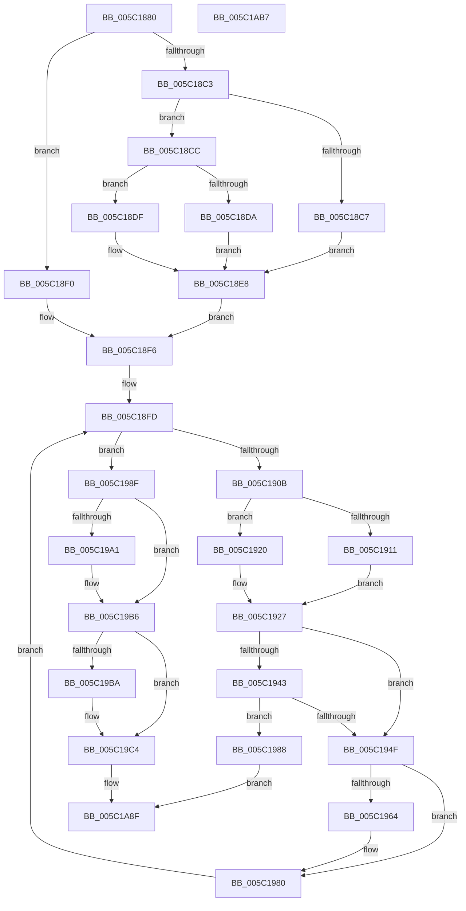

# KiInitMachineDependent

- RVA: `0x005C1880`–`0x005C1AB8` (길이 `568` bytes)
- VA: `0x00000001405C1880`
- 실행 섹션: `.text`
- PDB 이름 있음: `예`; PDB Function 태그: `아니요`
- unwind 정보 RVA: `0x000CA8C0`
- 디코드: `127`개 명령, `568/568` bytes 표시
- 미해석 바이트: `0` (있으면 어셈블리에 `.byte`로 보존)

> 이 문서는 커널 이미지의 기계어와 PDB 기호를 분석해 생성했습니다. 4번과 5번은 함수 원형과 자료형을 바이너리 사용 방식에서 추정한 C 해석이며 원본 소스 복구 결과는 아닙니다.

## 1. Dependencies

- 직접 호출 지점: **7**; 고유 호출 대상: **6**
- 직접 호출자로 확인된 함수: **1**
- RIP 상대 이미지 참조: **33**

### Outgoing calls
- `0x005C1916` → [KiSetSystemAffinityThreadToProcessor](KiSetSystemAffinityThreadToProcessor_function_005C4588.md) (function, `0x005C4588`)
- `0x005C1922` → [KiSetSystemAffinityThreadToProcessor](KiSetSystemAffinityThreadToProcessor_function_005C4588.md) (function, `0x005C4588`)
- `0x005C1946` → [KiInitializeCacheErrataSupport](../../init/C3/KiInitializeCacheErrataSupport_function_00C3A0D0.md) (function, `0x00C3A0D0`)
- `0x005C1952` → [KiInitializeMTRR](../../init/C3/KiInitializeMTRR_function_00C39A1C.md) (function, `0x00C39A1C`)
- `0x005C19BF` → [KeRevertToUserGroupAffinityThread](../39/KeRevertToUserGroupAffinityThread_function_00398EC0.md) (function, `0x00398EC0`)
- `0x005C1A14` → [memset](../6C/memset_function_006C6C40.md) (function, `0x006C6C40`)
- `0x005C1A97` → [_security_check_cookie](../6A/_security_check_cookie_function_006AC640.md) (function, `0x006AC640`)

### Direct callers
- [KeInitSystem](../../init/C7/KeInitSystem_function_00C71660.md) at `0x00C718EC`

### Static image references
- `0x005C1899` → RVA `0x00E0A740` (`.data`; read)
- `0x005C18A8` → RVA `0x00FC6D28` (`ALMOSTRO`; read)
- `0x005C18DF` → RVA `0x00FC6C70` (`ALMOSTRO`; read)
- `0x005C18E8` → RVA `0x00FC6C70` (`ALMOSTRO`; write)
- `0x005C18FD` → RVA `0x00FC6A80` (`ALMOSTRO`; read)
- `0x005C1957` → RVA `0x00FC6B30` (`ALMOSTRO`; read)
- `0x005C19AF` → RVA `0x00FC7300` (`ALMOSTRO`; write)
- `0x005C19C4` → RVA `0x00F10A20` (`.data`; read)
- `0x005C19CB` → RVA `0x00F10A00` (`.data`; write)
- `0x005C19D2` → RVA `0x00F106A0` (`.data`; read)
- `0x005C19D9` → RVA `0x00F10A08` (`.data`; write)
- `0x005C19E3` → RVA `0x00F10A10` (`.data`; write)
- `0x005C19EB` → RVA `0x00F10A18` (`.data`; write)
- `0x005C19F9` → RVA `0x00F10A1A` (`.data`; write)
- `0x005C1A00` → RVA `0x00F10A1C` (`.data`; write)
- `0x005C1A06` → RVA `0x00F10A28` (`.data`; write)
- `0x005C1A0D` → RVA `0x00F10A20` (`.data`; write)
- `0x005C1A19` → RVA `0x005CB110` (`KiAltReturnDpcRoutine`; read)
- `0x005C1A20` → RVA `0x00F106A8` (`.data`; write)
- `0x005C1A27` → RVA `0x00F106D0` (`.data`; write)
- `0x005C1A31` → RVA `0x005CB130` (`KiAltReturnWorkerRoutine`; read)
- `0x005C1A38` → RVA `0x00F106A0` (`.data`; write)
- `0x005C1A3F` → RVA `0x00F10708` (`.data`; write)
- `0x005C1A46` → RVA `0x005CAF50` (`KiAltContextProcessMcheckAltReturn`; read)
- `0x005C1A4D` → RVA `0x00F10718` (`.data`; write)
- `0x005C1A54` → RVA `0x00F106B0` (`.data`; write)
- `0x005C1A5B` → RVA `0x00F106B8` (`.data`; write)
- `0x005C1A65` → RVA `0x00F106D8` (`.data`; write)
- `0x005C1A6C` → RVA `0x00F106F0` (`.data`; write)
- `0x005C1A73` → RVA `0x00F106C8` (`.data`; write)
- `0x005C1A7A` → RVA `0x00F10710` (`.data`; write)
- `0x005C1A81` → RVA `0x00F106F8` (`.data`; write)
- `0x005C1A88` → RVA `0x00E66C70` (`.data`; write)

## 2. Other-region calls and transfers

- 다른 실행 섹션으로 향하는 call: **2**
  - `0x005C1946` → [KiInitializeCacheErrataSupport](../../init/C3/KiInitializeCacheErrataSupport_function_00C3A0D0.md) (`.text` → `INIT`)
  - `0x005C1952` → [KiInitializeMTRR](../../init/C3/KiInitializeMTRR_function_00C39A1C.md) (`.text` → `INIT`)
- 별도 외부 분기/꼬리 이동을 확인하지 못했습니다.

## 3. Assembly (complete function range)

```asm
005C1880  48 8B C4                        mov rax, rsp
005C1883  48 89 58 08                     mov qword ptr [rax + 8], rbx
005C1887  48 89 68 10                     mov qword ptr [rax + 0x10], rbp
005C188B  48 89 70 18                     mov qword ptr [rax + 0x18], rsi
005C188F  48 89 78 20                     mov qword ptr [rax + 0x20], rdi
005C1893  41 56                           push r14
005C1895  48 83 EC 40                     sub rsp, 0x40
005C1899  48 8B 05 A0 8E 84 00            mov rax, qword ptr [rip + 0x848ea0]
005C18A0  48 33 C4                        xor rax, rsp
005C18A3  48 89 44 24 30                  mov qword ptr [rsp + 0x30], rax
005C18A8  48 8B 05 79 54 A0 00            mov rax, qword ptr [rip + 0xa05479]
005C18AF  33 DB                           xor ebx, ebx
005C18B1  0F 57 C0                        xorps xmm0, xmm0
005C18B4  41 BE 01 00 00 00               mov r14d, 1
005C18BA  0F 11 44 24 20                  movups xmmword ptr [rsp + 0x20], xmm0
005C18BF  A8 03                           test al, 3
005C18C1  74 2D                           je 0x1405c18f0
005C18C3  A8 02                           test al, 2
005C18C5  74 05                           je 0x1405c18cc
005C18C7  8D 43 02                        lea eax, [rbx + 2]
005C18CA  EB 1C                           jmp 0x1405c18e8
005C18CC  48 B8 EC 02 00 00 80 F7 FF FF   movabs rax, 0xfffff780000002ec
005C18D6  38 18                           cmp byte ptr [rax], bl
005C18D8  74 05                           je 0x1405c18df
005C18DA  41 8B C6                        mov eax, r14d
005C18DD  EB 09                           jmp 0x1405c18e8
005C18DF  8B 05 8B 53 A0 00               mov eax, dword ptr [rip + 0xa0538b]
005C18E5  41 23 C6                        and eax, r14d
005C18E8  89 05 82 53 A0 00               mov dword ptr [rip + 0xa05382], eax
005C18EE  EB 06                           jmp 0x1405c18f6
005C18F0  89 1D 7A 53 A0 00               mov dword ptr [rip + 0xa0537a], ebx
005C18F6  8B EB                           mov ebp, ebx
005C18F8  40 8A F3                        mov sil, bl
005C18FB  8B FB                           mov edi, ebx
005C18FD  8B 05 7D 51 A0 00               mov eax, dword ptr [rip + 0xa0517d]
005C1903  3B F8                           cmp edi, eax
005C1905  0F 83 84 00 00 00               jae 0x1405c198f
005C190B  8B CF                           mov ecx, edi
005C190D  85 ED                           test ebp, ebp
005C190F  75 0F                           jne 0x1405c1920
005C1911  48 8D 54 24 20                  lea rdx, [rsp + 0x20]
005C1916  E8 6D 2C 00 00                  call 0x1405c4588
005C191B  41 8B EE                        mov ebp, r14d
005C191E  EB 07                           jmp 0x1405c1927
005C1920  33 D2                           xor edx, edx
005C1922  E8 61 2C 00 00                  call 0x1405c4588
005C1927  8B 05 53 51 A0 00               mov eax, dword ptr [rip + 0xa05153]
005C192D  41 2B C6                        sub eax, r14d
005C1930  40 0F B6 F6                     movzx esi, sil
005C1934  3B F8                           cmp edi, eax
005C1936  41 0F 44 F6                     cmove esi, r14d
005C193A  F6 05 E7 53 A0 00 03            test byte ptr [rip + 0xa053e7], 3
005C1941  74 0C                           je 0x1405c194f
005C1943  40 8A CE                        mov cl, sil
005C1946  E8 85 87 67 00                  call 0x140c3a0d0
005C194B  84 C0                           test al, al
005C194D  74 39                           je 0x1405c1988
005C194F  40 8A CE                        mov cl, sil
005C1952  E8 C5 80 67 00                  call 0x140c39a1c
005C1957  48 F7 05 CE 51 A0 00 00 00 40 00  test qword ptr [rip + 0xa051ce], 0x400000
005C1962  74 1C                           je 0x1405c1980
005C1964  B9 A0 01 00 00                  mov ecx, 0x1a0
005C1969  0F 32                           rdmsr
005C196B  48 C1 E2 20                     shl rdx, 0x20
005C196F  48 0B C2                        or rax, rdx
005C1972  48 0F BA E8 1B                  bts rax, 0x1b
005C1977  48 8B D0                        mov rdx, rax
005C197A  48 C1 EA 20                     shr rdx, 0x20
005C197E  0F 30                           wrmsr
005C1980  41 03 FE                        add edi, r14d
005C1983  E9 75 FF FF FF                  jmp 0x1405c18fd
005C1988  32 C0                           xor al, al
005C198A  E9 00 01 00 00                  jmp 0x1405c1a8f
005C198F  65 48 8B 04 25 20 00 00 00      mov rax, qword ptr gs:[0x20]
005C1998  80 B8 8D 00 00 00 02            cmp byte ptr [rax + 0x8d], 2
005C199F  75 15                           jne 0x1405c19b6
005C19A1  B9 A0 01 00 00                  mov ecx, 0x1a0
005C19A6  0F 32                           rdmsr
005C19A8  48 C1 E2 20                     shl rdx, 0x20
005C19AC  48 0B C2                        or rax, rdx
005C19AF  48 89 05 4A 59 A0 00            mov qword ptr [rip + 0xa0594a], rax
005C19B6  85 ED                           test ebp, ebp
005C19B8  74 0A                           je 0x1405c19c4
005C19BA  48 8D 4C 24 20                  lea rcx, [rsp + 0x20]
005C19BF  E8 FC 74 DD FF                  call 0x140398ec0
005C19C4  48 8D 05 55 F0 94 00            lea rax, [rip + 0x94f055]
005C19CB  44 89 35 2E F0 94 00            mov dword ptr [rip + 0x94f02e], r14d
005C19D2  48 8D 3D C7 EC 94 00            lea rdi, [rip + 0x94ecc7]
005C19D9  48 89 1D 28 F0 94 00            mov qword ptr [rip + 0x94f028], rbx
005C19E0  48 8B CF                        mov rcx, rdi
005C19E3  89 1D 27 F0 94 00               mov dword ptr [rip + 0x94f027], ebx
005C19E9  33 D2                           xor edx, edx
005C19EB  66 44 89 35 25 F0 94 00         mov word ptr [rip + 0x94f025], r14w
005C19F3  41 B8 80 00 00 00               mov r8d, 0x80
005C19F9  C6 05 1A F0 94 00 06            mov byte ptr [rip + 0x94f01a], 6
005C1A00  89 1D 16 F0 94 00               mov dword ptr [rip + 0x94f016], ebx
005C1A06  48 89 05 1B F0 94 00            mov qword ptr [rip + 0x94f01b], rax
005C1A0D  48 89 05 0C F0 94 00            mov qword ptr [rip + 0x94f00c], rax
005C1A14  E8 27 52 10 00                  call 0x1406c6c40
005C1A19  48 8D 0D F0 96 00 00            lea rcx, [rip + 0x96f0]
005C1A20  48 89 3D 81 EC 94 00            mov qword ptr [rip + 0x94ec81], rdi
005C1A27  48 89 0D A2 EC 94 00            mov qword ptr [rip + 0x94eca2], rcx
005C1A2E  41 8A C6                        mov al, r14b
005C1A31  48 8D 0D F8 96 00 00            lea rcx, [rip + 0x96f8]
005C1A38  48 89 3D 61 EC 94 00            mov qword ptr [rip + 0x94ec61], rdi
005C1A3F  48 89 0D C2 EC 94 00            mov qword ptr [rip + 0x94ecc2], rcx
005C1A46  48 8D 0D 03 95 00 00            lea rcx, [rip + 0x9503]
005C1A4D  48 89 0D C4 EC 94 00            mov qword ptr [rip + 0x94ecc4], rcx
005C1A54  48 89 1D 55 EC 94 00            mov qword ptr [rip + 0x94ec55], rbx
005C1A5B  C7 05 53 EC 94 00 13 01 00 00   mov dword ptr [rip + 0x94ec53], 0x113
005C1A65  48 89 3D 6C EC 94 00            mov qword ptr [rip + 0x94ec6c], rdi
005C1A6C  48 89 1D 7D EC 94 00            mov qword ptr [rip + 0x94ec7d], rbx
005C1A73  48 89 1D 4E EC 94 00            mov qword ptr [rip + 0x94ec4e], rbx
005C1A7A  48 89 3D 8F EC 94 00            mov qword ptr [rip + 0x94ec8f], rdi
005C1A81  48 89 1D 70 EC 94 00            mov qword ptr [rip + 0x94ec70], rbx
005C1A88  44 88 35 E1 51 8A 00            mov byte ptr [rip + 0x8a51e1], r14b
005C1A8F  48 8B 4C 24 30                  mov rcx, qword ptr [rsp + 0x30]
005C1A94  48 33 CC                        xor rcx, rsp
005C1A97  E8 A4 AB 0E 00                  call 0x1406ac640
005C1A9C  48 8B 5C 24 50                  mov rbx, qword ptr [rsp + 0x50]
005C1AA1  48 8B 6C 24 58                  mov rbp, qword ptr [rsp + 0x58]
005C1AA6  48 8B 74 24 60                  mov rsi, qword ptr [rsp + 0x60]
005C1AAB  48 8B 7C 24 68                  mov rdi, qword ptr [rsp + 0x68]
005C1AB0  48 83 C4 40                     add rsp, 0x40
005C1AB4  41 5E                           pop r14
005C1AB6  C3                              ret
005C1AB7  CC                              int3
```

## 4. C-style interpretation (structured pseudocode)

```c
__int64 __fastcall KiInitMachineDependent(void)
{
    __int64 result;
    __int64 v_rbx;
    __int64 v_rdi;
    __int64 v_rsi;
    __int64 v_rsp;
    unsigned __int64 v_stack_m18;
    unsigned __int64 v_stack_m28;
    unsigned __int64 v_stack_p10;
    unsigned __int64 v_stack_p18;
    unsigned __int64 v_stack_p20;
    unsigned __int64 v_stack_p8;

    *(unsigned __int64 *)(v_rsp + 8) = v_rbx;
    *(unsigned __int64 *)(v_rsp + 16) = v_rbp;
    *(unsigned __int64 *)(v_rsp + 24) = v_rsi;
    *(unsigned __int64 *)(v_rsp + 32) = v_rdi;
    v_rsp = (v_rsp) - (64);
    result = (*(unsigned __int64 *)(v_rip + 8687264)) ^ (v_rsp);
    v_stack_m18 = result;
    v_rbx = 0;
    v_stack_m28 = v_xmm0;
    if ((((unsigned __int8)(*(unsigned __int64 *)(v_rip + 10507385))) & (3)) == 0) goto loc_005C18F0;
    if ((((unsigned __int8)(*(unsigned __int64 *)(v_rip + 10507385))) & (2)) == 0) goto loc_005C18CC;
    goto loc_005C18E8;
loc_005C18CC:
    if ((*(unsigned __int8 *)(v_rbx + 2)) == 0) goto loc_005C18DF;
    goto loc_005C18E8;
loc_005C18DF:
    result = (unsigned int)(((unsigned int)(*(unsigned int *)(v_rip + 10507147))) & (1));
loc_005C18E8:
    *(unsigned int *)(v_rip + 10507138) = (unsigned int)(result);
    goto loc_005C18F6;
loc_005C18F0:
    *(unsigned int *)(v_rip + 10507130) = 0;
loc_005C18F6:
loc_005C18FD:
    if (0 >= ((unsigned int)((unsigned int)(*(unsigned int *)(v_rip + 10506621))))) goto loc_005C198F;
    if (0 != 0) goto loc_005C1920;
    result = KiSetSystemAffinityThreadToProcessor(0, v_stack_m28, a3, a4);
    goto loc_005C1927;
loc_005C1920:
    a2 = 0;
    result = KiSetSystemAffinityThreadToProcessor(0, a2, a3, a4);
loc_005C1927:
    result = (unsigned int)(((unsigned int)(*(unsigned int *)(v_rip + 10506579))) - (1));
    v_rsi = 0;
    if (0 == ((unsigned int)(result))) { v_rsi = 1; }
    if (((*(unsigned __int8 *)(v_rip + 10507239)) & (3)) == 0) goto loc_005C194F;
    result = KiInitializeCacheErrataSupport((unsigned __int8)(v_rsi), a2, a3, a4);
    if ((unsigned __int8)(result) == 0) goto loc_005C1988;
loc_005C194F:
    result = KiInitializeMTRR((unsigned __int8)(v_rsi), a2, a3, a4);
    if (((*(unsigned __int64 *)(v_rip + 10506702)) & (0x400000ULL)) != 0) {
        a1 = 416;
        a2 = (a2) << (32);
        result = (result) | (a2);
        a2 = result;
        a2 = (a2) >> (32);
    }
    v_rdi = (unsigned int)((0) + (1));
    goto loc_005C18FD;
loc_005C1988:
    result = 0;
    goto loc_005C1A8F;
loc_005C198F:
    result = *(unsigned __int64 *)(gs_base + (0 + 32));
    if ((*(unsigned __int8 *)(*(unsigned __int64 *)(gs_base + (0 + 32)) + 141)) == 2) {
        a1 = 416;
        a2 = (a2) << (32);
        result = (*(unsigned __int64 *)(gs_base + (0 + 32))) | (a2);
        *(unsigned __int64 *)(v_rip + 10508618) = result;
    }
    if (1 != 0) {
        a1 = v_stack_m28;
        result = KeRevertToUserGroupAffinityThread(a1, a2, a3, a4);
    }
    *(unsigned int *)(v_rip + 9760814) = 1;
    *(unsigned __int64 *)(v_rip + 9760808) = 0;
    *(unsigned int *)(v_rip + 9760807) = 0;
    a2 = 0;
    *(unsigned __int16 *)(v_rip + 9760805) = 1;
    *(unsigned __int8 *)(v_rip + 9760794) = 6;
    *(unsigned int *)(v_rip + 9760790) = 0;
    *(unsigned __int64 *)(v_rip + 9760795) = v_rip + 9760853;
    *(unsigned __int64 *)(v_rip + 9760780) = v_rip + 9760853;
    result = memset(v_rip + 9759943, a2, 128, a4);
    *(unsigned __int64 *)(v_rip + 9759873) = v_rip + 9759943;
    *(unsigned __int64 *)(v_rip + 9759906) = v_rip + 38640;
    *(unsigned __int64 *)(v_rip + 9759841) = v_rip + 9759943;
    *(unsigned __int64 *)(v_rip + 9759938) = v_rip + 38648;
    *(unsigned __int64 *)(v_rip + 9759940) = v_rip + 38147;
    *(unsigned __int64 *)(v_rip + 9759829) = 0;
    *(unsigned int *)(v_rip + 9759827) = 275;
    *(unsigned __int64 *)(v_rip + 9759852) = v_rip + 9759943;
    *(unsigned __int64 *)(v_rip + 9759869) = 0;
    *(unsigned __int64 *)(v_rip + 9759822) = 0;
    *(unsigned __int64 *)(v_rip + 9759887) = v_rip + 9759943;
    *(unsigned __int64 *)(v_rip + 9759856) = 0;
    *(unsigned __int8 *)(v_rip + 9064929) = 1;
loc_005C1A8F:
    a1 = (v_stack_m18) ^ (v_rsp);
    result = _security_check_cookie(a1, a2, 128, a4);
    v_rsp = (v_rsp) + (64);
    return result;
}
```

## 5. (Beta) C Style

```c
void KiInitMachineDependent(void)
{
    int64_t result;
    int64_t local_rbx;
    int64_t local_rdi;
    int64_t local_rsi;
    int64_t local_rsp;
    uint64_t v_stack_m18;
    uint64_t v_stack_m28;
    uint64_t v_stack_p10;
    uint64_t v_stack_p18;
    uint64_t v_stack_p20;
    uint64_t v_stack_p8;

    *(uint64_t *)(local_rsp + 0x8) = local_rbx;
    *(uint64_t *)(local_rsp + 0x10) = local_rbp;
    *(uint64_t *)(local_rsp + 0x18) = local_rsi;
    *(uint64_t *)(local_rsp + 0x20) = local_rdi;
    local_rsp = (local_rsp) - (64);
    result = (*(uint64_t *)(v_rip + 0x848EA0)) ^ (local_rsp);
    v_stack_m18 = result;
    local_rbx = 0;
    v_stack_m28 = v_xmm0;
    if ((((uint8_t)(*(uint64_t *)(v_rip + 0xA05479))) & (3)) == 0) goto loc_005C18F0;
    if ((((uint8_t)(*(uint64_t *)(v_rip + 0xA05479))) & (2)) == 0) goto loc_005C18CC;
    goto loc_005C18E8;
loc_005C18CC:
    if ((*(uint8_t *)(local_rbx + 0x2)) == 0) goto loc_005C18DF;
    goto loc_005C18E8;
loc_005C18DF:
    result = (uint32_t)(((uint32_t)(*(uint32_t *)(v_rip + 0xA0538B))) & (1));
loc_005C18E8:
    *(uint32_t *)(v_rip + 0xA05382) = (uint32_t)(result);
    goto loc_005C18F6;
loc_005C18F0:
    *(uint32_t *)(v_rip + 0xA0537A) = 0;
loc_005C18F6:
loc_005C18FD:
    if (0 >= ((uint32_t)((uint32_t)(*(uint32_t *)(v_rip + 0xA0517D))))) goto loc_005C198F;
    if (0 != 0) goto loc_005C1920;
    result = KiSetSystemAffinityThreadToProcessor(0, v_stack_m28, a3, a4);
    goto loc_005C1927;
loc_005C1920:
    a2 = 0;
    result = KiSetSystemAffinityThreadToProcessor(0, a2, a3, a4);
loc_005C1927:
    result = (uint32_t)(((uint32_t)(*(uint32_t *)(v_rip + 0xA05153))) - (1));
    local_rsi = 0;
    if (0 == ((uint32_t)(result))) { local_rsi = 1; }
    if (((*(uint8_t *)(v_rip + 0xA053E7)) & (3)) == 0) goto loc_005C194F;
    result = KiInitializeCacheErrataSupport((uint8_t)(local_rsi), a2, a3, a4);
    if ((uint8_t)(result) == 0) goto loc_005C1988;
loc_005C194F:
    result = KiInitializeMTRR((uint8_t)(local_rsi), a2, a3, a4);
    if (((*(uint64_t *)(v_rip + 0xA051CE)) & (0x400000ULL)) != 0) {
        a1 = 416;
        a2 = (a2) << (32);
        result = (result) | (a2);
        a2 = result;
        a2 = (a2) >> (32);
    }
    local_rdi = (uint32_t)((0) + (1));
    goto loc_005C18FD;
loc_005C1988:
    result = 0;
    goto loc_005C1A8F;
loc_005C198F:
    result = *(uint64_t *)(gs_base + (0 + 0x20));
    if ((*(uint8_t *)(*(uint64_t *)(gs_base + (0 + 0x20)) + 0x8D)) == 2) {
        a1 = 416;
        a2 = (a2) << (32);
        result = (*(uint64_t *)(gs_base + (0 + 0x20))) | (a2);
        *(uint64_t *)(v_rip + 0xA0594A) = result;
    }
    if (1 != 0) {
        a1 = v_stack_m28;
        result = KeRevertToUserGroupAffinityThread(a1, a2, a3, a4);
    }
    *(uint32_t *)(v_rip + 0x94F02E) = 1;
    *(uint64_t *)(v_rip + 0x94F028) = 0;
    *(uint32_t *)(v_rip + 0x94F027) = 0;
    a2 = 0;
    *(uint16_t *)(v_rip + 0x94F025) = 1;
    *(uint8_t *)(v_rip + 0x94F01A) = 6;
    *(uint32_t *)(v_rip + 0x94F016) = 0;
    *(uint64_t *)(v_rip + 0x94F01B) = v_rip + 9760853;
    *(uint64_t *)(v_rip + 0x94F00C) = v_rip + 9760853;
    result = memset(v_rip + 9759943, a2, 128, a4);
    *(uint64_t *)(v_rip + 0x94EC81) = v_rip + 9759943;
    *(uint64_t *)(v_rip + 0x94ECA2) = v_rip + 38640;
    *(uint64_t *)(v_rip + 0x94EC61) = v_rip + 9759943;
    *(uint64_t *)(v_rip + 0x94ECC2) = v_rip + 38648;
    *(uint64_t *)(v_rip + 0x94ECC4) = v_rip + 38147;
    *(uint64_t *)(v_rip + 0x94EC55) = 0;
    *(uint32_t *)(v_rip + 0x94EC53) = 275;
    *(uint64_t *)(v_rip + 0x94EC6C) = v_rip + 9759943;
    *(uint64_t *)(v_rip + 0x94EC7D) = 0;
    *(uint64_t *)(v_rip + 0x94EC4E) = 0;
    *(uint64_t *)(v_rip + 0x94EC8F) = v_rip + 9759943;
    *(uint64_t *)(v_rip + 0x94EC70) = 0;
    *(uint8_t *)(v_rip + 0x8A51E1) = 1;
loc_005C1A8F:
    a1 = (v_stack_m18) ^ (local_rsp);
    result = _security_check_cookie(a1, a2, 128, a4);
    local_rsp = (local_rsp) + (64);
    return result;
}
```

## 6. Execution-region graph

[열기: 2D/3D 그래프와 함수 탐색 컨트롤 패널](../../../control-panel.html?section=text&rva=0x005C1880&view=graph)

- 2D 그래프는 위에서 아래로 흐르고, 3D 그래프는 빈 공간을 드래그해 회전합니다. Shift+드래그는 이동, 휠은 확대·축소, 함수 노드 선택은 대상 보고서 이동입니다.

### Static fallback


