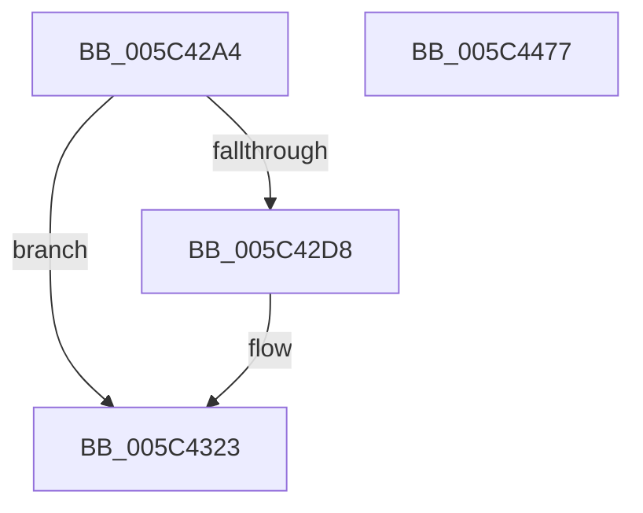

# KiInitializeAndStartInitialThread

- RVA: `0x005C42A4`–`0x005C4478` (길이 `468` bytes)
- VA: `0x00000001405C42A4`
- 실행 섹션: `.text`
- PDB 이름 있음: `예`; PDB Function 태그: `아니요`
- unwind 정보 RVA: `0x000C4204`
- 디코드: `96`개 명령, `468/468` bytes 표시
- 미해석 바이트: `0` (있으면 어셈블리에 `.byte`로 보존)

> 이 문서는 커널 이미지의 기계어와 PDB 기호를 분석해 생성했습니다. 4번과 5번은 함수 원형과 자료형을 바이너리 사용 방식에서 추정한 C 해석이며 원본 소스 복구 결과는 아닙니다.

## 1. Dependencies

- 직접 호출 지점: **5**; 고유 호출 대상: **4**
- 직접 호출자로 확인된 함수: **1**
- RIP 상대 이미지 참조: **12**

### Outgoing calls
- `0x005C4368` → [memset](../6C/memset_function_006C6C40.md) (function, `0x006C6C40`)
- `0x005C4387` → [memset](../6C/memset_function_006C6C40.md) (function, `0x006C6C40`)
- `0x005C43F1` → [KeInitThread](../../pagelk/B7/KeInitThread_function_00B78450.md) (function, `0x00B78450`)
- `0x005C4415` → [PsInitializeThreadRngState](../48/PsInitializeThreadRngState_function_0048975C.md) (function, `0x0048975C`)
- `0x005C4453` → [KiStartIdleThread](KiStartIdleThread_function_005C46B0.md) (function, `0x005C46B0`)

### Direct callers
- [KiInitializeKernel](../../pagelk/B6/KiInitializeKernel_function_00B68D20.md) at `0x00B694EF`

### Static image references
- `0x005C42C1` → RVA `0x01201841` (`CFGRO`; read)
- `0x005C4323` → RVA `0x00FCD040` (`ALMOSTRO`; read)
- `0x005C433A` → RVA `0x00FCD150` (`ALMOSTRO`; read)
- `0x005C4350` → RVA `0x00FCD044` (`ALMOSTRO`; read/write)
- `0x005C4357` → RVA `0x00FCD048` (`ALMOSTRO`; read)
- `0x005C435E` → RVA `0x00FCD040` (`ALMOSTRO`; write)
- `0x005C4392` → RVA `0x00FCFF00` (`CACHEALI`; read)
- `0x005C439F` → RVA `0x006B2910` (`KiIdleLoop`; read)
- `0x005C43B9` → RVA `0x00E15740` (`.data`; read)
- `0x005C43C0` → RVA `0x00E15740` (`.data`; write)
- `0x005C43C7` → RVA `0x00E1574C` (`.data`; write)
- `0x005C43F6` → RVA `0x00E07130` (`.data`; read)

## 2. Other-region calls and transfers

- 다른 실행 섹션으로 향하는 call: **1**
  - `0x005C43F1` → [KeInitThread](../../pagelk/B7/KeInitThread_function_00B78450.md) (`.text` → `PAGELK`)
- 별도 외부 분기/꼬리 이동을 확인하지 못했습니다.

## 3. Assembly (complete function range)

```asm
005C42A4  48 8B C4                        mov rax, rsp
005C42A7  48 89 58 08                     mov qword ptr [rax + 8], rbx
005C42AB  48 89 68 10                     mov qword ptr [rax + 0x10], rbp
005C42AF  48 89 70 18                     mov qword ptr [rax + 0x18], rsi
005C42B3  48 89 78 20                     mov qword ptr [rax + 0x20], rdi
005C42B7  41 54                           push r12
005C42B9  41 56                           push r14
005C42BB  41 57                           push r15
005C42BD  48 83 EC 70                     sub rsp, 0x70
005C42C1  80 3D 79 D5 C3 00 00            cmp byte ptr [rip + 0xc3d579], 0
005C42C8  49 8B E8                        mov rbp, r8
005C42CB  48 8B F2                        mov rsi, rdx
005C42CE  48 8B D9                        mov rbx, rcx
005C42D1  BF 06 00 00 00                  mov edi, 6
005C42D6  74 4B                           je 0x1405c4323
005C42D8  49 8B 81 F0 00 00 00            mov rax, qword ptr [r9 + 0xf0]
005C42DF  BF 07 00 00 00                  mov edi, 7
005C42E4  4C 8B 88 80 0E 00 00            mov r9, qword ptr [rax + 0xe80]
005C42EB  48 8B 81 20 04 00 00            mov rax, qword ptr [rcx + 0x420]
005C42F2  49 81 C1 10 10 00 00            add r9, 0x1010
005C42F9  4C 89 89 18 04 00 00            mov qword ptr [rcx + 0x418], r9
005C4300  49 81 C1 00 D0 FF FF            add r9, -0x3000
005C4307  4C 33 C8                        xor r9, rax
005C430A  48 83 E0 FA                     and rax, 0xfffffffffffffffa
005C430E  49 81 E1 02 F0 FF FF            and r9, 0xfffffffffffff002
005C4315  4C 33 C8                        xor r9, rax
005C4318  49 83 C9 02                     or r9, 2
005C431C  4C 89 89 20 04 00 00            mov qword ptr [rcx + 0x420], r9
005C4323  48 8D 05 16 8D A0 00            lea rax, [rip + 0xa08d16]
005C432A  41 BE 00 01 00 00               mov r14d, 0x100
005C4330  48 89 81 40 02 00 00            mov qword ptr [rcx + 0x240], rax
005C4337  45 8B C6                        mov r8d, r14d
005C433A  48 8D 05 0F 8E A0 00            lea rax, [rip + 0xa08e0f]
005C4341  33 D2                           xor edx, edx
005C4343  48 89 81 28 02 00 00            mov qword ptr [rcx + 0x228], rax
005C434A  41 BC 01 00 00 00               mov r12d, 1
005C4350  83 25 ED 8C A0 00 00            and dword ptr [rip + 0xa08ced], 0
005C4357  48 8D 0D EA 8C A0 00            lea rcx, [rip + 0xa08cea]
005C435E  C7 05 D8 8C A0 00 01 00 20 00   mov dword ptr [rip + 0xa08cd8], 0x200001
005C4368  E8 D3 28 10 00                  call 0x1406c6c40
005C436D  48 8B 8B 28 02 00 00            mov rcx, qword ptr [rbx + 0x228]
005C4374  45 8B C6                        mov r8d, r14d
005C4377  33 D2                           xor edx, edx
005C4379  83 61 04 00                     and dword ptr [rcx + 4], 0
005C437D  C7 01 01 00 20 00               mov dword ptr [rcx], 0x200001
005C4383  48 83 C1 08                     add rcx, 8
005C4387  E8 B4 28 10 00                  call 0x1406c6c40
005C438C  48 83 64 24 60 00               and qword ptr [rsp + 0x60], 0
005C4392  48 8D 05 67 BB A0 00            lea rax, [rip + 0xa0bb67]
005C4399  48 83 64 24 30 00               and qword ptr [rsp + 0x30], 0
005C439F  4C 8D 35 6A E5 0E 00            lea r14, [rip + 0xee56a]
005C43A6  48 83 64 24 38 00               and qword ptr [rsp + 0x38], 0
005C43AC  48 8D 54 24 20                  lea rdx, [rsp + 0x20]
005C43B1  48 89 44 24 50                  mov qword ptr [rsp + 0x50], rax
005C43B6  0F 57 C0                        xorps xmm0, xmm0
005C43B9  48 8D 05 80 13 85 00            lea rax, [rip + 0x851380]
005C43C0  48 89 1D 79 13 85 00            mov qword ptr [rip + 0x851379], rbx
005C43C7  C6 05 7E 13 85 00 06            mov byte ptr [rip + 0x85137e], 6
005C43CE  48 8B CB                        mov rcx, rbx
005C43D1  48 89 83 70 04 00 00            mov qword ptr [rbx + 0x470], rax
005C43D8  66 0F 7F 44 24 40               movdqa xmmword ptr [rsp + 0x40], xmm0
005C43DE  44 89 64 24 58                  mov dword ptr [rsp + 0x58], r12d
005C43E3  48 89 74 24 20                  mov qword ptr [rsp + 0x20], rsi
005C43E8  4C 89 74 24 28                  mov qword ptr [rsp + 0x28], r14
005C43ED  89 7C 24 5C                     mov dword ptr [rsp + 0x5c], edi
005C43F1  E8 5A 40 5B 00                  call 0x140b78450
005C43F6  48 8D 05 33 2D 84 00            lea rax, [rip + 0x842d33]
005C43FD  4C 89 B3 E0 04 00 00            mov qword ptr [rbx + 0x4e0], r14
005C4404  48 8B CB                        mov rcx, rbx
005C4407  48 89 83 A0 06 00 00            mov qword ptr [rbx + 0x6a0], rax
005C440E  4C 89 B3 60 05 00 00            mov qword ptr [rbx + 0x560], r14
005C4415  E8 42 53 EC FF                  call 0x14048975c
005C441A  4C 8D 93 F0 05 00 00            lea r10, [rbx + 0x5f0]
005C4421  4C 8B C6                        mov r8, rsi
005C4424  4D 89 52 08                     mov qword ptr [r10 + 8], r10
005C4428  48 8D 83 00 06 00 00            lea rax, [rbx + 0x600]
005C442F  4D 89 12                        mov qword ptr [r10], r10
005C4432  48 8B D5                        mov rdx, rbp
005C4435  48 89 40 08                     mov qword ptr [rax + 8], rax
005C4439  48 8B CB                        mov rcx, rbx
005C443C  48 89 00                        mov qword ptr [rax], rax
005C443F  48 83 A3 10 06 00 00 00         and qword ptr [rbx + 0x610], 0
005C4447  C6 83 27 07 00 00 FF            mov byte ptr [rbx + 0x727], 0xff
005C444E  F0 0F BA 2B 15                  lock bts dword ptr [rbx], 0x15
005C4453  E8 58 02 00 00                  call 0x1405c46b0
005C4458  4C 8D 5C 24 70                  lea r11, [rsp + 0x70]
005C445D  49 8B 5B 20                     mov rbx, qword ptr [r11 + 0x20]
005C4461  49 8B 6B 28                     mov rbp, qword ptr [r11 + 0x28]
005C4465  49 8B 73 30                     mov rsi, qword ptr [r11 + 0x30]
005C4469  49 8B 7B 38                     mov rdi, qword ptr [r11 + 0x38]
005C446D  49 8B E3                        mov rsp, r11
005C4470  41 5F                           pop r15
005C4472  41 5E                           pop r14
005C4474  41 5C                           pop r12
005C4476  C3                              ret
005C4477  CC                              int3
```

## 4. C-style interpretation (structured pseudocode)

```c
__int64 __fastcall KiInitializeAndStartInitialThread(__int64 a1, __int64 a2, __int64 a3, __int64 a4)
{
    __int64 result;
    __int64 v_rdi;
    __int64 v_rsp;
    unsigned __int64 v_stack_m18;
    unsigned __int64 v_stack_m28;
    unsigned int v_stack_m2C;
    unsigned int v_stack_m30;
    unsigned __int64 v_stack_m38;
    unsigned __int64 v_stack_m48;
    unsigned __int64 v_stack_m50;
    unsigned __int64 v_stack_m58;
    unsigned __int64 v_stack_m60;
    unsigned __int64 v_stack_m68;

    *(unsigned __int64 *)(v_rsp + 8) = v_rbx;
    *(unsigned __int64 *)(v_rsp + 16) = v_rbp;
    *(unsigned __int64 *)(v_rsp + 24) = v_rsi;
    *(unsigned __int64 *)(v_rsp + 32) = v_rdi;
    v_rsp = (v_rsp) - (112);
    result = v_rsp;
    v_rdi = 6;
    if ((*(unsigned __int8 *)(v_rip + 12834169)) != 0) {
        result = *(unsigned __int64 *)(a4 + 240);
        v_rdi = 7;
        a4 = *(unsigned __int64 *)(result + 3712);
        result = *(unsigned __int64 *)(a1 + 1056);
        a4 = (a4) + (0x1010ULL);
        *(unsigned __int64 *)(a1 + 1048) = a4;
        a4 = (a4) + (0xFFFFFFFFFFFFD000ULL);
        a4 = (a4) ^ (result);
        result = (result) & (-6);
        a4 = (a4) & (0xFFFFFFFFFFFFF002ULL);
        a4 = (a4) ^ (result);
        a4 = (a4) | (2);
        *(unsigned __int64 *)(a1 + 1056) = a4;
    }
    *(unsigned __int64 *)(a1 + 576) = v_rip + 10521878;
    a2 = 0;
    *(unsigned __int64 *)(a1 + 552) = v_rip + 10522127;
    *(unsigned int *)(v_rip + 10521816) = 0x200001ULL;
    result = memset(v_rip + 10521834, a2, 256, a4);
    a2 = 0;
    *(unsigned int *)(*(unsigned __int64 *)(a1 + 552)) = 0x200001ULL;
    a1 = (*(unsigned __int64 *)(a1 + 552)) + (8);
    result = memset(a1, a2, 256, a4);
    v_stack_m38 = v_rip + 10533735;
    *(unsigned __int64 *)(v_rip + 8721273) = a1;
    *(unsigned __int8 *)(v_rip + 8721278) = 6;
    *(unsigned __int64 *)(a1 + 1136) = v_rip + 8721280;
    v_stack_m48 = v_xmm0;
    v_stack_m30 = 1;
    v_stack_m68 = 0;
    v_stack_m60 = v_rip + 976234;
    v_stack_m2C = (unsigned int)(v_rdi);
    result = KeInitThread(a1, v_stack_m68, 256, a4);
    *(unsigned __int64 *)(a1 + 1248) = v_rip + 976234;
    *(unsigned __int64 *)(a1 + 1696) = v_rip + 8662323;
    *(unsigned __int64 *)(a1 + 1376) = v_rip + 976234;
    result = PsInitializeThreadRngState(a1, v_stack_m68, 256, a4);
    *(unsigned __int64 *)(a1 + 1520 + 8) = a1 + 1520;
    *(unsigned __int64 *)(a1 + 1520) = a1 + 1520;
    *(unsigned __int64 *)(a1 + 1536 + 8) = a1 + 1536;
    *(unsigned __int64 *)(a1 + 1536) = a1 + 1536;
    *(unsigned __int8 *)(a1 + 1831) = 255;
    result = KiStartIdleThread(a1, a3, 0, a4);
    return result;
}
```

## 5. (Beta) C Style

```c
int64_t KiInitializeAndStartInitialThread(void *Arg1, int64_t Arg2, int64_t Arg3, void *Arg4)
{
    uint8_t *arg1 = (uint8_t *)Arg1;
    uint8_t *arg4 = (uint8_t *)Arg4;

    int64_t result;
    int64_t local_rdi;
    int64_t local_rsp;
    uint64_t v_stack_m18;
    uint64_t v_stack_m28;
    uint32_t v_stack_m2C;
    uint32_t v_stack_m30;
    uint64_t v_stack_m38;
    uint64_t v_stack_m48;
    uint64_t v_stack_m50;
    uint64_t v_stack_m58;
    uint64_t v_stack_m60;
    uint64_t v_stack_m68;

    *(uint64_t *)(local_rsp + 0x8) = local_rbx;
    *(uint64_t *)(local_rsp + 0x10) = local_rbp;
    *(uint64_t *)(local_rsp + 0x18) = local_rsi;
    *(uint64_t *)(local_rsp + 0x20) = local_rdi;
    local_rsp = (local_rsp) - (112);
    result = local_rsp;
    local_rdi = 6;
    if ((*(uint8_t *)(v_rip + 0xC3D579)) != 0) {
        result = *(uint64_t *)(arg4 + 0xF0);
        local_rdi = 7;
        Arg4 = *(uint64_t *)(result + 0xE80);
        result = *(uint64_t *)(arg1 + 0x420);
        Arg4 = (Arg4) + (0x1010ULL);
        *(void **)(arg1 + 0x418) = Arg4;
        Arg4 = (Arg4) + (0xFFFFFFFFFFFFD000ULL);
        Arg4 = (Arg4) ^ (result);
        result = (result) & (-6);
        Arg4 = (Arg4) & (0xFFFFFFFFFFFFF002ULL);
        Arg4 = (Arg4) ^ (result);
        Arg4 = (Arg4) | (2);
        *(void **)(arg1 + 0x420) = Arg4;
    }
    *(uint64_t *)(arg1 + 0x240) = v_rip + 10521878;
    Arg2 = 0;
    *(uint64_t *)(arg1 + 0x228) = v_rip + 10522127;
    *(uint32_t *)(v_rip + 0xA08CD8) = 0x200001ULL;
    result = memset(v_rip + 10521834, Arg2, 256, Arg4);
    Arg2 = 0;
    *(uint32_t *)(*(uint64_t *)(arg1 + 0x228)) = 0x200001ULL;
    Arg1 = (*(uint64_t *)(arg1 + 0x228)) + (8);
    result = memset(Arg1, Arg2, 256, Arg4);
    v_stack_m38 = v_rip + 10533735;
    *(void **)(v_rip + 0x851379) = Arg1;
    *(uint8_t *)(v_rip + 0x85137E) = 6;
    *(uint64_t *)(arg1 + 0x470) = v_rip + 8721280;
    v_stack_m48 = v_xmm0;
    v_stack_m30 = 1;
    v_stack_m68 = 0;
    v_stack_m60 = v_rip + 976234;
    v_stack_m2C = (uint32_t)(local_rdi);
    result = KeInitThread(Arg1, v_stack_m68, 256, Arg4);
    *(uint64_t *)(arg1 + 0x4E0) = v_rip + 976234;
    *(uint64_t *)(arg1 + 0x6A0) = v_rip + 8662323;
    *(uint64_t *)(arg1 + 0x560) = v_rip + 976234;
    result = PsInitializeThreadRngState(Arg1, v_stack_m68, 256, Arg4);
    *(void **)(arg1 + 0x5F0 + 0x8) = Arg1 + 1520;
    *(void **)(arg1 + 0x5F0) = Arg1 + 1520;
    *(void **)(arg1 + 0x600 + 0x8) = Arg1 + 1536;
    *(void **)(arg1 + 0x600) = Arg1 + 1536;
    *(uint8_t *)(arg1 + 0x727) = 255;
    result = KiStartIdleThread(Arg1, Arg3, 0, Arg4);
    return result;
}
```

### 관측된 메모리 오프셋

구조체 형식이 확인되지 않은 접근은 인자 기준의 오프셋으로만 기록했습니다.

| 기준 인자 | 오프셋 표현 | 폭 (bit) | 접근 |
|---|---:|---:|---|
| `Arg1` | `+ 0x0` | `32` | `R/W` |
| `Arg1` | `+ 0x0` | `64` | `W` |
| `Arg1` | `+ 0x8` | `64` | `W` |
| `Arg1` | `+ 0x228` | `64` | `R` |
| `Arg1` | `+ 0x228` | `64` | `W` |
| `Arg1` | `+ 0x240` | `64` | `W` |
| `Arg1` | `+ 0x418` | `64` | `W` |
| `Arg1` | `+ 0x420` | `64` | `R` |
| `Arg1` | `+ 0x420` | `64` | `W` |
| `Arg1` | `+ 0x470` | `64` | `W` |
| `Arg1` | `+ 0x4E0` | `64` | `W` |
| `Arg1` | `+ 0x560` | `64` | `W` |
| `Arg1` | `+ 0x5F0` | `64` | `R` |
| `Arg1` | `+ 0x600` | `64` | `R` |
| `Arg1` | `+ 0x610` | `64` | `R/W` |
| `Arg1` | `+ 0x6A0` | `64` | `W` |
| `Arg1` | `+ 0x727` | `8` | `W` |
| `Arg4` | `+ 0xF0` | `64` | `R` |

## 6. Execution-region graph

[열기: 2D/3D 그래프와 함수 탐색 컨트롤 패널](../../../control-panel.html?section=text&rva=0x005C42A4&view=graph)

- 2D 그래프는 위에서 아래로 흐르고, 3D 그래프는 빈 공간을 드래그해 회전합니다. Shift+드래그는 이동, 휠은 확대·축소, 함수 노드 선택은 대상 보고서 이동입니다.

### Static fallback


