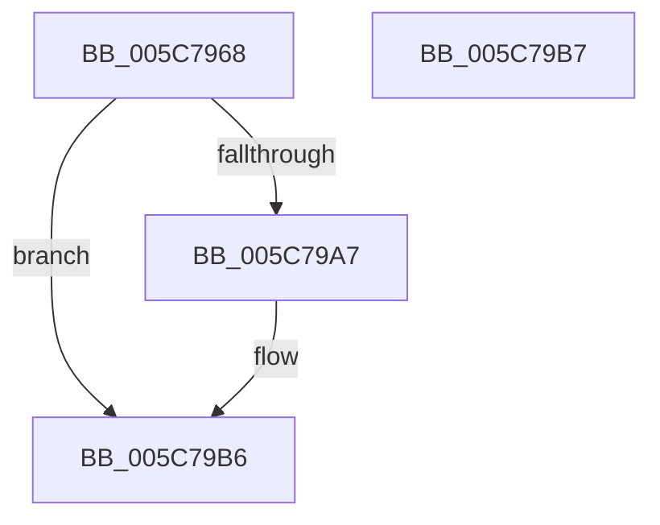

# KiInitializeBugcheckRecoveryProcessor

- RVA: `0x005C7968`–`0x005C79B8` (길이 `80` bytes)
- VA: `0x00000001405C7968`
- 실행 섹션: `.text`
- PDB 이름 있음: `예`; PDB Function 태그: `아니요`
- unwind 정보 RVA: `0x000DB714`
- 디코드: `16`개 명령, `80/80` bytes 표시
- 미해석 바이트: `0` (있으면 어셈블리에 `.byte`로 보존)

> 이 문서는 커널 이미지의 기계어와 PDB 기호를 분석해 생성했습니다. 4번과 5번은 함수 원형과 자료형을 바이너리 사용 방식에서 추정한 C 해석이며 원본 소스 복구 결과는 아닙니다.

## 1. Dependencies

- 직접 호출 지점: **0**; 고유 호출 대상: **0**
- 직접 호출자로 확인된 함수: **1**
- RIP 상대 이미지 참조: **1**

### Outgoing calls
- 직접 디코드된 call 명령이 없습니다.

### Direct callers
- [KiInitPrcb](../../pagelk/B6/KiInitPrcb_function_00B66644.md) at `0x00B66778`

### Static image references
- `0x005C7975` → RVA `0x005C7360` (`KiBugCheckRecoveryFreezeProcessorDpc`; read)

## 2. Other-region calls and transfers

- 다른 실행 섹션으로 향하는 call: **0**
- 별도 외부 분기/꼬리 이동을 확인하지 못했습니다.

## 3. Assembly (complete function range)

```asm
005C7968  45 33 C0                        xor r8d, r8d
005C796B  C7 81 D0 9E 00 00 13 02 00 00   mov dword ptr [rcx + 0x9ed0], 0x213
005C7975  48 8D 05 E4 F9 FF FF            lea rax, [rip - 0x61c]
005C797C  4C 89 81 F0 9E 00 00            mov qword ptr [rcx + 0x9ef0], r8
005C7983  48 89 81 E8 9E 00 00            mov qword ptr [rcx + 0x9ee8], rax
005C798A  4C 89 81 08 9F 00 00            mov qword ptr [rcx + 0x9f08], r8
005C7991  4C 89 81 E0 9E 00 00            mov qword ptr [rcx + 0x9ee0], r8
005C7998  48 8B 81 08 9F 00 00            mov rax, qword ptr [rcx + 0x9f08]
005C799F  8B 51 24                        mov edx, dword ptr [rcx + 0x24]
005C79A2  48 85 C0                        test rax, rax
005C79A5  75 0F                           jne 0x1405c79b6
005C79A7  B8 00 08 00 00                  mov eax, 0x800
005C79AC  66 03 D0                        add dx, ax
005C79AF  66 89 91 D2 9E 00 00            mov word ptr [rcx + 0x9ed2], dx
005C79B6  C3                              ret
005C79B7  CC                              int3
```

## 4. C-style interpretation (structured pseudocode)

```c
__int64 __fastcall KiInitializeBugcheckRecoveryProcessor(__int64 a1, __int64 a2, int a3)
{
    __int64 result;

    a3 = 0;
    *(unsigned int *)(a1 + 40656) = 531;
    *(unsigned __int64 *)(a1 + 40688) = 0;
    *(unsigned __int64 *)(a1 + 40680) = v_rip - 1564;
    *(unsigned __int64 *)(a1 + 40712) = 0;
    *(unsigned __int64 *)(a1 + 40672) = 0;
    result = *(unsigned __int64 *)(a1 + 40712);
    if (*(unsigned __int64 *)(a1 + 40712) == 0) {
        result = 0x800ULL;
        a2 = (unsigned __int16)(((unsigned int)(*(unsigned int *)(a1 + 36))) + ((unsigned __int16)(result)));
        *(unsigned __int16 *)(a1 + 40658) = (unsigned __int16)(a2);
    }
    return result;
}
```

## 5. (Beta) C Style

```c
int64_t KiInitializeBugcheckRecoveryProcessor(void *Arg1, int64_t Arg2, int32_t Arg3)
{
    uint8_t *arg1 = (uint8_t *)Arg1;

    int64_t result;

    Arg3 = 0;
    *(uint32_t *)(arg1 + 0x9ED0) = 531;
    *(uint64_t *)(arg1 + 0x9EF0) = 0;
    *(uint64_t *)(arg1 + 0x9EE8) = v_rip - 1564;
    *(uint64_t *)(arg1 + 0x9F08) = 0;
    *(uint64_t *)(arg1 + 0x9EE0) = 0;
    result = *(uint64_t *)(arg1 + 0x9F08);
    if (*(uint64_t *)(arg1 + 0x9F08) == 0) {
        result = 0x800ULL;
        Arg2 = (uint16_t)(((uint32_t)(*(uint32_t *)(arg1 + 0x24))) + ((uint16_t)(result)));
        *(uint16_t *)(arg1 + 0x9ED2) = (uint16_t)(Arg2);
    }
    return result;
}
```

### 관측된 메모리 오프셋

구조체 형식이 확인되지 않은 접근은 인자 기준의 오프셋으로만 기록했습니다.

| 기준 인자 | 오프셋 표현 | 폭 (bit) | 접근 |
|---|---:|---:|---|
| `Arg1` | `+ 0x24` | `32` | `R` |
| `Arg1` | `+ 0x9ED0` | `32` | `W` |
| `Arg1` | `+ 0x9ED2` | `16` | `W` |
| `Arg1` | `+ 0x9EE0` | `64` | `W` |
| `Arg1` | `+ 0x9EE8` | `64` | `W` |
| `Arg1` | `+ 0x9EF0` | `64` | `W` |
| `Arg1` | `+ 0x9F08` | `64` | `R` |
| `Arg1` | `+ 0x9F08` | `64` | `W` |

## 6. Execution-region graph

[열기: 2D/3D 그래프와 함수 탐색 컨트롤 패널](../../../control-panel.html?section=text&rva=0x005C7968&view=graph)

- 2D 그래프는 위에서 아래로 흐르고, 3D 그래프는 빈 공간을 드래그해 회전합니다. Shift+드래그는 이동, 휠은 확대·축소, 함수 노드 선택은 대상 보고서 이동입니다.

### Static fallback


