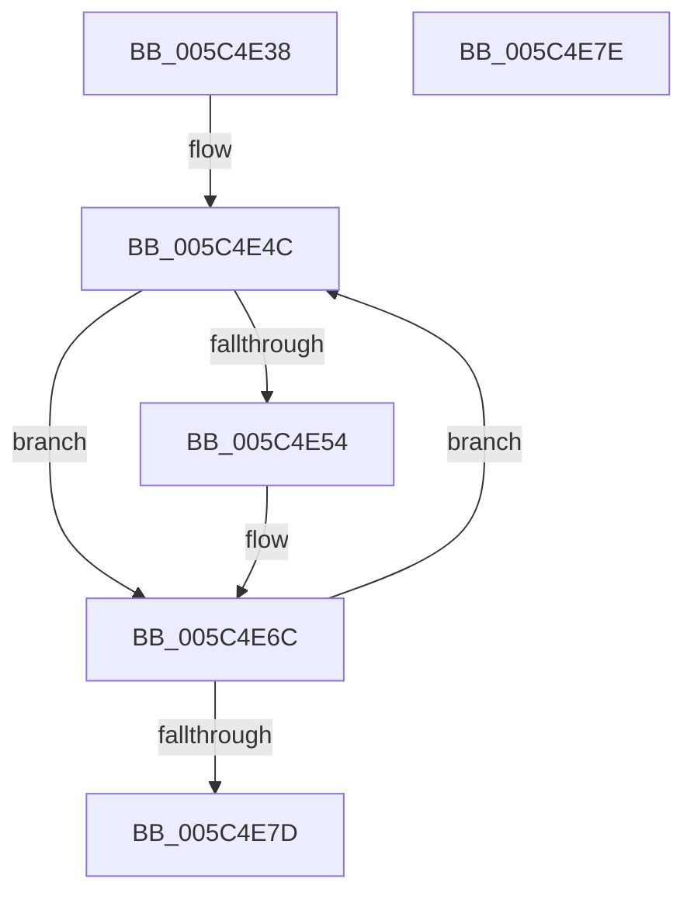

# KiInitializeDescriptorIst

- RVA: `0x005C4E38`–`0x005C4E7F` (길이 `71` bytes)
- VA: `0x00000001405C4E38`
- 실행 섹션: `.text`
- PDB 이름 있음: `예`; PDB Function 태그: `아니요`
- unwind 정보 RVA: `0x000DB714`
- 디코드: `18`개 명령, `71/71` bytes 표시
- 미해석 바이트: `0` (있으면 어셈블리에 `.byte`로 보존)

> 이 문서는 커널 이미지의 기계어와 PDB 기호를 분석해 생성했습니다. 4번과 5번은 함수 원형과 자료형을 바이너리 사용 방식에서 추정한 C 해석이며 원본 소스 복구 결과는 아닙니다.

## 1. Dependencies

- 직접 호출 지점: **0**; 고유 호출 대상: **0**
- 직접 호출자로 확인된 함수: **1**
- RIP 상대 이미지 참조: **0**

### Outgoing calls
- 직접 디코드된 call 명령이 없습니다.

### Direct callers
- [KiEnableKvaShadowing](../../pagelk/B6/KiEnableKvaShadowing_function_00B6ACBC.md) at `0x00B6AD31`

### Static image references
- 디코드된 RIP-relative 메모리 참조가 없습니다.

## 2. Other-region calls and transfers

- 다른 실행 섹션으로 향하는 call: **0**
- 별도 외부 분기/꼬리 이동을 확인하지 못했습니다.

## 3. Assembly (complete function range)

```asm
005C4E38  4C 8D 8A 24 10 00 00            lea r9, [rdx + 0x1024]
005C4E3F  41 BA 07 00 00 00               mov r10d, 7
005C4E45  4C 8D 82 D0 43 00 00            lea r8, [rdx + 0x43d0]
005C4E4C  49 8B 11                        mov rdx, qword ptr [r9]
005C4E4F  48 85 D2                        test rdx, rdx
005C4E52  74 18                           je 0x1405c4e6c
005C4E54  48 83 C2 E0                     add rdx, -0x20
005C4E58  48 8D 81 80 FE FF FF            lea rax, [rcx - 0x180]
005C4E5F  49 89 00                        mov qword ptr [r8], rax
005C4E62  49 89 50 08                     mov qword ptr [r8 + 8], rdx
005C4E66  4C 89 02                        mov qword ptr [rdx], r8
005C4E69  4D 89 01                        mov qword ptr [r9], r8
005C4E6C  49 81 C0 00 02 00 00            add r8, 0x200
005C4E73  49 83 C1 08                     add r9, 8
005C4E77  49 83 EA 01                     sub r10, 1
005C4E7B  75 CF                           jne 0x1405c4e4c
005C4E7D  C3                              ret
005C4E7E  CC                              int3
```

## 4. C-style interpretation (structured pseudocode)

```c
__int64 __fastcall KiInitializeDescriptorIst(__int64 a1, __int64 a2)
{
    __int64 result;
    __int64 v_r10;

loc_005C4E4C:
    if (*(unsigned __int64 *)(a2 + 4132) != 0) {
        a2 = (*(unsigned __int64 *)(a2 + 4132)) + (-32);
        result = a1 - 384;
        *(unsigned __int64 *)(a2 + 17360) = result;
        *(unsigned __int64 *)(a2 + 17360 + 8) = a2;
        *(unsigned __int64 *)(a2) = a2 + 17360;
        *(unsigned __int64 *)(a2 + 4132) = a2 + 17360;
    }
    a3 = (a2 + 17360) + (512);
    a4 = (a2 + 4132) + (8);
    v_r10 = (7) - (1);
    if (condition_is_not_equal) goto loc_005C4E4C;
    return result;
}
```

## 5. (Beta) C Style

```c
int64_t KiInitializeDescriptorIst(void *Arg1, void *Arg2)
{
    uint8_t *arg1 = (uint8_t *)Arg1;
    uint8_t *arg2 = (uint8_t *)Arg2;

    int64_t result;
    int64_t local_r10;

loc_005C4E4C:
    if (*(uint64_t *)(arg2 + 0x1024) != 0) {
        Arg2 = (*(uint64_t *)(arg2 + 0x1024)) + (-32);
        result = Arg1 - 384;
        *(uint64_t *)(arg2 + 0x43D0) = result;
        *(void **)(arg2 + 0x43D0 + 0x8) = Arg2;
        *(void **)(arg2) = Arg2 + 17360;
        *(void **)(arg2 + 0x1024) = Arg2 + 17360;
    }
    a3 = (Arg2 + 17360) + (512);
    a4 = (Arg2 + 4132) + (8);
    local_r10 = (7) - (1);
    if (condition_is_not_equal) goto loc_005C4E4C;
    return result;
}
```

### 관측된 메모리 오프셋

구조체 형식이 확인되지 않은 접근은 인자 기준의 오프셋으로만 기록했습니다.

| 기준 인자 | 오프셋 표현 | 폭 (bit) | 접근 |
|---|---:|---:|---|
| `Arg1` | `- 0x180` | `64` | `R` |
| `Arg2` | `+ 0x0` | `64` | `R` |
| `Arg2` | `+ 0x0` | `64` | `W` |
| `Arg2` | `+ 0x8` | `64` | `W` |
| `Arg2` | `+ 0x1024` | `64` | `R` |
| `Arg2` | `+ 0x43D0` | `64` | `R` |

## 6. Execution-region graph

[열기: 2D/3D 그래프와 함수 탐색 컨트롤 패널](../../../control-panel.html?section=text&rva=0x005C4E38&view=graph)

- 2D 그래프는 위에서 아래로 흐르고, 3D 그래프는 빈 공간을 드래그해 회전합니다. Shift+드래그는 이동, 휠은 확대·축소, 함수 노드 선택은 대상 보고서 이동입니다.

### Static fallback


