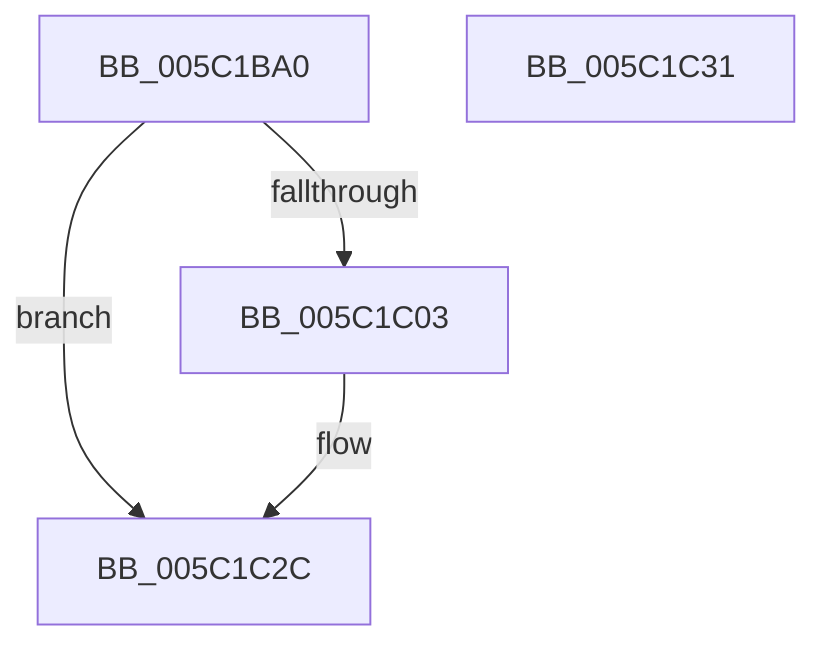

# KiInitializeIdealProcessorRebalancer

- RVA: `0x005C1BA0`–`0x005C1C32` (길이 `146` bytes)
- VA: `0x00000001405C1BA0`
- 실행 섹션: `.text`
- PDB 이름 있음: `예`; PDB Function 태그: `아니요`
- unwind 정보 RVA: `0x0005D2F4`
- 디코드: `29`개 명령, `146/146` bytes 표시
- 미해석 바이트: `0` (있으면 어셈블리에 `.byte`로 보존)

> 이 문서는 커널 이미지의 기계어와 PDB 기호를 분석해 생성했습니다. 4번과 5번은 함수 원형과 자료형을 바이너리 사용 방식에서 추정한 C 해석이며 원본 소스 복구 결과는 아닙니다.

## 1. Dependencies

- 직접 호출 지점: **3**; 고유 호출 대상: **3**
- 직접 호출자로 확인된 함수: **1**
- RIP 상대 이미지 참조: **8**

### Outgoing calls
- `0x005C1BB3` → [memset](../6C/memset_function_006C6C40.md) (function, `0x006C6C40`)
- `0x005C1BCF` → [KiInitializeTimer2](../3A/KiInitializeTimer2_function_003A3288.md) (function, `0x003A3288`)
- `0x005C1C27` → [KeSetTimer2](../3A/KeSetTimer2_function_003A08E0.md) (function, `0x003A08E0`)

### Direct callers
- [KeInitSystem](../../init/C7/KeInitSystem_function_00C71660.md) at `0x00C719FC`

### Static image references
- `0x005C1BA6` → RVA `0x00E17000` (`.data`; read)
- `0x005C1BBE` → RVA `0x004951C0` (`KiIdealProcessorRebalancerTimerCallback`; read)
- `0x005C1BD6` → RVA `0x00484BB0` (`KiIdealProcessorRebalancerWorker`; read)
- `0x005C1BDD` → RVA `0x00E17098` (`.data`; write)
- `0x005C1BE4` → RVA `0x00FC5084` (`ALMOSTRO`; read)
- `0x005C1BEA` → RVA `0x00E170A0` (`.data`; write)
- `0x005C1BF1` → RVA `0x00E17088` (`.data`; write)
- `0x005C1BF8` → RVA `0x00E170A8` (`.data`; write)

## 2. Other-region calls and transfers

- 다른 실행 섹션으로 향하는 call: **0**
- 별도 외부 분기/꼬리 이동을 확인하지 못했습니다.

## 3. Assembly (complete function range)

```asm
005C1BA0  48 83 EC 38                     sub rsp, 0x38
005C1BA4  33 D2                           xor edx, edx
005C1BA6  48 8D 0D 53 54 85 00            lea rcx, [rip + 0x855453]
005C1BAD  41 B8 B8 00 00 00               mov r8d, 0xb8
005C1BB3  E8 88 50 10 00                  call 0x1406c6c40
005C1BB8  41 B9 08 00 00 00               mov r9d, 8
005C1BBE  48 8D 15 FB 35 ED FF            lea rdx, [rip - 0x12ca05]
005C1BC5  45 33 C0                        xor r8d, r8d
005C1BC8  48 8D 0D 31 54 85 00            lea rcx, [rip + 0x855431]
005C1BCF  E8 B4 16 DE FF                  call 0x1403a3288
005C1BD4  33 D2                           xor edx, edx
005C1BD6  48 8D 05 D3 2F EC FF            lea rax, [rip - 0x13d02d]
005C1BDD  48 89 05 B4 54 85 00            mov qword ptr [rip + 0x8554b4], rax
005C1BE4  8B 05 9A 34 A0 00               mov eax, dword ptr [rip + 0xa0349a]
005C1BEA  48 89 15 AF 54 85 00            mov qword ptr [rip + 0x8554af], rdx
005C1BF1  48 89 15 90 54 85 00            mov qword ptr [rip + 0x855490], rdx
005C1BF8  48 89 15 A9 54 85 00            mov qword ptr [rip + 0x8554a9], rdx
005C1BFF  A8 08                           test al, 8
005C1C01  74 29                           je 0x1405c1c2c
005C1C03  48 83 4C 24 28 FF               or qword ptr [rsp + 0x28], 0xffffffffffffffff
005C1C09  4C 8D 4C 24 20                  lea r9, [rsp + 0x20]
005C1C0E  48 89 54 24 20                  mov qword ptr [rsp + 0x20], rdx
005C1C13  48 8D 0D E6 53 85 00            lea rcx, [rip + 0x8553e6]
005C1C1A  48 C7 C2 80 69 67 FF            mov rdx, 0xffffffffff676980
005C1C21  41 B8 80 96 98 00               mov r8d, 0x989680
005C1C27  E8 B4 EC DD FF                  call 0x1403a08e0
005C1C2C  48 83 C4 38                     add rsp, 0x38
005C1C30  C3                              ret
005C1C31  CC                              int3
```

## 4. C-style interpretation (structured pseudocode)

```c
__int64 __fastcall KiInitializeIdealProcessorRebalancer(__int64 a1, int a2)
{
    __int64 result;
    __int64 v_rsp;
    unsigned __int64 v_stack_m10;
    unsigned __int64 v_stack_m18;

    v_rsp = (v_rsp) - (56);
    a2 = 0;
    result = memset(v_rip + 8737875, a2, 184, a4);
    a3 = 0;
    result = KiInitializeTimer2(v_rip + 8737841, v_rip - 1231365, a3, 8);
    a2 = 0;
    *(unsigned __int64 *)(v_rip + 8737972) = v_rip - 1298477;
    *(unsigned __int64 *)(v_rip + 8737967) = 0;
    *(unsigned __int64 *)(v_rip + 8737936) = 0;
    *(unsigned __int64 *)(v_rip + 8737961) = 0;
    result = (unsigned int)(*(unsigned int *)(v_rip + 10499226));
    if ((((unsigned __int8)((unsigned int)(*(unsigned int *)(v_rip + 10499226)))) & (8)) != 0) {
        a4 = v_stack_m18;
        v_stack_m18 = 0;
        a1 = v_rip + 8737766;
        a2 = 0xFFFFFFFFFF676980ULL;
        a3 = 0x989680ULL;
        result = KeSetTimer2(a1, a2, a3, a4);
    }
    v_rsp = (v_rsp) + (56);
    return result;
}
```

## 5. (Beta) C Style

```c
int64_t KiInitializeIdealProcessorRebalancer(int64_t Arg1, int32_t Arg2)
{
    int64_t result;
    int64_t local_rsp;
    uint64_t v_stack_m10;
    uint64_t v_stack_m18;

    local_rsp = (local_rsp) - (56);
    Arg2 = 0;
    result = memset(v_rip + 8737875, Arg2, 184, a4);
    a3 = 0;
    result = KiInitializeTimer2(v_rip + 8737841, v_rip - 1231365, a3, 8);
    Arg2 = 0;
    *(uint64_t *)(v_rip + 0x8554B4) = v_rip - 1298477;
    *(uint64_t *)(v_rip + 0x8554AF) = 0;
    *(uint64_t *)(v_rip + 0x855490) = 0;
    *(uint64_t *)(v_rip + 0x8554A9) = 0;
    result = (uint32_t)(*(uint32_t *)(v_rip + 0xA0349A));
    if ((((uint8_t)((uint32_t)(*(uint32_t *)(v_rip + 0xA0349A)))) & (8)) != 0) {
        a4 = v_stack_m18;
        v_stack_m18 = 0;
        Arg1 = v_rip + 8737766;
        Arg2 = 0xFFFFFFFFFF676980ULL;
        a3 = 0x989680ULL;
        result = KeSetTimer2(Arg1, Arg2, a3, a4);
    }
    local_rsp = (local_rsp) + (56);
    return result;
}
```

## 6. Execution-region graph

[열기: 2D/3D 그래프와 함수 탐색 컨트롤 패널](../../../control-panel.html?section=text&rva=0x005C1BA0&view=graph)

- 2D 그래프는 위에서 아래로 흐르고, 3D 그래프는 빈 공간을 드래그해 회전합니다. Shift+드래그는 이동, 휠은 확대·축소, 함수 노드 선택은 대상 보고서 이동입니다.

### Static fallback


