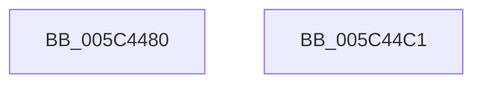

# KiInitializePriorityState

- RVA: `0x005C4480`–`0x005C44C2` (길이 `66` bytes)
- VA: `0x00000001405C4480`
- 실행 섹션: `.text`
- PDB 이름 있음: `예`; PDB Function 태그: `아니요`
- unwind 정보 RVA: `0x0005CAAC`
- 디코드: `24`개 명령, `66/66` bytes 표시
- 미해석 바이트: `0` (있으면 어셈블리에 `.byte`로 보존)

> 이 문서는 커널 이미지의 기계어와 PDB 기호를 분석해 생성했습니다. 4번과 5번은 함수 원형과 자료형을 바이너리 사용 방식에서 추정한 C 해석이며 원본 소스 복구 결과는 아닙니다.

## 1. Dependencies

- 직접 호출 지점: **1**; 고유 호출 대상: **1**
- 직접 호출자로 확인된 함수: **2**
- RIP 상대 이미지 참조: **0**

### Outgoing calls
- `0x005C4493` → [KiQueryEffectivePriorityThread](../25/KiQueryEffectivePriorityThread_function_00257BA0.md) (function, `0x00257BA0`)

### Direct callers
- [KiAssignSubNodeSharedReadyQueues](../5B/KiAssignSubNodeSharedReadyQueues_function_005B737C.md) at `0x005B7525`
- [KiStartIdleThread](KiStartIdleThread_function_005C46B0.md) at `0x005C474D`

### Static image references
- 디코드된 RIP-relative 메모리 참조가 없습니다.

## 2. Other-region calls and transfers

- 다른 실행 섹션으로 향하는 call: **0**
- 별도 외부 분기/꼬리 이동을 확인하지 못했습니다.

## 3. Assembly (complete function range)

```asm
005C4480  48 89 5C 24 08                  mov qword ptr [rsp + 8], rbx
005C4485  57                              push rdi
005C4486  48 83 EC 20                     sub rsp, 0x20
005C448A  48 8B F9                        mov rdi, rcx
005C448D  49 8B D8                        mov rbx, r8
005C4490  49 8B C8                        mov rcx, r8
005C4493  E8 08 37 C9 FF                  call 0x140257ba0
005C4498  44 8A 0F                        mov r9b, byte ptr [rdi]
005C449B  8A D0                           mov dl, al
005C449D  41 32 D1                        xor dl, r9b
005C44A0  24 7F                           and al, 0x7f
005C44A2  80 E2 7F                        and dl, 0x7f
005C44A5  41 32 D1                        xor dl, r9b
005C44A8  88 17                           mov byte ptr [rdi], dl
005C44AA  8B 4B 78                        mov ecx, dword ptr [rbx + 0x78]
005C44AD  48 8B 5C 24 30                  mov rbx, qword ptr [rsp + 0x30]
005C44B2  D1 E9                           shr ecx, 1
005C44B4  C0 E1 07                        shl cl, 7
005C44B7  0A C8                           or cl, al
005C44B9  88 0F                           mov byte ptr [rdi], cl
005C44BB  48 83 C4 20                     add rsp, 0x20
005C44BF  5F                              pop rdi
005C44C0  C3                              ret
005C44C1  CC                              int3
```

## 4. C-style interpretation (structured pseudocode)

```c
__int64 __fastcall KiInitializePriorityState(__int64 a1, __int64 a2, __int64 a3)
{
    __int64 result;
    __int64 v_rsp;
    unsigned __int64 v_stack_p8;

    v_stack_p8 = v_rbx;
    v_rsp = (v_rsp) - (32);
    result = KiQueryEffectivePriorityThread(a3, a2, a3, a4);
    a2 = (unsigned __int8)(((unsigned __int8)(result)) ^ ((unsigned __int8)(*(unsigned __int8 *)(a1))));
    result = (unsigned __int8)((result) & (127));
    a2 = (unsigned __int8)((a2) & (127));
    a2 = (unsigned __int8)((a2) ^ ((unsigned __int8)(*(unsigned __int8 *)(a1))));
    *(unsigned __int8 *)(a1) = (unsigned __int8)(a2);
    a1 = (unsigned int)(((unsigned int)(*(unsigned int *)(a3 + 120))) >> (1));
    a1 = (unsigned __int8)((a1) << (7));
    a1 = (unsigned __int8)((a1) | ((unsigned __int8)(result)));
    *(unsigned __int8 *)(a1) = (unsigned __int8)(a1);
    v_rsp = (v_rsp) + (32);
    return result;
}
```

## 5. (Beta) C Style

```c
int64_t KiInitializePriorityState(void *Arg1, int64_t Arg2, void *Arg3)
{
    uint8_t *arg1 = (uint8_t *)Arg1;
    uint8_t *arg3 = (uint8_t *)Arg3;

    int64_t result;
    int64_t local_rsp;
    uint64_t v_stack_p8;

    v_stack_p8 = local_rbx;
    local_rsp = (local_rsp) - (32);
    result = KiQueryEffectivePriorityThread(Arg3, Arg2, Arg3, a4);
    Arg2 = (uint8_t)(((uint8_t)(result)) ^ ((uint8_t)(*(uint8_t *)(arg1))));
    result = (uint8_t)((result) & (127));
    Arg2 = (uint8_t)((Arg2) & (127));
    Arg2 = (uint8_t)((Arg2) ^ ((uint8_t)(*(uint8_t *)(arg1))));
    *(uint8_t *)(arg1) = (uint8_t)(Arg2);
    Arg1 = (uint32_t)(((uint32_t)(*(uint32_t *)(arg3 + 0x78))) >> (1));
    Arg1 = (uint8_t)((Arg1) << (7));
    Arg1 = (uint8_t)((Arg1) | ((uint8_t)(result)));
    *(uint8_t *)(arg1) = (uint8_t)(Arg1);
    local_rsp = (local_rsp) + (32);
    return result;
}
```

### 관측된 메모리 오프셋

구조체 형식이 확인되지 않은 접근은 인자 기준의 오프셋으로만 기록했습니다.

| 기준 인자 | 오프셋 표현 | 폭 (bit) | 접근 |
|---|---:|---:|---|
| `Arg1` | `+ 0x0` | `8` | `R` |
| `Arg1` | `+ 0x0` | `8` | `W` |
| `Arg3` | `+ 0x78` | `32` | `R` |

## 6. Execution-region graph

[열기: 2D/3D 그래프와 함수 탐색 컨트롤 패널](../../../control-panel.html?section=text&rva=0x005C4480&view=graph)

- 2D 그래프는 위에서 아래로 흐르고, 3D 그래프는 빈 공간을 드래그해 회전합니다. Shift+드래그는 이동, 휠은 확대·축소, 함수 노드 선택은 대상 보고서 이동입니다.

### Static fallback


