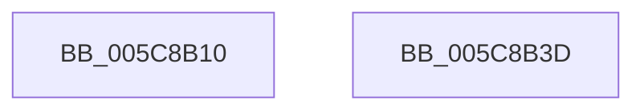

# KiInitializeProcessorGroupSchedulingData

- RVA: `0x005C8B10`–`0x005C8B3E` (길이 `46` bytes)
- VA: `0x00000001405C8B10`
- 실행 섹션: `.text`
- PDB 이름 있음: `예`; PDB Function 태그: `아니요`
- unwind 정보 RVA: `0x000DB714`
- 디코드: `10`개 명령, `46/46` bytes 표시
- 미해석 바이트: `0` (있으면 어셈블리에 `.byte`로 보존)

> 이 문서는 커널 이미지의 기계어와 PDB 기호를 분석해 생성했습니다. 4번과 5번은 함수 원형과 자료형을 바이너리 사용 방식에서 추정한 C 해석이며 원본 소스 복구 결과는 아닙니다.

## 1. Dependencies

- 직접 호출 지점: **0**; 고유 호출 대상: **0**
- 직접 호출자로 확인된 함수: **1**
- RIP 상대 이미지 참조: **1**

### Outgoing calls
- 직접 디코드된 call 명령이 없습니다.

### Direct callers
- [KiAddProcessorToGroupSchedulingDatabase](../../pagelk/B6/KiAddProcessorToGroupSchedulingDatabase_function_00B6B1D8.md) at `0x00B6B1F4`

### Static image references
- `0x005C8B2E` → RVA `0x00F23150` (`.data`; read)

## 2. Other-region calls and transfers

- 다른 실행 섹션으로 향하는 call: **0**
- 별도 외부 분기/꼬리 이동을 확인하지 못했습니다.

## 3. Assembly (complete function range)

```asm
005C8B10  48 8D 81 88 8A 00 00            lea rax, [rcx + 0x8a88]
005C8B17  48 89 40 08                     mov qword ptr [rax + 8], rax
005C8B1B  48 89 00                        mov qword ptr [rax], rax
005C8B1E  69 41 24 B8 01 00 00            imul eax, dword ptr [rcx + 0x24], 0x1b8
005C8B25  83 E8 80                        sub eax, -0x80
005C8B28  89 81 D8 00 00 00               mov dword ptr [rcx + 0xd8], eax
005C8B2E  48 8B 05 1B A6 95 00            mov rax, qword ptr [rip + 0x95a61b]
005C8B35  48 89 81 D8 8B 00 00            mov qword ptr [rcx + 0x8bd8], rax
005C8B3C  C3                              ret
005C8B3D  CC                              int3
```

## 4. C-style interpretation (structured pseudocode)

```c
__int64 __fastcall KiInitializeProcessorGroupSchedulingData(__int64 a1)
{
    __int64 result;

    *(unsigned __int64 *)(a1 + 35464 + 8) = a1 + 35464;
    *(unsigned __int64 *)(a1 + 35464) = a1 + 35464;
    result = (unsigned int)((a1 + 35464) * (*(unsigned int *)(a1 + 36)));
    result = (unsigned int)((result) - (-128));
    *(unsigned int *)(a1 + 216) = (unsigned int)(result);
    *(unsigned __int64 *)(a1 + 35800) = *(unsigned __int64 *)(v_rip + 9807387);
    return *(unsigned __int64 *)(v_rip + 9807387);
}
```

## 5. (Beta) C Style

```c
int64_t KiInitializeProcessorGroupSchedulingData(void *Arg1)
{
    uint8_t *arg1 = (uint8_t *)Arg1;

    int64_t result;

    *(void **)(arg1 + 0x8A88 + 0x8) = Arg1 + 35464;
    *(void **)(arg1 + 0x8A88) = Arg1 + 35464;
    result = (uint32_t)((Arg1 + 35464) * (*(uint32_t *)(arg1 + 0x24)));
    result = (uint32_t)((result) - (-128));
    *(uint32_t *)(arg1 + 0xD8) = (uint32_t)(result);
    *(uint64_t *)(arg1 + 0x8BD8) = *(uint64_t *)(v_rip + 0x95A61B);
    return *(uint64_t *)(v_rip + 0x95A61B);
}
```

### 관측된 메모리 오프셋

구조체 형식이 확인되지 않은 접근은 인자 기준의 오프셋으로만 기록했습니다.

| 기준 인자 | 오프셋 표현 | 폭 (bit) | 접근 |
|---|---:|---:|---|
| `Arg1` | `+ 0x0` | `64` | `W` |
| `Arg1` | `+ 0x8` | `64` | `W` |
| `Arg1` | `+ 0x24` | `32` | `R` |
| `Arg1` | `+ 0xD8` | `32` | `W` |
| `Arg1` | `+ 0x8A88` | `64` | `R` |
| `Arg1` | `+ 0x8BD8` | `64` | `W` |

## 6. Execution-region graph

[열기: 2D/3D 그래프와 함수 탐색 컨트롤 패널](../../../control-panel.html?section=text&rva=0x005C8B10&view=graph)

- 2D 그래프는 위에서 아래로 흐르고, 3D 그래프는 빈 공간을 드래그해 회전합니다. Shift+드래그는 이동, 휠은 확대·축소, 함수 노드 선택은 대상 보고서 이동입니다.

### Static fallback


