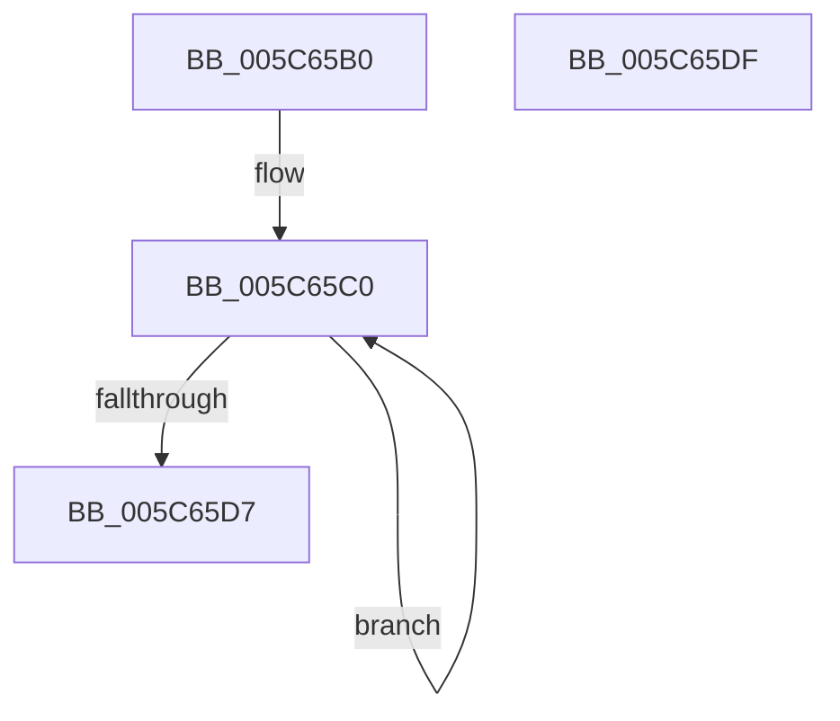

# KiInitializeTimer2Data

- RVA: `0x005C65B0`–`0x005C65E0` (길이 `48` bytes)
- VA: `0x00000001405C65B0`
- 실행 섹션: `.text`
- PDB 이름 있음: `예`; PDB Function 태그: `아니요`
- unwind 정보 RVA: `0x000DB714`
- 디코드: `12`개 명령, `48/48` bytes 표시
- 미해석 바이트: `0` (있으면 어셈블리에 `.byte`로 보존)

> 이 문서는 커널 이미지의 기계어와 PDB 기호를 분석해 생성했습니다. 4번과 5번은 함수 원형과 자료형을 바이너리 사용 방식에서 추정한 C 해석이며 원본 소스 복구 결과는 아닙니다.

## 1. Dependencies

- 직접 호출 지점: **0**; 고유 호출 대상: **0**
- 직접 호출자로 확인된 함수: **1**
- RIP 상대 이미지 참조: **2**

### Outgoing calls
- 직접 디코드된 call 명령이 없습니다.

### Direct callers
- [sub_00B4742A](../../page/B4/Unknown_function_00B4742A.md) at `0x00B47436`

### Static image references
- `0x005C65B0` → RVA `0x00F23330` (`.data`; read)
- `0x005C65D7` → RVA `0x00F23300` (`.data`; write)

## 2. Other-region calls and transfers

- 다른 실행 섹션으로 향하는 call: **0**
- 별도 외부 분기/꼬리 이동을 확인하지 못했습니다.

## 3. Assembly (complete function range)

```asm
005C65B0  48 8D 05 79 CD 95 00            lea rax, [rip + 0x95cd79]
005C65B7  B9 07 00 00 00                  mov ecx, 7
005C65BC  48 83 CA FF                     or rdx, 0xffffffffffffffff
005C65C0  48 83 60 F0 00                  and qword ptr [rax - 0x10], 0
005C65C5  48 83 60 F8 00                  and qword ptr [rax - 8], 0
005C65CA  48 89 10                        mov qword ptr [rax], rdx
005C65CD  48 8D 40 18                     lea rax, [rax + 0x18]
005C65D1  48 83 E9 01                     sub rcx, 1
005C65D5  75 E9                           jne 0x1405c65c0
005C65D7  48 89 15 22 CD 95 00            mov qword ptr [rip + 0x95cd22], rdx
005C65DE  C3                              ret
005C65DF  CC                              int3
```

## 4. C-style interpretation (structured pseudocode)

```c
__int64 __fastcall KiInitializeTimer2Data(__int64 a1, __int64 a2)
{
    a2 = (a2) | (-1);
loc_005C65C0:
    *(unsigned __int64 *)(v_rip + 9817465) = a2;
    a1 = (7) - (1);
    if (condition_is_not_equal) goto loc_005C65C0;
    *(unsigned __int64 *)(v_rip + 9817378) = a2;
    return v_rip + 9817465 + 24;
}
```

## 5. (Beta) C Style

```c
int64_t KiInitializeTimer2Data(int64_t Arg1, int64_t Arg2)
{
    Arg2 = (Arg2) | (-1);
loc_005C65C0:
    *(uint64_t *)(v_rip + 0x95CD79) = Arg2;
    Arg1 = (7) - (1);
    if (condition_is_not_equal) goto loc_005C65C0;
    *(uint64_t *)(v_rip + 0x95CD22) = Arg2;
    return v_rip + 9817465 + 24;
}
```

## 6. Execution-region graph

[열기: 2D/3D 그래프와 함수 탐색 컨트롤 패널](../../../control-panel.html?section=text&rva=0x005C65B0&view=graph)

- 2D 그래프는 위에서 아래로 흐르고, 3D 그래프는 빈 공간을 드래그해 회전합니다. Shift+드래그는 이동, 휠은 확대·축소, 함수 노드 선택은 대상 보고서 이동입니다.

### Static fallback


