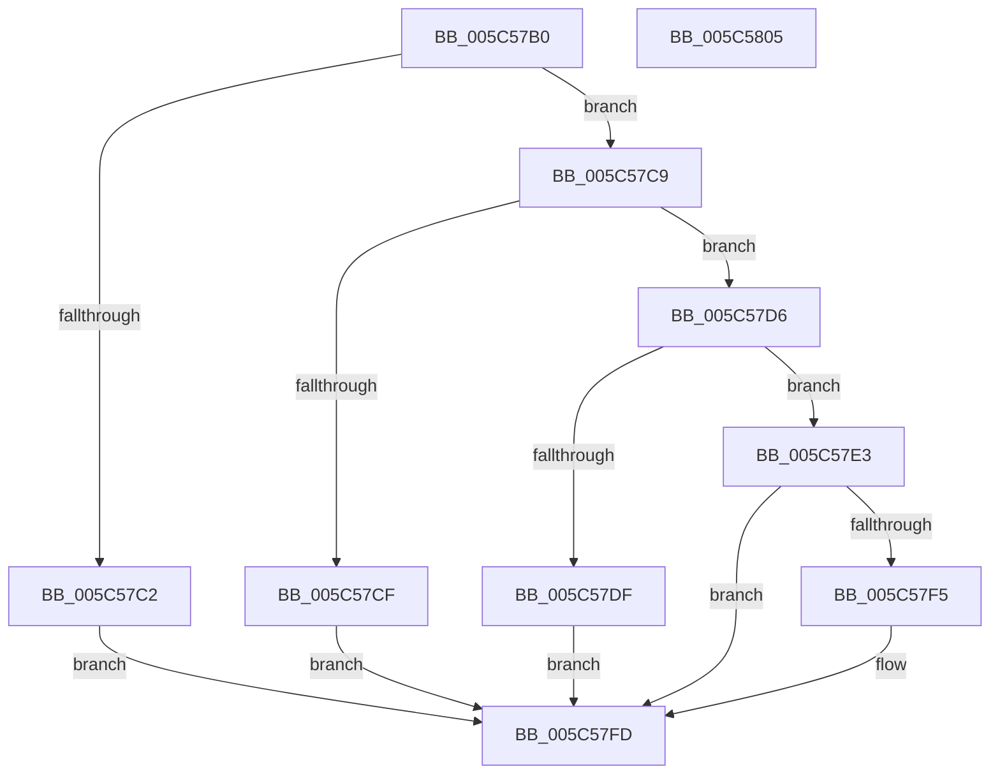

# KiIntSteerAssignCpuSet

- RVA: `0x005C57B0`–`0x005C5806` (길이 `86` bytes)
- VA: `0x00000001405C57B0`
- 실행 섹션: `.text`
- PDB 이름 있음: `예`; PDB Function 태그: `아니요`
- unwind 정보 RVA: `0x0005CF00`
- 디코드: `27`개 명령, `86/86` bytes 표시
- 미해석 바이트: `0` (있으면 어셈블리에 `.byte`로 보존)

> 이 문서는 커널 이미지의 기계어와 PDB 기호를 분석해 생성했습니다. 4번과 5번은 함수 원형과 자료형을 바이너리 사용 방식에서 추정한 C 해석이며 원본 소스 복구 결과는 아닙니다.

## 1. Dependencies

- 직접 호출 지점: **2**; 고유 호출 대상: **2**
- 직접 호출자로 확인된 함수: **2**
- RIP 상대 이미지 참조: **0**

### Outgoing calls
- `0x005C57EA` → [KiIntSteerComputeCpuSet](../4B/KiIntSteerComputeCpuSet_function_004B0B24.md) (function, `0x004B0B24`)
- `0x005C57F8` → [KiIntSteerClearCpuSetAssignment](KiIntSteerClearCpuSetAssignment_function_005C59AC.md) (function, `0x005C59AC`)

### Direct callers
- [KeIntSteerAssignCpuSet](KeIntSteerAssignCpuSet_function_005C5668.md) at `0x005C56BC`
- [KeIntSteerAssignCpuSetForGsiv](KeIntSteerAssignCpuSetForGsiv_function_005C5700.md) at `0x005C5774`

### Static image references
- 디코드된 RIP-relative 메모리 참조가 없습니다.

## 2. Other-region calls and transfers

- 다른 실행 섹션으로 향하는 call: **0**
- 별도 외부 분기/꼬리 이동을 확인하지 못했습니다.

## 3. Assembly (complete function range)

```asm
005C57B0  40 53                           push rbx
005C57B2  48 83 EC 20                     sub rsp, 0x20
005C57B6  80 B9 84 00 00 00 00            cmp byte ptr [rcx + 0x84], 0
005C57BD  48 8B D9                        mov rbx, rcx
005C57C0  75 07                           jne 0x1405c57c9
005C57C2  BA BB 00 00 C0                  mov edx, 0xc00000bb
005C57C7  EB 34                           jmp 0x1405c57fd
005C57C9  66 39 51 48                     cmp word ptr [rcx + 0x48], dx
005C57CD  74 07                           je 0x1405c57d6
005C57CF  BA 0D 00 00 C0                  mov edx, 0xc000000d
005C57D4  EB 27                           jmp 0x1405c57fd
005C57D6  4C 39 81 88 00 00 00            cmp qword ptr [rcx + 0x88], r8
005C57DD  75 04                           jne 0x1405c57e3
005C57DF  33 D2                           xor edx, edx
005C57E1  EB 1A                           jmp 0x1405c57fd
005C57E3  4C 89 81 88 00 00 00            mov qword ptr [rcx + 0x88], r8
005C57EA  E8 35 B3 EE FF                  call 0x1404b0b24
005C57EF  8B D0                           mov edx, eax
005C57F1  85 C0                           test eax, eax
005C57F3  79 08                           jns 0x1405c57fd
005C57F5  48 8B CB                        mov rcx, rbx
005C57F8  E8 AF 01 00 00                  call 0x1405c59ac
005C57FD  8B C2                           mov eax, edx
005C57FF  48 83 C4 20                     add rsp, 0x20
005C5803  5B                              pop rbx
005C5804  C3                              ret
005C5805  CC                              int3
```

## 4. C-style interpretation (structured pseudocode)

```c
__int64 __fastcall KiIntSteerAssignCpuSet(__int64 a1, __int64 a2, __int64 a3)
{
    __int64 result;
    __int64 v_rsp;

    v_rsp = (v_rsp) - (32);
    if ((*(unsigned __int8 *)(a1 + 132)) != 0) goto loc_005C57C9;
    goto loc_005C57FD;
loc_005C57C9:
    if ((*(unsigned __int16 *)(a1 + 72)) == ((unsigned __int16)((unsigned int)(0xC00000BBULL)))) goto loc_005C57D6;
    goto loc_005C57FD;
loc_005C57D6:
    if ((*(unsigned __int64 *)(a1 + 136)) != a3) goto loc_005C57E3;
    a2 = 0;
    goto loc_005C57FD;
loc_005C57E3:
    *(unsigned __int64 *)(a1 + 136) = a3;
    result = KiIntSteerComputeCpuSet(a1, a2, a3, a4);
    if (sign_flag) {
        a1 = a1;
        result = KiIntSteerClearCpuSetAssignment(a1, (unsigned int)((unsigned int)(result)), a3, a4);
    }
    v_rsp = (v_rsp) + (32);
    return (unsigned int)((unsigned int)((unsigned int)((unsigned int)(result))));
}
```

## 5. (Beta) C Style

```c
int64_t KiIntSteerAssignCpuSet(void *Arg1, int64_t Arg2, int64_t Arg3)
{
    uint8_t *arg1 = (uint8_t *)Arg1;

    int64_t result;
    int64_t local_rsp;

    local_rsp = (local_rsp) - (32);
    if ((*(uint8_t *)(arg1 + 0x84)) != 0) goto loc_005C57C9;
    goto loc_005C57FD;
loc_005C57C9:
    if ((*(uint16_t *)(arg1 + 0x48)) == ((uint16_t)((uint32_t)(0xC00000BBULL)))) goto loc_005C57D6;
    goto loc_005C57FD;
loc_005C57D6:
    if ((*(uint64_t *)(arg1 + 0x88)) != Arg3) goto loc_005C57E3;
    Arg2 = 0;
    goto loc_005C57FD;
loc_005C57E3:
    *(uint64_t *)(arg1 + 0x88) = Arg3;
    result = KiIntSteerComputeCpuSet(Arg1, Arg2, Arg3, a4);
    if (sign_flag) {
        Arg1 = Arg1;
        result = KiIntSteerClearCpuSetAssignment(Arg1, (uint32_t)((uint32_t)(result)), Arg3, a4);
    }
    local_rsp = (local_rsp) + (32);
    return (uint32_t)((uint32_t)((uint32_t)((uint32_t)(result))));
}
```

### 관측된 메모리 오프셋

구조체 형식이 확인되지 않은 접근은 인자 기준의 오프셋으로만 기록했습니다.

| 기준 인자 | 오프셋 표현 | 폭 (bit) | 접근 |
|---|---:|---:|---|
| `Arg1` | `+ 0x48` | `16` | `R` |
| `Arg1` | `+ 0x84` | `8` | `R` |
| `Arg1` | `+ 0x88` | `64` | `R` |
| `Arg1` | `+ 0x88` | `64` | `W` |

## 6. Execution-region graph

[열기: 2D/3D 그래프와 함수 탐색 컨트롤 패널](../../../control-panel.html?section=text&rva=0x005C57B0&view=graph)

- 2D 그래프는 위에서 아래로 흐르고, 3D 그래프는 빈 공간을 드래그해 회전합니다. Shift+드래그는 이동, 휠은 확대·축소, 함수 노드 선택은 대상 보고서 이동입니다.

### Static fallback


