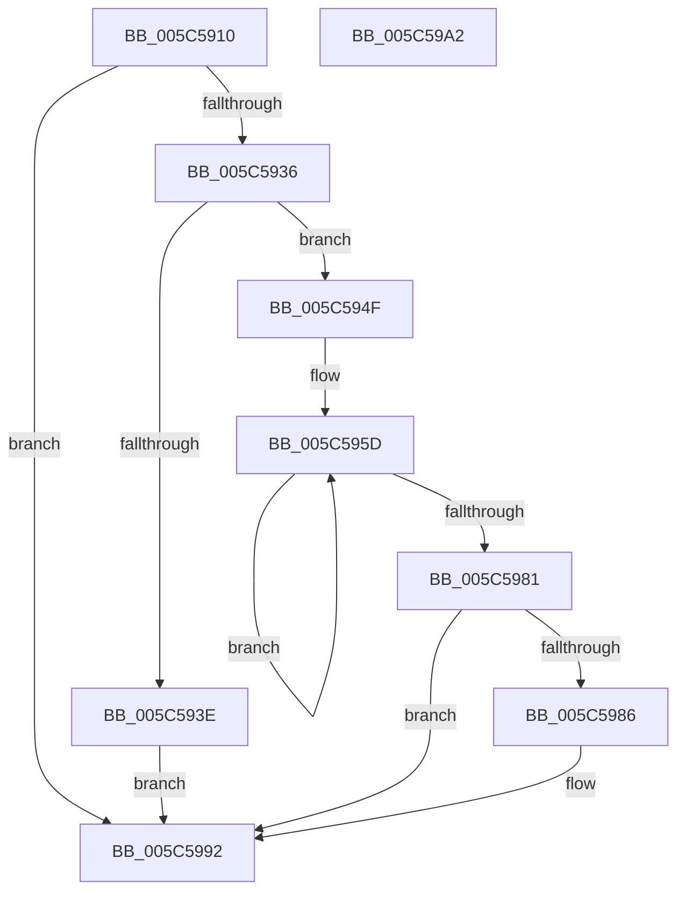

# KiIntSteerCallbackRecordTriageCallbackInterruptObject

- RVA: `0x005C5910`–`0x005C59A3` (길이 `147` bytes)
- VA: `0x00000001405C5910`
- 실행 섹션: `.text`
- PDB 이름 있음: `예`; PDB Function 태그: `아니요`
- unwind 정보 RVA: `0x00060BC4`
- 디코드: `46`개 명령, `147/147` bytes 표시
- 미해석 바이트: `0` (있으면 어셈블리에 `.byte`로 보존)

> 이 문서는 커널 이미지의 기계어와 PDB 기호를 분석해 생성했습니다. 4번과 5번은 함수 원형과 자료형을 바이너리 사용 방식에서 추정한 C 해석이며 원본 소스 복구 결과는 아닙니다.

## 1. Dependencies

- 직접 호출 지점: **1**; 고유 호출 대상: **1**
- 직접 호출자로 확인된 함수: **1**
- RIP 상대 이미지 참조: **0**

### Outgoing calls
- `0x005C5928` → [KiIntSteerComputeRelevanceForTriageDumps](KiIntSteerComputeRelevanceForTriageDumps_function_005C59D4.md) (function, `0x005C59D4`)

### Direct callers
- [KiIntSteerCallbackRecordTriageCallback](KiIntSteerCallbackRecordTriageCallback_function_005C5810.md) at `0x005C589B`

### Static image references
- 디코드된 RIP-relative 메모리 참조가 없습니다.

## 2. Other-region calls and transfers

- 다른 실행 섹션으로 향하는 call: **0**
- 별도 외부 분기/꼬리 이동을 확인하지 못했습니다.

## 3. Assembly (complete function range)

```asm
005C5910  48 89 5C 24 08                  mov qword ptr [rsp + 8], rbx
005C5915  48 89 74 24 10                  mov qword ptr [rsp + 0x10], rsi
005C591A  57                              push rdi
005C591B  48 83 EC 20                     sub rsp, 0x20
005C591F  48 8B D9                        mov rbx, rcx
005C5922  48 8B FA                        mov rdi, rdx
005C5925  48 8B CA                        mov rcx, rdx
005C5928  E8 A7 00 00 00                  call 0x1405c59d4
005C592D  33 D2                           xor edx, edx
005C592F  44 8B C0                        mov r8d, eax
005C5932  85 C0                           test eax, eax
005C5934  74 5C                           je 0x1405c5992
005C5936  8B 43 08                        mov eax, dword ptr [rbx + 8]
005C5939  83 F8 08                        cmp eax, 8
005C593C  73 11                           jae 0x1405c594f
005C593E  48 8B 0B                        mov rcx, qword ptr [rbx]
005C5941  48 89 3C C1                     mov qword ptr [rcx + rax*8], rdi
005C5945  44 89 44 83 2C                  mov dword ptr [rbx + rax*4 + 0x2c], r8d
005C594A  FF 43 08                        inc dword ptr [rbx + 8]
005C594D  EB 43                           jmp 0x1405c5992
005C594F  44 8B 5B 2C                     mov r11d, dword ptr [rbx + 0x2c]
005C5953  48 8D 73 30                     lea rsi, [rbx + 0x30]
005C5957  41 BA 01 00 00 00               mov r10d, 1
005C595D  8B 0E                           mov ecx, dword ptr [rsi]
005C595F  41 8B C2                        mov eax, r10d
005C5962  49 3B CB                        cmp rcx, r11
005C5965  48 8D 76 04                     lea rsi, [rsi + 4]
005C5969  44 8B C9                        mov r9d, ecx
005C596C  4D 0F 43 CB                     cmovae r9, r11
005C5970  0F 43 C2                        cmovae eax, edx
005C5973  41 FF C2                        inc r10d
005C5976  8B D0                           mov edx, eax
005C5978  4D 8B D9                        mov r11, r9
005C597B  41 83 FA 08                     cmp r10d, 8
005C597F  72 DC                           jb 0x1405c595d
005C5981  4D 3B C1                        cmp r8, r9
005C5984  76 0C                           jbe 0x1405c5992
005C5986  48 8B 03                        mov rax, qword ptr [rbx]
005C5989  44 89 44 93 2C                  mov dword ptr [rbx + rdx*4 + 0x2c], r8d
005C598E  48 89 3C D0                     mov qword ptr [rax + rdx*8], rdi
005C5992  48 8B 5C 24 30                  mov rbx, qword ptr [rsp + 0x30]
005C5997  48 8B 74 24 38                  mov rsi, qword ptr [rsp + 0x38]
005C599C  48 83 C4 20                     add rsp, 0x20
005C59A0  5F                              pop rdi
005C59A1  C3                              ret
005C59A2  CC                              int3
```

## 4. C-style interpretation (structured pseudocode)

```c
__int64 __fastcall KiIntSteerCallbackRecordTriageCallbackInterruptObject(__int64 a1, __int64 a2)
{
    __int64 result;
    __int64 v_r10;
    __int64 v_rsp;
    unsigned __int64 v_stack_p10;
    unsigned __int64 v_stack_p8;

    v_stack_p8 = v_rbx;
    v_stack_p10 = v_rsi;
    v_rsp = (v_rsp) - (32);
    result = KiIntSteerComputeRelevanceForTriageDumps(a2, a2, a3, a4);
    a2 = 0;
    if ((unsigned int)(result) == 0) goto loc_005C5992;
    if (((unsigned int)((unsigned int)(*(unsigned int *)(a1 + 8)))) >= 8) goto loc_005C594F;
    *(unsigned __int64 *)(*(unsigned __int64 *)(a1) + (unsigned int)(*(unsigned int *)(a1 + 8)) * 8) = 0;
    *(unsigned int *)(a1 + (unsigned int)(*(unsigned int *)(a1 + 8)) * 4 + 44) = (unsigned int)((unsigned int)((unsigned int)(result)));
    goto loc_005C5992;
loc_005C594F:
loc_005C595D:
    a4 = (unsigned int)((unsigned int)((unsigned int)(*(unsigned int *)(a1 + 48))));
    if (((unsigned int)(*(unsigned int *)(a1 + 48))) >= ((unsigned int)(*(unsigned int *)(a1 + 44)))) { a4 = (unsigned int)(*(unsigned int *)(a1 + 44)); }
    result = 1;
    if (((unsigned int)(*(unsigned int *)(a1 + 48))) >= ((unsigned int)(*(unsigned int *)(a1 + 44)))) { result = 0; }
    v_r10 = (unsigned int)((1) + 1);
    if (((unsigned int)(v_r10)) < 8) goto loc_005C595D;
    if (((unsigned int)((unsigned int)(result))) >= = a4) {
        result = *(unsigned __int64 *)(a1);
        *(unsigned int *)(a1 + (unsigned int)((unsigned int)(result)) * 4 + 44) = (unsigned int)((unsigned int)((unsigned int)(result)));
        *(unsigned __int64 *)(result + (unsigned int)((unsigned int)(result)) * 8) = 0;
    }
    v_rsp = (v_rsp) + (32);
    return result;
}
```

## 5. (Beta) C Style

```c
int64_t KiIntSteerCallbackRecordTriageCallbackInterruptObject(void *Arg1, int64_t Arg2)
{
    uint8_t *arg1 = (uint8_t *)Arg1;

    int64_t result;
    int64_t local_r10;
    int64_t local_rsp;
    uint64_t v_stack_p10;
    uint64_t v_stack_p8;

    v_stack_p8 = local_rbx;
    v_stack_p10 = local_rsi;
    local_rsp = (local_rsp) - (32);
    result = KiIntSteerComputeRelevanceForTriageDumps(Arg2, Arg2, a3, a4);
    Arg2 = 0;
    if ((uint32_t)(result) == 0) goto loc_005C5992;
    if (((uint32_t)((uint32_t)(*(uint32_t *)(arg1 + 0x8)))) >= 8) goto loc_005C594F;
    *(uint64_t *)(*(uint64_t *)(arg1) + (uint32_t)(*(uint32_t *)(arg1 + 0x8)) * 8) = 0;
    *(uint32_t *)(arg1 + (uint32_t)(*(uint32_t *)(arg1 + 0x8)) * 4 + 0x2C) = (uint32_t)((uint32_t)((uint32_t)(result)));
    goto loc_005C5992;
loc_005C594F:
loc_005C595D:
    a4 = (uint32_t)((uint32_t)((uint32_t)(*(uint32_t *)(arg1 + 0x30))));
    if (((uint32_t)(*(uint32_t *)(arg1 + 0x30))) >= ((uint32_t)(*(uint32_t *)(arg1 + 0x2C)))) { a4 = (uint32_t)(*(uint32_t *)(arg1 + 0x2C)); }
    result = 1;
    if (((uint32_t)(*(uint32_t *)(arg1 + 0x30))) >= ((uint32_t)(*(uint32_t *)(arg1 + 0x2C)))) { result = 0; }
    local_r10 = (uint32_t)((1) + 1);
    if (((uint32_t)(local_r10)) < 8) goto loc_005C595D;
    if (((uint32_t)((uint32_t)(result))) >= = a4) {
        result = *(uint64_t *)(arg1);
        *(uint32_t *)(arg1 + (uint32_t)((uint32_t)(result)) * 4 + 0x2C) = (uint32_t)((uint32_t)((uint32_t)(result)));
        *(uint64_t *)(result + (uint32_t)((uint32_t)(result)) * 8) = 0;
    }
    local_rsp = (local_rsp) + (32);
    return result;
}
```

### 관측된 메모리 오프셋

구조체 형식이 확인되지 않은 접근은 인자 기준의 오프셋으로만 기록했습니다.

| 기준 인자 | 오프셋 표현 | 폭 (bit) | 접근 |
|---|---:|---:|---|
| `Arg1` | `+ 0x0` | `32` | `R` |
| `Arg1` | `+ 0x0` | `64` | `R` |
| `Arg1` | `+ 0x4` | `64` | `R` |
| `Arg1` | `+ 0x8` | `32` | `R` |
| `Arg1` | `+ 0x8` | `32` | `R/W` |
| `Arg1` | `+ 0x2C` | `32` | `R` |
| `Arg1` | `+ 0x2C + rax*4` | `32` | `W` |
| `Arg1` | `+ 0x2C + rdx*4` | `32` | `W` |
| `Arg1` | `+ 0x30` | `64` | `R` |

## 6. Execution-region graph

[열기: 2D/3D 그래프와 함수 탐색 컨트롤 패널](../../../control-panel.html?section=text&rva=0x005C5910&view=graph)

- 2D 그래프는 위에서 아래로 흐르고, 3D 그래프는 빈 공간을 드래그해 회전합니다. Shift+드래그는 이동, 휠은 확대·축소, 함수 노드 선택은 대상 보고서 이동입니다.

### Static fallback


