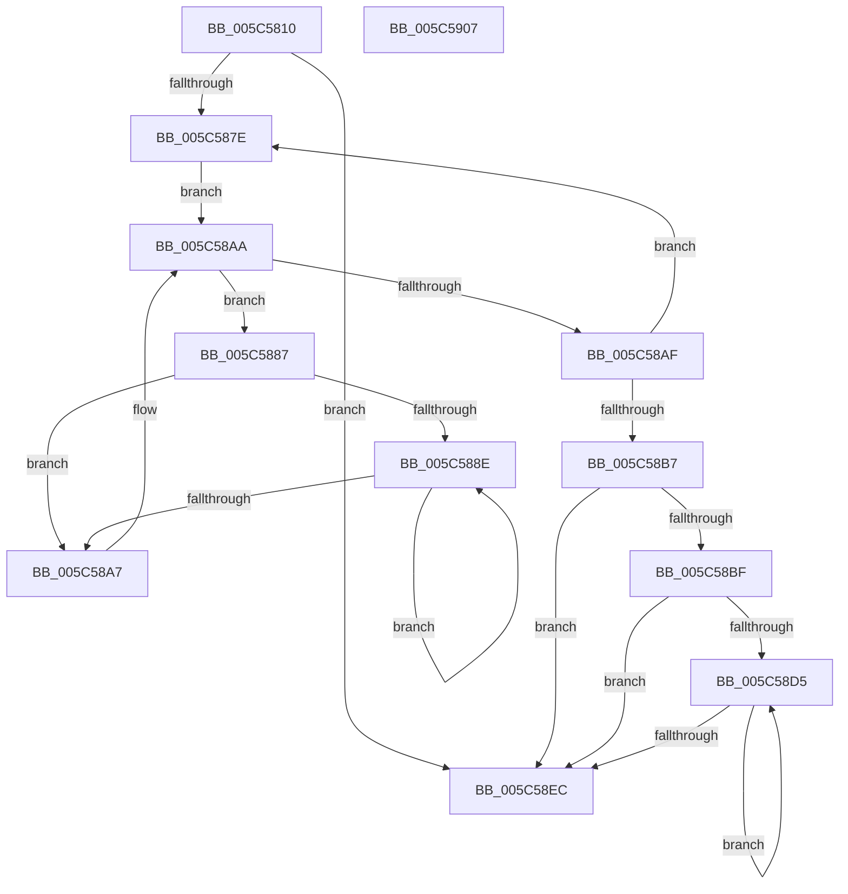

# KiIntSteerCallbackRecordTriageCallback

- RVA: `0x005C5810`–`0x005C5908` (길이 `248` bytes)
- VA: `0x00000001405C5810`
- 실행 섹션: `.text`
- PDB 이름 있음: `예`; PDB Function 태그: `아니요`
- unwind 정보 RVA: `0x000C449C`
- 디코드: `73`개 명령, `248/248` bytes 표시
- 미해석 바이트: `0` (있으면 어셈블리에 `.byte`로 보존)

> 이 문서는 커널 이미지의 기계어와 PDB 기호를 분석해 생성했습니다. 4번과 5번은 함수 원형과 자료형을 바이너리 사용 방식에서 추정한 C 해석이며 원본 소스 복구 결과는 아닙니다.

## 1. Dependencies

- 직접 호출 지점: **5**; 고유 호출 대상: **4**
- 직접 호출자로 확인된 함수: **0**
- RIP 상대 이미지 참조: **3**

### Outgoing calls
- `0x005C5843` → [memset](../6C/memset_function_006C6C40.md) (function, `0x006C6C40`)
- `0x005C589B` → [KiIntSteerCallbackRecordTriageCallbackInterruptObject](KiIntSteerCallbackRecordTriageCallbackInterruptObject_function_005C5910.md) (function, `0x005C5910`)
- `0x005C58CC` → [IoAddTriageDumpDataBlock](../42/IoAddTriageDumpDataBlock_function_00428374.md) (function, `0x00428374`)
- `0x005C58DD` → [IoAddTriageDumpDataBlock](../42/IoAddTriageDumpDataBlock_function_00428374.md) (function, `0x00428374`)
- `0x005C58F4` → [_security_check_cookie](../6A/_security_check_cookie_function_006AC640.md) (function, `0x006AC640`)

### Direct callers
- 이 함수 시작 RVA로 연결되는 직접 call은 확인되지 않았습니다. 간접 호출은 완전히 역산할 수 없습니다.

### Static image references
- `0x005C581E` → RVA `0x00E0A740` (`.data`; read)
- `0x005C584D` → RVA `0x00F10D50` (`.data`; read)
- `0x005C5859` → RVA `0x00F10D00` (`.data`; read)

## 2. Other-region calls and transfers

- 다른 실행 섹션으로 향하는 call: **0**
- 별도 외부 분기/꼬리 이동을 확인하지 못했습니다.

## 3. Assembly (complete function range)

```asm
005C5810  40 53                           push rbx
005C5812  55                              push rbp
005C5813  56                              push rsi
005C5814  57                              push rdi
005C5815  41 56                           push r14
005C5817  48 81 EC 80 00 00 00            sub rsp, 0x80
005C581E  48 8B 05 1B 4F 84 00            mov rax, qword ptr [rip + 0x844f1b]
005C5825  48 33 C4                        xor rax, rsp
005C5828  48 89 44 24 70                  mov qword ptr [rsp + 0x70], rax
005C582D  48 8B FA                        mov rdi, rdx
005C5830  49 8B F0                        mov rsi, r8
005C5833  33 D2                           xor edx, edx
005C5835  8B D9                           mov ebx, ecx
005C5837  48 8D 4C 24 20                  lea rcx, [rsp + 0x20]
005C583C  41 8B E9                        mov ebp, r9d
005C583F  44 8D 42 50                     lea r8d, [rdx + 0x50]
005C5843  E8 F8 13 10 00                  call 0x1406c6c40
005C5848  83 64 24 28 00                  and dword ptr [rsp + 0x28], 0
005C584D  4C 8D 35 FC B4 94 00            lea r14, [rip + 0x94b4fc]
005C5854  48 89 7C 24 30                  mov qword ptr [rsp + 0x30], rdi
005C5859  48 8D 05 A0 B4 94 00            lea rax, [rip + 0x94b4a0]
005C5860  48 8B 3D E9 B4 94 00            mov rdi, qword ptr [rip + 0x94b4e9]
005C5867  48 89 44 24 20                  mov qword ptr [rsp + 0x20], rax
005C586C  89 5C 24 38                     mov dword ptr [rsp + 0x38], ebx
005C5870  48 89 74 24 40                  mov qword ptr [rsp + 0x40], rsi
005C5875  89 6C 24 48                     mov dword ptr [rsp + 0x48], ebp
005C5879  49 3B FE                        cmp rdi, r14
005C587C  74 6E                           je 0x1405c58ec
005C587E  48 8D 77 10                     lea rsi, [rdi + 0x10]
005C5882  48 8B 1E                        mov rbx, qword ptr [rsi]
005C5885  EB 23                           jmp 0x1405c58aa
005C5887  33 ED                           xor ebp, ebp
005C5889  39 6B 18                        cmp dword ptr [rbx + 0x18], ebp
005C588C  76 19                           jbe 0x1405c58a7
005C588E  48 8B 53 20                     mov rdx, qword ptr [rbx + 0x20]
005C5892  48 8D 4C 24 20                  lea rcx, [rsp + 0x20]
005C5897  48 8B 14 EA                     mov rdx, qword ptr [rdx + rbp*8]
005C589B  E8 70 00 00 00                  call 0x1405c5910
005C58A0  FF C5                           inc ebp
005C58A2  3B 6B 18                        cmp ebp, dword ptr [rbx + 0x18]
005C58A5  72 E7                           jb 0x1405c588e
005C58A7  48 8B 1B                        mov rbx, qword ptr [rbx]
005C58AA  48 3B DE                        cmp rbx, rsi
005C58AD  75 D8                           jne 0x1405c5887
005C58AF  48 8B 3F                        mov rdi, qword ptr [rdi]
005C58B2  49 3B FE                        cmp rdi, r14
005C58B5  75 C7                           jne 0x1405c587e
005C58B7  8B 7C 24 28                     mov edi, dword ptr [rsp + 0x28]
005C58BB  85 FF                           test edi, edi
005C58BD  74 2D                           je 0x1405c58ec
005C58BF  48 8B 5C 24 20                  mov rbx, qword ptr [rsp + 0x20]
005C58C4  BA 40 00 00 00                  mov edx, 0x40
005C58C9  48 8B CB                        mov rcx, rbx
005C58CC  E8 A3 2A E6 FF                  call 0x140428374
005C58D1  85 FF                           test edi, edi
005C58D3  74 17                           je 0x1405c58ec
005C58D5  48 8B 0B                        mov rcx, qword ptr [rbx]
005C58D8  BA 20 01 00 00                  mov edx, 0x120
005C58DD  E8 92 2A E6 FF                  call 0x140428374
005C58E2  48 8D 5B 08                     lea rbx, [rbx + 8]
005C58E6  48 83 EF 01                     sub rdi, 1
005C58EA  75 E9                           jne 0x1405c58d5
005C58EC  48 8B 4C 24 70                  mov rcx, qword ptr [rsp + 0x70]
005C58F1  48 33 CC                        xor rcx, rsp
005C58F4  E8 47 6D 0E 00                  call 0x1406ac640
005C58F9  48 81 C4 80 00 00 00            add rsp, 0x80
005C5900  41 5E                           pop r14
005C5902  5F                              pop rdi
005C5903  5E                              pop rsi
005C5904  5D                              pop rbp
005C5905  5B                              pop rbx
005C5906  C3                              ret
005C5907  CC                              int3
```

## 4. C-style interpretation (structured pseudocode)

```c
__int64 __fastcall KiIntSteerCallbackRecordTriageCallback(int a1, __int64 a2, __int64 a3, int a4)
{
    __int64 result;
    __int64 v_rbp;
    __int64 v_rdi;
    __int64 v_rsp;
    unsigned __int64 v_stack_m38;
    unsigned int v_stack_m60;
    unsigned __int64 v_stack_m68;
    unsigned int v_stack_m70;
    unsigned __int64 v_stack_m78;
    unsigned int v_stack_m80;
    unsigned __int64 v_stack_m88;

    v_rsp = (v_rsp) - (128);
    result = (*(unsigned __int64 *)(v_rip + 8671003)) ^ (v_rsp);
    v_stack_m38 = result;
    a2 = 0;
    result = memset(v_stack_m88, a2, a2 + 80, a4);
    v_stack_m78 = 0;
    v_stack_m88 = v_rip + 9745568;
    v_stack_m70 = (unsigned int)((unsigned int)(a1));
    v_stack_m68 = a3;
    v_stack_m60 = (unsigned int)((unsigned int)(a4));
    if ((*(unsigned __int64 *)(v_rip + 9745641)) == (v_rip + 9745660)) goto loc_005C58EC;
loc_005C587E:
    goto loc_005C58AA;
loc_005C5887:
    v_rbp = 0;
    if ((*(unsigned int *)(*(unsigned __int64 *)(*(unsigned __int64 *)(v_rip + 9745641) + 16) + 24)) <= 0) goto loc_005C58A7;
loc_005C588E:
    result = KiIntSteerCallbackRecordTriageCallbackInterruptObject(v_stack_m88, *(unsigned __int64 *)(*(unsigned __int64 *)(*(unsigned __int64 *)(*(unsigned __int64 *)(v_rip + 9745641) + 16) + 32) + v_rbp * 8), a2 + 80, a4);
    v_rbp = (unsigned int)((v_rbp) + 1);
    if (((unsigned int)(v_rbp)) < (*(unsigned int *)(*(unsigned __int64 *)(*(unsigned __int64 *)(v_rip + 9745641) + 16) + 24))) goto loc_005C588E;
loc_005C58A7:
loc_005C58AA:
    if ((*(unsigned __int64 *)(*(unsigned __int64 *)(*(unsigned __int64 *)(v_rip + 9745641) + 16))) != (*(unsigned __int64 *)(v_rip + 9745641) + 16)) goto loc_005C5887;
    if ((*(unsigned __int64 *)(*(unsigned __int64 *)(v_rip + 9745641))) != (v_rip + 9745660)) goto loc_005C587E;
    if ((unsigned int)((unsigned int)(v_stack_m80)) == 0) goto loc_005C58EC;
    result = IoAddTriageDumpDataBlock(v_stack_m88, 64, a2 + 80, a4);
    if ((unsigned int)((unsigned int)(v_stack_m80)) == 0) goto loc_005C58EC;
loc_005C58D5:
    result = IoAddTriageDumpDataBlock(*(unsigned __int64 *)(v_stack_m88), 288, a2 + 80, a4);
    v_rdi = ((unsigned int)(v_stack_m80)) - (1);
    if (condition_is_not_equal) goto loc_005C58D5;
loc_005C58EC:
    a1 = (v_stack_m38) ^ (v_rsp);
    result = _security_check_cookie(a1, 288, a2 + 80, a4);
    v_rsp = (v_rsp) + (128);
    return result;
}
```

## 5. (Beta) C Style

```c
int64_t KiIntSteerCallbackRecordTriageCallback(int32_t Arg1, int64_t Arg2, int64_t Arg3, int32_t Arg4)
{
    int64_t result;
    int64_t local_rbp;
    int64_t local_rdi;
    int64_t local_rsp;
    uint64_t v_stack_m38;
    uint32_t v_stack_m60;
    uint64_t v_stack_m68;
    uint32_t v_stack_m70;
    uint64_t v_stack_m78;
    uint32_t v_stack_m80;
    uint64_t v_stack_m88;

    local_rsp = (local_rsp) - (128);
    result = (*(uint64_t *)(v_rip + 0x844F1B)) ^ (local_rsp);
    v_stack_m38 = result;
    Arg2 = 0;
    result = memset(v_stack_m88, Arg2, Arg2 + 80, Arg4);
    v_stack_m78 = 0;
    v_stack_m88 = v_rip + 9745568;
    v_stack_m70 = (uint32_t)((uint32_t)(Arg1));
    v_stack_m68 = Arg3;
    v_stack_m60 = (uint32_t)((uint32_t)(Arg4));
    if ((*(uint64_t *)(v_rip + 0x94B4E9)) == (v_rip + 9745660)) goto loc_005C58EC;
loc_005C587E:
    goto loc_005C58AA;
loc_005C5887:
    local_rbp = 0;
    if ((*(uint32_t *)(*(uint64_t *)(*(uint64_t *)(v_rip + 0x94B4E9) + 0x10) + 0x18)) <= 0) goto loc_005C58A7;
loc_005C588E:
    result = KiIntSteerCallbackRecordTriageCallbackInterruptObject(v_stack_m88, *(uint64_t *)(*(uint64_t *)(*(uint64_t *)(*(uint64_t *)(v_rip + 0x94B4E9) + 0x10) + 0x20) + local_rbp * 8), Arg2 + 80, Arg4);
    local_rbp = (uint32_t)((local_rbp) + 1);
    if (((uint32_t)(local_rbp)) < (*(uint32_t *)(*(uint64_t *)(*(uint64_t *)(v_rip + 0x94B4E9) + 0x10) + 0x18))) goto loc_005C588E;
loc_005C58A7:
loc_005C58AA:
    if ((*(uint64_t *)(*(uint64_t *)(*(uint64_t *)(v_rip + 0x94B4E9) + 0x10))) != (*(uint64_t *)(v_rip + 0x94B4E9) + 16)) goto loc_005C5887;
    if ((*(uint64_t *)(*(uint64_t *)(v_rip + 0x94B4E9))) != (v_rip + 9745660)) goto loc_005C587E;
    if ((uint32_t)((uint32_t)(v_stack_m80)) == 0) goto loc_005C58EC;
    result = IoAddTriageDumpDataBlock(v_stack_m88, 64, Arg2 + 80, Arg4);
    if ((uint32_t)((uint32_t)(v_stack_m80)) == 0) goto loc_005C58EC;
loc_005C58D5:
    result = IoAddTriageDumpDataBlock(*(uint64_t *)(v_stack_m88), 288, Arg2 + 80, Arg4);
    local_rdi = ((uint32_t)(v_stack_m80)) - (1);
    if (condition_is_not_equal) goto loc_005C58D5;
loc_005C58EC:
    Arg1 = (v_stack_m38) ^ (local_rsp);
    result = _security_check_cookie(Arg1, 288, Arg2 + 80, Arg4);
    local_rsp = (local_rsp) + (128);
    return result;
}
```

## 6. Execution-region graph

[열기: 2D/3D 그래프와 함수 탐색 컨트롤 패널](../../../control-panel.html?section=text&rva=0x005C5810&view=graph)

- 2D 그래프는 위에서 아래로 흐르고, 3D 그래프는 빈 공간을 드래그해 회전합니다. Shift+드래그는 이동, 휠은 확대·축소, 함수 노드 선택은 대상 보고서 이동입니다.

### Static fallback


