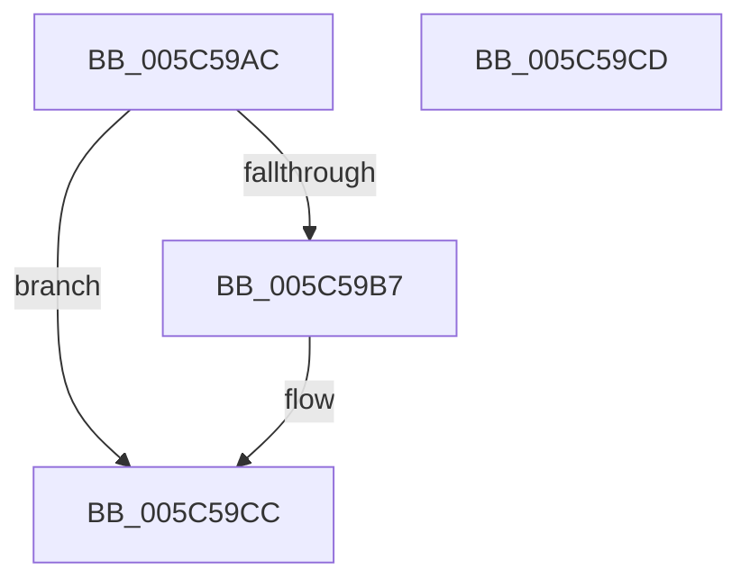

# KiIntSteerClearCpuSetAssignment

- RVA: `0x005C59AC`–`0x005C59CE` (길이 `34` bytes)
- VA: `0x00000001405C59AC`
- 실행 섹션: `.text`
- PDB 이름 있음: `예`; PDB Function 태그: `아니요`
- unwind 정보 RVA: `0x000DB714`
- 디코드: `8`개 명령, `34/34` bytes 표시
- 미해석 바이트: `0` (있으면 어셈블리에 `.byte`로 보존)

> 이 문서는 커널 이미지의 기계어와 PDB 기호를 분석해 생성했습니다. 4번과 5번은 함수 원형과 자료형을 바이너리 사용 방식에서 추정한 C 해석이며 원본 소스 복구 결과는 아닙니다.

## 1. Dependencies

- 직접 호출 지점: **0**; 고유 호출 대상: **0**
- 직접 호출자로 확인된 함수: **3**
- RIP 상대 이미지 참조: **0**

### Outgoing calls
- 직접 디코드된 call 명령이 없습니다.

### Direct callers
- [KeIntSteerAssignCpuSet](KeIntSteerAssignCpuSet_function_005C5668.md) at `0x005C56C5`
- [KeIntSteerAssignCpuSetForGsiv](KeIntSteerAssignCpuSetForGsiv_function_005C5700.md) at `0x005C575C`
- [KiIntSteerAssignCpuSet](KiIntSteerAssignCpuSet_function_005C57B0.md) at `0x005C57F8`

### Static image references
- 디코드된 RIP-relative 메모리 참조가 없습니다.

## 2. Other-region calls and transfers

- 다른 실행 섹션으로 향하는 call: **0**
- 별도 외부 분기/꼬리 이동을 확인하지 못했습니다.

## 3. Assembly (complete function range)

```asm
005C59AC  33 C0                           xor eax, eax
005C59AE  48 39 81 88 00 00 00            cmp qword ptr [rcx + 0x88], rax
005C59B5  74 15                           je 0x1405c59cc
005C59B7  66 89 81 90 00 00 00            mov word ptr [rcx + 0x90], ax
005C59BE  48 89 81 88 00 00 00            mov qword ptr [rcx + 0x88], rax
005C59C5  48 89 81 B0 00 00 00            mov qword ptr [rcx + 0xb0], rax
005C59CC  C3                              ret
005C59CD  CC                              int3
```

## 4. C-style interpretation (structured pseudocode)

```c
__int64 __fastcall KiIntSteerClearCpuSetAssignment(__int64 a1)
{
    __int64 result;

    result = 0;
    if ((*(unsigned __int64 *)(a1 + 136)) != 0) {
        *(unsigned __int16 *)(a1 + 144) = 0;
        *(unsigned __int64 *)(a1 + 136) = 0;
        *(unsigned __int64 *)(a1 + 176) = 0;
    }
    return result;
}
```

## 5. (Beta) C Style

```c
int64_t KiIntSteerClearCpuSetAssignment(void *Arg1)
{
    uint8_t *arg1 = (uint8_t *)Arg1;

    int64_t result;

    result = 0;
    if ((*(uint64_t *)(arg1 + 0x88)) != 0) {
        *(uint16_t *)(arg1 + 0x90) = 0;
        *(uint64_t *)(arg1 + 0x88) = 0;
        *(uint64_t *)(arg1 + 0xB0) = 0;
    }
    return result;
}
```

### 관측된 메모리 오프셋

구조체 형식이 확인되지 않은 접근은 인자 기준의 오프셋으로만 기록했습니다.

| 기준 인자 | 오프셋 표현 | 폭 (bit) | 접근 |
|---|---:|---:|---|
| `Arg1` | `+ 0x88` | `64` | `R` |
| `Arg1` | `+ 0x88` | `64` | `W` |
| `Arg1` | `+ 0x90` | `16` | `W` |
| `Arg1` | `+ 0xB0` | `64` | `W` |

## 6. Execution-region graph

[열기: 2D/3D 그래프와 함수 탐색 컨트롤 패널](../../../control-panel.html?section=text&rva=0x005C59AC&view=graph)

- 2D 그래프는 위에서 아래로 흐르고, 3D 그래프는 빈 공간을 드래그해 회전합니다. Shift+드래그는 이동, 휠은 확대·축소, 함수 노드 선택은 대상 보고서 이동입니다.

### Static fallback


