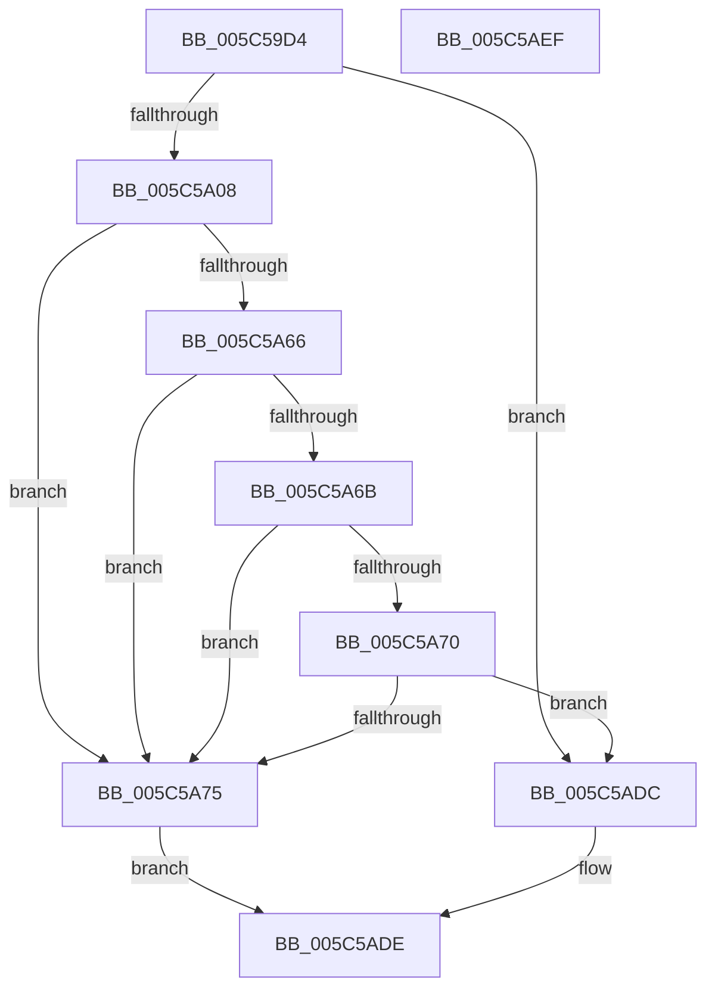

# KiIntSteerComputeRelevanceForTriageDumps

- RVA: `0x005C59D4`–`0x005C5AF0` (길이 `284` bytes)
- VA: `0x00000001405C59D4`
- 실행 섹션: `.text`
- PDB 이름 있음: `예`; PDB Function 태그: `아니요`
- unwind 정보 RVA: `0x000A4B64`
- 디코드: `76`개 명령, `284/284` bytes 표시
- 미해석 바이트: `0` (있으면 어셈블리에 `.byte`로 보존)

> 이 문서는 커널 이미지의 기계어와 PDB 기호를 분석해 생성했습니다. 4번과 5번은 함수 원형과 자료형을 바이너리 사용 방식에서 추정한 C 해석이며 원본 소스 복구 결과는 아닙니다.

## 1. Dependencies

- 직접 호출 지점: **0**; 고유 호출 대상: **0**
- 직접 호출자로 확인된 함수: **1**
- RIP 상대 이미지 참조: **2**

### Outgoing calls
- 직접 디코드된 call 명령이 없습니다.

### Direct callers
- [KiIntSteerCallbackRecordTriageCallbackInterruptObject](KiIntSteerCallbackRecordTriageCallbackInterruptObject_function_005C5910.md) at `0x005C5928`

### Static image references
- `0x005C59E7` → RVA `0x00FC8C40` (`ALMOSTRO`; read)
- `0x005C5A14` → RVA `0x00FC6AA0` (`ALMOSTRO`; read)

## 2. Other-region calls and transfers

- 다른 실행 섹션으로 향하는 call: **0**
- 별도 외부 분기/꼬리 이동을 확인하지 못했습니다.

## 3. Assembly (complete function range)

```asm
005C59D4  48 89 5C 24 10                  mov qword ptr [rsp + 0x10], rbx
005C59D9  48 89 6C 24 18                  mov qword ptr [rsp + 0x18], rbp
005C59DE  48 89 74 24 20                  mov qword ptr [rsp + 0x20], rsi
005C59E3  57                              push rdi
005C59E4  8B 41 60                        mov eax, dword ptr [rcx + 0x60]
005C59E7  4C 8D 05 52 32 A0 00            lea r8, [rip + 0xa03252]
005C59EE  4D 8B 04 C0                     mov r8, qword ptr [r8 + rax*8]
005C59F2  41 8B 90 EC 83 00 00            mov edx, dword ptr [r8 + 0x83ec]
005C59F9  2B 91 E8 00 00 00               sub edx, dword ptr [rcx + 0xe8]
005C59FF  83 FA 01                        cmp edx, 1
005C5A02  0F 87 D4 00 00 00               ja 0x1405c5adc
005C5A08  41 8B 90 A8 83 00 00            mov edx, dword ptr [r8 + 0x83a8]
005C5A0F  B8 CD CC CC CC                  mov eax, 0xcccccccd
005C5A14  0F AF 15 85 10 A0 00            imul edx, dword ptr [rip + 0xa01085]
005C5A1B  48 8B A9 F8 00 00 00            mov rbp, qword ptr [rcx + 0xf8]
005C5A22  48 8B B9 08 01 00 00            mov rdi, qword ptr [rcx + 0x108]
005C5A29  48 8B B1 F0 00 00 00            mov rsi, qword ptr [rcx + 0xf0]
005C5A30  48 8B 99 00 01 00 00            mov rbx, qword ptr [rcx + 0x100]
005C5A37  F7 E2                           mul edx
005C5A39  41 8B 40 44                     mov eax, dword ptr [r8 + 0x44]
005C5A3D  C1 EA 03                        shr edx, 3
005C5A40  44 8B CA                        mov r9d, edx
005C5A43  49 0F AF C1                     imul rax, r9
005C5A47  44 8B DA                        mov r11d, edx
005C5A4A  49 C1 EB 02                     shr r11, 2
005C5A4E  49 C1 E9 09                     shr r9, 9
005C5A52  4C 8D 14 40                     lea r10, [rax + rax*2]
005C5A56  49 C1 EA 02                     shr r10, 2
005C5A5A  49 8B C2                        mov rax, r10
005C5A5D  48 C1 E8 03                     shr rax, 3
005C5A61  49 3B E9                        cmp rbp, r9
005C5A64  73 0F                           jae 0x1405c5a75
005C5A66  48 3B F0                        cmp rsi, rax
005C5A69  73 0A                           jae 0x1405c5a75
005C5A6B  49 3B F9                        cmp rdi, r9
005C5A6E  73 05                           jae 0x1405c5a75
005C5A70  48 3B D8                        cmp rbx, rax
005C5A73  72 67                           jb 0x1405c5adc
005C5A75  49 0F BD C2                     bsr rax, r10
005C5A79  4D 8B C3                        mov r8, r11
005C5A7C  41 B9 3F 00 00 00               mov r9d, 0x3f
005C5A82  41 8B D1                        mov edx, r9d
005C5A85  2B D0                           sub edx, eax
005C5A87  49 0F BD C3                     bsr rax, r11
005C5A8B  44 2B C8                        sub r9d, eax
005C5A8E  49 8B C2                        mov rax, r10
005C5A91  49 3B FB                        cmp rdi, r11
005C5A94  41 8B C9                        mov ecx, r9d
005C5A97  4C 0F 46 C7                     cmovbe r8, rdi
005C5A9B  49 D3 E0                        shl r8, cl
005C5A9E  8B CA                           mov ecx, edx
005C5AA0  49 C1 E8 24                     shr r8, 0x24
005C5AA4  49 3B DA                        cmp rbx, r10
005C5AA7  48 0F 46 C3                     cmovbe rax, rbx
005C5AAB  48 D3 E0                        shl rax, cl
005C5AAE  48 C1 E8 24                     shr rax, 0x24
005C5AB2  41 03 C0                        add eax, r8d
005C5AB5  49 3B F2                        cmp rsi, r10
005C5AB8  4C 0F 46 D6                     cmovbe r10, rsi
005C5ABC  49 D3 E2                        shl r10, cl
005C5ABF  41 8B C9                        mov ecx, r9d
005C5AC2  49 C1 EA 22                     shr r10, 0x22
005C5AC6  41 03 C2                        add eax, r10d
005C5AC9  49 3B EB                        cmp rbp, r11
005C5ACC  4C 0F 46 DD                     cmovbe r11, rbp
005C5AD0  49 D3 E3                        shl r11, cl
005C5AD3  49 C1 EB 22                     shr r11, 0x22
005C5AD7  41 03 C3                        add eax, r11d
005C5ADA  EB 02                           jmp 0x1405c5ade
005C5ADC  33 C0                           xor eax, eax
005C5ADE  48 8B 5C 24 18                  mov rbx, qword ptr [rsp + 0x18]
005C5AE3  48 8B 6C 24 20                  mov rbp, qword ptr [rsp + 0x20]
005C5AE8  48 8B 74 24 28                  mov rsi, qword ptr [rsp + 0x28]
005C5AED  5F                              pop rdi
005C5AEE  C3                              ret
005C5AEF  CC                              int3
```

## 4. C-style interpretation (structured pseudocode)

```c
__int64 __fastcall KiIntSteerComputeRelevanceForTriageDumps(__int64 a1)
{
    __int64 result;
    __int64 v_r10;
    __int64 v_r11;
    unsigned __int64 v_stack_p10;
    unsigned __int64 v_stack_p18;
    unsigned __int64 v_stack_p20;

    v_stack_p10 = v_rbx;
    v_stack_p18 = v_rbp;
    v_stack_p20 = v_rsi;
    a2 = (unsigned int)(((unsigned int)(*(unsigned int *)(*(unsigned __int64 *)(v_rip + 10498642 + (unsigned int)(*(unsigned int *)(a1 + 96)) * 8) + 33772))) - (*(unsigned int *)(a1 + 232)));
    if (((unsigned int)(a2)) > 1) goto loc_005C5ADC;
    a2 = (unsigned int)(((unsigned int)(*(unsigned int *)(*(unsigned __int64 *)(v_rip + 10498642 + (unsigned int)(*(unsigned int *)(a1 + 96)) * 8) + 33704))) * (*(unsigned int *)(v_rip + 10489989)));
    a2 = (unsigned int)((a2) >> (3));
    result = ((unsigned int)(*(unsigned int *)(*(unsigned __int64 *)(v_rip + 10498642 + (unsigned int)(*(unsigned int *)(a1 + 96)) * 8) + 68))) * ((unsigned int)((unsigned int)(a2)));
    v_r11 = ((unsigned int)((unsigned int)(a2))) >> (2);
    a4 = ((unsigned int)((unsigned int)(a2))) >> (9);
    v_r10 = (result + result * 2) >> (2);
    result = (v_r10) >> (3);
    if ((*(unsigned __int64 *)(a1 + 248)) >= a4) goto loc_005C5A75;
    if ((*(unsigned __int64 *)(a1 + 240)) >= result) goto loc_005C5A75;
    if ((*(unsigned __int64 *)(a1 + 264)) >= a4) goto loc_005C5A75;
    if ((*(unsigned __int64 *)(a1 + 256)) < result) goto loc_005C5ADC;
loc_005C5A75:
    a2 = (unsigned int)((63) - ((unsigned int)(result)));
    a4 = (unsigned int)((63) - ((unsigned int)(result)));
    a3 = v_r11;
    if ((*(unsigned __int64 *)(a1 + 264)) <= v_r11) { a3 = *(unsigned __int64 *)(a1 + 264); }
    a3 = (a3) << ((unsigned __int8)((unsigned int)((unsigned int)(a4))));
    a3 = (a3) >> (36);
    result = v_r10;
    if ((*(unsigned __int64 *)(a1 + 256)) <= v_r10) { result = *(unsigned __int64 *)(a1 + 256); }
    result = (result) << ((unsigned __int8)((unsigned int)((unsigned int)(a2))));
    result = (result) >> (36);
    result = (unsigned int)((result) + ((unsigned int)(a3)));
    if ((*(unsigned __int64 *)(a1 + 240)) <= v_r10) { v_r10 = *(unsigned __int64 *)(a1 + 240); }
    v_r10 = (v_r10) << ((unsigned __int8)((unsigned int)((unsigned int)(a2))));
    v_r10 = (v_r10) >> (34);
    result = (unsigned int)((result) + ((unsigned int)(v_r10)));
    if ((*(unsigned __int64 *)(a1 + 248)) <= v_r11) { v_r11 = *(unsigned __int64 *)(a1 + 248); }
    v_r11 = (v_r11) << ((unsigned __int8)((unsigned int)((unsigned int)(a4))));
    v_r11 = (v_r11) >> (34);
    result = (unsigned int)((result) + ((unsigned int)(v_r11)));
    goto loc_005C5ADE;
loc_005C5ADC:
    result = 0;
loc_005C5ADE:
    return result;
}
```

## 5. (Beta) C Style

```c
int64_t KiIntSteerComputeRelevanceForTriageDumps(void *Arg1)
{
    uint8_t *arg1 = (uint8_t *)Arg1;

    int64_t result;
    int64_t local_r10;
    int64_t local_r11;
    uint64_t v_stack_p10;
    uint64_t v_stack_p18;
    uint64_t v_stack_p20;

    v_stack_p10 = local_rbx;
    v_stack_p18 = local_rbp;
    v_stack_p20 = local_rsi;
    a2 = (uint32_t)(((uint32_t)(*(uint32_t *)(*(uint64_t *)(v_rip + 0xA03252 + (uint32_t)(*(uint32_t *)(arg1 + 0x60)) * 8) + 0x83EC))) - (*(uint32_t *)(arg1 + 0xE8)));
    if (((uint32_t)(a2)) > 1) goto loc_005C5ADC;
    a2 = (uint32_t)(((uint32_t)(*(uint32_t *)(*(uint64_t *)(v_rip + 0xA03252 + (uint32_t)(*(uint32_t *)(arg1 + 0x60)) * 8) + 0x83A8))) * (*(uint32_t *)(v_rip + 0xA01085)));
    a2 = (uint32_t)((a2) >> (3));
    result = ((uint32_t)(*(uint32_t *)(*(uint64_t *)(v_rip + 0xA03252 + (uint32_t)(*(uint32_t *)(arg1 + 0x60)) * 8) + 0x44))) * ((uint32_t)((uint32_t)(a2)));
    local_r11 = ((uint32_t)((uint32_t)(a2))) >> (2);
    a4 = ((uint32_t)((uint32_t)(a2))) >> (9);
    local_r10 = (result + result * 2) >> (2);
    result = (local_r10) >> (3);
    if ((*(uint64_t *)(arg1 + 0xF8)) >= a4) goto loc_005C5A75;
    if ((*(uint64_t *)(arg1 + 0xF0)) >= result) goto loc_005C5A75;
    if ((*(uint64_t *)(arg1 + 0x108)) >= a4) goto loc_005C5A75;
    if ((*(uint64_t *)(arg1 + 0x100)) < result) goto loc_005C5ADC;
loc_005C5A75:
    a2 = (uint32_t)((63) - ((uint32_t)(result)));
    a4 = (uint32_t)((63) - ((uint32_t)(result)));
    a3 = local_r11;
    if ((*(uint64_t *)(arg1 + 0x108)) <= local_r11) { a3 = *(uint64_t *)(arg1 + 0x108); }
    a3 = (a3) << ((uint8_t)((uint32_t)((uint32_t)(a4))));
    a3 = (a3) >> (36);
    result = local_r10;
    if ((*(uint64_t *)(arg1 + 0x100)) <= local_r10) { result = *(uint64_t *)(arg1 + 0x100); }
    result = (result) << ((uint8_t)((uint32_t)((uint32_t)(a2))));
    result = (result) >> (36);
    result = (uint32_t)((result) + ((uint32_t)(a3)));
    if ((*(uint64_t *)(arg1 + 0xF0)) <= local_r10) { local_r10 = *(uint64_t *)(arg1 + 0xF0); }
    local_r10 = (local_r10) << ((uint8_t)((uint32_t)((uint32_t)(a2))));
    local_r10 = (local_r10) >> (34);
    result = (uint32_t)((result) + ((uint32_t)(local_r10)));
    if ((*(uint64_t *)(arg1 + 0xF8)) <= local_r11) { local_r11 = *(uint64_t *)(arg1 + 0xF8); }
    local_r11 = (local_r11) << ((uint8_t)((uint32_t)((uint32_t)(a4))));
    local_r11 = (local_r11) >> (34);
    result = (uint32_t)((result) + ((uint32_t)(local_r11)));
    goto loc_005C5ADE;
loc_005C5ADC:
    result = 0;
loc_005C5ADE:
    return result;
}
```

### 관측된 메모리 오프셋

구조체 형식이 확인되지 않은 접근은 인자 기준의 오프셋으로만 기록했습니다.

| 기준 인자 | 오프셋 표현 | 폭 (bit) | 접근 |
|---|---:|---:|---|
| `Arg1` | `+ 0x60` | `32` | `R` |
| `Arg1` | `+ 0xE8` | `32` | `R` |
| `Arg1` | `+ 0xF0` | `64` | `R` |
| `Arg1` | `+ 0xF8` | `64` | `R` |
| `Arg1` | `+ 0x100` | `64` | `R` |
| `Arg1` | `+ 0x108` | `64` | `R` |

## 6. Execution-region graph

[열기: 2D/3D 그래프와 함수 탐색 컨트롤 패널](../../../control-panel.html?section=text&rva=0x005C59D4&view=graph)

- 2D 그래프는 위에서 아래로 흐르고, 3D 그래프는 빈 공간을 드래그해 회전합니다. Shift+드래그는 이동, 휠은 확대·축소, 함수 노드 선택은 대상 보고서 이동입니다.

### Static fallback


