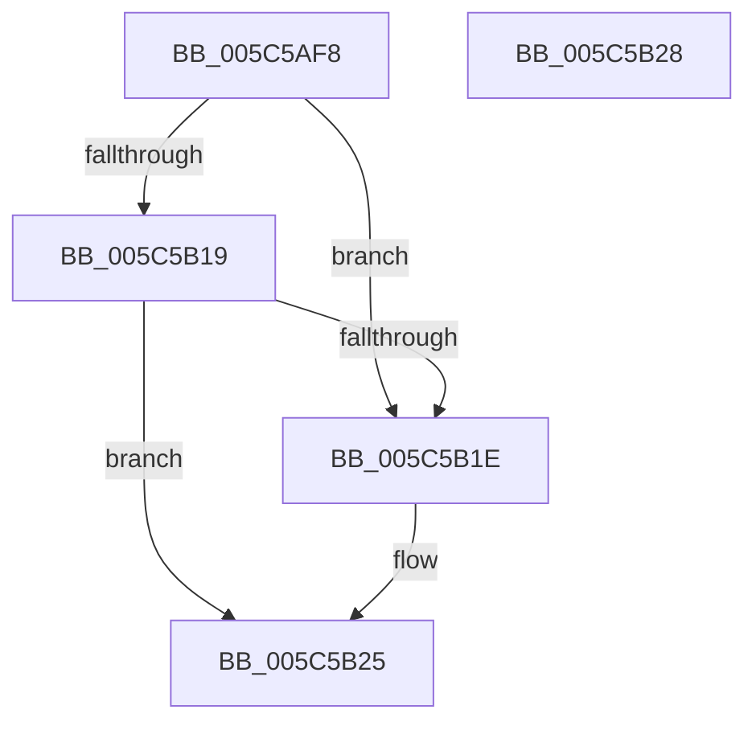

# KiIntSteerInitPrcb

- RVA: `0x005C5AF8`–`0x005C5B29` (길이 `49` bytes)
- VA: `0x00000001405C5AF8`
- 실행 섹션: `.text`
- PDB 이름 있음: `예`; PDB Function 태그: `아니요`
- unwind 정보 RVA: `0x000DB714`
- 디코드: `12`개 명령, `49/49` bytes 표시
- 미해석 바이트: `0` (있으면 어셈블리에 `.byte`로 보존)

> 이 문서는 커널 이미지의 기계어와 PDB 기호를 분석해 생성했습니다. 4번과 5번은 함수 원형과 자료형을 바이너리 사용 방식에서 추정한 C 해석이며 원본 소스 복구 결과는 아닙니다.

## 1. Dependencies

- 직접 호출 지점: **0**; 고유 호출 대상: **0**
- 직접 호출자로 확인된 함수: **1**
- RIP 상대 이미지 참조: **2**

### Outgoing calls
- 직접 디코드된 call 명령이 없습니다.

### Direct callers
- [KiInitPrcb](../../pagelk/B6/KiInitPrcb_function_00B66644.md) at `0x00B66972`

### Static image references
- `0x005C5B0D` → RVA `0x00F10BB0` (`.data`; read)
- `0x005C5B1E` → RVA `0x00F10BB0` (`.data`; write)

## 2. Other-region calls and transfers

- 다른 실행 섹션으로 향하는 call: **0**
- 별도 외부 분기/꼬리 이동을 확인하지 못했습니다.

## 3. Assembly (complete function range)

```asm
005C5AF8  83 A1 98 2D 00 00 00            and dword ptr [rcx + 0x2d98], 0
005C5AFF  8B 41 44                        mov eax, dword ptr [rcx + 0x44]
005C5B02  48 C7 81 90 2D 00 00 01 00 00 00  mov qword ptr [rcx + 0x2d90], 1
005C5B0D  48 8B 0D 9C B0 94 00            mov rcx, qword ptr [rip + 0x94b09c]
005C5B14  48 85 C9                        test rcx, rcx
005C5B17  74 05                           je 0x1405c5b1e
005C5B19  48 3B C1                        cmp rax, rcx
005C5B1C  73 07                           jae 0x1405c5b25
005C5B1E  48 89 05 8B B0 94 00            mov qword ptr [rip + 0x94b08b], rax
005C5B25  33 C0                           xor eax, eax
005C5B27  C3                              ret
005C5B28  CC                              int3
```

## 4. C-style interpretation (structured pseudocode)

```c
__int64 __fastcall KiIntSteerInitPrcb(__int64 a1)
{
    __int64 result;

    *(unsigned __int64 *)(a1 + 11664) = 1;
    if (*(unsigned __int64 *)(v_rip + 9744540) == 0) goto loc_005C5B1E;
    if (((unsigned int)(*(unsigned int *)(a1 + 68))) < (*(unsigned __int64 *)(v_rip + 9744540))) {
        *(unsigned __int64 *)(v_rip + 9744523) = (unsigned int)(*(unsigned int *)(a1 + 68));
    }
    result = 0;
    return result;
}
```

## 5. (Beta) C Style

```c
int64_t KiIntSteerInitPrcb(void *Arg1)
{
    uint8_t *arg1 = (uint8_t *)Arg1;

    int64_t result;

    *(uint64_t *)(arg1 + 0x2D90) = 1;
    if (*(uint64_t *)(v_rip + 0x94B09C) == 0) goto loc_005C5B1E;
    if (((uint32_t)(*(uint32_t *)(arg1 + 0x44))) < (*(uint64_t *)(v_rip + 0x94B09C))) {
        *(uint64_t *)(v_rip + 0x94B08B) = (uint32_t)(*(uint32_t *)(arg1 + 0x44));
    }
    result = 0;
    return result;
}
```

### 관측된 메모리 오프셋

구조체 형식이 확인되지 않은 접근은 인자 기준의 오프셋으로만 기록했습니다.

| 기준 인자 | 오프셋 표현 | 폭 (bit) | 접근 |
|---|---:|---:|---|
| `Arg1` | `+ 0x44` | `32` | `R` |
| `Arg1` | `+ 0x2D90` | `64` | `W` |
| `Arg1` | `+ 0x2D98` | `32` | `R/W` |

## 6. Execution-region graph

[열기: 2D/3D 그래프와 함수 탐색 컨트롤 패널](../../../control-panel.html?section=text&rva=0x005C5AF8&view=graph)

- 2D 그래프는 위에서 아래로 흐르고, 3D 그래프는 빈 공간을 드래그해 회전합니다. Shift+드래그는 이동, 휠은 확대·축소, 함수 노드 선택은 대상 보고서 이동입니다.

### Static fallback


