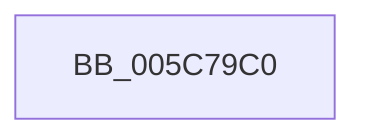

# KiInvokeDeferredDpcWatchdogViolation

- RVA: `0x005C79C0`–`0x005C79EB` (길이 `43` bytes)
- VA: `0x00000001405C79C0`
- 실행 섹션: `.text`
- PDB 이름 있음: `예`; PDB Function 태그: `아니요`
- unwind 정보 RVA: `0x000622F0`
- 디코드: `9`개 명령, `43/43` bytes 표시
- 미해석 바이트: `0` (있으면 어셈블리에 `.byte`로 보존)

> 이 문서는 커널 이미지의 기계어와 PDB 기호를 분석해 생성했습니다. 4번과 5번은 함수 원형과 자료형을 바이너리 사용 방식에서 추정한 C 해석이며 원본 소스 복구 결과는 아닙니다.

## 1. Dependencies

- 직접 호출 지점: **1**; 고유 호출 대상: **1**
- 직접 호출자로 확인된 함수: **1**
- RIP 상대 이미지 참조: **3**

### Outgoing calls
- `0x005C79E5` → [KeBugCheckEx](../4F/KeBugCheckEx_function_004FD660.md) (function, `0x004FD660`)

### Direct callers
- [KxDeferredDpcWatchdogViolation](../6B/KxDeferredDpcWatchdogViolation_function_006B2120.md) at `0x006B2124`

### Static image references
- `0x005C79C4` → RVA `0x00F1085C` (`.data`; read)
- `0x005C79CB` → RVA `0x00FC53C8` (`ALMOSTRO`; read)
- `0x005C79D2` → RVA `0x00F10858` (`.data`; read)

## 2. Other-region calls and transfers

- 다른 실행 섹션으로 향하는 call: **0**
- 별도 외부 분기/꼬리 이동을 확인하지 못했습니다.

## 3. Assembly (complete function range)

```asm
005C79C0  48 83 EC 38                     sub rsp, 0x38
005C79C4  44 8B 0D 91 8E 94 00            mov r9d, dword ptr [rip + 0x948e91]
005C79CB  48 8D 05 F6 D9 9F 00            lea rax, [rip + 0x9fd9f6]
005C79D2  44 8B 05 7F 8E 94 00            mov r8d, dword ptr [rip + 0x948e7f]
005C79D9  33 D2                           xor edx, edx
005C79DB  B9 33 01 00 00                  mov ecx, 0x133
005C79E0  48 89 44 24 20                  mov qword ptr [rsp + 0x20], rax
005C79E5  E8 76 5C F3 FF                  call 0x1404fd660
005C79EA  CC                              int3
```

## 4. C-style interpretation (structured pseudocode)

```c
__int64 __fastcall KiInvokeDeferredDpcWatchdogViolation(__int64 a1, int a2)
{
    __int64 result;
    __int64 v_rsp;
    unsigned __int64 v_stack_m18;

    v_rsp = (v_rsp) - (56);
    a2 = 0;
    v_stack_m18 = v_rip + 10476022;
    result = KeBugCheckEx(307, a2, (unsigned int)(*(unsigned int *)(v_rip + 9735807)), (unsigned int)(*(unsigned int *)(v_rip + 9735825)));
    return result;
}
```

## 5. (Beta) C Style

```c
int64_t KiInvokeDeferredDpcWatchdogViolation(int64_t Arg1, int32_t Arg2)
{
    int64_t result;
    int64_t local_rsp;
    uint64_t v_stack_m18;

    local_rsp = (local_rsp) - (56);
    Arg2 = 0;
    v_stack_m18 = v_rip + 10476022;
    result = KeBugCheckEx(307, Arg2, (uint32_t)(*(uint32_t *)(v_rip + 0x948E7F)), (uint32_t)(*(uint32_t *)(v_rip + 0x948E91)));
    return result;
}
```

## 6. Execution-region graph

[열기: 2D/3D 그래프와 함수 탐색 컨트롤 패널](../../../control-panel.html?section=text&rva=0x005C79C0&view=graph)

- 2D 그래프는 위에서 아래로 흐르고, 3D 그래프는 빈 공간을 드래그해 회전합니다. Shift+드래그는 이동, 휠은 확대·축소, 함수 노드 선택은 대상 보고서 이동입니다.

### Static fallback


