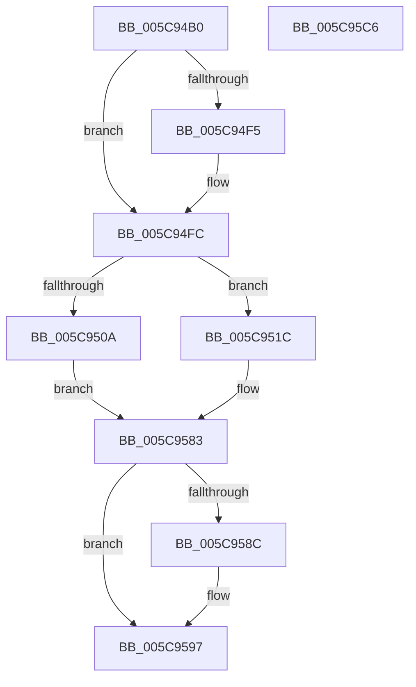

# KiIpiTargetCall

- RVA: `0x005C94B0`–`0x005C95C7` (길이 `279` bytes)
- VA: `0x00000001405C94B0`
- 실행 섹션: `.text`
- PDB 이름 있음: `예`; PDB Function 태그: `아니요`
- unwind 정보 RVA: `0x000CAC68`
- 디코드: `67`개 명령, `279/279` bytes 표시
- 미해석 바이트: `0` (있으면 어셈블리에 `.byte`로 보존)

> 이 문서는 커널 이미지의 기계어와 PDB 기호를 분석해 생성했습니다. 4번과 5번은 함수 원형과 자료형을 바이너리 사용 방식에서 추정한 C 해석이며 원본 소스 복구 결과는 아닙니다.

## 1. Dependencies

- 직접 호출 지점: **9**; 고유 호출 대상: **8**
- 직접 호출자로 확인된 함수: **0**
- RIP 상대 이미지 참조: **3**

### Outgoing calls
- `0x005C94F7` → [KiRaiseIrqlProcessIrqlFlags](../4F/KiRaiseIrqlProcessIrqlFlags_function_004F56FC.md) (function, `0x004F56FC`)
- `0x005C9510` → [guard_dispatch_icall](../6B/guard_dispatch_icall_function_006BAAD0.md) (function, `0x006BAAD0`)
- `0x005C9529` → [memset](../6C/memset_function_006C6C40.md) (function, `0x006C6C40`)
- `0x005C9548` → [memset](../6C/memset_function_006C6C40.md) (function, `0x006C6C40`)
- `0x005C9554` → [KeAddProcessorAffinityEx](../25/KeAddProcessorAffinityEx_function_0025B6F0.md) (function, `0x0025B6F0`)
- `0x005C9579` → [KiIpiSendPacket](../47/KiIpiSendPacket_function_004711DC.md) (function, `0x004711DC`)
- `0x005C957E` → [KiIpiStallOnPacketTargets](../47/KiIpiStallOnPacketTargets_function_004718D8.md) (function, `0x004718D8`)
- `0x005C9592` → [KiLowerIrqlProcessIrqlFlags](../4F/KiLowerIrqlProcessIrqlFlags_function_004F5698.md) (function, `0x004F5698`)
- `0x005C95AE` → [_security_check_cookie](../6A/_security_check_cookie_function_006AC640.md) (function, `0x006AC640`)

### Direct callers
- 이 함수 시작 RVA로 연결되는 직접 call은 확인되지 않았습니다. 간접 호출은 완전히 역산할 수 없습니다.

### Static image references
- `0x005C94BF` → RVA `0x00E0A740` (`.data`; read)
- `0x005C94EC` → RVA `0x00FC6D20` (`ALMOSTRO`; read)
- `0x005C9566` → RVA `0x005C95D0` (`KiIpiTargetCallIpi`; read)

## 2. Other-region calls and transfers

- 다른 실행 섹션으로 향하는 call: **0**
- 별도 외부 분기/꼬리 이동을 확인하지 못했습니다.

## 3. Assembly (complete function range)

```asm
005C94B0  48 89 5C 24 20                  mov qword ptr [rsp + 0x20], rbx
005C94B5  55                              push rbp
005C94B6  56                              push rsi
005C94B7  57                              push rdi
005C94B8  48 81 EC 60 01 00 00            sub rsp, 0x160
005C94BF  48 8B 05 7A 12 84 00            mov rax, qword ptr [rip + 0x84127a]
005C94C6  48 33 C4                        xor rax, rsp
005C94C9  48 89 84 24 50 01 00 00         mov qword ptr [rsp + 0x150], rax
005C94D1  48 83 64 24 30 00               and qword ptr [rsp + 0x30], 0
005C94D7  49 8B E8                        mov rbp, r8
005C94DA  48 8B F2                        mov rsi, rdx
005C94DD  8B F9                           mov edi, ecx
005C94DF  44 0F 20 C3                     mov rbx, cr8
005C94E3  BA 0C 00 00 00                  mov edx, 0xc
005C94E8  44 0F 22 C2                     mov cr8, rdx
005C94EC  83 3D 2D D8 9F 00 00            cmp dword ptr [rip + 0x9fd82d], 0
005C94F3  74 07                           je 0x1405c94fc
005C94F5  8A CB                           mov cl, bl
005C94F7  E8 00 C2 F2 FF                  call 0x1404f56fc
005C94FC  65 48 8B 04 25 20 00 00 00      mov rax, qword ptr gs:[0x20]
005C9505  39 78 24                        cmp dword ptr [rax + 0x24], edi
005C9508  75 12                           jne 0x1405c951c
005C950A  48 8B CD                        mov rcx, rbp
005C950D  48 8B C6                        mov rax, rsi
005C9510  E8 BB 15 0F 00                  call 0x1406baad0
005C9515  48 89 44 24 30                  mov qword ptr [rsp + 0x30], rax
005C951A  EB 67                           jmp 0x1405c9583
005C951C  33 D2                           xor edx, edx
005C951E  48 8D 4C 24 48                  lea rcx, [rsp + 0x48]
005C9523  41 B8 00 01 00 00               mov r8d, 0x100
005C9529  E8 12 D7 0F 00                  call 0x1406c6c40
005C952E  83 64 24 44 00                  and dword ptr [rsp + 0x44], 0
005C9533  48 8D 4C 24 48                  lea rcx, [rsp + 0x48]
005C9538  33 D2                           xor edx, edx
005C953A  C7 44 24 40 01 00 20 00         mov dword ptr [rsp + 0x40], 0x200001
005C9542  41 B8 00 01 00 00               mov r8d, 0x100
005C9548  E8 F3 D6 0F 00                  call 0x1406c6c40
005C954D  8B D7                           mov edx, edi
005C954F  48 8D 4C 24 40                  lea rcx, [rsp + 0x40]
005C9554  E8 97 21 C9 FF                  call 0x14025b6f0
005C9559  48 8D 44 24 30                  lea rax, [rsp + 0x30]
005C955E  4C 8B CE                        mov r9, rsi
005C9561  48 89 44 24 28                  mov qword ptr [rsp + 0x28], rax
005C9566  4C 8D 05 63 00 00 00            lea r8, [rip + 0x63]
005C956D  48 8D 54 24 40                  lea rdx, [rsp + 0x40]
005C9572  48 89 6C 24 20                  mov qword ptr [rsp + 0x20], rbp
005C9577  33 C9                           xor ecx, ecx
005C9579  E8 5E 7C EA FF                  call 0x1404711dc
005C957E  E8 55 83 EA FF                  call 0x1404718d8
005C9583  83 3D 96 D7 9F 00 00            cmp dword ptr [rip + 0x9fd796], 0
005C958A  74 0B                           je 0x1405c9597
005C958C  8A D3                           mov dl, bl
005C958E  44 0F 20 C1                     mov rcx, cr8
005C9592  E8 01 C1 F2 FF                  call 0x1404f5698
005C9597  0F B6 C3                        movzx eax, bl
005C959A  44 0F 22 C0                     mov cr8, rax
005C959E  48 8B 44 24 30                  mov rax, qword ptr [rsp + 0x30]
005C95A3  48 8B 8C 24 50 01 00 00         mov rcx, qword ptr [rsp + 0x150]
005C95AB  48 33 CC                        xor rcx, rsp
005C95AE  E8 8D 30 0E 00                  call 0x1406ac640
005C95B3  48 8B 9C 24 98 01 00 00         mov rbx, qword ptr [rsp + 0x198]
005C95BB  48 81 C4 60 01 00 00            add rsp, 0x160
005C95C2  5F                              pop rdi
005C95C3  5E                              pop rsi
005C95C4  5D                              pop rbp
005C95C5  C3                              ret
005C95C6  CC                              int3
```

## 4. C-style interpretation (structured pseudocode)

```c
__int64 __fastcall KiIpiTargetCall(int a1, __int64 a2, __int64 a3)
{
    __int64 result;
    __int64 v_rsp;
    unsigned __int64 v_stack_m130;
    unsigned int v_stack_m134;
    unsigned int v_stack_m138;
    unsigned __int64 v_stack_m148;
    unsigned __int64 v_stack_m150;
    unsigned __int64 v_stack_m158;
    unsigned __int64 v_stack_m28;
    unsigned __int64 v_stack_p20;

    v_stack_p20 = v_rbx;
    v_rsp = (v_rsp) - (352);
    result = (*(unsigned __int64 *)(v_rip + 8655482)) ^ (v_rsp);
    v_stack_m28 = result;
    if ((*(unsigned int *)(v_rip + 10475565)) != 0) {
        a1 = (unsigned __int8)(v_cr8);
        result = KiRaiseIrqlProcessIrqlFlags(a1, 12, a3, a4);
    }
    if ((*(unsigned int *)(*(unsigned __int64 *)(gs_base + (0 + 32)) + 36)) != ((unsigned int)((unsigned int)(a1)))) goto loc_005C951C;
    result = guard_dispatch_icall(a3, 12, a3, a4);
    v_stack_m148 = result;
    goto loc_005C9583;
loc_005C951C:
    a2 = 0;
    result = memset(v_stack_m130, a2, 256, a4);
    a2 = 0;
    v_stack_m138 = 0x200001ULL;
    result = memset(v_stack_m130, a2, 256, a4);
    result = KeAddProcessorAffinityEx(v_stack_m138, (unsigned int)((unsigned int)((unsigned int)(a1))), 256, a4);
    v_stack_m150 = v_stack_m148;
    v_stack_m158 = a3;
    a1 = 0;
    result = KiIpiSendPacket(a1, v_stack_m138, v_rip + 99, 0);
    result = KiIpiStallOnPacketTargets(a1, v_stack_m138, v_rip + 99, 0);
loc_005C9583:
    if ((*(unsigned int *)(v_rip + 10475414)) != 0) {
        a2 = (unsigned __int8)(v_cr8);
        a1 = 12;
        result = KiLowerIrqlProcessIrqlFlags(a1, a2, v_rip + 99, 0);
    }
    a1 = (v_stack_m28) ^ (v_rsp);
    result = _security_check_cookie(a1, a2, v_rip + 99, 0);
    v_rsp = (v_rsp) + (352);
    return result;
}
```

## 5. (Beta) C Style

```c
int64_t KiIpiTargetCall(int32_t Arg1, int64_t Arg2, int64_t Arg3)
{
    int64_t result;
    int64_t local_rsp;
    uint64_t v_stack_m130;
    uint32_t v_stack_m134;
    uint32_t v_stack_m138;
    uint64_t v_stack_m148;
    uint64_t v_stack_m150;
    uint64_t v_stack_m158;
    uint64_t v_stack_m28;
    uint64_t v_stack_p20;

    v_stack_p20 = local_rbx;
    local_rsp = (local_rsp) - (352);
    result = (*(uint64_t *)(v_rip + 0x84127A)) ^ (local_rsp);
    v_stack_m28 = result;
    if ((*(uint32_t *)(v_rip + 0x9FD82D)) != 0) {
        Arg1 = (uint8_t)(v_cr8);
        result = KiRaiseIrqlProcessIrqlFlags(Arg1, 12, Arg3, a4);
    }
    if ((*(uint32_t *)(*(uint64_t *)(gs_base + (0 + 0x20)) + 0x24)) != ((uint32_t)((uint32_t)(Arg1)))) goto loc_005C951C;
    result = guard_dispatch_icall(Arg3, 12, Arg3, a4);
    v_stack_m148 = result;
    goto loc_005C9583;
loc_005C951C:
    Arg2 = 0;
    result = memset(v_stack_m130, Arg2, 256, a4);
    Arg2 = 0;
    v_stack_m138 = 0x200001ULL;
    result = memset(v_stack_m130, Arg2, 256, a4);
    result = KeAddProcessorAffinityEx(v_stack_m138, (uint32_t)((uint32_t)((uint32_t)(Arg1))), 256, a4);
    v_stack_m150 = v_stack_m148;
    v_stack_m158 = Arg3;
    Arg1 = 0;
    result = KiIpiSendPacket(Arg1, v_stack_m138, v_rip + 99, 0);
    result = KiIpiStallOnPacketTargets(Arg1, v_stack_m138, v_rip + 99, 0);
loc_005C9583:
    if ((*(uint32_t *)(v_rip + 0x9FD796)) != 0) {
        Arg2 = (uint8_t)(v_cr8);
        Arg1 = 12;
        result = KiLowerIrqlProcessIrqlFlags(Arg1, Arg2, v_rip + 99, 0);
    }
    Arg1 = (v_stack_m28) ^ (local_rsp);
    result = _security_check_cookie(Arg1, Arg2, v_rip + 99, 0);
    local_rsp = (local_rsp) + (352);
    return result;
}
```

## 6. Execution-region graph

[열기: 2D/3D 그래프와 함수 탐색 컨트롤 패널](../../../control-panel.html?section=text&rva=0x005C94B0&view=graph)

- 2D 그래프는 위에서 아래로 흐르고, 3D 그래프는 빈 공간을 드래그해 회전합니다. Shift+드래그는 이동, 휠은 확대·축소, 함수 노드 선택은 대상 보고서 이동입니다.

### Static fallback


