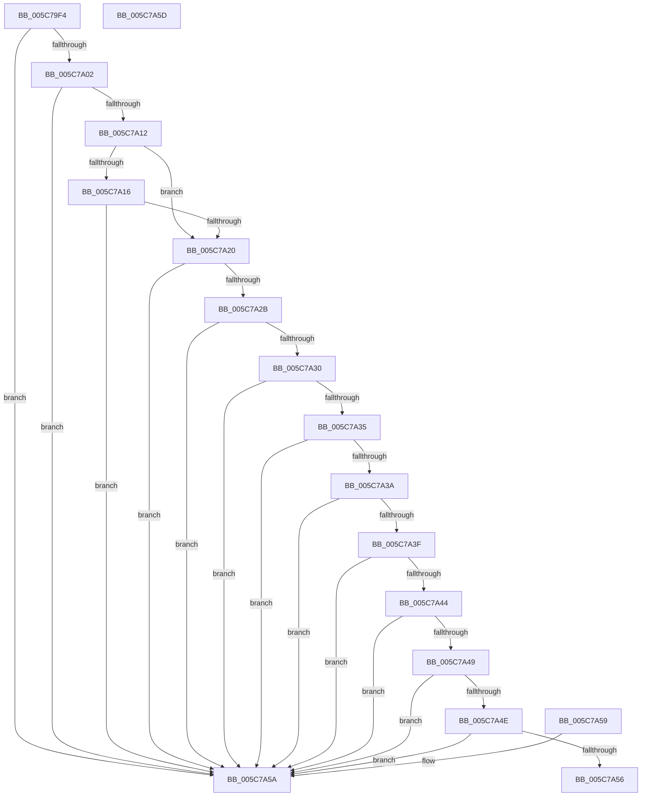

# KiIsRecoveryPossibleOnCurrentStack

- RVA: `0x005C79F4`–`0x005C7A5E` (길이 `106` bytes)
- VA: `0x00000001405C79F4`
- 실행 섹션: `.text`
- PDB 이름 있음: `예`; PDB Function 태그: `아니요`
- unwind 정보 RVA: `0x000DB714`
- 디코드: `37`개 명령, `106/106` bytes 표시
- 미해석 바이트: `0` (있으면 어셈블리에 `.byte`로 보존)

> 이 문서는 커널 이미지의 기계어와 PDB 기호를 분석해 생성했습니다. 4번과 5번은 함수 원형과 자료형을 바이너리 사용 방식에서 추정한 C 해석이며 원본 소스 복구 결과는 아닙니다.

## 1. Dependencies

- 직접 호출 지점: **0**; 고유 호출 대상: **0**
- 직접 호출자로 확인된 함수: **1**
- RIP 상대 이미지 참조: **1**

### Outgoing calls
- 직접 디코드된 call 명령이 없습니다.

### Direct callers
- [KiAttemptBugcheckRecovery](KiAttemptBugcheckRecovery_function_005C6D24.md) at `0x005C6D75`

### Static image references
- `0x005C7A20` → RVA `0x00F47580` (`.data`; read)

## 2. Other-region calls and transfers

- 다른 실행 섹션으로 향하는 call: **0**
- 별도 외부 분기/꼬리 이동을 확인하지 못했습니다.

## 3. Assembly (complete function range)

```asm
005C79F4  65 66 8B 04 25 26 85 00 00      mov ax, word ptr gs:[0x8526]
005C79FD  66 85 C0                        test ax, ax
005C7A00  75 58                           jne 0x1405c7a5a
005C7A02  65 48 8B 0C 25 20 00 00 00      mov rcx, qword ptr gs:[0x20]
005C7A0B  8A 41 20                        mov al, byte ptr [rcx + 0x20]
005C7A0E  3C 02                           cmp al, 2
005C7A10  73 48                           jae 0x1405c7a5a
005C7A12  3C 01                           cmp al, 1
005C7A14  75 0A                           jne 0x1405c7a20
005C7A16  8A 81 BA 38 00 00               mov al, byte ptr [rcx + 0x38ba]
005C7A1C  84 C0                           test al, al
005C7A1E  74 3A                           je 0x1405c7a5a
005C7A20  8B 0D 5A FB 97 00               mov ecx, dword ptr [rip + 0x97fb5a]
005C7A26  83 E9 7F                        sub ecx, 0x7f
005C7A29  74 2F                           je 0x1405c7a5a
005C7A2B  83 E9 63                        sub ecx, 0x63
005C7A2E  74 2A                           je 0x1405c7a5a
005C7A30  83 E9 19                        sub ecx, 0x19
005C7A33  74 25                           je 0x1405c7a5a
005C7A35  83 E9 0E                        sub ecx, 0xe
005C7A38  74 20                           je 0x1405c7a5a
005C7A3A  83 E9 08                        sub ecx, 8
005C7A3D  74 1B                           je 0x1405c7a5a
005C7A3F  83 E9 28                        sub ecx, 0x28
005C7A42  74 16                           je 0x1405c7a5a
005C7A44  83 E9 52                        sub ecx, 0x52
005C7A47  74 11                           je 0x1405c7a5a
005C7A49  83 E9 3D                        sub ecx, 0x3d
005C7A4C  74 0C                           je 0x1405c7a5a
005C7A4E  81 F9 39 FE 01 00               cmp ecx, 0x1fe39
005C7A54  74 04                           je 0x1405c7a5a
005C7A56  B0 01                           mov al, 1
005C7A58  C3                              ret
005C7A59  CC                              int3
005C7A5A  32 C0                           xor al, al
005C7A5C  C3                              ret
005C7A5D  CC                              int3
```

## 4. C-style interpretation (structured pseudocode)

```c
__int64 __fastcall KiIsRecoveryPossibleOnCurrentStack(void)
{
    __int64 result;

    if ((unsigned __int16)(*(unsigned __int16 *)(gs_base + (0 + 34086))) != 0) goto loc_005C7A5A;
    if (((unsigned __int8)(*(unsigned __int8 *)(*(unsigned __int64 *)(gs_base + (0 + 32)) + 32))) >= 2) goto loc_005C7A5A;
    if (((unsigned __int8)(*(unsigned __int8 *)(*(unsigned __int64 *)(gs_base + (0 + 32)) + 32))) != 1) goto loc_005C7A20;
    if ((unsigned __int8)(*(unsigned __int8 *)(*(unsigned __int64 *)(gs_base + (0 + 32)) + 14522)) == 0) goto loc_005C7A5A;
loc_005C7A20:
    a1 = (unsigned int)(((unsigned int)(*(unsigned int *)(v_rip + 9960282))) - (127));
    if (condition_is_equal) goto loc_005C7A5A;
    a1 = (unsigned int)((a1) - (99));
    if (condition_is_equal) goto loc_005C7A5A;
    a1 = (unsigned int)((a1) - (25));
    if (condition_is_equal) goto loc_005C7A5A;
    a1 = (unsigned int)((a1) - (14));
    if (condition_is_equal) goto loc_005C7A5A;
    a1 = (unsigned int)((a1) - (8));
    if (condition_is_equal) goto loc_005C7A5A;
    a1 = (unsigned int)((a1) - (40));
    if (condition_is_equal) goto loc_005C7A5A;
    a1 = (unsigned int)((a1) - (82));
    if (condition_is_equal) goto loc_005C7A5A;
    a1 = (unsigned int)((a1) - (61));
    if (condition_is_equal) goto loc_005C7A5A;
    if (((unsigned int)(a1)) == 0x1FE39ULL) goto loc_005C7A5A;
    return 1;
loc_005C7A5A:
    result = 0;
    return result;
}
```

## 5. (Beta) C Style

```c
void KiIsRecoveryPossibleOnCurrentStack(void)
{
    int64_t result;

    if ((uint16_t)(*(uint16_t *)(gs_base + (0 + 0x8526))) != 0) goto loc_005C7A5A;
    if (((uint8_t)(*(uint8_t *)(*(uint64_t *)(gs_base + (0 + 0x20)) + 0x20))) >= 2) goto loc_005C7A5A;
    if (((uint8_t)(*(uint8_t *)(*(uint64_t *)(gs_base + (0 + 0x20)) + 0x20))) != 1) goto loc_005C7A20;
    if ((uint8_t)(*(uint8_t *)(*(uint64_t *)(gs_base + (0 + 0x20)) + 0x38BA)) == 0) goto loc_005C7A5A;
loc_005C7A20:
    a1 = (uint32_t)(((uint32_t)(*(uint32_t *)(v_rip + 0x97FB5A))) - (127));
    if (condition_is_equal) goto loc_005C7A5A;
    a1 = (uint32_t)((a1) - (99));
    if (condition_is_equal) goto loc_005C7A5A;
    a1 = (uint32_t)((a1) - (25));
    if (condition_is_equal) goto loc_005C7A5A;
    a1 = (uint32_t)((a1) - (14));
    if (condition_is_equal) goto loc_005C7A5A;
    a1 = (uint32_t)((a1) - (8));
    if (condition_is_equal) goto loc_005C7A5A;
    a1 = (uint32_t)((a1) - (40));
    if (condition_is_equal) goto loc_005C7A5A;
    a1 = (uint32_t)((a1) - (82));
    if (condition_is_equal) goto loc_005C7A5A;
    a1 = (uint32_t)((a1) - (61));
    if (condition_is_equal) goto loc_005C7A5A;
    if (((uint32_t)(a1)) == 0x1FE39ULL) goto loc_005C7A5A;
    return 1;
loc_005C7A5A:
    result = 0;
    return result;
}
```

## 6. Execution-region graph

[열기: 2D/3D 그래프와 함수 탐색 컨트롤 패널](../../../control-panel.html?section=text&rva=0x005C79F4&view=graph)

- 2D 그래프는 위에서 아래로 흐르고, 3D 그래프는 빈 공간을 드래그해 회전합니다. Shift+드래그는 이동, 휠은 확대·축소, 함수 노드 선택은 대상 보고서 이동입니다.

### Static fallback


