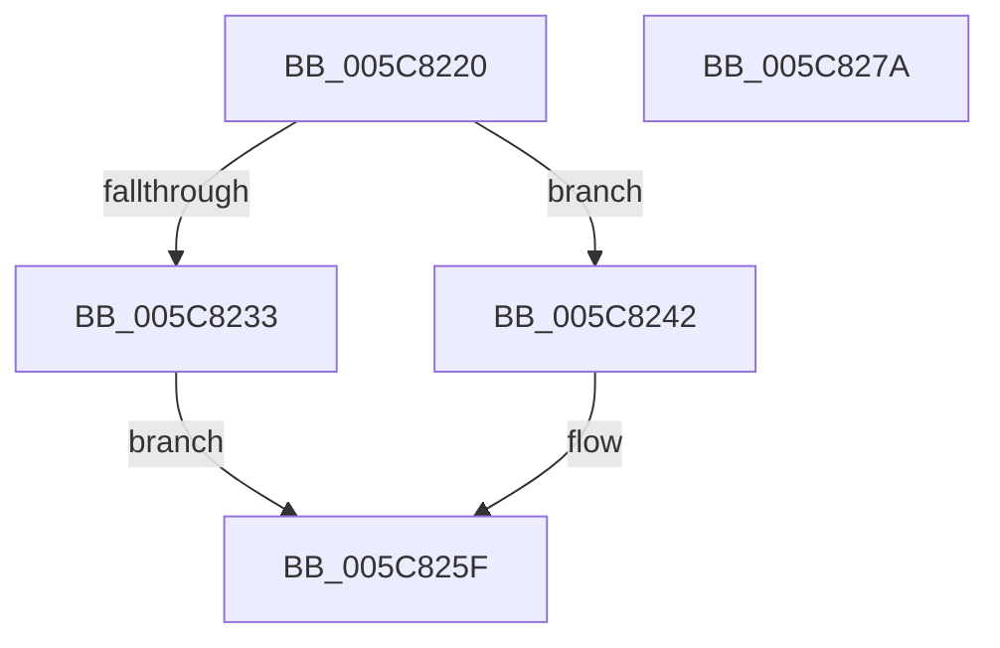

# KiKernelShadowStackAssistMceAlternateReturn

- RVA: `0x005C8220`–`0x005C827B` (길이 `91` bytes)
- VA: `0x00000001405C8220`
- 실행 섹션: `.text`
- PDB 이름 있음: `예`; PDB Function 태그: `아니요`
- unwind 정보 RVA: `0x0005D2F4`
- 디코드: `21`개 명령, `91/91` bytes 표시
- 미해석 바이트: `0` (있으면 어셈블리에 `.byte`로 보존)

> 이 문서는 커널 이미지의 기계어와 PDB 기호를 분석해 생성했습니다. 4번과 5번은 함수 원형과 자료형을 바이너리 사용 방식에서 추정한 C 해석이며 원본 소스 복구 결과는 아닙니다.

## 1. Dependencies

- 직접 호출 지점: **1**; 고유 호출 대상: **1**
- 직접 호출자로 확인된 함수: **1**
- RIP 상대 이미지 참조: **0**

### Outgoing calls
- `0x005C8270` → [VslKernelShadowStackAssist](../3D/VslKernelShadowStackAssist_function_003D5BA0.md) (function, `0x003D5BA0`)

### Direct callers
- [KiMcheckAbort](../6C/KiMcheckAbort_function_006C16C0.md) at `0x006C1AAE`

### Static image references
- 디코드된 RIP-relative 메모리 참조가 없습니다.

## 2. Other-region calls and transfers

- 다른 실행 섹션으로 향하는 call: **0**
- 별도 외부 분기/꼬리 이동을 확인하지 못했습니다.

## 3. Assembly (complete function range)

```asm
005C8220  48 83 EC 38                     sub rsp, 0x38
005C8224  F6 81 70 01 00 00 01            test byte ptr [rcx + 0x170], 1
005C822B  41 B8 04 00 00 00               mov r8d, 4
005C8231  75 0F                           jne 0x1405c8242
005C8233  48 8B 91 D8 00 00 00            mov rdx, qword ptr [rcx + 0xd8]
005C823A  45 8B D0                        mov r10d, r8d
005C823D  4C 8B 0A                        mov r9, qword ptr [rdx]
005C8240  EB 1D                           jmp 0x1405c825f
005C8242  65 48 8B 04 25 20 00 00 00      mov rax, qword ptr gs:[0x20]
005C824B  41 BA 05 00 00 00               mov r10d, 5
005C8251  45 33 C9                        xor r9d, r9d
005C8254  48 8B 90 B0 9B 00 00            mov rdx, qword ptr [rax + 0x9bb0]
005C825B  48 8B 52 10                     mov rdx, qword ptr [rdx + 0x10]
005C825F  44 89 44 24 28                  mov dword ptr [rsp + 0x28], r8d
005C8264  41 8B CA                        mov ecx, r10d
005C8267  48 83 64 24 20 00               and qword ptr [rsp + 0x20], 0
005C826D  45 33 C0                        xor r8d, r8d
005C8270  E8 2B D9 E0 FF                  call 0x1403d5ba0
005C8275  48 83 C4 38                     add rsp, 0x38
005C8279  C3                              ret
005C827A  CC                              int3
```

## 4. C-style interpretation (structured pseudocode)

```c
__int64 __fastcall KiKernelShadowStackAssistMceAlternateReturn(__int64 a1)
{
    __int64 result;
    __int64 v_rsp;
    unsigned int v_stack_m10;
    unsigned __int64 v_stack_m18;

    v_rsp = (v_rsp) - (56);
    if (((*(unsigned __int8 *)(a1 + 368)) & (1)) != 0) goto loc_005C8242;
    goto loc_005C825F;
loc_005C8242:
    a4 = 0;
loc_005C825F:
    v_stack_m10 = 4;
    a3 = 0;
    result = VslKernelShadowStackAssist(5, *(unsigned __int64 *)(*(unsigned __int64 *)(*(unsigned __int64 *)(gs_base + (0 + 32)) + 39856) + 16), a3, a4);
    v_rsp = (v_rsp) + (56);
    return result;
}
```

## 5. (Beta) C Style

```c
int64_t KiKernelShadowStackAssistMceAlternateReturn(void *Arg1)
{
    uint8_t *arg1 = (uint8_t *)Arg1;

    int64_t result;
    int64_t local_rsp;
    uint32_t v_stack_m10;
    uint64_t v_stack_m18;

    local_rsp = (local_rsp) - (56);
    if (((*(uint8_t *)(arg1 + 0x170)) & (1)) != 0) goto loc_005C8242;
    goto loc_005C825F;
loc_005C8242:
    a4 = 0;
loc_005C825F:
    v_stack_m10 = 4;
    a3 = 0;
    result = VslKernelShadowStackAssist(5, *(uint64_t *)(*(uint64_t *)(*(uint64_t *)(gs_base + (0 + 0x20)) + 0x9BB0) + 0x10), a3, a4);
    local_rsp = (local_rsp) + (56);
    return result;
}
```

### 관측된 메모리 오프셋

구조체 형식이 확인되지 않은 접근은 인자 기준의 오프셋으로만 기록했습니다.

| 기준 인자 | 오프셋 표현 | 폭 (bit) | 접근 |
|---|---:|---:|---|
| `Arg1` | `+ 0xD8` | `64` | `R` |
| `Arg1` | `+ 0x170` | `8` | `R` |

## 6. Execution-region graph

[열기: 2D/3D 그래프와 함수 탐색 컨트롤 패널](../../../control-panel.html?section=text&rva=0x005C8220&view=graph)

- 2D 그래프는 위에서 아래로 흐르고, 3D 그래프는 빈 공간을 드래그해 회전합니다. Shift+드래그는 이동, 휠은 확대·축소, 함수 노드 선택은 대상 보고서 이동입니다.

### Static fallback


