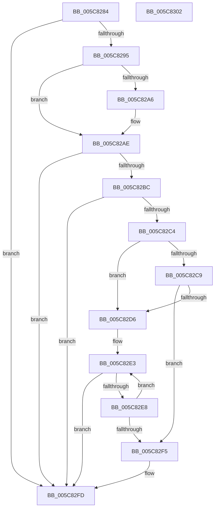

# KiLogControlProtectionKernelModeReturnMismatch

- RVA: `0x005C8284`–`0x005C8303` (길이 `127` bytes)
- VA: `0x00000001405C8284`
- 실행 섹션: `.text`
- PDB 이름 있음: `예`; PDB Function 태그: `아니요`
- unwind 정보 RVA: `0x0005C788`
- 디코드: `33`개 명령, `127/127` bytes 표시
- 미해석 바이트: `0` (있으면 어셈블리에 `.byte`로 보존)

> 이 문서는 커널 이미지의 기계어와 PDB 기호를 분석해 생성했습니다. 4번과 5번은 함수 원형과 자료형을 바이너리 사용 방식에서 추정한 C 해석이며 원본 소스 복구 결과는 아닙니다.

## 1. Dependencies

- 직접 호출 지점: **1**; 고유 호출 대상: **1**
- 직접 호출자로 확인된 함수: **1**
- RIP 상대 이미지 참조: **6**

### Outgoing calls
- `0x005C82F8` → [EtwTimLogControlProtectionKernelModeReturnMismatch](../65/EtwTimLogControlProtectionKernelModeReturnMismatch_function_00651E84.md) (function, `0x00651E84`)

### Direct callers
- [KiProcessControlProtectionFromKernelMode](../44/KiProcessControlProtectionFromKernelMode_function_00444B2C.md) at `0x00444C8F`

### Static image references
- `0x005C828D` → RVA `0x00FC80A0` (`ALMOSTRO`; read)
- `0x005C8299` → RVA `0x00FC80AC` (`ALMOSTRO`; read/write)
- `0x005C82A6` → RVA `0x00FC80B4` (`ALMOSTRO`; read/write)
- `0x005C82CB` → RVA `0x00FC80B0` (`ALMOSTRO`; read)
- `0x005C82D6` → RVA `0x00FC80A4` (`ALMOSTRO`; read)
- `0x005C82DC` → RVA `0x00FC80A8` (`ALMOSTRO`; read)

## 2. Other-region calls and transfers

- 다른 실행 섹션으로 향하는 call: **0**
- 별도 외부 분기/꼬리 이동을 확인하지 못했습니다.

## 3. Assembly (complete function range)

```asm
005C8284  48 83 EC 28                     sub rsp, 0x28
005C8288  44 8B C9                        mov r9d, ecx
005C828B  33 C9                           xor ecx, ecx
005C828D  38 0D 0D FE 9F 00               cmp byte ptr [rip + 0x9ffe0d], cl
005C8293  74 68                           je 0x1405c82fd
005C8295  44 8D 41 01                     lea r8d, [rcx + 1]
005C8299  F0 44 01 05 0B FE 9F 00         lock add dword ptr [rip + 0x9ffe0b], r8d
005C82A1  39 4A 1C                        cmp dword ptr [rdx + 0x1c], ecx
005C82A4  74 08                           je 0x1405c82ae
005C82A6  F0 44 01 05 06 FE 9F 00         lock add dword ptr [rip + 0x9ffe06], r8d
005C82AE  65 66 8B 04 25 26 85 00 00      mov ax, word ptr gs:[0x8526]
005C82B7  66 85 C0                        test ax, ax
005C82BA  75 41                           jne 0x1405c82fd
005C82BC  44 0F 20 C0                     mov rax, cr8
005C82C0  3C 0F                           cmp al, 0xf
005C82C2  73 39                           jae 0x1405c82fd
005C82C4  39 4A 1C                        cmp dword ptr [rdx + 0x1c], ecx
005C82C7  74 0D                           je 0x1405c82d6
005C82C9  33 C0                           xor eax, eax
005C82CB  F0 44 0F B1 05 DC FD 9F 00      lock cmpxchg dword ptr [rip + 0x9ffddc], r8d
005C82D4  74 1F                           je 0x1405c82f5
005C82D6  8B 05 C8 FD 9F 00               mov eax, dword ptr [rip + 0x9ffdc8]
005C82DC  44 8B 05 C5 FD 9F 00            mov r8d, dword ptr [rip + 0x9ffdc5]
005C82E3  41 3B C0                        cmp eax, r8d
005C82E6  7D 15                           jge 0x1405c82fd
005C82E8  8D 48 01                        lea ecx, [rax + 1]
005C82EB  F0 0F B1 0D B1 FD 9F 00         lock cmpxchg dword ptr [rip + 0x9ffdb1], ecx
005C82F3  75 EE                           jne 0x1405c82e3
005C82F5  41 8B C9                        mov ecx, r9d
005C82F8  E8 87 9B 08 00                  call 0x140651e84
005C82FD  48 83 C4 28                     add rsp, 0x28
005C8301  C3                              ret
005C8302  CC                              int3
```

## 4. C-style interpretation (structured pseudocode)

```c
__int64 __fastcall KiLogControlProtectionKernelModeReturnMismatch(int a1, __int64 a2)
{
    __int64 result;
    __int64 v_rsp;

    v_rsp = (v_rsp) - (40);
    a1 = 0;
    if ((*(unsigned __int8 *)(v_rip + 10485261)) == 0) goto loc_005C82FD;
    if ((*(unsigned int *)(a2 + 28)) != 0) {
    }
    if ((unsigned __int16)(*(unsigned __int16 *)(gs_base + (0 + 34086))) != 0) goto loc_005C82FD;
    if (((unsigned __int8)(v_cr8)) >= 15) goto loc_005C82FD;
    if ((*(unsigned int *)(a2 + 28)) == 0) goto loc_005C82D6;
    result = 0;
    if (condition_is_equal) goto loc_005C82F5;
loc_005C82D6:
loc_005C82E3:
    if (((unsigned int)((unsigned int)(*(unsigned int *)(v_rip + 10485192)))) >= ((unsigned int)((unsigned int)(*(unsigned int *)(v_rip + 10485189))))) goto loc_005C82FD;
    if (((unsigned int)((unsigned int)(*(unsigned int *)(v_rip + 10485192)))) != ((unsigned int)((unsigned int)(*(unsigned int *)(v_rip + 10485189))))) goto loc_005C82E3;
loc_005C82F5:
    result = EtwTimLogControlProtectionKernelModeReturnMismatch((unsigned int)((unsigned int)((unsigned int)(a1))), a2, (unsigned int)(*(unsigned int *)(v_rip + 10485189)), (unsigned int)(a1));
loc_005C82FD:
    v_rsp = (v_rsp) + (40);
    return result;
}
```

## 5. (Beta) C Style

```c
int64_t KiLogControlProtectionKernelModeReturnMismatch(int32_t Arg1, void *Arg2)
{
    uint8_t *arg2 = (uint8_t *)Arg2;

    int64_t result;
    int64_t local_rsp;

    local_rsp = (local_rsp) - (40);
    Arg1 = 0;
    if ((*(uint8_t *)(v_rip + 0x9FFE0D)) == 0) goto loc_005C82FD;
    if ((*(uint32_t *)(arg2 + 0x1C)) != 0) {
    }
    if ((uint16_t)(*(uint16_t *)(gs_base + (0 + 0x8526))) != 0) goto loc_005C82FD;
    if (((uint8_t)(v_cr8)) >= 15) goto loc_005C82FD;
    if ((*(uint32_t *)(arg2 + 0x1C)) == 0) goto loc_005C82D6;
    result = 0;
    if (condition_is_equal) goto loc_005C82F5;
loc_005C82D6:
loc_005C82E3:
    if (((uint32_t)((uint32_t)(*(uint32_t *)(v_rip + 0x9FFDC8)))) >= ((uint32_t)((uint32_t)(*(uint32_t *)(v_rip + 0x9FFDC5))))) goto loc_005C82FD;
    if (((uint32_t)((uint32_t)(*(uint32_t *)(v_rip + 0x9FFDC8)))) != ((uint32_t)((uint32_t)(*(uint32_t *)(v_rip + 0x9FFDC5))))) goto loc_005C82E3;
loc_005C82F5:
    result = EtwTimLogControlProtectionKernelModeReturnMismatch((uint32_t)((uint32_t)((uint32_t)(Arg1))), Arg2, (uint32_t)(*(uint32_t *)(v_rip + 0x9FFDC5)), (uint32_t)(Arg1));
loc_005C82FD:
    local_rsp = (local_rsp) + (40);
    return result;
}
```

### 관측된 메모리 오프셋

구조체 형식이 확인되지 않은 접근은 인자 기준의 오프셋으로만 기록했습니다.

| 기준 인자 | 오프셋 표현 | 폭 (bit) | 접근 |
|---|---:|---:|---|
| `Arg2` | `+ 0x1C` | `32` | `R` |

## 6. Execution-region graph

[열기: 2D/3D 그래프와 함수 탐색 컨트롤 패널](../../../control-panel.html?section=text&rva=0x005C8284&view=graph)

- 2D 그래프는 위에서 아래로 흐르고, 3D 그래프는 빈 공간을 드래그해 회전합니다. Shift+드래그는 이동, 휠은 확대·축소, 함수 노드 선택은 대상 보고서 이동입니다.

### Static fallback


