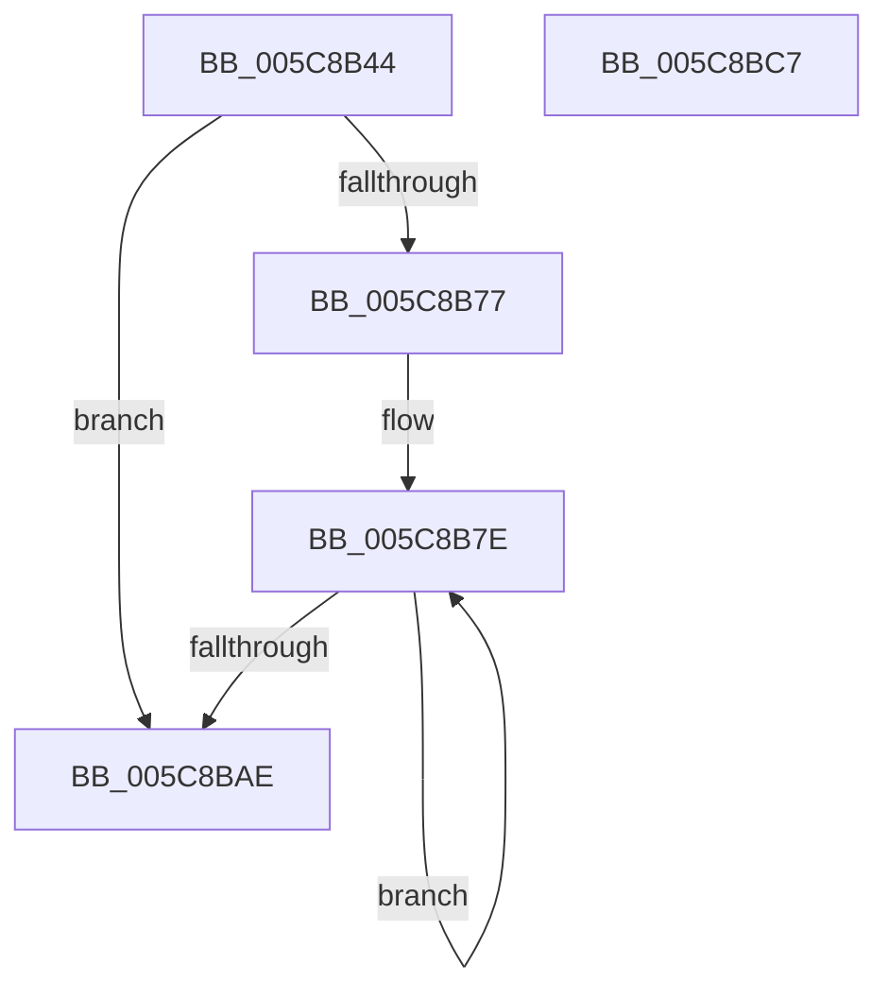

# KiLogSingleSchedulingGroupRundown

- RVA: `0x005C8B44`–`0x005C8BC8` (길이 `132` bytes)
- VA: `0x00000001405C8B44`
- 실행 섹션: `.text`
- PDB 이름 있음: `예`; PDB Function 태그: `아니요`
- unwind 정보 RVA: `0x00084C9C`
- 디코드: `40`개 명령, `132/132` bytes 표시
- 미해석 바이트: `0` (있으면 어셈블리에 `.byte`로 보존)

> 이 문서는 커널 이미지의 기계어와 PDB 기호를 분석해 생성했습니다. 4번과 5번은 함수 원형과 자료형을 바이너리 사용 방식에서 추정한 C 해석이며 원본 소스 복구 결과는 아닙니다.

## 1. Dependencies

- 직접 호출 지점: **2**; 고유 호출 대상: **2**
- 직접 호출자로 확인된 함수: **1**
- RIP 상대 이미지 참조: **1**

### Outgoing calls
- `0x005C8B64` → [EtwTraceSchedulingGroupRundown](../65/EtwTraceSchedulingGroupRundown_function_0065018C.md) (function, `0x0065018C`)
- `0x005C8B9B` → [EtwTraceScbRundown](../65/EtwTraceScbRundown_function_0065006C.md) (function, `0x0065006C`)

### Direct callers
- [KeTraceSchedulingGroupRundown](KeTraceSchedulingGroupRundown_function_005C8D20.md) at `0x005C8D80`

### Static image references
- `0x005C8B69` → RVA `0x00FC6A80` (`ALMOSTRO`; read)

## 2. Other-region calls and transfers

- 다른 실행 섹션으로 향하는 call: **0**
- 별도 외부 분기/꼬리 이동을 확인하지 못했습니다.

## 3. Assembly (complete function range)

```asm
005C8B44  48 89 5C 24 08                  mov qword ptr [rsp + 8], rbx
005C8B49  48 89 6C 24 10                  mov qword ptr [rsp + 0x10], rbp
005C8B4E  48 89 74 24 18                  mov qword ptr [rsp + 0x18], rsi
005C8B53  57                              push rdi
005C8B54  41 56                           push r14
005C8B56  41 57                           push r15
005C8B58  48 83 EC 30                     sub rsp, 0x30
005C8B5C  49 8B D8                        mov rbx, r8
005C8B5F  8B EA                           mov ebp, edx
005C8B61  4C 8B F1                        mov r14, rcx
005C8B64  E8 23 76 08 00                  call 0x14065018c
005C8B69  44 8B 3D 10 DF 9F 00            mov r15d, dword ptr [rip + 0x9fdf10]
005C8B70  33 FF                           xor edi, edi
005C8B72  45 85 FF                        test r15d, r15d
005C8B75  74 37                           je 0x1405c8bae
005C8B77  48 8D B3 FC 00 00 00            lea rsi, [rbx + 0xfc]
005C8B7E  8B 0E                           mov ecx, dword ptr [rsi]
005C8B80  44 8B CF                        mov r9d, edi
005C8B83  0F B7 46 F4                     movzx eax, word ptr [rsi - 0xc]
005C8B87  4C 8B C3                        mov r8, rbx
005C8B8A  D0 E8                           shr al, 1
005C8B8C  8B D5                           mov edx, ebp
005C8B8E  24 01                           and al, 1
005C8B90  88 44 24 28                     mov byte ptr [rsp + 0x28], al
005C8B94  89 4C 24 20                     mov dword ptr [rsp + 0x20], ecx
005C8B98  49 8B CE                        mov rcx, r14
005C8B9B  E8 CC 74 08 00                  call 0x14065006c
005C8BA0  FF C7                           inc edi
005C8BA2  48 8D B6 B8 01 00 00            lea rsi, [rsi + 0x1b8]
005C8BA9  41 3B FF                        cmp edi, r15d
005C8BAC  72 D0                           jb 0x1405c8b7e
005C8BAE  48 8B 5C 24 50                  mov rbx, qword ptr [rsp + 0x50]
005C8BB3  48 8B 6C 24 58                  mov rbp, qword ptr [rsp + 0x58]
005C8BB8  48 8B 74 24 60                  mov rsi, qword ptr [rsp + 0x60]
005C8BBD  48 83 C4 30                     add rsp, 0x30
005C8BC1  41 5F                           pop r15
005C8BC3  41 5E                           pop r14
005C8BC5  5F                              pop rdi
005C8BC6  C3                              ret
005C8BC7  CC                              int3
```

## 4. C-style interpretation (structured pseudocode)

```c
__int64 __fastcall KiLogSingleSchedulingGroupRundown(__int64 a1, int a2, __int64 a3)
{
    __int64 result;
    __int64 v_rdi;
    __int64 v_rsp;
    unsigned __int8 v_stack_m20;
    unsigned int v_stack_m28;
    unsigned __int64 v_stack_p10;
    unsigned __int64 v_stack_p18;
    unsigned __int64 v_stack_p8;

    v_stack_p8 = v_rbx;
    v_stack_p10 = v_rbp;
    v_stack_p18 = v_rsi;
    v_rsp = (v_rsp) - (48);
    result = EtwTraceSchedulingGroupRundown(a1, a2, a3, a4);
    v_rdi = 0;
    if ((unsigned int)((unsigned int)(*(unsigned int *)(v_rip + 10477328))) == 0) goto loc_005C8BAE;
loc_005C8B7E:
    result = (unsigned __int8)((*(unsigned __int16 *)(a3 + 252 - 12)) >> (1));
    result = (unsigned __int8)((result) & (1));
    v_stack_m20 = (unsigned __int8)(result);
    v_stack_m28 = (unsigned int)((unsigned int)(*(unsigned int *)(a3 + 252)));
    result = EtwTraceScbRundown(a1, (unsigned int)((unsigned int)((unsigned int)(a2))), a3, 0);
    v_rdi = (unsigned int)((v_rdi) + 1);
    if (((unsigned int)(v_rdi)) < ((unsigned int)((unsigned int)(*(unsigned int *)(v_rip + 10477328))))) goto loc_005C8B7E;
loc_005C8BAE:
    v_rsp = (v_rsp) + (48);
    return result;
}
```

## 5. (Beta) C Style

```c
int64_t KiLogSingleSchedulingGroupRundown(int64_t Arg1, int32_t Arg2, void *Arg3)
{
    uint8_t *arg3 = (uint8_t *)Arg3;

    int64_t result;
    int64_t local_rdi;
    int64_t local_rsp;
    uint8_t v_stack_m20;
    uint32_t v_stack_m28;
    uint64_t v_stack_p10;
    uint64_t v_stack_p18;
    uint64_t v_stack_p8;

    v_stack_p8 = local_rbx;
    v_stack_p10 = local_rbp;
    v_stack_p18 = local_rsi;
    local_rsp = (local_rsp) - (48);
    result = EtwTraceSchedulingGroupRundown(Arg1, Arg2, Arg3, a4);
    local_rdi = 0;
    if ((uint32_t)((uint32_t)(*(uint32_t *)(v_rip + 0x9FDF10))) == 0) goto loc_005C8BAE;
loc_005C8B7E:
    result = (uint8_t)((*(uint16_t *)(arg3 + 0xFC - 0xC)) >> (1));
    result = (uint8_t)((result) & (1));
    v_stack_m20 = (uint8_t)(result);
    v_stack_m28 = (uint32_t)((uint32_t)(*(uint32_t *)(arg3 + 0xFC)));
    result = EtwTraceScbRundown(Arg1, (uint32_t)((uint32_t)((uint32_t)(Arg2))), Arg3, 0);
    local_rdi = (uint32_t)((local_rdi) + 1);
    if (((uint32_t)(local_rdi)) < ((uint32_t)((uint32_t)(*(uint32_t *)(v_rip + 0x9FDF10))))) goto loc_005C8B7E;
loc_005C8BAE:
    local_rsp = (local_rsp) + (48);
    return result;
}
```

### 관측된 메모리 오프셋

구조체 형식이 확인되지 않은 접근은 인자 기준의 오프셋으로만 기록했습니다.

| 기준 인자 | 오프셋 표현 | 폭 (bit) | 접근 |
|---|---:|---:|---|
| `Arg3` | `- 0xC` | `16` | `R` |
| `Arg3` | `+ 0x0` | `32` | `R` |
| `Arg3` | `+ 0xFC` | `64` | `R` |
| `Arg3` | `+ 0x1B8` | `64` | `R` |

## 6. Execution-region graph

[열기: 2D/3D 그래프와 함수 탐색 컨트롤 패널](../../../control-panel.html?section=text&rva=0x005C8B44&view=graph)

- 2D 그래프는 위에서 아래로 흐르고, 3D 그래프는 빈 공간을 드래그해 회전합니다. Shift+드래그는 이동, 휠은 확대·축소, 함수 노드 선택은 대상 보고서 이동입니다.

### Static fallback


