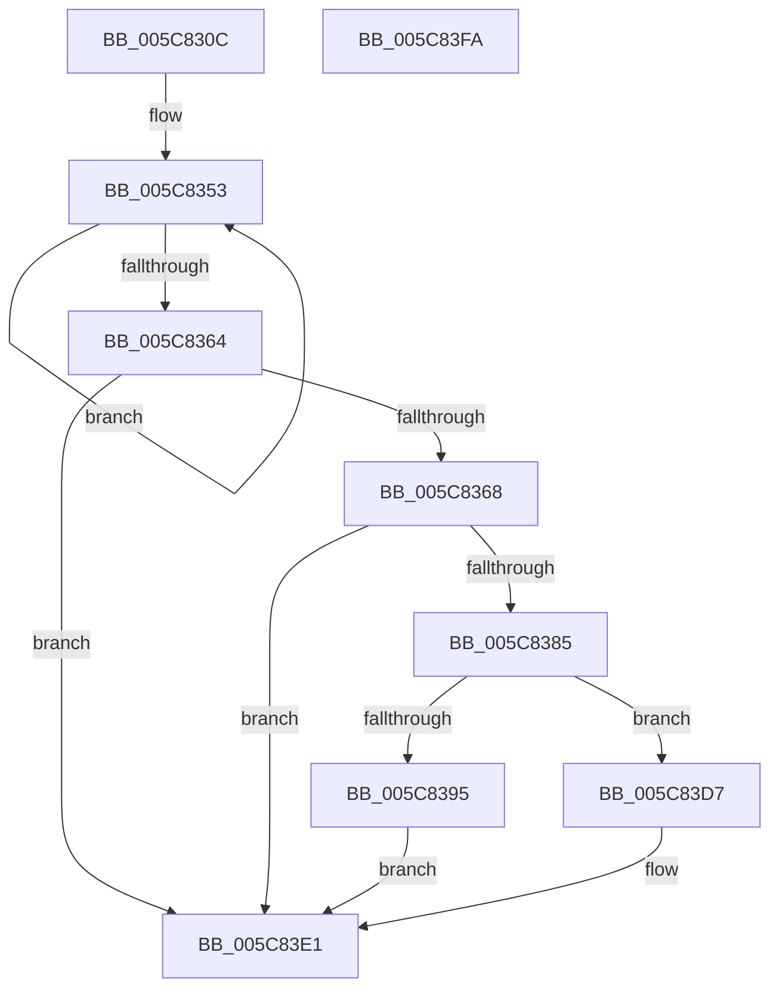

# KiLogUserCetSetContextIpValidationFailure

- RVA: `0x005C830C`–`0x005C83FB` (길이 `239` bytes)
- VA: `0x00000001405C830C`
- 실행 섹션: `.text`
- PDB 이름 있음: `예`; PDB Function 태그: `아니요`
- unwind 정보 RVA: `0x00060300`
- 디코드: `61`개 명령, `239/239` bytes 표시
- 미해석 바이트: `0` (있으면 어셈블리에 `.byte`로 보존)

> 이 문서는 커널 이미지의 기계어와 PDB 기호를 분석해 생성했습니다. 4번과 5번은 함수 원형과 자료형을 바이너리 사용 방식에서 추정한 C 해석이며 원본 소스 복구 결과는 아닙니다.

## 1. Dependencies

- 직접 호출 지점: **5**; 고유 호출 대상: **5**
- 직접 호출자로 확인된 함수: **6**
- RIP 상대 이미지 참조: **1**

### Outgoing calls
- `0x005C8378` → [ExAllocatePool2](../../poolcode/B8/ExAllocatePool2_function_00B820F0.md) (function, `0x00B820F0`)
- `0x005C838C` → [ExAcquireRundownProtection](../21/ExAcquireRundownProtection_function_00216620.md) (function, `0x00216620`)
- `0x005C839D` → [ObfReferenceObjectWithTag](../21/ObfReferenceObjectWithTag_function_00210710.md) (function, `0x00210710`)
- `0x005C83D0` → [ExQueueWorkItem](../2F/ExQueueWorkItem_function_002F9520.md) (function, `0x002F9520`)
- `0x005C83DC` → [ExFreePoolWithTag](../../poolcode/B8/ExFreePoolWithTag_function_00B82870.md) (function, `0x00B82870`)

### Direct callers
- [KiContinuePreviousModeUser](../2F/KiContinuePreviousModeUser_function_002F9B10.md) at `0x002F9EE5`
- [sub_0040BE54](../40/Unknown_function_0040BE54.md) at `0x0040BE7A`
- [KeVerifyContextRecord](../40/KeVerifyContextRecord_function_0040BE90.md) at `0x0040C013`
- [sub_006DF3D6](../6D/Unknown_function_006DF3D6.md) at `0x006DF402`
- [sub_006EC90E](../6E/Unknown_function_006EC90E.md) at `0x006EC913`
- [sub_006EC920](../6E/Unknown_function_006EC920.md) at `0x006EC94B`

### Static image references
- `0x005C83A6` → RVA `0x00747760` (`KiLogUserCetSetContextIpValidationFailureWorker`; read)

## 2. Other-region calls and transfers

- 다른 실행 섹션으로 향하는 call: **2**
  - `0x005C8378` → [ExAllocatePool2](../../poolcode/B8/ExAllocatePool2_function_00B820F0.md) (`.text` → `POOLCODE`)
  - `0x005C83DC` → [ExFreePoolWithTag](../../poolcode/B8/ExFreePoolWithTag_function_00B82870.md) (`.text` → `POOLCODE`)
- 별도 외부 분기/꼬리 이동을 확인하지 못했습니다.

## 3. Assembly (complete function range)

```asm
005C830C  48 89 5C 24 08                  mov qword ptr [rsp + 8], rbx
005C8311  48 89 6C 24 10                  mov qword ptr [rsp + 0x10], rbp
005C8316  48 89 74 24 18                  mov qword ptr [rsp + 0x18], rsi
005C831B  57                              push rdi
005C831C  41 56                           push r14
005C831E  41 57                           push r15
005C8320  48 83 EC 20                     sub rsp, 0x20
005C8324  65 48 8B 04 25 88 01 00 00      mov rax, qword ptr gs:[0x188]
005C832D  49 8B E8                        mov rbp, r8
005C8330  41 0F B6 F1                     movzx esi, r9b
005C8334  44 8B F2                        mov r14d, edx
005C8337  44 8B F9                        mov r15d, ecx
005C833A  48 8B B8 20 02 00 00            mov rdi, qword ptr [rax + 0x220]
005C8341  0F 0D 8F 54 07 00 00            prefetchw byte ptr [rdi + 0x754]
005C8348  8B 87 54 07 00 00               mov eax, dword ptr [rdi + 0x754]
005C834E  B9 00 00 08 00                  mov ecx, 0x80000
005C8353  44 8B D0                        mov r10d, eax
005C8356  44 0B D1                        or r10d, ecx
005C8359  F0 44 0F B1 97 54 07 00 00      lock cmpxchg dword ptr [rdi + 0x754], r10d
005C8362  75 EF                           jne 0x1405c8353
005C8364  85 C1                           test ecx, eax
005C8366  75 79                           jne 0x1405c83e1
005C8368  BA 40 00 00 00                  mov edx, 0x40
005C836D  B9 00 01 00 00                  mov ecx, 0x100
005C8372  41 B8 4B 6C 73 63               mov r8d, 0x63736c4b
005C8378  E8 73 9D 5B 00                  call 0x140b820f0
005C837D  48 8B D8                        mov rbx, rax
005C8380  48 85 C0                        test rax, rax
005C8383  74 5C                           je 0x1405c83e1
005C8385  48 8D 8F E8 01 00 00            lea rcx, [rdi + 0x1e8]
005C838C  E8 8F E2 C4 FF                  call 0x140216620
005C8391  84 C0                           test al, al
005C8393  74 42                           je 0x1405c83d7
005C8395  BA 44 66 6C 74                  mov edx, 0x746c6644
005C839A  48 8B CF                        mov rcx, rdi
005C839D  E8 6E 83 C4 FF                  call 0x140210710
005C83A2  48 83 23 00                     and qword ptr [rbx], 0
005C83A6  48 8D 05 B3 F3 17 00            lea rax, [rip + 0x17f3b3]
005C83AD  48 89 43 10                     mov qword ptr [rbx + 0x10], rax
005C83B1  BA 01 00 00 00                  mov edx, 1
005C83B6  48 89 5B 18                     mov qword ptr [rbx + 0x18], rbx
005C83BA  48 8B CB                        mov rcx, rbx
005C83BD  44 89 7B 20                     mov dword ptr [rbx + 0x20], r15d
005C83C1  48 89 7B 28                     mov qword ptr [rbx + 0x28], rdi
005C83C5  48 89 6B 30                     mov qword ptr [rbx + 0x30], rbp
005C83C9  89 73 38                        mov dword ptr [rbx + 0x38], esi
005C83CC  44 89 73 3C                     mov dword ptr [rbx + 0x3c], r14d
005C83D0  E8 4B 11 D3 FF                  call 0x1402f9520
005C83D5  EB 0A                           jmp 0x1405c83e1
005C83D7  33 D2                           xor edx, edx
005C83D9  48 8B CB                        mov rcx, rbx
005C83DC  E8 8F A4 5B 00                  call 0x140b82870
005C83E1  48 8B 5C 24 40                  mov rbx, qword ptr [rsp + 0x40]
005C83E6  48 8B 6C 24 48                  mov rbp, qword ptr [rsp + 0x48]
005C83EB  48 8B 74 24 50                  mov rsi, qword ptr [rsp + 0x50]
005C83F0  48 83 C4 20                     add rsp, 0x20
005C83F4  41 5F                           pop r15
005C83F6  41 5E                           pop r14
005C83F8  5F                              pop rdi
005C83F9  C3                              ret
005C83FA  CC                              int3
```

## 4. C-style interpretation (structured pseudocode)

```c
__int64 __fastcall KiLogUserCetSetContextIpValidationFailure(int a1, int a2, __int64 a3, unsigned __int8 a4)
{
    __int64 result;
    __int64 v_r10;
    __int64 v_rsp;
    unsigned __int64 v_stack_p10;
    unsigned __int64 v_stack_p18;
    unsigned __int64 v_stack_p8;

    v_stack_p8 = v_rbx;
    v_stack_p10 = v_rbp;
    v_stack_p18 = v_rsi;
    v_rsp = (v_rsp) - (32);
loc_005C8353:
    v_r10 = (unsigned int)(((unsigned int)((unsigned int)((unsigned int)(*(unsigned int *)(*(unsigned __int64 *)(*(unsigned __int64 *)(gs_base + (0 + 392)) + 544) + 1876))))) | ((unsigned int)((unsigned int)(0x80000ULL))));
    if (condition_is_not_equal) goto loc_005C8353;
    if ((((unsigned int)((unsigned int)(0x80000ULL))) & ((unsigned int)((unsigned int)(*(unsigned int *)(*(unsigned __int64 *)(*(unsigned __int64 *)(gs_base + (0 + 392)) + 544) + 1876))))) != 0) goto loc_005C83E1;
    result = ExAllocatePool2(256, 64, (unsigned int)(0x63736C4BULL), a4);
    if (result == 0) goto loc_005C83E1;
    result = ExAcquireRundownProtection(*(unsigned __int64 *)(*(unsigned __int64 *)(gs_base + (0 + 392)) + 544) + 488, 64, (unsigned int)(0x63736C4BULL), a4);
    if ((unsigned __int8)(result) == 0) goto loc_005C83D7;
    result = ObfReferenceObjectWithTag(*(unsigned __int64 *)(*(unsigned __int64 *)(gs_base + (0 + 392)) + 544), (unsigned int)(0x746C6644ULL), (unsigned int)(0x63736C4BULL), a4);
    *(unsigned __int64 *)(result + 16) = v_rip + 1569715;
    *(unsigned __int64 *)(result + 24) = result;
    *(unsigned int *)(result + 32) = (unsigned int)((unsigned int)(a1));
    *(unsigned __int64 *)(result + 40) = *(unsigned __int64 *)(*(unsigned __int64 *)(gs_base + (0 + 392)) + 544);
    *(unsigned __int64 *)(result + 48) = a3;
    *(unsigned int *)(result + 56) = a4;
    *(unsigned int *)(result + 60) = (unsigned int)((unsigned int)(a2));
    result = ExQueueWorkItem(result, 1, (unsigned int)(0x63736C4BULL), a4);
    goto loc_005C83E1;
loc_005C83D7:
    a2 = 0;
    result = ExFreePoolWithTag(result, a2, (unsigned int)(0x63736C4BULL), a4);
loc_005C83E1:
    v_rsp = (v_rsp) + (32);
    return result;
}
```

## 5. (Beta) C Style

```c
int64_t KiLogUserCetSetContextIpValidationFailure(int32_t Arg1, int32_t Arg2, int64_t Arg3, uint8_t Arg4)
{
    int64_t result;
    int64_t local_r10;
    int64_t local_rsp;
    uint64_t v_stack_p10;
    uint64_t v_stack_p18;
    uint64_t v_stack_p8;

    v_stack_p8 = local_rbx;
    v_stack_p10 = local_rbp;
    v_stack_p18 = local_rsi;
    local_rsp = (local_rsp) - (32);
loc_005C8353:
    local_r10 = (uint32_t)(((uint32_t)((uint32_t)((uint32_t)(*(uint32_t *)(*(uint64_t *)(*(uint64_t *)(gs_base + (0 + 0x188)) + 0x220) + 0x754))))) | ((uint32_t)((uint32_t)(0x80000ULL))));
    if (condition_is_not_equal) goto loc_005C8353;
    if ((((uint32_t)((uint32_t)(0x80000ULL))) & ((uint32_t)((uint32_t)(*(uint32_t *)(*(uint64_t *)(*(uint64_t *)(gs_base + (0 + 0x188)) + 0x220) + 0x754))))) != 0) goto loc_005C83E1;
    result = ExAllocatePool2(256, 64, (uint32_t)(0x63736C4BULL), Arg4);
    if (result == 0) goto loc_005C83E1;
    result = ExAcquireRundownProtection(*(uint64_t *)(*(uint64_t *)(gs_base + (0 + 0x188)) + 0x220) + 488, 64, (uint32_t)(0x63736C4BULL), Arg4);
    if ((uint8_t)(result) == 0) goto loc_005C83D7;
    result = ObfReferenceObjectWithTag(*(uint64_t *)(*(uint64_t *)(gs_base + (0 + 0x188)) + 0x220), (uint32_t)(0x746C6644ULL), (uint32_t)(0x63736C4BULL), Arg4);
    *(uint64_t *)(result + 0x10) = v_rip + 1569715;
    *(uint64_t *)(result + 0x18) = result;
    *(uint32_t *)(result + 0x20) = (uint32_t)((uint32_t)(Arg1));
    *(uint64_t *)(result + 0x28) = *(uint64_t *)(*(uint64_t *)(gs_base + (0 + 0x188)) + 0x220);
    *(uint64_t *)(result + 0x30) = Arg3;
    *(uint32_t *)(result + 0x38) = Arg4;
    *(uint32_t *)(result + 0x3C) = (uint32_t)((uint32_t)(Arg2));
    result = ExQueueWorkItem(result, 1, (uint32_t)(0x63736C4BULL), Arg4);
    goto loc_005C83E1;
loc_005C83D7:
    Arg2 = 0;
    result = ExFreePoolWithTag(result, Arg2, (uint32_t)(0x63736C4BULL), Arg4);
loc_005C83E1:
    local_rsp = (local_rsp) + (32);
    return result;
}
```

## 6. Execution-region graph

[열기: 2D/3D 그래프와 함수 탐색 컨트롤 패널](../../../control-panel.html?section=text&rva=0x005C830C&view=graph)

- 2D 그래프는 위에서 아래로 흐르고, 3D 그래프는 빈 공간을 드래그해 회전합니다. Shift+드래그는 이동, 휠은 확대·축소, 함수 노드 선택은 대상 보고서 이동입니다.

### Static fallback


