# KiMcheckAlternateReturn

- RVA: `0x005CB180`–`0x005CB53F` (길이 `959` bytes)
- VA: `0x00000001405CB180`
- 실행 섹션: `.text`
- PDB 이름 있음: `예`; PDB Function 태그: `아니요`
- unwind 정보 RVA: `0x000CB330`
- 디코드: `244`개 명령, `959/959` bytes 표시
- 미해석 바이트: `0` (있으면 어셈블리에 `.byte`로 보존)

> 이 문서는 커널 이미지의 기계어와 PDB 기호를 분석해 생성했습니다. 4번과 5번은 함수 원형과 자료형을 바이너리 사용 방식에서 추정한 C 해석이며 원본 소스 복구 결과는 아닙니다.

## 1. Dependencies

- 직접 호출 지점: **13**; 고유 호출 대상: **13**
- 직접 호출자로 확인된 함수: **1**
- RIP 상대 이미지 참조: **9**

### Outgoing calls
- `0x005CB293` → [ExAllocatePool2](../../poolcode/B8/ExAllocatePool2_function_00B820F0.md) (function, `0x00B820F0`)
- `0x005CB2F9` → [WheaLogInternalEvent](../66/WheaLogInternalEvent_function_006605B0.md) (function, `0x006605B0`)
- `0x005CB31E` → [WheaGetCurrentProcessName](../65/WheaGetCurrentProcessName_function_0065F260.md) (function, `0x0065F260`)
- `0x005CB343` → [WheaTerminateProcess](../../page/7D/WheaTerminateProcess_function_007D7810.md) (function, `0x007D7810`)
- `0x005CB362` → [WheaGetErrPacketFromErrRecord](../55/WheaGetErrPacketFromErrRecord_function_00556490.md) (function, `0x00556490`)
- `0x005CB37A` → [WheapGetErrorSource](../49/WheapGetErrorSource_function_0049554C.md) (function, `0x0049554C`)
- `0x005CB3A6` → [WheaAttemptPhysicalPageOffline](../../page/7D/WheaAttemptPhysicalPageOffline_function_007D7380.md) (function, `0x007D7380`)
- `0x005CB3B5` → [ExFreePoolWithTag](../../poolcode/B8/ExFreePoolWithTag_function_00B82870.md) (function, `0x00B82870`)
- `0x005CB420` → [KiAltContextWorkQueueAddItem](KiAltContextWorkQueueAddItem_function_005CB028.md) (function, `0x005CB028`)
- `0x005CB43D` → [KeStallExecutionProcessor](../44/KeStallExecutionProcessor_function_0044F620.md) (function, `0x0044F620`)
- `0x005CB503` → [WheaRecoveryBugCheck](../65/WheaRecoveryBugCheck_function_0065E110.md) (function, `0x0065E110`)
- `0x005CB50C` → [WheaProcessWaitingETWEvents](../66/WheaProcessWaitingETWEvents_function_006607A0.md) (function, `0x006607A0`)
- `0x005CB518` → [_security_check_cookie](../6A/_security_check_cookie_function_006AC640.md) (function, `0x006AC640`)

### Direct callers
- [KxMcheckAlternateReturn](../6C/KxMcheckAlternateReturn_function_006C1E00.md) at `0x006C217A`

### Static image references
- `0x005CB1A2` → RVA `0x00E0A740` (`.data`; read)
- `0x005CB20A` → RVA `0x00024DA8` (`.rdata`; read)
- `0x005CB217` → RVA `0x00024DB0` (`.rdata`; read)
- `0x005CB23C` → RVA `0x00024DF8` (`.rdata`; read)
- `0x005CB249` → RVA `0x00024E00` (`.rdata`; read)
- `0x005CB373` → RVA `0x00EEF018` (`.data`; read)
- `0x005CB3BF` → RVA `0x00E66C70` (`.data`; read)
- `0x005CB3CF` → RVA `0x00E66980` (`.data`; read)
- `0x005CB409` → RVA `0x00E66970` (`.data`; read)

## 2. Other-region calls and transfers

- 다른 실행 섹션으로 향하는 call: **4**
  - `0x005CB293` → [ExAllocatePool2](../../poolcode/B8/ExAllocatePool2_function_00B820F0.md) (`.text` → `POOLCODE`)
  - `0x005CB343` → [WheaTerminateProcess](../../page/7D/WheaTerminateProcess_function_007D7810.md) (`.text` → `PAGE`)
  - `0x005CB3A6` → [WheaAttemptPhysicalPageOffline](../../page/7D/WheaAttemptPhysicalPageOffline_function_007D7380.md) (`.text` → `PAGE`)
  - `0x005CB3B5` → [ExFreePoolWithTag](../../poolcode/B8/ExFreePoolWithTag_function_00B82870.md) (`.text` → `POOLCODE`)
- 별도 외부 분기/꼬리 이동을 확인하지 못했습니다.

## 3. Assembly (complete function range)

```asm
005CB180  48 89 5C 24 10                  mov qword ptr [rsp + 0x10], rbx
005CB185  48 89 74 24 18                  mov qword ptr [rsp + 0x18], rsi
005CB18A  48 89 7C 24 20                  mov qword ptr [rsp + 0x20], rdi
005CB18F  55                              push rbp
005CB190  41 54                           push r12
005CB192  41 55                           push r13
005CB194  41 56                           push r14
005CB196  41 57                           push r15
005CB198  48 8B EC                        mov rbp, rsp
005CB19B  48 81 EC 80 00 00 00            sub rsp, 0x80
005CB1A2  48 8B 05 97 F5 83 00            mov rax, qword ptr [rip + 0x83f597]
005CB1A9  48 33 C4                        xor rax, rsp
005CB1AC  48 89 45 F8                     mov qword ptr [rbp - 8], rax
005CB1B0  44 8A 29                        mov r13b, byte ptr [rcx]
005CB1B3  0F 57 C0                        xorps xmm0, xmm0
005CB1B6  4C 8B 71 08                     mov r14, qword ptr [rcx + 8]
005CB1BA  33 C0                           xor eax, eax
005CB1BC  41 80 E5 10                     and r13b, 0x10
005CB1C0  48 89 4D B8                     mov qword ptr [rbp - 0x48], rcx
005CB1C4  33 DB                           xor ebx, ebx
005CB1C6  88 45 F0                        mov byte ptr [rbp - 0x10], al
005CB1C9  33 FF                           xor edi, edi
005CB1CB  4C 8B E1                        mov r12, rcx
005CB1CE  0F 11 45 C0                     movups xmmword ptr [rbp - 0x40], xmm0
005CB1D2  BE BB 00 00 C0                  mov esi, 0xc00000bb
005CB1D7  0F 11 45 D0                     movups xmmword ptr [rbp - 0x30], xmm0
005CB1DB  0F 11 45 E0                     movups xmmword ptr [rbp - 0x20], xmm0
005CB1DF  45 0F 20 C7                     mov r15, cr8
005CB1E3  45 0F B7 4E 0A                  movzx r9d, word ptr [r14 + 0xa]
005CB1E8  49 8D 96 80 00 00 00            lea rdx, [r14 + 0x80]
005CB1EF  48 8B CA                        mov rcx, rdx
005CB1F2  4C 89 7D B0                     mov qword ptr [rbp - 0x50], r15
005CB1F6  45 33 C0                        xor r8d, r8d
005CB1F9  44 8D 50 01                     lea r10d, [rax + 1]
005CB1FD  45 3B C1                        cmp r8d, r9d
005CB200  0F 83 A7 00 00 00               jae 0x1405cb2ad
005CB206  48 8B 41 10                     mov rax, qword ptr [rcx + 0x10]
005CB20A  48 2B 05 97 9B A5 FF            sub rax, qword ptr [rip - 0x5a6469]
005CB211  75 0B                           jne 0x1405cb21e
005CB213  48 8B 41 18                     mov rax, qword ptr [rcx + 0x18]
005CB217  48 2B 05 92 9B A5 FF            sub rax, qword ptr [rip - 0x5a646e]
005CB21E  48 85 C0                        test rax, rax
005CB221  74 09                           je 0x1405cb22c
005CB223  48 83 C1 48                     add rcx, 0x48
005CB227  45 03 C2                        add r8d, r10d
005CB22A  EB D1                           jmp 0x1405cb1fd
005CB22C  8B 19                           mov ebx, dword ptr [rcx]
005CB22E  45 8B C2                        mov r8d, r10d
005CB231  33 C9                           xor ecx, ecx
005CB233  41 3B C9                        cmp ecx, r9d
005CB236  73 2B                           jae 0x1405cb263
005CB238  48 8B 42 10                     mov rax, qword ptr [rdx + 0x10]
005CB23C  48 2B 05 B5 9B A5 FF            sub rax, qword ptr [rip - 0x5a644b]
005CB243  75 0B                           jne 0x1405cb250
005CB245  48 8B 42 18                     mov rax, qword ptr [rdx + 0x18]
005CB249  48 2B 05 B0 9B A5 FF            sub rax, qword ptr [rip - 0x5a6450]
005CB250  48 85 C0                        test rax, rax
005CB253  74 09                           je 0x1405cb25e
005CB255  48 83 C2 48                     add rdx, 0x48
005CB259  41 03 C8                        add ecx, r8d
005CB25C  EB D5                           jmp 0x1405cb233
005CB25E  8B 3A                           mov edi, dword ptr [rdx]
005CB260  49 03 FE                        add rdi, r14
005CB263  41 8B 04 24                     mov eax, dword ptr [r12]
005CB267  4A 8B 5C 33 30                  mov rbx, qword ptr [rbx + r14 + 0x30]
005CB26C  A8 04                           test al, 4
005CB26E  74 3D                           je 0x1405cb2ad
005CB270  48 85 FF                        test rdi, rdi
005CB273  74 05                           je 0x1405cb27a
005CB275  48 83 4F 01 08                  or qword ptr [rdi + 1], 8
005CB27A  45 84 FF                        test r15b, r15b
005CB27D  0F 85 3C 01 00 00               jne 0x1405cb3bf
005CB283  BA 28 18 00 00                  mov edx, 0x1828
005CB288  B9 00 01 00 00                  mov ecx, 0x100
005CB28D  41 B8 57 68 65 61               mov r8d, 0x61656857
005CB293  E8 58 6E 5B 00                  call 0x140b820f0
005CB298  4C 8B F8                        mov r15, rax
005CB29B  48 85 C0                        test rax, rax
005CB29E  0F 85 ED 00 00 00               jne 0x1405cb391
005CB2A4  BE 9A 00 00 C0                  mov esi, 0xc000009a
005CB2A9  4C 8B 7D B0                     mov r15, qword ptr [rbp - 0x50]
005CB2AD  41 8B 04 24                     mov eax, dword ptr [r12]
005CB2B1  B9 01 00 00 00                  mov ecx, 1
005CB2B6  83 65 CC 00                     and dword ptr [rbp - 0x34], 0
005CB2BA  89 4D C4                        mov dword ptr [rbp - 0x3c], ecx
005CB2BD  48 8D 4D C0                     lea rcx, [rbp - 0x40]
005CB2C1  C7 45 C0 57 68 4C 67            mov dword ptr [rbp - 0x40], 0x674c6857
005CB2C8  C7 45 C8 31 00 00 00            mov dword ptr [rbp - 0x38], 0x31
005CB2CF  C7 45 D4 35 00 00 80            mov dword ptr [rbp - 0x2c], 0x80000035
005CB2D6  C7 45 D0 4B 52 4E 4C            mov dword ptr [rbp - 0x30], 0x4c4e524b
005CB2DD  C7 45 D8 02 00 00 00            mov dword ptr [rbp - 0x28], 2
005CB2E4  C7 45 DC 11 00 00 00            mov dword ptr [rbp - 0x24], 0x11
005CB2EB  89 45 E0                        mov dword ptr [rbp - 0x20], eax
005CB2EE  48 89 5D E4                     mov qword ptr [rbp - 0x1c], rbx
005CB2F2  89 75 EC                        mov dword ptr [rbp - 0x14], esi
005CB2F5  44 88 6D F0                     mov byte ptr [rbp - 0x10], r13b
005CB2F9  E8 B2 52 09 00                  call 0x1406605b0
005CB2FE  48 85 FF                        test rdi, rdi
005CB301  74 20                           je 0x1405cb323
005CB303  48 8D 47 13                     lea rax, [rdi + 0x13]
005CB307  44 88 7F 0D                     mov byte ptr [rdi + 0xd], r15b
005CB30B  48 8D 55 B0                     lea rdx, [rbp - 0x50]
005CB30F  48 89 45 B8                     mov qword ptr [rbp - 0x48], rax
005CB313  48 8D 4D B8                     lea rcx, [rbp - 0x48]
005CB317  C7 45 B0 14 00 00 00            mov dword ptr [rbp - 0x50], 0x14
005CB31E  E8 3D 3F 09 00                  call 0x14065f260
005CB323  BB 03 01 00 00                  mov ebx, 0x103
005CB328  3B F3                           cmp esi, ebx
005CB32A  75 1C                           jne 0x1405cb348
005CB32C  41 8B 04 24                     mov eax, dword ptr [r12]
005CB330  A8 08                           test al, 8
005CB332  74 14                           je 0x1405cb348
005CB334  45 84 ED                        test r13b, r13b
005CB337  75 0F                           jne 0x1405cb348
005CB339  48 85 FF                        test rdi, rdi
005CB33C  74 05                           je 0x1405cb343
005CB33E  48 83 4F 01 02                  or qword ptr [rdi + 1], 2
005CB343  E8 C8 C4 20 00                  call 0x1407d7810
005CB348  41 0F BA 76 68 07               btr dword ptr [r14 + 0x68], 7
005CB34E  85 F6                           test esi, esi
005CB350  0F 84 B6 01 00 00               je 0x1405cb50c
005CB356  45 84 ED                        test r13b, r13b
005CB359  0F 84 A9 01 00 00               je 0x1405cb508
005CB35F  49 8B CE                        mov rcx, r14
005CB362  E8 29 B1 F8 FF                  call 0x140556490
005CB367  48 85 C0                        test rax, rax
005CB36A  0F 84 36 01 00 00               je 0x1405cb4a6
005CB370  8B 50 18                        mov edx, dword ptr [rax + 0x18]
005CB373  48 8D 0D 9E 3C 92 00            lea rcx, [rip + 0x923c9e]
005CB37A  E8 CD A1 EC FF                  call 0x14049554c
005CB37F  48 8D 48 60                     lea rcx, [rax + 0x60]
005CB383  48 F7 D8                        neg rax
005CB386  48 1B D2                        sbb rdx, rdx
005CB389  48 23 D1                        and rdx, rcx
005CB38C  E9 17 01 00 00                  jmp 0x1405cb4a8
005CB391  33 D2                           xor edx, edx
005CB393  4C 89 7C 24 20                  mov qword ptr [rsp + 0x20], r15
005CB398  48 8B CB                        mov rcx, rbx
005CB39B  45 8A CD                        mov r9b, r13b
005CB39E  48 C1 E9 0C                     shr rcx, 0xc
005CB3A2  44 8D 42 01                     lea r8d, [rdx + 1]
005CB3A6  E8 D5 BF 20 00                  call 0x1407d7380
005CB3AB  BA 57 68 65 61                  mov edx, 0x61656857
005CB3B0  49 8B CF                        mov rcx, r15
005CB3B3  8B F0                           mov esi, eax
005CB3B5  E8 B6 74 5B 00                  call 0x140b82870
005CB3BA  E9 EA FE FF FF                  jmp 0x1405cb2a9
005CB3BF  80 3D AA B8 89 00 00            cmp byte ptr [rip + 0x89b8aa], 0
005CB3C6  0F 84 E1 FE FF FF               je 0x1405cb2ad
005CB3CC  45 32 FF                        xor r15b, r15b
005CB3CF  48 8D 15 AA B5 89 00            lea rdx, [rip + 0x89b5aa]
005CB3D6  41 0F B6 C7                     movzx eax, r15b
005CB3DA  48 8D 0C 40                     lea rcx, [rax + rax*2]
005CB3DE  48 03 C9                        add rcx, rcx
005CB3E1  33 C0                           xor eax, eax
005CB3E3  F0 44 0F B1 04 CA               lock cmpxchg dword ptr [rdx + rcx*8], r8d
005CB3E9  74 0E                           je 0x1405cb3f9
005CB3EB  45 02 F8                        add r15b, r8b
005CB3EE  41 80 FF 10                     cmp r15b, 0x10
005CB3F2  72 E2                           jb 0x1405cb3d6
005CB3F4  E9 AB FE FF FF                  jmp 0x1405cb2a4
005CB3F9  41 0F 10 04 24                  movups xmm0, xmmword ptr [r12]
005CB3FE  41 0F B6 C7                     movzx eax, r15b
005CB402  48 8D 34 40                     lea rsi, [rax + rax*2]
005CB406  48 03 F6                        add rsi, rsi
005CB409  48 8D 05 60 B5 89 00            lea rax, [rip + 0x89b560]
005CB410  F3 0F 7F 44 F0 18               movdqu xmmword ptr [rax + rsi*8 + 0x18], xmm0
005CB416  F0 44 01 44 F0 10               lock add dword ptr [rax + rsi*8 + 0x10], r8d
005CB41C  48 8D 0C F0                     lea rcx, [rax + rsi*8]
005CB420  E8 03 FC FF FF                  call 0x1405cb028
005CB425  45 33 E4                        xor r12d, r12d
005CB428  48 8D 05 41 B5 89 00            lea rax, [rip + 0x89b541]
005CB42F  8B 44 F0 10                     mov eax, dword ptr [rax + rsi*8 + 0x10]
005CB433  83 F8 01                        cmp eax, 1
005CB436  7E 28                           jle 0x1405cb460
005CB438  B9 32 00 00 00                  mov ecx, 0x32
005CB43D  E8 DE 41 E8 FF                  call 0x14044f620
005CB442  41 83 C4 32                     add r12d, 0x32
005CB446  41 81 FC 80 84 1E 00            cmp r12d, 0x1e8480
005CB44D  72 D9                           jb 0x1405cb428
005CB44F  48 8D 05 1A B5 89 00            lea rax, [rip + 0x89b51a]
005CB456  C7 44 F0 28 02 01 00 00         mov dword ptr [rax + rsi*8 + 0x28], 0x102
005CB45E  EB 07                           jmp 0x1405cb467
005CB460  48 8D 05 09 B5 89 00            lea rax, [rip + 0x89b509]
005CB467  8B 74 F0 28                     mov esi, dword ptr [rax + rsi*8 + 0x28]
005CB46B  41 0F B6 C7                     movzx eax, r15b
005CB46F  48 8D 0C 40                     lea rcx, [rax + rax*2]
005CB473  48 C1 E1 04                     shl rcx, 4
005CB477  48 8D 05 02 B5 89 00            lea rax, [rip + 0x89b502]
005CB47E  48 03 C8                        add rcx, rax
005CB481  33 C0                           xor eax, eax
005CB483  87 01                           xchg dword ptr [rcx], eax
005CB485  4C 8B 65 B8                     mov r12, qword ptr [rbp - 0x48]
005CB489  85 F6                           test esi, esi
005CB48B  0F 85 18 FE FF FF               jne 0x1405cb2a9
005CB491  4C 8B 7D B0                     mov r15, qword ptr [rbp - 0x50]
005CB495  B8 E5 00 00 C0                  mov eax, 0xc00000e5
005CB49A  41 80 FF 02                     cmp r15b, 2
005CB49E  0F 43 F0                        cmovae esi, eax
005CB4A1  E9 07 FE FF FF                  jmp 0x1405cb2ad
005CB4A6  33 D2                           xor edx, edx
005CB4A8  48 85 FF                        test rdi, rdi
005CB4AB  74 43                           je 0x1405cb4f0
005CB4AD  C6 47 0E 00                     mov byte ptr [rdi + 0xe], 0
005CB4B1  81 FE 02 01 00 00               cmp esi, 0x102
005CB4B7  75 09                           jne 0x1405cb4c2
005CB4B9  C7 47 0F 02 00 00 00            mov dword ptr [rdi + 0xf], 2
005CB4C0  EB 2E                           jmp 0x1405cb4f0
005CB4C2  81 FE 9A 00 00 C0               cmp esi, 0xc000009a
005CB4C8  75 09                           jne 0x1405cb4d3
005CB4CA  C7 47 0F 0B 00 00 00            mov dword ptr [rdi + 0xf], 0xb
005CB4D1  EB 1D                           jmp 0x1405cb4f0
005CB4D3  3B F3                           cmp esi, ebx
005CB4D5  75 09                           jne 0x1405cb4e0
005CB4D7  C7 47 0F 01 00 00 00            mov dword ptr [rdi + 0xf], 1
005CB4DE  EB 10                           jmp 0x1405cb4f0
005CB4E0  8D 86 1B FF FF 3F               lea eax, [rsi + 0x3fffff1b]
005CB4E6  F7 D8                           neg eax
005CB4E8  1B C0                           sbb eax, eax
005CB4EA  83 C0 10                        add eax, 0x10
005CB4ED  89 47 0F                        mov dword ptr [rdi + 0xf], eax
005CB4F0  41 83 66 68 FE                  and dword ptr [r14 + 0x68], 0xfffffffe
005CB4F5  45 33 C0                        xor r8d, r8d
005CB4F8  49 8B CE                        mov rcx, r14
005CB4FB  41 C7 46 0C 01 00 00 00         mov dword ptr [r14 + 0xc], 1
005CB503  E8 08 2C 09 00                  call 0x14065e110
005CB508  85 F6                           test esi, esi
005CB50A  78 05                           js 0x1405cb511
005CB50C  E8 8F 52 09 00                  call 0x1406607a0
005CB511  48 8B 4D F8                     mov rcx, qword ptr [rbp - 8]
005CB515  48 33 CC                        xor rcx, rsp
005CB518  E8 23 11 0E 00                  call 0x1406ac640
005CB51D  4C 8D 9C 24 80 00 00 00         lea r11, [rsp + 0x80]
005CB525  49 8B 5B 38                     mov rbx, qword ptr [r11 + 0x38]
005CB529  49 8B 73 40                     mov rsi, qword ptr [r11 + 0x40]
005CB52D  49 8B 7B 48                     mov rdi, qword ptr [r11 + 0x48]
005CB531  49 8B E3                        mov rsp, r11
005CB534  41 5F                           pop r15
005CB536  41 5E                           pop r14
005CB538  41 5D                           pop r13
005CB53A  41 5C                           pop r12
005CB53C  5D                              pop rbp
005CB53D  C3                              ret
005CB53E  CC                              int3
```

## 4. C-style interpretation (structured pseudocode)

```c
__int64 __fastcall KiMcheckAlternateReturn(__int64 a1, __int64 a2, int a3)
{
    __int64 result;
    __int64 v_r12;
    __int64 v_r13;
    __int64 v_r15;
    __int64 v_rbx;
    __int64 v_rdi;
    __int64 v_rsi;
    __int64 v_rsp;
    unsigned __int64 v_stack_m28;
    unsigned __int64 v_stack_m30;
    unsigned __int8 v_stack_m38;
    unsigned int v_stack_m3C;
    unsigned __int64 v_stack_m44;
    unsigned __int64 v_stack_m48;
    unsigned int v_stack_m4C;
    unsigned int v_stack_m50;
    unsigned int v_stack_m54;
    unsigned __int64 v_stack_m58;
    unsigned int v_stack_m5C;
    unsigned int v_stack_m60;
    unsigned int v_stack_m64;
    unsigned __int64 v_stack_m68;
    unsigned __int64 v_stack_m70;
    unsigned __int64 v_stack_m78;
    unsigned __int64 v_stack_m88;
    unsigned __int64 v_stack_p10;
    unsigned __int64 v_stack_p18;
    unsigned __int64 v_stack_p20;

    v_stack_p10 = v_rbx;
    v_stack_p18 = v_rsi;
    v_stack_p20 = v_rdi;
    v_rsp = (v_rsp) - (128);
    result = (*(unsigned __int64 *)(v_rip + 8648087)) ^ (v_rsp);
    v_stack_m30 = result;
    result = 0;
    v_r13 = (unsigned __int8)((*(unsigned __int8 *)(a1)) & (16));
    v_stack_m70 = a1;
    v_rbx = 0;
    v_stack_m38 = 0;
    v_rdi = 0;
    v_stack_m68 = v_xmm0;
    v_stack_m58 = v_xmm0;
    v_stack_m48 = v_xmm0;
    v_stack_m78 = v_cr8;
    a3 = 0;
loc_005CB1FD:
    if (0 >= ((unsigned int)(*(unsigned __int16 *)(*(unsigned __int64 *)(a1 + 8) + 10)))) goto loc_005CB2AD;
    result = (*(unsigned __int64 *)(*(unsigned __int64 *)(a1 + 8) + 128 + 16)) - (*(unsigned __int64 *)(v_rip - 5923945));
    if (!(condition_is_not_equal)) {
        result = *(unsigned __int64 *)(*(unsigned __int64 *)(a1 + 8) + 128 + 24);
        result = (result) - (*(unsigned __int64 *)(v_rip - 5923950));
    }
    if (result == 0) goto loc_005CB22C;
    a1 = (*(unsigned __int64 *)(a1 + 8) + 128) + (72);
    a3 = (unsigned int)((a3) + ((unsigned int)(result + 1)));
    goto loc_005CB1FD;
loc_005CB22C:
    a1 = 0;
loc_005CB233:
    if (0 >= ((unsigned int)(*(unsigned __int16 *)(*(unsigned __int64 *)(a1 + 8) + 10)))) goto loc_005CB263;
    result = (*(unsigned __int64 *)(*(unsigned __int64 *)(a1 + 8) + 128 + 16)) - (*(unsigned __int64 *)(v_rip - 5923915));
    if (!(condition_is_not_equal)) {
        result = *(unsigned __int64 *)(*(unsigned __int64 *)(a1 + 8) + 128 + 24);
        result = (result) - (*(unsigned __int64 *)(v_rip - 5923920));
    }
    if (result == 0) goto loc_005CB25E;
    a2 = (*(unsigned __int64 *)(a1 + 8) + 128) + (72);
    a1 = (unsigned int)((a1) + ((unsigned int)((unsigned int)((unsigned int)(result + 1)))));
    goto loc_005CB233;
loc_005CB25E:
    v_rdi = ((unsigned int)(*(unsigned int *)(a2))) + (*(unsigned __int64 *)(a1 + 8));
loc_005CB263:
    if ((((unsigned __int8)((unsigned int)(*(unsigned int *)(a1)))) & (4)) == 0) goto loc_005CB2AD;
    if (v_rdi != 0) {
    }
    if ((unsigned __int8)(v_cr8) != 0) goto loc_005CB3BF;
    result = ExAllocatePool2(256, (unsigned int)(0x1828ULL), (unsigned int)(0x61656857ULL), *(unsigned __int16 *)(*(unsigned __int64 *)(a1 + 8) + 10));
    if (result != 0) goto loc_005CB391;
loc_005CB2A4:
loc_005CB2A9:
loc_005CB2AD:
    v_stack_m64 = 1;
    v_stack_m68 = 0x674C6857ULL;
    v_stack_m60 = 49;
    v_stack_m54 = 0x80000035ULL;
    v_stack_m58 = 0x4C4E524BULL;
    v_stack_m50 = 2;
    v_stack_m4C = 17;
    v_stack_m48 = (unsigned int)((unsigned int)(*(unsigned int *)(a1)));
    v_stack_m44 = *(unsigned __int64 *)((unsigned int)(*(unsigned int *)(a1)) + *(unsigned __int64 *)(a1 + 8) * 1 + 48);
    v_stack_m3C = (unsigned int)((unsigned int)(0xC000009AULL));
    v_stack_m38 = (unsigned __int8)(v_r13);
    result = WheaLogInternalEvent(v_stack_m68, (unsigned int)(0x1828ULL), (unsigned int)(0x61656857ULL), *(unsigned __int16 *)(*(unsigned __int64 *)(a1 + 8) + 10));
    if (v_rdi != 0) {
        result = v_rdi + 19;
        *(unsigned __int8 *)(v_rdi + 13) = (unsigned __int8)(v_stack_m78);
        a2 = v_stack_m78;
        v_stack_m70 = result;
        a1 = v_stack_m70;
        v_stack_m78 = 20;
        result = WheaGetCurrentProcessName(a1, a2, (unsigned int)(0x61656857ULL), *(unsigned __int16 *)(*(unsigned __int64 *)(a1 + 8) + 10));
    }
    if (((unsigned int)((unsigned int)(0xC000009AULL))) != 259) goto loc_005CB348;
    if ((((unsigned __int8)((unsigned int)(*(unsigned int *)(a1)))) & (8)) == 0) goto loc_005CB348;
    if ((unsigned __int8)(v_r13) != 0) goto loc_005CB348;
    if (v_rdi != 0) {
    }
    result = WheaTerminateProcess(a1, a2, (unsigned int)(0x61656857ULL), *(unsigned __int16 *)(*(unsigned __int64 *)(a1 + 8) + 10));
loc_005CB348:
    if ((unsigned int)((unsigned int)(0xC000009AULL)) == 0) goto loc_005CB50C;
    if ((unsigned __int8)(v_r13) == 0) goto loc_005CB508;
    result = WheaGetErrPacketFromErrRecord(*(unsigned __int64 *)(a1 + 8), a2, (unsigned int)(0x61656857ULL), *(unsigned __int16 *)(*(unsigned __int64 *)(a1 + 8) + 10));
    if (result == 0) goto loc_005CB4A6;
    result = WheapGetErrorSource(v_rip + 9583774, (unsigned int)(*(unsigned int *)(result + 24)), (unsigned int)(0x61656857ULL), *(unsigned __int16 *)(*(unsigned __int64 *)(a1 + 8) + 10));
    result = -(result);
    a2 = ((unsigned int)(*(unsigned int *)(result + 24))) & (result + 96);
    goto loc_005CB4A8;
loc_005CB391:
    a2 = 0;
    v_stack_m88 = v_stack_m78;
    a1 = (259) >> (12);
    result = WheaAttemptPhysicalPageOffline(a1, a2, a2 + 1, (unsigned __int8)(v_r13));
    result = ExFreePoolWithTag(v_stack_m78, (unsigned int)(0x61656857ULL), a2 + 1, (unsigned __int8)(v_r13));
    goto loc_005CB2A9;
loc_005CB3BF:
    if ((*(unsigned __int8 *)(v_rip + 9025706)) == 0) goto loc_005CB2AD;
    v_r15 = 0;
loc_005CB3D6:
    a1 = (0 + 0 * 2) + (0 + 0 * 2);
    result = 0;
    if (condition_is_equal) goto loc_005CB3F9;
    v_r15 = (unsigned __int8)((v_r15) + ((unsigned __int8)(a2 + 1)));
    if (((unsigned __int8)(v_r15)) < 16) goto loc_005CB3D6;
    goto loc_005CB2A4;
loc_005CB3F9:
    v_rsi = ((unsigned __int8)(v_r15) + (unsigned __int8)(v_r15) * 2) + ((unsigned __int8)(v_r15) + (unsigned __int8)(v_r15) * 2);
    *(unsigned __int64 *)(v_rip + 9024864 + v_rsi * 8 + 24) = v_xmm0;
    result = KiAltContextWorkQueueAddItem(v_rip + 9024864 + v_rsi * 8, v_rip + 9024938, a2 + 1, (unsigned __int8)(v_r13));
    v_r12 = 0;
loc_005CB428:
    if (((unsigned int)((unsigned int)(*(unsigned int *)(v_rip + 9024833 + v_rsi * 8 + 16)))) <= 1) goto loc_005CB460;
    result = KeStallExecutionProcessor(50, v_rip + 9024938, a2 + 1, (unsigned __int8)(v_r13));
    v_r12 = (unsigned int)((v_r12) + (50));
    if (((unsigned int)(v_r12)) < 0x1E8480ULL) goto loc_005CB428;
    *(unsigned int *)(v_rip + 9024794 + v_rsi * 8 + 40) = 258;
    goto loc_005CB467;
loc_005CB460:
loc_005CB467:
    a1 = ((unsigned __int8)(v_r15) + (unsigned __int8)(v_r15) * 2) << (4);
    a1 = (a1) + (v_rip + 9024770);
    result = 0;
    if ((unsigned int)((unsigned int)(*(unsigned int *)(v_rip + 9024777 + v_rsi * 8 + 40))) != 0) goto loc_005CB2A9;
    v_rsi = (unsigned int)(*(unsigned int *)(v_rip + 9024777 + v_rsi * 8 + 40));
    if (((unsigned __int8)(v_stack_m78)) >= 2) { v_rsi = (unsigned int)((unsigned int)(0xC00000E5ULL)); }
    goto loc_005CB2AD;
loc_005CB4A6:
    a2 = 0;
loc_005CB4A8:
    if (v_rdi == 0) goto loc_005CB4F0;
    *(unsigned __int8 *)(v_rdi + 14) = 0;
    if (((unsigned int)(v_rsi)) != 258) goto loc_005CB4C2;
    *(unsigned int *)(v_rdi + 15) = 2;
    goto loc_005CB4F0;
loc_005CB4C2:
    if (((unsigned int)(v_rsi)) != 0xC000009AULL) goto loc_005CB4D3;
    *(unsigned int *)(v_rdi + 15) = 11;
    goto loc_005CB4F0;
loc_005CB4D3:
    if (((unsigned int)(v_rsi)) != 259) goto loc_005CB4E0;
    *(unsigned int *)(v_rdi + 15) = 1;
    goto loc_005CB4F0;
loc_005CB4E0:
    result = (unsigned int)(-(v_rsi + 1073741595));
    result = (unsigned int)((result) + (16));
    *(unsigned int *)(v_rdi + 15) = (unsigned int)(result);
loc_005CB4F0:
    a3 = 0;
    *(unsigned int *)(*(unsigned __int64 *)(a1 + 8) + 12) = 1;
    result = WheaRecoveryBugCheck(*(unsigned __int64 *)(a1 + 8), a2, a3, (unsigned __int8)(v_r13));
loc_005CB508:
    if (!(sign_flag)) {
        result = WheaProcessWaitingETWEvents(*(unsigned __int64 *)(a1 + 8), a2, a3, (unsigned __int8)(v_r13));
    }
    a1 = (v_stack_m30) ^ (v_rsp);
    result = _security_check_cookie(a1, a2, a3, (unsigned __int8)(v_r13));
    return result;
}
```

## 5. (Beta) C Style

```c
int64_t KiMcheckAlternateReturn(void *Arg1, int64_t Arg2, int32_t Arg3)
{
    uint8_t *arg1 = (uint8_t *)Arg1;

    int64_t result;
    int64_t local_r12;
    int64_t local_r13;
    int64_t local_r15;
    int64_t local_rbx;
    int64_t local_rdi;
    int64_t local_rsi;
    int64_t local_rsp;
    uint64_t v_stack_m28;
    uint64_t v_stack_m30;
    uint8_t v_stack_m38;
    uint32_t v_stack_m3C;
    uint64_t v_stack_m44;
    uint64_t v_stack_m48;
    uint32_t v_stack_m4C;
    uint32_t v_stack_m50;
    uint32_t v_stack_m54;
    uint64_t v_stack_m58;
    uint32_t v_stack_m5C;
    uint32_t v_stack_m60;
    uint32_t v_stack_m64;
    uint64_t v_stack_m68;
    uint64_t v_stack_m70;
    uint64_t v_stack_m78;
    uint64_t v_stack_m88;
    uint64_t v_stack_p10;
    uint64_t v_stack_p18;
    uint64_t v_stack_p20;

    v_stack_p10 = local_rbx;
    v_stack_p18 = local_rsi;
    v_stack_p20 = local_rdi;
    local_rsp = (local_rsp) - (128);
    result = (*(uint64_t *)(v_rip + 0x83F597)) ^ (local_rsp);
    v_stack_m30 = result;
    result = 0;
    local_r13 = (uint8_t)((*(uint8_t *)(arg1)) & (16));
    v_stack_m70 = Arg1;
    local_rbx = 0;
    v_stack_m38 = 0;
    local_rdi = 0;
    v_stack_m68 = v_xmm0;
    v_stack_m58 = v_xmm0;
    v_stack_m48 = v_xmm0;
    v_stack_m78 = v_cr8;
    Arg3 = 0;
loc_005CB1FD:
    if (0 >= ((uint32_t)(*(uint16_t *)(*(uint64_t *)(arg1 + 0x8) + 0xA)))) goto loc_005CB2AD;
    result = (*(uint64_t *)(*(uint64_t *)(arg1 + 0x8) + 0x80 + 0x10)) - (*(uint64_t *)(v_rip - 0x5A6469));
    if (!(condition_is_not_equal)) {
        result = *(uint64_t *)(*(uint64_t *)(arg1 + 0x8) + 0x80 + 0x18);
        result = (result) - (*(uint64_t *)(v_rip - 0x5A646E));
    }
    if (result == 0) goto loc_005CB22C;
    Arg1 = (*(uint64_t *)(arg1 + 0x8) + 128) + (72);
    Arg3 = (uint32_t)((Arg3) + ((uint32_t)(result + 1)));
    goto loc_005CB1FD;
loc_005CB22C:
    Arg1 = 0;
loc_005CB233:
    if (0 >= ((uint32_t)(*(uint16_t *)(*(uint64_t *)(arg1 + 0x8) + 0xA)))) goto loc_005CB263;
    result = (*(uint64_t *)(*(uint64_t *)(arg1 + 0x8) + 0x80 + 0x10)) - (*(uint64_t *)(v_rip - 0x5A644B));
    if (!(condition_is_not_equal)) {
        result = *(uint64_t *)(*(uint64_t *)(arg1 + 0x8) + 0x80 + 0x18);
        result = (result) - (*(uint64_t *)(v_rip - 0x5A6450));
    }
    if (result == 0) goto loc_005CB25E;
    Arg2 = (*(uint64_t *)(arg1 + 0x8) + 128) + (72);
    Arg1 = (uint32_t)((Arg1) + ((uint32_t)((uint32_t)((uint32_t)(result + 1)))));
    goto loc_005CB233;
loc_005CB25E:
    local_rdi = ((uint32_t)(*(uint32_t *)(Arg2))) + (*(uint64_t *)(arg1 + 0x8));
loc_005CB263:
    if ((((uint8_t)((uint32_t)(*(uint32_t *)(arg1)))) & (4)) == 0) goto loc_005CB2AD;
    if (local_rdi != 0) {
    }
    if ((uint8_t)(v_cr8) != 0) goto loc_005CB3BF;
    result = ExAllocatePool2(256, (uint32_t)(0x1828ULL), (uint32_t)(0x61656857ULL), *(uint16_t *)(*(uint64_t *)(arg1 + 0x8) + 0xA));
    if (result != 0) goto loc_005CB391;
loc_005CB2A4:
loc_005CB2A9:
loc_005CB2AD:
    v_stack_m64 = 1;
    v_stack_m68 = 0x674C6857ULL;
    v_stack_m60 = 49;
    v_stack_m54 = 0x80000035ULL;
    v_stack_m58 = 0x4C4E524BULL;
    v_stack_m50 = 2;
    v_stack_m4C = 17;
    v_stack_m48 = (uint32_t)((uint32_t)(*(uint32_t *)(arg1)));
    v_stack_m44 = *(uint64_t *)((uint32_t)(*(uint32_t *)(arg1)) + *(uint64_t *)(arg1 + 0x8) * 1 + 0x30);
    v_stack_m3C = (uint32_t)((uint32_t)(0xC000009AULL));
    v_stack_m38 = (uint8_t)(local_r13);
    result = WheaLogInternalEvent(v_stack_m68, (uint32_t)(0x1828ULL), (uint32_t)(0x61656857ULL), *(uint16_t *)(*(uint64_t *)(arg1 + 0x8) + 0xA));
    if (local_rdi != 0) {
        result = local_rdi + 19;
        *(uint8_t *)(local_rdi + 0xD) = (uint8_t)(v_stack_m78);
        Arg2 = v_stack_m78;
        v_stack_m70 = result;
        Arg1 = v_stack_m70;
        v_stack_m78 = 20;
        result = WheaGetCurrentProcessName(Arg1, Arg2, (uint32_t)(0x61656857ULL), *(uint16_t *)(*(uint64_t *)(arg1 + 0x8) + 0xA));
    }
    if (((uint32_t)((uint32_t)(0xC000009AULL))) != 259) goto loc_005CB348;
    if ((((uint8_t)((uint32_t)(*(uint32_t *)(arg1)))) & (8)) == 0) goto loc_005CB348;
    if ((uint8_t)(local_r13) != 0) goto loc_005CB348;
    if (local_rdi != 0) {
    }
    result = WheaTerminateProcess(Arg1, Arg2, (uint32_t)(0x61656857ULL), *(uint16_t *)(*(uint64_t *)(arg1 + 0x8) + 0xA));
loc_005CB348:
    if ((uint32_t)((uint32_t)(0xC000009AULL)) == 0) goto loc_005CB50C;
    if ((uint8_t)(local_r13) == 0) goto loc_005CB508;
    result = WheaGetErrPacketFromErrRecord(*(uint64_t *)(arg1 + 0x8), Arg2, (uint32_t)(0x61656857ULL), *(uint16_t *)(*(uint64_t *)(arg1 + 0x8) + 0xA));
    if (result == 0) goto loc_005CB4A6;
    result = WheapGetErrorSource(v_rip + 9583774, (uint32_t)(*(uint32_t *)(result + 0x18)), (uint32_t)(0x61656857ULL), *(uint16_t *)(*(uint64_t *)(arg1 + 0x8) + 0xA));
    result = -(result);
    Arg2 = ((uint32_t)(*(uint32_t *)(result + 0x18))) & (result + 96);
    goto loc_005CB4A8;
loc_005CB391:
    Arg2 = 0;
    v_stack_m88 = v_stack_m78;
    Arg1 = (259) >> (12);
    result = WheaAttemptPhysicalPageOffline(Arg1, Arg2, Arg2 + 1, (uint8_t)(local_r13));
    result = ExFreePoolWithTag(v_stack_m78, (uint32_t)(0x61656857ULL), Arg2 + 1, (uint8_t)(local_r13));
    goto loc_005CB2A9;
loc_005CB3BF:
    if ((*(uint8_t *)(v_rip + 0x89B8AA)) == 0) goto loc_005CB2AD;
    local_r15 = 0;
loc_005CB3D6:
    Arg1 = (0 + 0 * 2) + (0 + 0 * 2);
    result = 0;
    if (condition_is_equal) goto loc_005CB3F9;
    local_r15 = (uint8_t)((local_r15) + ((uint8_t)(Arg2 + 1)));
    if (((uint8_t)(local_r15)) < 16) goto loc_005CB3D6;
    goto loc_005CB2A4;
loc_005CB3F9:
    local_rsi = ((uint8_t)(local_r15) + (uint8_t)(local_r15) * 2) + ((uint8_t)(local_r15) + (uint8_t)(local_r15) * 2);
    *(uint64_t *)(v_rip + 0x89B560 + local_rsi * 8 + 0x18) = v_xmm0;
    result = KiAltContextWorkQueueAddItem(v_rip + 9024864 + local_rsi * 8, v_rip + 9024938, Arg2 + 1, (uint8_t)(local_r13));
    local_r12 = 0;
loc_005CB428:
    if (((uint32_t)((uint32_t)(*(uint32_t *)(v_rip + 0x89B541 + local_rsi * 8 + 0x10)))) <= 1) goto loc_005CB460;
    result = KeStallExecutionProcessor(50, v_rip + 9024938, Arg2 + 1, (uint8_t)(local_r13));
    local_r12 = (uint32_t)((local_r12) + (50));
    if (((uint32_t)(local_r12)) < 0x1E8480ULL) goto loc_005CB428;
    *(uint32_t *)(v_rip + 0x89B51A + local_rsi * 8 + 0x28) = 258;
    goto loc_005CB467;
loc_005CB460:
loc_005CB467:
    Arg1 = ((uint8_t)(local_r15) + (uint8_t)(local_r15) * 2) << (4);
    Arg1 = (Arg1) + (v_rip + 9024770);
    result = 0;
    if ((uint32_t)((uint32_t)(*(uint32_t *)(v_rip + 0x89B509 + local_rsi * 8 + 0x28))) != 0) goto loc_005CB2A9;
    local_rsi = (uint32_t)(*(uint32_t *)(v_rip + 0x89B509 + local_rsi * 8 + 0x28));
    if (((uint8_t)(v_stack_m78)) >= 2) { local_rsi = (uint32_t)((uint32_t)(0xC00000E5ULL)); }
    goto loc_005CB2AD;
loc_005CB4A6:
    Arg2 = 0;
loc_005CB4A8:
    if (local_rdi == 0) goto loc_005CB4F0;
    *(uint8_t *)(local_rdi + 0xE) = 0;
    if (((uint32_t)(local_rsi)) != 258) goto loc_005CB4C2;
    *(uint32_t *)(local_rdi + 0xF) = 2;
    goto loc_005CB4F0;
loc_005CB4C2:
    if (((uint32_t)(local_rsi)) != 0xC000009AULL) goto loc_005CB4D3;
    *(uint32_t *)(local_rdi + 0xF) = 11;
    goto loc_005CB4F0;
loc_005CB4D3:
    if (((uint32_t)(local_rsi)) != 259) goto loc_005CB4E0;
    *(uint32_t *)(local_rdi + 0xF) = 1;
    goto loc_005CB4F0;
loc_005CB4E0:
    result = (uint32_t)(-(local_rsi + 1073741595));
    result = (uint32_t)((result) + (16));
    *(uint32_t *)(local_rdi + 0xF) = (uint32_t)(result);
loc_005CB4F0:
    Arg3 = 0;
    *(uint32_t *)(*(uint64_t *)(arg1 + 0x8) + 0xC) = 1;
    result = WheaRecoveryBugCheck(*(uint64_t *)(arg1 + 0x8), Arg2, Arg3, (uint8_t)(local_r13));
loc_005CB508:
    if (!(sign_flag)) {
        result = WheaProcessWaitingETWEvents(*(uint64_t *)(arg1 + 0x8), Arg2, Arg3, (uint8_t)(local_r13));
    }
    Arg1 = (v_stack_m30) ^ (local_rsp);
    result = _security_check_cookie(Arg1, Arg2, Arg3, (uint8_t)(local_r13));
    return result;
}
```

### 관측된 메모리 오프셋

구조체 형식이 확인되지 않은 접근은 인자 기준의 오프셋으로만 기록했습니다.

| 기준 인자 | 오프셋 표현 | 폭 (bit) | 접근 |
|---|---:|---:|---|
| `Arg1` | `+ 0x0` | `8` | `R` |
| `Arg1` | `+ 0x0` | `32` | `R` |
| `Arg1` | `+ 0x0` | `128` | `R` |
| `Arg1` | `+ 0x8` | `64` | `R` |

## 6. Execution-region graph

[열기: 2D/3D 그래프와 함수 탐색 컨트롤 패널](../../../control-panel.html?section=text&rva=0x005CB180&view=graph)

- 2D 그래프는 위에서 아래로 흐르고, 3D 그래프는 빈 공간을 드래그해 회전합니다. Shift+드래그는 이동, 휠은 확대·축소, 함수 노드 선택은 대상 보고서 이동입니다.

### Static fallback

```mermaid
flowchart TD
  bb_005CB180[BB_005CB180]
  bb_005CB1FD[BB_005CB1FD]
  bb_005CB206[BB_005CB206]
  bb_005CB213[BB_005CB213]
  bb_005CB21E[BB_005CB21E]
  bb_005CB223[BB_005CB223]
  bb_005CB22C[BB_005CB22C]
  bb_005CB233[BB_005CB233]
  bb_005CB238[BB_005CB238]
  bb_005CB245[BB_005CB245]
  bb_005CB250[BB_005CB250]
  bb_005CB255[BB_005CB255]
  bb_005CB25E[BB_005CB25E]
  bb_005CB263[BB_005CB263]
  bb_005CB270[BB_005CB270]
  bb_005CB275[BB_005CB275]
  bb_005CB27A[BB_005CB27A]
  bb_005CB283[BB_005CB283]
  bb_005CB2A4[BB_005CB2A4]
  bb_005CB2A9[BB_005CB2A9]
  bb_005CB2AD[BB_005CB2AD]
  bb_005CB303[BB_005CB303]
  bb_005CB323[BB_005CB323]
  bb_005CB32C[BB_005CB32C]
  bb_005CB334[BB_005CB334]
  bb_005CB339[BB_005CB339]
  bb_005CB33E[BB_005CB33E]
  bb_005CB343[BB_005CB343]
  bb_005CB348[BB_005CB348]
  bb_005CB356[BB_005CB356]
  bb_005CB35F[BB_005CB35F]
  bb_005CB370[BB_005CB370]
  bb_005CB391[BB_005CB391]
  bb_005CB3BF[BB_005CB3BF]
  bb_005CB3CC[BB_005CB3CC]
  bb_005CB3D6[BB_005CB3D6]
  bb_005CB3EB[BB_005CB3EB]
  bb_005CB3F4[BB_005CB3F4]
  bb_005CB3F9[BB_005CB3F9]
  bb_005CB428[BB_005CB428]
  bb_005CB438[BB_005CB438]
  bb_005CB44F[BB_005CB44F]
  bb_005CB460[BB_005CB460]
  bb_005CB467[BB_005CB467]
  bb_005CB491[BB_005CB491]
  bb_005CB4A6[BB_005CB4A6]
  bb_005CB4A8[BB_005CB4A8]
  bb_005CB4AD[BB_005CB4AD]
  bb_005CB4B9[BB_005CB4B9]
  bb_005CB4C2[BB_005CB4C2]
  bb_005CB4CA[BB_005CB4CA]
  bb_005CB4D3[BB_005CB4D3]
  bb_005CB4D7[BB_005CB4D7]
  bb_005CB4E0[BB_005CB4E0]
  bb_005CB4F0[BB_005CB4F0]
  bb_005CB508[BB_005CB508]
  bb_005CB50C[BB_005CB50C]
  bb_005CB511[BB_005CB511]
  bb_005CB53E[BB_005CB53E]
  bb_005CB180 -->|flow| bb_005CB1FD
  bb_005CB1FD -->|branch| bb_005CB2AD
  bb_005CB1FD -->|fallthrough| bb_005CB206
  bb_005CB206 -->|branch| bb_005CB21E
  bb_005CB206 -->|fallthrough| bb_005CB213
  bb_005CB213 -->|flow| bb_005CB21E
  bb_005CB21E -->|branch| bb_005CB22C
  bb_005CB21E -->|fallthrough| bb_005CB223
  bb_005CB223 -->|branch| bb_005CB1FD
  bb_005CB22C -->|flow| bb_005CB233
  bb_005CB233 -->|branch| bb_005CB263
  bb_005CB233 -->|fallthrough| bb_005CB238
  bb_005CB238 -->|branch| bb_005CB250
  bb_005CB238 -->|fallthrough| bb_005CB245
  bb_005CB245 -->|flow| bb_005CB250
  bb_005CB250 -->|branch| bb_005CB25E
  bb_005CB250 -->|fallthrough| bb_005CB255
  bb_005CB255 -->|branch| bb_005CB233
  bb_005CB25E -->|flow| bb_005CB263
  bb_005CB263 -->|branch| bb_005CB2AD
  bb_005CB263 -->|fallthrough| bb_005CB270
  bb_005CB270 -->|branch| bb_005CB27A
  bb_005CB270 -->|fallthrough| bb_005CB275
  bb_005CB275 -->|flow| bb_005CB27A
  bb_005CB27A -->|branch| bb_005CB3BF
  bb_005CB27A -->|fallthrough| bb_005CB283
  bb_005CB283 -->|branch| bb_005CB391
  bb_005CB283 -->|fallthrough| bb_005CB2A4
  bb_005CB2A4 -->|flow| bb_005CB2A9
  bb_005CB2A9 -->|flow| bb_005CB2AD
  bb_005CB2AD -->|branch| bb_005CB323
  bb_005CB2AD -->|fallthrough| bb_005CB303
  bb_005CB303 -->|flow| bb_005CB323
  bb_005CB323 -->|branch| bb_005CB348
  bb_005CB323 -->|fallthrough| bb_005CB32C
  bb_005CB32C -->|branch| bb_005CB348
  bb_005CB32C -->|fallthrough| bb_005CB334
  bb_005CB334 -->|branch| bb_005CB348
  bb_005CB334 -->|fallthrough| bb_005CB339
  bb_005CB339 -->|branch| bb_005CB343
  bb_005CB339 -->|fallthrough| bb_005CB33E
  bb_005CB33E -->|flow| bb_005CB343
  bb_005CB343 -->|flow| bb_005CB348
  bb_005CB348 -->|branch| bb_005CB50C
  bb_005CB348 -->|fallthrough| bb_005CB356
  bb_005CB356 -->|branch| bb_005CB508
  bb_005CB356 -->|fallthrough| bb_005CB35F
  bb_005CB35F -->|branch| bb_005CB4A6
  bb_005CB35F -->|fallthrough| bb_005CB370
  bb_005CB370 -->|branch| bb_005CB4A8
  bb_005CB391 -->|branch| bb_005CB2A9
  bb_005CB3BF -->|branch| bb_005CB2AD
  bb_005CB3BF -->|fallthrough| bb_005CB3CC
  bb_005CB3CC -->|flow| bb_005CB3D6
  bb_005CB3D6 -->|branch| bb_005CB3F9
  bb_005CB3D6 -->|fallthrough| bb_005CB3EB
  bb_005CB3EB -->|branch| bb_005CB3D6
  bb_005CB3EB -->|fallthrough| bb_005CB3F4
  bb_005CB3F4 -->|branch| bb_005CB2A4
  bb_005CB3F9 -->|flow| bb_005CB428
  bb_005CB428 -->|branch| bb_005CB460
  bb_005CB428 -->|fallthrough| bb_005CB438
  bb_005CB438 -->|branch| bb_005CB428
  bb_005CB438 -->|fallthrough| bb_005CB44F
  bb_005CB44F -->|branch| bb_005CB467
  bb_005CB460 -->|flow| bb_005CB467
  bb_005CB467 -->|branch| bb_005CB2A9
  bb_005CB467 -->|fallthrough| bb_005CB491
  bb_005CB491 -->|branch| bb_005CB2AD
  bb_005CB4A6 -->|flow| bb_005CB4A8
  bb_005CB4A8 -->|branch| bb_005CB4F0
  bb_005CB4A8 -->|fallthrough| bb_005CB4AD
  bb_005CB4AD -->|branch| bb_005CB4C2
  bb_005CB4AD -->|fallthrough| bb_005CB4B9
  bb_005CB4B9 -->|branch| bb_005CB4F0
  bb_005CB4C2 -->|branch| bb_005CB4D3
  bb_005CB4C2 -->|fallthrough| bb_005CB4CA
  bb_005CB4CA -->|branch| bb_005CB4F0
  bb_005CB4D3 -->|branch| bb_005CB4E0
  bb_005CB4D3 -->|fallthrough| bb_005CB4D7
  bb_005CB4D7 -->|branch| bb_005CB4F0
  bb_005CB4E0 -->|flow| bb_005CB4F0
  bb_005CB4F0 -->|flow| bb_005CB508
  bb_005CB508 -->|branch| bb_005CB511
  bb_005CB508 -->|fallthrough| bb_005CB50C
  bb_005CB50C -->|flow| bb_005CB511
```


