# KiMcheckFastForward

- RVA: `0x005CB550`–`0x005CB874` (길이 `804` bytes)
- VA: `0x00000001405CB550`
- 실행 섹션: `.text`
- PDB 이름 있음: `예`; PDB Function 태그: `아니요`
- unwind 정보 RVA: `0x0009F048`
- 디코드: `193`개 명령, `804/804` bytes 표시
- 미해석 바이트: `0` (있으면 어셈블리에 `.byte`로 보존)

> 이 문서는 커널 이미지의 기계어와 PDB 기호를 분석해 생성했습니다. 4번과 5번은 함수 원형과 자료형을 바이너리 사용 방식에서 추정한 C 해석이며 원본 소스 복구 결과는 아닙니다.

## 1. Dependencies

- 직접 호출 지점: **4**; 고유 호출 대상: **2**
- 직접 호출자로 확인된 함수: **2**
- RIP 상대 이미지 참조: **20**

### Outgoing calls
- `0x005CB593` → [KiRspInIstStack](../41/KiRspInIstStack_function_00418504.md) (function, `0x00418504`)
- `0x005CB5AF` → [KiRspInIstStack](../41/KiRspInIstStack_function_00418504.md) (function, `0x00418504`)
- `0x005CB6DE` → [KeBugCheckEx](../4F/KeBugCheckEx_function_004FD660.md) (function, `0x004FD660`)
- `0x005CB710` → [KeBugCheckEx](../4F/KeBugCheckEx_function_004FD660.md) (function, `0x004FD660`)

### Direct callers
- [KiNmiInterrupt](../6B/KiNmiInterrupt_function_006BD3C0.md) at `0x006BD5C2`
- [KiMcheckAbort](../6C/KiMcheckAbort_function_006C16C0.md) at `0x006C18C3`

### Static image references
- `0x005CB59F` → RVA `0x00F10740` (`.data`; read/write)
- `0x005CB5BB` → RVA `0x00F10744` (`.data`; read/write)
- `0x005CB5CA` → RVA `0x006B1C37` (`KiMcheckExitMceTailMceBegin`; read)
- `0x005CB5D6` → RVA `0x006B1C4D` (`KiMcheckExitMceTailMceEnd`; read)
- `0x005CB5E5` → RVA `0x00F10748` (`.data`; read/write)
- `0x005CB5ED` → RVA `0x006B1C7E` (`KiMcheckExitMceTailNmiBegin`; read)
- `0x005CB5F9` → RVA `0x006B1C94` (`KiMcheckExitMceTailNmiEnd`; read)
- `0x005CB610` → RVA `0x01201840` (`CFGRO`; read)
- `0x005CB619` → RVA `0x00BCCD3A` (`KiKernelIstMceExitMceTailMceBegin`; read)
- `0x005CB625` → RVA `0x00BCCD50` (`KiKernelIstMceExitMceTailMceEnd`; read)
- `0x005CB634` → RVA `0x00F1074C` (`.data`; read/write)
- `0x005CB645` → RVA `0x00BCCD81` (`KiKernelIstMceExitMceTailNmiBegin`; read)
- `0x005CB651` → RVA `0x00BCCD97` (`KiKernelIstMceExitMceTailNmiEnd`; read)
- `0x005CB67F` → RVA `0x00F1075C` (`.data`; read/write)
- `0x005CB68C` → RVA `0x00F10758` (`.data`; read/write)
- `0x005CB698` → RVA `0x00F10760` (`.data`; read/write)
- `0x005CB736` → RVA `0x00F10764` (`.data`; read/write)
- `0x005CB771` → RVA `0x00F10768` (`.data`; read/write)
- `0x005CB7E5` → RVA `0x00F10754` (`.data`; read/write)
- `0x005CB7F7` → RVA `0x00F10750` (`.data`; read/write)

## 2. Other-region calls and transfers

- 다른 실행 섹션으로 향하는 call: **0**
- 별도 외부 분기/꼬리 이동을 확인하지 못했습니다.

## 3. Assembly (complete function range)

```asm
005CB550  48 89 5C 24 10                  mov qword ptr [rsp + 0x10], rbx
005CB555  48 89 6C 24 18                  mov qword ptr [rsp + 0x18], rbp
005CB55A  48 89 74 24 20                  mov qword ptr [rsp + 0x20], rsi
005CB55F  57                              push rdi
005CB560  41 56                           push r14
005CB562  41 57                           push r15
005CB564  48 83 EC 30                     sub rsp, 0x30
005CB568  45 33 F6                        xor r14d, r14d
005CB56B  40 8A F2                        mov sil, dl
005CB56E  48 8B F9                        mov rdi, rcx
005CB571  41 8B DE                        mov ebx, r14d
005CB574  45 8D 7E 01                     lea r15d, [r14 + 1]
005CB578  44 84 B9 70 01 00 00            test byte ptr [rcx + 0x170], r15b
005CB57F  0F 85 E3 00 00 00               jne 0x1405cb668
005CB585  48 8B A9 80 01 00 00            mov rbp, qword ptr [rcx + 0x180]
005CB58C  41 8D 4E 03                     lea ecx, [r14 + 3]
005CB590  48 8B D5                        mov rdx, rbp
005CB593  E8 6C CF E4 FF                  call 0x140418504
005CB598  85 C0                           test eax, eax
005CB59A  74 0B                           je 0x1405cb5a7
005CB59C  41 8B DF                        mov ebx, r15d
005CB59F  F0 44 01 3D 99 51 94 00         lock add dword ptr [rip + 0x945199], r15d
005CB5A7  48 8B D5                        mov rdx, rbp
005CB5AA  B9 02 00 00 00                  mov ecx, 2
005CB5AF  E8 50 CF E4 FF                  call 0x140418504
005CB5B4  85 C0                           test eax, eax
005CB5B6  74 0B                           je 0x1405cb5c3
005CB5B8  83 CB 02                        or ebx, 2
005CB5BB  F0 44 01 3D 81 51 94 00         lock add dword ptr [rip + 0x945181], r15d
005CB5C3  48 8B 87 68 01 00 00            mov rax, qword ptr [rdi + 0x168]
005CB5CA  48 8D 0D 66 66 0E 00            lea rcx, [rip + 0xe6666]
005CB5D1  48 3B C1                        cmp rax, rcx
005CB5D4  72 17                           jb 0x1405cb5ed
005CB5D6  48 8D 0D 70 66 0E 00            lea rcx, [rip + 0xe6670]
005CB5DD  48 3B C1                        cmp rax, rcx
005CB5E0  73 0B                           jae 0x1405cb5ed
005CB5E2  83 CB 04                        or ebx, 4
005CB5E5  F0 44 01 3D 5B 51 94 00         lock add dword ptr [rip + 0x94515b], r15d
005CB5ED  48 8D 0D 8A 66 0E 00            lea rcx, [rip + 0xe668a]
005CB5F4  48 3B C1                        cmp rax, rcx
005CB5F7  72 17                           jb 0x1405cb610
005CB5F9  48 8D 0D 94 66 0E 00            lea rcx, [rip + 0xe6694]
005CB600  48 3B C1                        cmp rax, rcx
005CB603  73 0B                           jae 0x1405cb610
005CB605  83 CB 04                        or ebx, 4
005CB608  F0 44 01 3D 38 51 94 00         lock add dword ptr [rip + 0x945138], r15d
005CB610  44 38 35 29 62 C3 00            cmp byte ptr [rip + 0xc36229], r14b
005CB617  74 4F                           je 0x1405cb668
005CB619  48 8D 0D 1A 17 60 00            lea rcx, [rip + 0x60171a]
005CB620  48 3B C1                        cmp rax, rcx
005CB623  72 17                           jb 0x1405cb63c
005CB625  48 8D 0D 24 17 60 00            lea rcx, [rip + 0x601724]
005CB62C  48 3B C1                        cmp rax, rcx
005CB62F  73 0B                           jae 0x1405cb63c
005CB631  83 CB 04                        or ebx, 4
005CB634  F0 44 01 3D 10 51 94 00         lock add dword ptr [rip + 0x945110], r15d
005CB63C  44 38 35 FD 61 C3 00            cmp byte ptr [rip + 0xc361fd], r14b
005CB643  74 23                           je 0x1405cb668
005CB645  48 8D 0D 35 17 60 00            lea rcx, [rip + 0x601735]
005CB64C  48 3B C1                        cmp rax, rcx
005CB64F  72 17                           jb 0x1405cb668
005CB651  48 8D 0D 3F 17 60 00            lea rcx, [rip + 0x60173f]
005CB658  48 3B C1                        cmp rax, rcx
005CB65B  73 0B                           jae 0x1405cb668
005CB65D  83 CB 04                        or ebx, 4
005CB660  F0 44 01 3D E4 50 94 00         lock add dword ptr [rip + 0x9450e4], r15d
005CB668  65 4C 8B 0C 25 20 00 00 00      mov r9, qword ptr gs:[0x20]
005CB671  8B C3                           mov eax, ebx
005CB673  41 23 C7                        and eax, r15d
005CB676  40 84 F6                        test sil, sil
005CB679  75 11                           jne 0x1405cb68c
005CB67B  85 C0                           test eax, eax
005CB67D  75 0D                           jne 0x1405cb68c
005CB67F  F0 44 01 3D D5 50 94 00         lock add dword ptr [rip + 0x9450d5], r15d
005CB687  41 8B CE                        mov ecx, r14d
005CB68A  EB 17                           jmp 0x1405cb6a3
005CB68C  F0 44 01 3D C4 50 94 00         lock add dword ptr [rip + 0x9450c4], r15d
005CB694  85 C0                           test eax, eax
005CB696  74 08                           je 0x1405cb6a0
005CB698  F0 44 01 3D C0 50 94 00         lock add dword ptr [rip + 0x9450c0], r15d
005CB6A0  41 8B CF                        mov ecx, r15d
005CB6A3  44 38 35 96 61 C3 00            cmp byte ptr [rip + 0xc36196], r14b
005CB6AA  74 3E                           je 0x1405cb6ea
005CB6AC  4D 8B 81 88 FE FF FF            mov r8, qword ptr [r9 - 0x178]
005CB6B3  40 84 F6                        test sil, sil
005CB6B6  75 2C                           jne 0x1405cb6e4
005CB6B8  4D 8B 40 2C                     mov r8, qword ptr [r8 + 0x2c]
005CB6BC  8B C3                           mov eax, ebx
005CB6BE  24 06                           and al, 6
005CB6C0  3C 02                           cmp al, 2
005CB6C2  75 52                           jne 0x1405cb716
005CB6C4  4C 8B 8F 68 01 00 00            mov r9, qword ptr [rdi + 0x168]
005CB6CB  B9 FB 00 00 00                  mov ecx, 0xfb
005CB6D0  4C 8B 87 80 01 00 00            mov r8, qword ptr [rdi + 0x180]
005CB6D7  8B D3                           mov edx, ebx
005CB6D9  48 89 7C 24 20                  mov qword ptr [rsp + 0x20], rdi
005CB6DE  E8 7D 1F F3 FF                  call 0x1404fd660
005CB6E3  CC                              int3
005CB6E4  4D 8B 40 34                     mov r8, qword ptr [r8 + 0x34]
005CB6E8  EB 08                           jmp 0x1405cb6f2
005CB6EA  4D 8B C6                        mov r8, r14
005CB6ED  40 84 F6                        test sil, sil
005CB6F0  74 CA                           je 0x1405cb6bc
005CB6F2  85 C0                           test eax, eax
005CB6F4  74 30                           je 0x1405cb726
005CB6F6  4C 8B 8F 68 01 00 00            mov r9, qword ptr [rdi + 0x168]
005CB6FD  B9 11 01 00 00                  mov ecx, 0x111
005CB702  4C 8B 87 80 01 00 00            mov r8, qword ptr [rdi + 0x180]
005CB709  8B D3                           mov edx, ebx
005CB70B  48 89 7C 24 20                  mov qword ptr [rsp + 0x20], rdi
005CB710  E8 4B 1F F3 FF                  call 0x1404fd660
005CB715  CC                              int3
005CB716  40 84 F6                        test sil, sil
005CB719  75 0B                           jne 0x1405cb726
005CB71B  49 8D 91 50 9B 00 00            lea rdx, [r9 + 0x9b50]
005CB722  85 C9                           test ecx, ecx
005CB724  75 07                           jne 0x1405cb72d
005CB726  49 8D 91 00 9B 00 00            lea rdx, [r9 + 0x9b00]
005CB72D  F6 C3 04                        test bl, 4
005CB730  0F 84 BC 00 00 00               je 0x1405cb7f2
005CB736  F0 44 01 3D 26 50 94 00         lock add dword ptr [rip + 0x945026], r15d
005CB73E  44 38 35 FB 60 C3 00            cmp byte ptr [rip + 0xc360fb], r14b
005CB745  48 8B 42 40                     mov rax, qword ptr [rdx + 0x40]
005CB749  74 5C                           je 0x1405cb7a7
005CB74B  49 89 40 10                     mov qword ptr [r8 + 0x10], rax
005CB74F  48 8B 42 48                     mov rax, qword ptr [rdx + 0x48]
005CB753  49 89 40 18                     mov qword ptr [r8 + 0x18], rax
005CB757  F6 42 48 03                     test byte ptr [rdx + 0x48], 3
005CB75B  74 4E                           je 0x1405cb7ab
005CB75D  49 8B 41 08                     mov rax, qword ptr [r9 + 8]
005CB761  48 8B 88 20 02 00 00            mov rcx, qword ptr [rax + 0x220]
005CB768  44 38 B9 60 01 00 00            cmp byte ptr [rcx + 0x160], r15b
005CB76F  74 3A                           je 0x1405cb7ab
005CB771  F0 44 01 3D EF 4F 94 00         lock add dword ptr [rip + 0x944fef], r15d
005CB779  F0 41 0F BA B1 98 AE 00 00 00   lock btr dword ptr [r9 + 0xae98], 0
005CB783  0F 20 E1                        mov rcx, cr4
005CB786  48 F7 C1 80 00 02 00            test rcx, 0x20080
005CB78D  74 10                           je 0x1405cb79f
005CB78F  48 8B C1                        mov rax, rcx
005CB792  48 0F BA F8 07                  btc rax, 7
005CB797  0F 22 E0                        mov cr4, rax
005CB79A  0F 22 E1                        mov cr4, rcx
005CB79D  EB 0C                           jmp 0x1405cb7ab
005CB79F  0F 20 D8                        mov rax, cr3
005CB7A2  0F 22 D8                        mov cr3, rax
005CB7A5  EB 04                           jmp 0x1405cb7ab
005CB7A7  48 89 47 68                     mov qword ptr [rdi + 0x68], rax
005CB7AB  0F 10 02                        movups xmm0, xmmword ptr [rdx]
005CB7AE  0F 11 87 68 01 00 00            movups xmmword ptr [rdi + 0x168], xmm0
005CB7B5  0F 10 4A 10                     movups xmm1, xmmword ptr [rdx + 0x10]
005CB7B9  0F 11 8F 78 01 00 00            movups xmmword ptr [rdi + 0x178], xmm1
005CB7C0  F2 0F 10 42 20                  movsd xmm0, qword ptr [rdx + 0x20]
005CB7C5  F2 0F 11 87 88 01 00 00         movsd qword ptr [rdi + 0x188], xmm0
005CB7CD  48 8B 42 28                     mov rax, qword ptr [rdx + 0x28]
005CB7D1  48 89 47 30                     mov qword ptr [rdi + 0x30], rax
005CB7D5  48 8B 42 30                     mov rax, qword ptr [rdx + 0x30]
005CB7D9  48 89 47 38                     mov qword ptr [rdi + 0x38], rax
005CB7DD  48 8B 42 38                     mov rax, qword ptr [rdx + 0x38]
005CB7E1  48 89 47 40                     mov qword ptr [rdi + 0x40], rax
005CB7E5  F0 44 01 3D 67 4F 94 00         lock add dword ptr [rip + 0x944f67], r15d
005CB7ED  66 44 89 72 08                  mov word ptr [rdx + 8], r14w
005CB7F2  40 84 F6                        test sil, sil
005CB7F5  75 63                           jne 0x1405cb85a
005CB7F7  F0 44 01 3D 51 4F 94 00         lock add dword ptr [rip + 0x944f51], r15d
005CB7FF  0F 10 87 68 01 00 00            movups xmm0, xmmword ptr [rdi + 0x168]
005CB806  0F 11 02                        movups xmmword ptr [rdx], xmm0
005CB809  0F 10 8F 78 01 00 00            movups xmm1, xmmword ptr [rdi + 0x178]
005CB810  0F 11 4A 10                     movups xmmword ptr [rdx + 0x10], xmm1
005CB814  F2 0F 10 87 88 01 00 00         movsd xmm0, qword ptr [rdi + 0x188]
005CB81C  F2 0F 11 42 20                  movsd qword ptr [rdx + 0x20], xmm0
005CB821  48 8B 47 30                     mov rax, qword ptr [rdi + 0x30]
005CB825  48 89 42 28                     mov qword ptr [rdx + 0x28], rax
005CB829  48 8B 47 38                     mov rax, qword ptr [rdi + 0x38]
005CB82D  48 89 42 30                     mov qword ptr [rdx + 0x30], rax
005CB831  48 8B 47 40                     mov rax, qword ptr [rdi + 0x40]
005CB835  48 89 42 38                     mov qword ptr [rdx + 0x38], rax
005CB839  48 8B 47 68                     mov rax, qword ptr [rdi + 0x68]
005CB83D  48 89 42 40                     mov qword ptr [rdx + 0x40], rax
005CB841  44 38 35 F8 5F C3 00            cmp byte ptr [rip + 0xc35ff8], r14b
005CB848  74 10                           je 0x1405cb85a
005CB84A  49 8B 40 10                     mov rax, qword ptr [r8 + 0x10]
005CB84E  48 89 42 40                     mov qword ptr [rdx + 0x40], rax
005CB852  49 8B 40 18                     mov rax, qword ptr [r8 + 0x18]
005CB856  48 89 42 48                     mov qword ptr [rdx + 0x48], rax
005CB85A  48 8B 5C 24 58                  mov rbx, qword ptr [rsp + 0x58]
005CB85F  48 8B 6C 24 60                  mov rbp, qword ptr [rsp + 0x60]
005CB864  48 8B 74 24 68                  mov rsi, qword ptr [rsp + 0x68]
005CB869  48 83 C4 30                     add rsp, 0x30
005CB86D  41 5F                           pop r15
005CB86F  41 5E                           pop r14
005CB871  5F                              pop rdi
005CB872  C3                              ret
005CB873  CC                              int3
```

## 4. C-style interpretation (structured pseudocode)

```c
__int64 __fastcall KiMcheckFastForward(__int64 a1, unsigned __int8 a2)
{
    __int64 result;
    __int64 v_r14;
    __int64 v_rbx;
    __int64 v_rsp;
    unsigned __int64 v_stack_m28;
    unsigned __int64 v_stack_p10;
    unsigned __int64 v_stack_p18;
    unsigned __int64 v_stack_p20;

    v_stack_p10 = v_rbx;
    v_stack_p18 = v_rbp;
    v_stack_p20 = v_rsi;
    v_rsp = (v_rsp) - (48);
    v_r14 = 0;
    if (((*(unsigned __int8 *)(a1 + 368)) & ((unsigned __int8)(v_r14 + 1))) != 0) goto loc_005CB668;
    result = KiRspInIstStack(v_r14 + 3, *(unsigned __int64 *)(a1 + 384), a3, a4);
    v_rbx = 0;
    if ((unsigned int)(result) != 0) {
        v_rbx = (unsigned int)(v_r14 + 1);
    }
    result = KiRspInIstStack(2, *(unsigned __int64 *)(a1 + 384), a3, a4);
    if ((unsigned int)(result) != 0) {
        v_rbx = (unsigned int)((v_rbx) | (2));
    }
    if ((*(unsigned __int64 *)(a1 + 360)) < (v_rip + 943718)) goto loc_005CB5ED;
    if ((*(unsigned __int64 *)(a1 + 360)) < (v_rip + 943728)) {
        v_rbx = (unsigned int)((v_rbx) | (4));
    }
    if ((*(unsigned __int64 *)(a1 + 360)) < (v_rip + 943754)) goto loc_005CB610;
    if ((*(unsigned __int64 *)(a1 + 360)) < (v_rip + 943764)) {
        v_rbx = (unsigned int)((v_rbx) | (4));
    }
    if ((*(unsigned __int8 *)(v_rip + 12804649)) == 0) goto loc_005CB668;
    if ((*(unsigned __int64 *)(a1 + 360)) < (v_rip + 6297370)) goto loc_005CB63C;
    if ((*(unsigned __int64 *)(a1 + 360)) < (v_rip + 6297380)) {
        v_rbx = (unsigned int)((v_rbx) | (4));
    }
    if ((*(unsigned __int8 *)(v_rip + 12804605)) == 0) goto loc_005CB668;
    if ((*(unsigned __int64 *)(a1 + 360)) < (v_rip + 6297397)) goto loc_005CB668;
    if ((*(unsigned __int64 *)(a1 + 360)) < (v_rip + 6297407)) {
        v_rbx = (unsigned int)((v_rbx) | (4));
    }
    result = (unsigned int)(((unsigned int)((unsigned int)(v_rbx))) & ((unsigned int)(v_r14 + 1)));
    if (a2 != 0) goto loc_005CB68C;
    if ((unsigned int)(result) != 0) goto loc_005CB68C;
    goto loc_005CB6A3;
loc_005CB68C:
    if ((unsigned int)(result) != 0) {
    }
loc_005CB6A3:
    if ((*(unsigned __int8 *)(v_rip + 12804502)) == 0) goto loc_005CB6EA;
    if (a2 != 0) goto loc_005CB6E4;
loc_005CB6BC:
    result = (unsigned __int8)(((unsigned int)((unsigned int)(v_rbx))) & (6));
    if (((unsigned __int8)(result)) != 2) goto loc_005CB716;
    v_stack_m28 = a1;
    result = KeBugCheckEx(251, (unsigned int)((unsigned int)(v_rbx)), *(unsigned __int64 *)(a1 + 384), *(unsigned __int64 *)(a1 + 360));
loc_005CB6E4:
    goto loc_005CB6F2;
loc_005CB6EA:
    if (a2 == 0) goto loc_005CB6BC;
loc_005CB6F2:
    if ((unsigned int)(result) == 0) goto loc_005CB726;
    v_stack_m28 = a1;
    result = KeBugCheckEx(273, (unsigned int)((unsigned int)(v_rbx)), *(unsigned __int64 *)(a1 + 384), *(unsigned __int64 *)(a1 + 360));
loc_005CB716:
    if (a2 != 0) goto loc_005CB726;
    if (273 == 0) {
        a2 = *(unsigned __int64 *)(a1 + 360) + 39680;
    }
    if ((((unsigned __int8)(v_rbx)) & (4)) == 0) goto loc_005CB7F2;
    if ((*(unsigned __int8 *)(v_rip + 12804347)) == 0) goto loc_005CB7A7;
    *(unsigned __int64 *)(*(unsigned __int64 *)(a1 + 384) + 16) = *(unsigned __int64 *)(a2 + 64);
    *(unsigned __int64 *)(*(unsigned __int64 *)(a1 + 384) + 24) = *(unsigned __int64 *)(a2 + 72);
    if (((*(unsigned __int8 *)(a2 + 72)) & (3)) == 0) goto loc_005CB7AB;
    if ((*(unsigned __int8 *)(*(unsigned __int64 *)(*(unsigned __int64 *)(*(unsigned __int64 *)(a1 + 360) + 8) + 544) + 352)) == ((unsigned __int8)(v_r14 + 1))) goto loc_005CB7AB;
    if (((v_cr4) & (0x20080ULL)) == 0) goto loc_005CB79F;
    goto loc_005CB7AB;
loc_005CB79F:
    goto loc_005CB7AB;
loc_005CB7A7:
    *(unsigned __int64 *)(a1 + 104) = v_cr3;
loc_005CB7AB:
    *(unsigned __int64 *)(a1 + 360) = v_xmm0;
    *(unsigned __int64 *)(a1 + 376) = v_xmm1;
    *(unsigned __int64 *)(a1 + 392) = v_xmm0;
    *(unsigned __int64 *)(a1 + 48) = *(unsigned __int64 *)(a2 + 40);
    *(unsigned __int64 *)(a1 + 56) = *(unsigned __int64 *)(a2 + 48);
    *(unsigned __int64 *)(a1 + 64) = *(unsigned __int64 *)(a2 + 56);
    *(unsigned __int16 *)(a2 + 8) = 0;
loc_005CB7F2:
    if (a2 != 0) goto loc_005CB85A;
    *(unsigned __int64 *)(a2) = v_xmm0;
    *(unsigned __int64 *)(a2 + 16) = v_xmm1;
    *(unsigned __int64 *)(a2 + 32) = v_xmm0;
    *(unsigned __int64 *)(a2 + 40) = *(unsigned __int64 *)(a1 + 48);
    *(unsigned __int64 *)(a2 + 48) = *(unsigned __int64 *)(a1 + 56);
    *(unsigned __int64 *)(a2 + 56) = *(unsigned __int64 *)(a1 + 64);
    *(unsigned __int64 *)(a2 + 64) = *(unsigned __int64 *)(a1 + 104);
    result = *(unsigned __int64 *)(a1 + 104);
    if ((*(unsigned __int8 *)(v_rip + 12804088)) != 0) {
        result = *(unsigned __int64 *)(*(unsigned __int64 *)(a1 + 384) + 16);
        *(unsigned __int64 *)(a2 + 64) = result;
        result = *(unsigned __int64 *)(*(unsigned __int64 *)(a1 + 384) + 24);
        *(unsigned __int64 *)(a2 + 72) = result;
    }
    v_rsp = (v_rsp) + (48);
    return result;
}
```

## 5. (Beta) C Style

```c
int64_t KiMcheckFastForward(void *Arg1, uint8_t Arg2)
{
    uint8_t *arg1 = (uint8_t *)Arg1;

    int64_t result;
    int64_t local_r14;
    int64_t local_rbx;
    int64_t local_rsp;
    uint64_t v_stack_m28;
    uint64_t v_stack_p10;
    uint64_t v_stack_p18;
    uint64_t v_stack_p20;

    v_stack_p10 = local_rbx;
    v_stack_p18 = local_rbp;
    v_stack_p20 = local_rsi;
    local_rsp = (local_rsp) - (48);
    local_r14 = 0;
    if (((*(uint8_t *)(arg1 + 0x170)) & ((uint8_t)(local_r14 + 1))) != 0) goto loc_005CB668;
    result = KiRspInIstStack(local_r14 + 3, *(uint64_t *)(arg1 + 0x180), a3, a4);
    local_rbx = 0;
    if ((uint32_t)(result) != 0) {
        local_rbx = (uint32_t)(local_r14 + 1);
    }
    result = KiRspInIstStack(2, *(uint64_t *)(arg1 + 0x180), a3, a4);
    if ((uint32_t)(result) != 0) {
        local_rbx = (uint32_t)((local_rbx) | (2));
    }
    if ((*(uint64_t *)(arg1 + 0x168)) < (v_rip + 943718)) goto loc_005CB5ED;
    if ((*(uint64_t *)(arg1 + 0x168)) < (v_rip + 943728)) {
        local_rbx = (uint32_t)((local_rbx) | (4));
    }
    if ((*(uint64_t *)(arg1 + 0x168)) < (v_rip + 943754)) goto loc_005CB610;
    if ((*(uint64_t *)(arg1 + 0x168)) < (v_rip + 943764)) {
        local_rbx = (uint32_t)((local_rbx) | (4));
    }
    if ((*(uint8_t *)(v_rip + 0xC36229)) == 0) goto loc_005CB668;
    if ((*(uint64_t *)(arg1 + 0x168)) < (v_rip + 6297370)) goto loc_005CB63C;
    if ((*(uint64_t *)(arg1 + 0x168)) < (v_rip + 6297380)) {
        local_rbx = (uint32_t)((local_rbx) | (4));
    }
    if ((*(uint8_t *)(v_rip + 0xC361FD)) == 0) goto loc_005CB668;
    if ((*(uint64_t *)(arg1 + 0x168)) < (v_rip + 6297397)) goto loc_005CB668;
    if ((*(uint64_t *)(arg1 + 0x168)) < (v_rip + 6297407)) {
        local_rbx = (uint32_t)((local_rbx) | (4));
    }
    result = (uint32_t)(((uint32_t)((uint32_t)(local_rbx))) & ((uint32_t)(local_r14 + 1)));
    if (Arg2 != 0) goto loc_005CB68C;
    if ((uint32_t)(result) != 0) goto loc_005CB68C;
    goto loc_005CB6A3;
loc_005CB68C:
    if ((uint32_t)(result) != 0) {
    }
loc_005CB6A3:
    if ((*(uint8_t *)(v_rip + 0xC36196)) == 0) goto loc_005CB6EA;
    if (Arg2 != 0) goto loc_005CB6E4;
loc_005CB6BC:
    result = (uint8_t)(((uint32_t)((uint32_t)(local_rbx))) & (6));
    if (((uint8_t)(result)) != 2) goto loc_005CB716;
    v_stack_m28 = Arg1;
    result = KeBugCheckEx(251, (uint32_t)((uint32_t)(local_rbx)), *(uint64_t *)(arg1 + 0x180), *(uint64_t *)(arg1 + 0x168));
loc_005CB6E4:
    goto loc_005CB6F2;
loc_005CB6EA:
    if (Arg2 == 0) goto loc_005CB6BC;
loc_005CB6F2:
    if ((uint32_t)(result) == 0) goto loc_005CB726;
    v_stack_m28 = Arg1;
    result = KeBugCheckEx(273, (uint32_t)((uint32_t)(local_rbx)), *(uint64_t *)(arg1 + 0x180), *(uint64_t *)(arg1 + 0x168));
loc_005CB716:
    if (Arg2 != 0) goto loc_005CB726;
    if (273 == 0) {
        Arg2 = *(uint64_t *)(arg1 + 0x168) + 39680;
    }
    if ((((uint8_t)(local_rbx)) & (4)) == 0) goto loc_005CB7F2;
    if ((*(uint8_t *)(v_rip + 0xC360FB)) == 0) goto loc_005CB7A7;
    *(uint64_t *)(*(uint64_t *)(arg1 + 0x180) + 0x10) = *(uint64_t *)(Arg2 + 0x40);
    *(uint64_t *)(*(uint64_t *)(arg1 + 0x180) + 0x18) = *(uint64_t *)(Arg2 + 0x48);
    if (((*(uint8_t *)(Arg2 + 0x48)) & (3)) == 0) goto loc_005CB7AB;
    if ((*(uint8_t *)(*(uint64_t *)(*(uint64_t *)(*(uint64_t *)(arg1 + 0x168) + 0x8) + 0x220) + 0x160)) == ((uint8_t)(local_r14 + 1))) goto loc_005CB7AB;
    if (((v_cr4) & (0x20080ULL)) == 0) goto loc_005CB79F;
    goto loc_005CB7AB;
loc_005CB79F:
    goto loc_005CB7AB;
loc_005CB7A7:
    *(uint64_t *)(arg1 + 0x68) = v_cr3;
loc_005CB7AB:
    *(uint64_t *)(arg1 + 0x168) = v_xmm0;
    *(uint64_t *)(arg1 + 0x178) = v_xmm1;
    *(uint64_t *)(arg1 + 0x188) = v_xmm0;
    *(uint64_t *)(arg1 + 0x30) = *(uint64_t *)(Arg2 + 0x28);
    *(uint64_t *)(arg1 + 0x38) = *(uint64_t *)(Arg2 + 0x30);
    *(uint64_t *)(arg1 + 0x40) = *(uint64_t *)(Arg2 + 0x38);
    *(uint16_t *)(Arg2 + 0x8) = 0;
loc_005CB7F2:
    if (Arg2 != 0) goto loc_005CB85A;
    *(uint64_t *)(Arg2) = v_xmm0;
    *(uint64_t *)(Arg2 + 0x10) = v_xmm1;
    *(uint64_t *)(Arg2 + 0x20) = v_xmm0;
    *(uint64_t *)(Arg2 + 0x28) = *(uint64_t *)(arg1 + 0x30);
    *(uint64_t *)(Arg2 + 0x30) = *(uint64_t *)(arg1 + 0x38);
    *(uint64_t *)(Arg2 + 0x38) = *(uint64_t *)(arg1 + 0x40);
    *(uint64_t *)(Arg2 + 0x40) = *(uint64_t *)(arg1 + 0x68);
    result = *(uint64_t *)(arg1 + 0x68);
    if ((*(uint8_t *)(v_rip + 0xC35FF8)) != 0) {
        result = *(uint64_t *)(*(uint64_t *)(arg1 + 0x180) + 0x10);
        *(uint64_t *)(Arg2 + 0x40) = result;
        result = *(uint64_t *)(*(uint64_t *)(arg1 + 0x180) + 0x18);
        *(uint64_t *)(Arg2 + 0x48) = result;
    }
    local_rsp = (local_rsp) + (48);
    return result;
}
```

### 관측된 메모리 오프셋

구조체 형식이 확인되지 않은 접근은 인자 기준의 오프셋으로만 기록했습니다.

| 기준 인자 | 오프셋 표현 | 폭 (bit) | 접근 |
|---|---:|---:|---|
| `Arg1` | `+ 0x30` | `64` | `R` |
| `Arg1` | `+ 0x30` | `64` | `W` |
| `Arg1` | `+ 0x38` | `64` | `R` |
| `Arg1` | `+ 0x38` | `64` | `W` |
| `Arg1` | `+ 0x40` | `64` | `R` |
| `Arg1` | `+ 0x40` | `64` | `W` |
| `Arg1` | `+ 0x68` | `64` | `R` |
| `Arg1` | `+ 0x68` | `64` | `W` |
| `Arg1` | `+ 0x168` | `64` | `R` |
| `Arg1` | `+ 0x168` | `128` | `R` |
| `Arg1` | `+ 0x170` | `8` | `R` |
| `Arg1` | `+ 0x178` | `128` | `R` |
| `Arg1` | `+ 0x180` | `64` | `R` |
| `Arg1` | `+ 0x188` | `64` | `R` |
| `Arg1` | `+ 0x188` | `64` | `W` |

## 6. Execution-region graph

[열기: 2D/3D 그래프와 함수 탐색 컨트롤 패널](../../../control-panel.html?section=text&rva=0x005CB550&view=graph)

- 2D 그래프는 위에서 아래로 흐르고, 3D 그래프는 빈 공간을 드래그해 회전합니다. Shift+드래그는 이동, 휠은 확대·축소, 함수 노드 선택은 대상 보고서 이동입니다.

### Static fallback

```mermaid
flowchart TD
  bb_005CB550[BB_005CB550]
  bb_005CB585[BB_005CB585]
  bb_005CB59C[BB_005CB59C]
  bb_005CB5A7[BB_005CB5A7]
  bb_005CB5B8[BB_005CB5B8]
  bb_005CB5C3[BB_005CB5C3]
  bb_005CB5D6[BB_005CB5D6]
  bb_005CB5E2[BB_005CB5E2]
  bb_005CB5ED[BB_005CB5ED]
  bb_005CB5F9[BB_005CB5F9]
  bb_005CB605[BB_005CB605]
  bb_005CB610[BB_005CB610]
  bb_005CB619[BB_005CB619]
  bb_005CB625[BB_005CB625]
  bb_005CB631[BB_005CB631]
  bb_005CB63C[BB_005CB63C]
  bb_005CB645[BB_005CB645]
  bb_005CB651[BB_005CB651]
  bb_005CB65D[BB_005CB65D]
  bb_005CB668[BB_005CB668]
  bb_005CB67B[BB_005CB67B]
  bb_005CB67F[BB_005CB67F]
  bb_005CB68C[BB_005CB68C]
  bb_005CB698[BB_005CB698]
  bb_005CB6A0[BB_005CB6A0]
  bb_005CB6A3[BB_005CB6A3]
  bb_005CB6AC[BB_005CB6AC]
  bb_005CB6B8[BB_005CB6B8]
  bb_005CB6BC[BB_005CB6BC]
  bb_005CB6C4[BB_005CB6C4]
  bb_005CB6E4[BB_005CB6E4]
  bb_005CB6EA[BB_005CB6EA]
  bb_005CB6F2[BB_005CB6F2]
  bb_005CB6F6[BB_005CB6F6]
  bb_005CB716[BB_005CB716]
  bb_005CB71B[BB_005CB71B]
  bb_005CB726[BB_005CB726]
  bb_005CB72D[BB_005CB72D]
  bb_005CB736[BB_005CB736]
  bb_005CB74B[BB_005CB74B]
  bb_005CB75D[BB_005CB75D]
  bb_005CB771[BB_005CB771]
  bb_005CB78F[BB_005CB78F]
  bb_005CB79F[BB_005CB79F]
  bb_005CB7A7[BB_005CB7A7]
  bb_005CB7AB[BB_005CB7AB]
  bb_005CB7F2[BB_005CB7F2]
  bb_005CB7F7[BB_005CB7F7]
  bb_005CB84A[BB_005CB84A]
  bb_005CB85A[BB_005CB85A]
  bb_005CB873[BB_005CB873]
  bb_005CB550 -->|branch| bb_005CB668
  bb_005CB550 -->|fallthrough| bb_005CB585
  bb_005CB585 -->|branch| bb_005CB5A7
  bb_005CB585 -->|fallthrough| bb_005CB59C
  bb_005CB59C -->|flow| bb_005CB5A7
  bb_005CB5A7 -->|branch| bb_005CB5C3
  bb_005CB5A7 -->|fallthrough| bb_005CB5B8
  bb_005CB5B8 -->|flow| bb_005CB5C3
  bb_005CB5C3 -->|branch| bb_005CB5ED
  bb_005CB5C3 -->|fallthrough| bb_005CB5D6
  bb_005CB5D6 -->|branch| bb_005CB5ED
  bb_005CB5D6 -->|fallthrough| bb_005CB5E2
  bb_005CB5E2 -->|flow| bb_005CB5ED
  bb_005CB5ED -->|branch| bb_005CB610
  bb_005CB5ED -->|fallthrough| bb_005CB5F9
  bb_005CB5F9 -->|branch| bb_005CB610
  bb_005CB5F9 -->|fallthrough| bb_005CB605
  bb_005CB605 -->|flow| bb_005CB610
  bb_005CB610 -->|branch| bb_005CB668
  bb_005CB610 -->|fallthrough| bb_005CB619
  bb_005CB619 -->|branch| bb_005CB63C
  bb_005CB619 -->|fallthrough| bb_005CB625
  bb_005CB625 -->|branch| bb_005CB63C
  bb_005CB625 -->|fallthrough| bb_005CB631
  bb_005CB631 -->|flow| bb_005CB63C
  bb_005CB63C -->|branch| bb_005CB668
  bb_005CB63C -->|fallthrough| bb_005CB645
  bb_005CB645 -->|branch| bb_005CB668
  bb_005CB645 -->|fallthrough| bb_005CB651
  bb_005CB651 -->|branch| bb_005CB668
  bb_005CB651 -->|fallthrough| bb_005CB65D
  bb_005CB65D -->|flow| bb_005CB668
  bb_005CB668 -->|branch| bb_005CB68C
  bb_005CB668 -->|fallthrough| bb_005CB67B
  bb_005CB67B -->|branch| bb_005CB68C
  bb_005CB67B -->|fallthrough| bb_005CB67F
  bb_005CB67F -->|branch| bb_005CB6A3
  bb_005CB68C -->|branch| bb_005CB6A0
  bb_005CB68C -->|fallthrough| bb_005CB698
  bb_005CB698 -->|flow| bb_005CB6A0
  bb_005CB6A0 -->|flow| bb_005CB6A3
  bb_005CB6A3 -->|branch| bb_005CB6EA
  bb_005CB6A3 -->|fallthrough| bb_005CB6AC
  bb_005CB6AC -->|branch| bb_005CB6E4
  bb_005CB6AC -->|fallthrough| bb_005CB6B8
  bb_005CB6B8 -->|flow| bb_005CB6BC
  bb_005CB6BC -->|branch| bb_005CB716
  bb_005CB6BC -->|fallthrough| bb_005CB6C4
  bb_005CB6C4 -->|flow| bb_005CB6E4
  bb_005CB6E4 -->|branch| bb_005CB6F2
  bb_005CB6EA -->|branch| bb_005CB6BC
  bb_005CB6EA -->|fallthrough| bb_005CB6F2
  bb_005CB6F2 -->|branch| bb_005CB726
  bb_005CB6F2 -->|fallthrough| bb_005CB6F6
  bb_005CB6F6 -->|flow| bb_005CB716
  bb_005CB716 -->|branch| bb_005CB726
  bb_005CB716 -->|fallthrough| bb_005CB71B
  bb_005CB71B -->|branch| bb_005CB72D
  bb_005CB71B -->|fallthrough| bb_005CB726
  bb_005CB726 -->|flow| bb_005CB72D
  bb_005CB72D -->|branch| bb_005CB7F2
  bb_005CB72D -->|fallthrough| bb_005CB736
  bb_005CB736 -->|branch| bb_005CB7A7
  bb_005CB736 -->|fallthrough| bb_005CB74B
  bb_005CB74B -->|branch| bb_005CB7AB
  bb_005CB74B -->|fallthrough| bb_005CB75D
  bb_005CB75D -->|branch| bb_005CB7AB
  bb_005CB75D -->|fallthrough| bb_005CB771
  bb_005CB771 -->|branch| bb_005CB79F
  bb_005CB771 -->|fallthrough| bb_005CB78F
  bb_005CB78F -->|branch| bb_005CB7AB
  bb_005CB79F -->|branch| bb_005CB7AB
  bb_005CB7A7 -->|flow| bb_005CB7AB
  bb_005CB7AB -->|flow| bb_005CB7F2
  bb_005CB7F2 -->|branch| bb_005CB85A
  bb_005CB7F2 -->|fallthrough| bb_005CB7F7
  bb_005CB7F7 -->|branch| bb_005CB85A
  bb_005CB7F7 -->|fallthrough| bb_005CB84A
  bb_005CB84A -->|flow| bb_005CB85A
```


