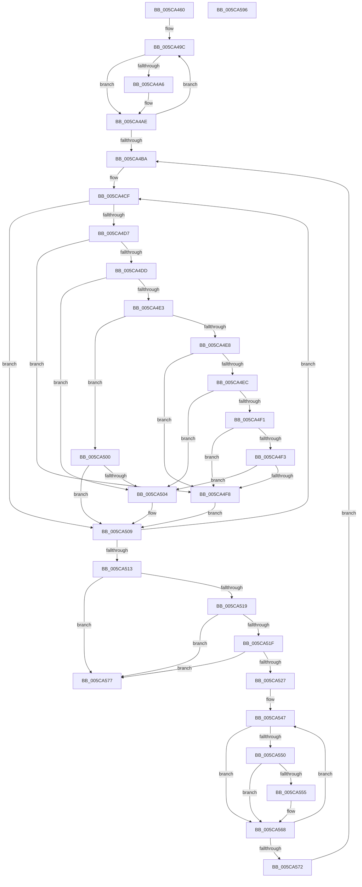

# KiMergeSmallSharedReadyQueueAssignments

- RVA: `0x005CA460`–`0x005CA597` (길이 `311` bytes)
- VA: `0x00000001405CA460`
- 실행 섹션: `.text`
- PDB 이름 있음: `예`; PDB Function 태그: `아니요`
- unwind 정보 RVA: `0x000BE338`
- 디코드: `99`개 명령, `311/311` bytes 표시
- 미해석 바이트: `0` (있으면 어셈블리에 `.byte`로 보존)

> 이 문서는 커널 이미지의 기계어와 PDB 기호를 분석해 생성했습니다. 4번과 5번은 함수 원형과 자료형을 바이너리 사용 방식에서 추정한 C 해석이며 원본 소스 복구 결과는 아닙니다.

## 1. Dependencies

- 직접 호출 지점: **2**; 고유 호출 대상: **2**
- 직접 호출자로 확인된 함수: **2**
- RIP 상대 이미지 참조: **1**

### Outgoing calls
- `0x005CA491` → [memset](../6C/memset_function_006C6C40.md) (function, `0x006C6C40`)
- `0x005CA57F` → [_security_check_cookie](../6A/_security_check_cookie_function_006AC640.md) (function, `0x006AC640`)

### Direct callers
- [KiAssignCooperativeIdleSearchContexts](../5B/KiAssignCooperativeIdleSearchContexts_function_005B7088.md) at `0x005B7188`
- [KiComputeSharedReadyQueueAssignments](KiComputeSharedReadyQueueAssignments_function_005C9BB0.md) at `0x005C9C67`

### Static image references
- `0x005CA46F` → RVA `0x00E0A740` (`.data`; read)

## 2. Other-region calls and transfers

- 다른 실행 섹션으로 향하는 call: **0**
- 별도 외부 분기/꼬리 이동을 확인하지 못했습니다.

## 3. Assembly (complete function range)

```asm
005CA460  48 89 5C 24 08                  mov qword ptr [rsp + 8], rbx
005CA465  48 89 74 24 10                  mov qword ptr [rsp + 0x10], rsi
005CA46A  57                              push rdi
005CA46B  48 83 EC 70                     sub rsp, 0x70
005CA46F  48 8B 05 CA 02 84 00            mov rax, qword ptr [rip + 0x8402ca]
005CA476  48 33 C4                        xor rax, rsp
005CA479  48 89 44 24 60                  mov qword ptr [rsp + 0x60], rax
005CA47E  8B F2                           mov esi, edx
005CA480  49 8B F8                        mov rdi, r8
005CA483  33 D2                           xor edx, edx
005CA485  48 8B D9                        mov rbx, rcx
005CA488  48 8D 4C 24 20                  lea rcx, [rsp + 0x20]
005CA48D  44 8D 42 40                     lea r8d, [rdx + 0x40]
005CA491  E8 AA C7 0F 00                  call 0x1406c6c40
005CA496  45 32 C9                        xor r9b, r9b
005CA499  4C 8B D7                        mov r10, rdi
005CA49C  41 0F B6 C1                     movzx eax, r9b
005CA4A0  48 0F A3 C3                     bt rbx, rax
005CA4A4  73 08                           jae 0x1405ca4ae
005CA4A6  41 0F B6 02                     movzx eax, byte ptr [r10]
005CA4AA  FE 44 04 20                     inc byte ptr [rsp + rax + 0x20]
005CA4AE  41 FE C1                        inc r9b
005CA4B1  49 FF C2                        inc r10
005CA4B4  41 80 F9 40                     cmp r9b, 0x40
005CA4B8  72 E2                           jb 0x1405ca49c
005CA4BA  41 B1 FF                        mov r9b, 0xff
005CA4BD  4C 8D 5C 24 20                  lea r11, [rsp + 0x20]
005CA4C2  BA FF 00 00 00                  mov edx, 0xff
005CA4C7  45 8A C1                        mov r8b, r9b
005CA4CA  44 8B D2                        mov r10d, edx
005CA4CD  32 C9                           xor cl, cl
005CA4CF  41 0F B6 03                     movzx eax, byte ptr [r11]
005CA4D3  84 C0                           test al, al
005CA4D5  74 32                           je 0x1405ca509
005CA4D7  41 80 F9 FF                     cmp r9b, 0xff
005CA4DB  74 1B                           je 0x1405ca4f8
005CA4DD  41 80 F8 FF                     cmp r8b, 0xff
005CA4E1  74 21                           je 0x1405ca504
005CA4E3  41 3B C2                        cmp eax, r10d
005CA4E6  73 18                           jae 0x1405ca500
005CA4E8  3B C2                           cmp eax, edx
005CA4EA  73 0C                           jae 0x1405ca4f8
005CA4EC  44 3B D2                        cmp r10d, edx
005CA4EF  72 13                           jb 0x1405ca504
005CA4F1  77 05                           ja 0x1405ca4f8
005CA4F3  45 3A C8                        cmp r9b, r8b
005CA4F6  73 0C                           jae 0x1405ca504
005CA4F8  44 8A C9                        mov r9b, cl
005CA4FB  44 8B D0                        mov r10d, eax
005CA4FE  EB 09                           jmp 0x1405ca509
005CA500  3B C2                           cmp eax, edx
005CA502  73 05                           jae 0x1405ca509
005CA504  8B D0                           mov edx, eax
005CA506  44 8A C1                        mov r8b, cl
005CA509  FE C1                           inc cl
005CA50B  49 FF C3                        inc r11
005CA50E  80 F9 40                        cmp cl, 0x40
005CA511  72 BC                           jb 0x1405ca4cf
005CA513  41 80 F9 FF                     cmp r9b, 0xff
005CA517  74 5E                           je 0x1405ca577
005CA519  41 80 F8 FF                     cmp r8b, 0xff
005CA51D  74 58                           je 0x1405ca577
005CA51F  42 8D 04 12                     lea eax, [rdx + r10]
005CA523  3B C6                           cmp eax, esi
005CA525  77 50                           ja 0x1405ca577
005CA527  45 3A C8                        cmp r9b, r8b
005CA52A  41 0F B6 C0                     movzx eax, r8b
005CA52E  45 0F B6 D9                     movzx r11d, r9b
005CA532  48 8B D7                        mov rdx, rdi
005CA535  44 0F 43 D8                     cmovae r11d, eax
005CA539  45 0F B6 D0                     movzx r10d, r8b
005CA53D  41 0F B6 C1                     movzx eax, r9b
005CA541  44 0F 43 D0                     cmovae r10d, eax
005CA545  32 C9                           xor cl, cl
005CA547  0F B6 C1                        movzx eax, cl
005CA54A  48 0F A3 C3                     bt rbx, rax
005CA54E  73 18                           jae 0x1405ca568
005CA550  44 38 12                        cmp byte ptr [rdx], r10b
005CA553  75 13                           jne 0x1405ca568
005CA555  41 0F B6 C3                     movzx eax, r11b
005CA559  44 88 1A                        mov byte ptr [rdx], r11b
005CA55C  FE 44 04 20                     inc byte ptr [rsp + rax + 0x20]
005CA560  41 0F B6 C2                     movzx eax, r10b
005CA564  FE 4C 04 20                     dec byte ptr [rsp + rax + 0x20]
005CA568  FE C1                           inc cl
005CA56A  48 FF C2                        inc rdx
005CA56D  80 F9 40                        cmp cl, 0x40
005CA570  72 D5                           jb 0x1405ca547
005CA572  E9 43 FF FF FF                  jmp 0x1405ca4ba
005CA577  48 8B 4C 24 60                  mov rcx, qword ptr [rsp + 0x60]
005CA57C  48 33 CC                        xor rcx, rsp
005CA57F  E8 BC 20 0E 00                  call 0x1406ac640
005CA584  4C 8D 5C 24 70                  lea r11, [rsp + 0x70]
005CA589  49 8B 5B 10                     mov rbx, qword ptr [r11 + 0x10]
005CA58D  49 8B 73 18                     mov rsi, qword ptr [r11 + 0x18]
005CA591  49 8B E3                        mov rsp, r11
005CA594  5F                              pop rdi
005CA595  C3                              ret
005CA596  CC                              int3
```

## 4. C-style interpretation (structured pseudocode)

```c
__int64 __fastcall KiMergeSmallSharedReadyQueueAssignments(__int64 a1, int a2, __int64 a3, unsigned __int8 a4)
{
    __int64 result;
    __int64 v_r10;
    __int64 v_r11;
    __int64 v_rsp;
    unsigned __int64 v_stack_m18;
    unsigned __int64 v_stack_m58;
    unsigned __int64 v_stack_m8;
    unsigned __int64 v_stack_p10;
    unsigned __int64 v_stack_p8;

    v_stack_p8 = v_rbx;
    v_stack_p10 = v_rsi;
    v_rsp = (v_rsp) - (112);
    result = (*(unsigned __int64 *)(v_rip + 8651466)) ^ (v_rsp);
    v_stack_m18 = result;
    a2 = 0;
    result = memset(v_stack_m58, a2, a2 + 64, a4);
    a4 = 0;
loc_005CA49C:
    result = 0;
    if (!(condition_is_above_or_equal)) {
        result = *(unsigned __int8 *)(a3);
    }
    a4 = (unsigned __int8)((a4) + 1);
    v_r10 = (a3) + 1;
    if (a4 < 64) goto loc_005CA49C;
loc_005CA4BA:
    a1 = 0;
loc_005CA4CF:
    if ((unsigned __int8)(*(unsigned __int8 *)(v_stack_m58)) == 0) goto loc_005CA509;
    if (255 == 255) goto loc_005CA4F8;
    if (255 == 255) goto loc_005CA504;
    if (((unsigned int)(*(unsigned __int8 *)(v_stack_m58))) >= 255) goto loc_005CA500;
    if (((unsigned int)(*(unsigned __int8 *)(v_stack_m58))) >= 255) goto loc_005CA4F8;
    if (255 < 255) goto loc_005CA504;
    if (255 > 255) goto loc_005CA4F8;
    if (255 >= 255) goto loc_005CA504;
loc_005CA4F8:
    goto loc_005CA509;
loc_005CA500:
    if (((unsigned int)(*(unsigned __int8 *)(v_stack_m58))) < 255) {
        a2 = (unsigned int)(*(unsigned __int8 *)(v_stack_m58));
        a3 = 0;
    }
    a1 = (unsigned __int8)((a1) + 1);
    v_r11 = (v_stack_m58) + 1;
    if (((unsigned __int8)(a1)) < 64) goto loc_005CA4CF;
    if (0 == 255) goto loc_005CA577;
    if (((unsigned __int8)(a3)) == 255) goto loc_005CA577;
    if (((unsigned int)(a2 + (unsigned int)((unsigned int)(*(unsigned __int8 *)(v_stack_m58))) * 1)) > ((unsigned int)((unsigned int)(a2)))) goto loc_005CA577;
    v_r11 = 0;
    if (0 >= ((unsigned __int8)(a3))) { v_r11 = (unsigned int)((unsigned __int8)(a3)); }
    v_r10 = (unsigned __int8)(a3);
    if (0 >= ((unsigned __int8)(a3))) { v_r10 = 0; }
    a1 = 0;
loc_005CA547:
    if (condition_is_above_or_equal) goto loc_005CA568;
    result = 0;
    if ((*(unsigned __int8 *)(a3)) == ((unsigned __int8)(v_r10))) {
        result = (unsigned __int8)(v_r11);
        *(unsigned __int8 *)(a3) = (unsigned __int8)(v_r11);
        result = (unsigned __int8)(v_r10);
    }
    a1 = (unsigned __int8)((a1) + 1);
    a2 = (a3) + 1;
    if (((unsigned __int8)(a1)) < 64) goto loc_005CA547;
    goto loc_005CA4BA;
loc_005CA577:
    a1 = (v_stack_m18) ^ (v_rsp);
    result = _security_check_cookie(a1, a2, a3, 0);
    return result;
}
```

## 5. (Beta) C Style

```c
int64_t KiMergeSmallSharedReadyQueueAssignments(int64_t Arg1, int32_t Arg2, int64_t Arg3, uint8_t Arg4)
{
    int64_t result;
    int64_t local_r10;
    int64_t local_r11;
    int64_t local_rsp;
    uint64_t v_stack_m18;
    uint64_t v_stack_m58;
    uint64_t v_stack_m8;
    uint64_t v_stack_p10;
    uint64_t v_stack_p8;

    v_stack_p8 = local_rbx;
    v_stack_p10 = local_rsi;
    local_rsp = (local_rsp) - (112);
    result = (*(uint64_t *)(v_rip + 0x8402CA)) ^ (local_rsp);
    v_stack_m18 = result;
    Arg2 = 0;
    result = memset(v_stack_m58, Arg2, Arg2 + 64, Arg4);
    Arg4 = 0;
loc_005CA49C:
    result = 0;
    if (!(condition_is_above_or_equal)) {
        result = *(uint8_t *)(Arg3);
    }
    Arg4 = (uint8_t)((Arg4) + 1);
    local_r10 = (Arg3) + 1;
    if (Arg4 < 64) goto loc_005CA49C;
loc_005CA4BA:
    Arg1 = 0;
loc_005CA4CF:
    if ((uint8_t)(*(uint8_t *)(v_stack_m58)) == 0) goto loc_005CA509;
    if (255 == 255) goto loc_005CA4F8;
    if (255 == 255) goto loc_005CA504;
    if (((uint32_t)(*(uint8_t *)(v_stack_m58))) >= 255) goto loc_005CA500;
    if (((uint32_t)(*(uint8_t *)(v_stack_m58))) >= 255) goto loc_005CA4F8;
    if (255 < 255) goto loc_005CA504;
    if (255 > 255) goto loc_005CA4F8;
    if (255 >= 255) goto loc_005CA504;
loc_005CA4F8:
    goto loc_005CA509;
loc_005CA500:
    if (((uint32_t)(*(uint8_t *)(v_stack_m58))) < 255) {
        Arg2 = (uint32_t)(*(uint8_t *)(v_stack_m58));
        Arg3 = 0;
    }
    Arg1 = (uint8_t)((Arg1) + 1);
    local_r11 = (v_stack_m58) + 1;
    if (((uint8_t)(Arg1)) < 64) goto loc_005CA4CF;
    if (0 == 255) goto loc_005CA577;
    if (((uint8_t)(Arg3)) == 255) goto loc_005CA577;
    if (((uint32_t)(Arg2 + (uint32_t)((uint32_t)(*(uint8_t *)(v_stack_m58))) * 1)) > ((uint32_t)((uint32_t)(Arg2)))) goto loc_005CA577;
    local_r11 = 0;
    if (0 >= ((uint8_t)(Arg3))) { local_r11 = (uint32_t)((uint8_t)(Arg3)); }
    local_r10 = (uint8_t)(Arg3);
    if (0 >= ((uint8_t)(Arg3))) { local_r10 = 0; }
    Arg1 = 0;
loc_005CA547:
    if (condition_is_above_or_equal) goto loc_005CA568;
    result = 0;
    if ((*(uint8_t *)(Arg3)) == ((uint8_t)(local_r10))) {
        result = (uint8_t)(local_r11);
        *(uint8_t *)(Arg3) = (uint8_t)(local_r11);
        result = (uint8_t)(local_r10);
    }
    Arg1 = (uint8_t)((Arg1) + 1);
    Arg2 = (Arg3) + 1;
    if (((uint8_t)(Arg1)) < 64) goto loc_005CA547;
    goto loc_005CA4BA;
loc_005CA577:
    Arg1 = (v_stack_m18) ^ (local_rsp);
    result = _security_check_cookie(Arg1, Arg2, Arg3, 0);
    return result;
}
```

## 6. Execution-region graph

[열기: 2D/3D 그래프와 함수 탐색 컨트롤 패널](../../../control-panel.html?section=text&rva=0x005CA460&view=graph)

- 2D 그래프는 위에서 아래로 흐르고, 3D 그래프는 빈 공간을 드래그해 회전합니다. Shift+드래그는 이동, 휠은 확대·축소, 함수 노드 선택은 대상 보고서 이동입니다.

### Static fallback


