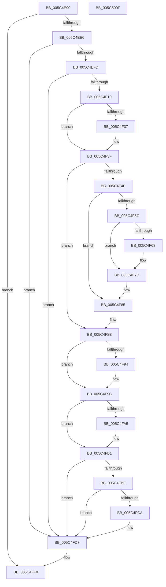

# KiMonitorCacheErrata

- RVA: `0x005C4E90`–`0x005C5010` (길이 `384` bytes)
- VA: `0x00000001405C4E90`
- 실행 섹션: `.text`
- PDB 이름 있음: `예`; PDB Function 태그: `아니요`
- unwind 정보 RVA: `0x0005FEF8`
- 디코드: `100`개 명령, `384/384` bytes 표시
- 미해석 바이트: `0` (있으면 어셈블리에 `.byte`로 보존)

> 이 문서는 커널 이미지의 기계어와 PDB 기호를 분석해 생성했습니다. 4번과 5번은 함수 원형과 자료형을 바이너리 사용 방식에서 추정한 C 해석이며 원본 소스 복구 결과는 아닙니다.

## 1. Dependencies

- 직접 호출 지점: **5**; 고유 호출 대상: **5**
- 직접 호출자로 확인된 함수: **0**
- RIP 상대 이미지 참조: **6**

### Outgoing calls
- `0x005C4F3A` → [KiRaiseIrqlProcessIrqlFlags](../4F/KiRaiseIrqlProcessIrqlFlags_function_004F56FC.md) (function, `0x004F56FC`)
- `0x005C4F70` → [ObReferenceObjectSafeWithTag](../21/ObReferenceObjectSafeWithTag_function_00210EE0.md) (function, `0x00210EE0`)
- `0x005C4F97` → [MmReadProcessPageTables](../68/MmReadProcessPageTables_function_006866C8.md) (function, `0x006866C8`)
- `0x005C4FAC` → [KiLowerIrqlProcessIrqlFlags](../4F/KiLowerIrqlProcessIrqlFlags_function_004F5698.md) (function, `0x004F5698`)
- `0x005C4FD2` → [ObDereferenceObjectDeferDeleteWithTag](../26/ObDereferenceObjectDeferDeleteWithTag_function_00263EA0.md) (function, `0x00263EA0`)

### Direct callers
- 이 함수 시작 RVA로 연결되는 직접 call은 확인되지 않았습니다. 간접 호출은 완전히 역산할 수 없습니다.

### Static image references
- `0x005C4EBA` → RVA `0x00FC6D28` (`ALMOSTRO`; read)
- `0x005C4ED5` → RVA `0x00F10D64` (`.data`; read)
- `0x005C4F13` → RVA `0x00FC8C40` (`ALMOSTRO`; read)
- `0x005C4F2F` → RVA `0x00FC6D20` (`ALMOSTRO`; read)
- `0x005C4F46` → RVA `0x00FCFF00` (`CACHEALI`; read)
- `0x005C4FE3` → RVA `0x00FC6A80` (`ALMOSTRO`; read)

## 2. Other-region calls and transfers

- 다른 실행 섹션으로 향하는 call: **0**
- 별도 외부 분기/꼬리 이동을 확인하지 못했습니다.

## 3. Assembly (complete function range)

```asm
005C4E90  48 8B C4                        mov rax, rsp
005C4E93  48 89 58 08                     mov qword ptr [rax + 8], rbx
005C4E97  48 89 68 10                     mov qword ptr [rax + 0x10], rbp
005C4E9B  48 89 70 18                     mov qword ptr [rax + 0x18], rsi
005C4E9F  48 89 78 20                     mov qword ptr [rax + 0x20], rdi
005C4EA3  41 54                           push r12
005C4EA5  41 56                           push r14
005C4EA7  41 57                           push r15
005C4EA9  48 83 EC 20                     sub rsp, 0x20
005C4EAD  65 48 8B 0C 25 20 00 00 00      mov rcx, qword ptr gs:[0x20]
005C4EB6  48 83 C8 FF                     or rax, 0xffffffffffffffff
005C4EBA  4C 8B 25 67 1E A0 00            mov r12, qword ptr [rip + 0xa01e67]
005C4EC1  8B 59 24                        mov ebx, dword ptr [rcx + 0x24]
005C4EC4  48 83 C3 27                     add rbx, 0x27
005C4EC8  48 C1 E3 04                     shl rbx, 4
005C4ECC  49 03 DC                        add rbx, r12
005C4ECF  48 87 03                        xchg qword ptr [rbx], rax
005C4ED2  8B 43 08                        mov eax, dword ptr [rbx + 8]
005C4ED5  2B 05 89 BE 94 00               sub eax, dword ptr [rip + 0x94be89]
005C4EDB  89 43 08                        mov dword ptr [rbx + 8], eax
005C4EDE  85 C0                           test eax, eax
005C4EE0  0F 8F 0A 01 00 00               jg 0x1405c4ff0
005C4EE6  8B 53 0C                        mov edx, dword ptr [rbx + 0xc]
005C4EE9  48 83 C2 27                     add rdx, 0x27
005C4EED  48 C1 E2 04                     shl rdx, 4
005C4EF1  49 03 D4                        add rdx, r12
005C4EF4  48 3B DA                        cmp rbx, rdx
005C4EF7  0F 84 DA 00 00 00               je 0x1405c4fd7
005C4EFD  8B 49 24                        mov ecx, dword ptr [rcx + 0x24]
005C4F00  F0 48 0F B3 0A                  lock btr qword ptr [rdx], rcx
005C4F05  0F 92 C0                        setb al
005C4F08  84 C0                           test al, al
005C4F0A  0F 85 C7 00 00 00               jne 0x1405c4fd7
005C4F10  8B 43 0C                        mov eax, dword ptr [rbx + 0xc]
005C4F13  48 8D 3D 26 3D A0 00            lea rdi, [rip + 0xa03d26]
005C4F1A  33 F6                           xor esi, esi
005C4F1C  48 8B 3C C7                     mov rdi, qword ptr [rdi + rax*8]
005C4F20  4C 8B 7F 08                     mov r15, qword ptr [rdi + 8]
005C4F24  45 0F 20 C6                     mov r14, cr8
005C4F28  8D 56 0F                        lea edx, [rsi + 0xf]
005C4F2B  44 0F 22 C2                     mov cr8, rdx
005C4F2F  39 35 EB 1D A0 00               cmp dword ptr [rip + 0xa01deb], esi
005C4F35  74 08                           je 0x1405c4f3f
005C4F37  41 8A CE                        mov cl, r14b
005C4F3A  E8 BD 07 F3 FF                  call 0x1404f56fc
005C4F3F  F0 48 0F BA 6F 30 00            lock bts qword ptr [rdi + 0x30], 0
005C4F46  48 8D 05 B3 AF A0 00            lea rax, [rip + 0xa0afb3]
005C4F4D  72 3C                           jb 0x1405c4f8b
005C4F4F  48 8B 6F 08                     mov rbp, qword ptr [rdi + 8]
005C4F53  F0 48 0F BA 6D 40 00            lock bts qword ptr [rbp + 0x40], 0
005C4F5A  72 29                           jb 0x1405c4f85
005C4F5C  48 8B B5 B8 00 00 00            mov rsi, qword ptr [rbp + 0xb8]
005C4F63  48 3B F0                        cmp rsi, rax
005C4F66  74 15                           je 0x1405c4f7d
005C4F68  BA 45 72 72 61                  mov edx, 0x61727245
005C4F6D  48 8B CE                        mov rcx, rsi
005C4F70  E8 6B BF C4 FF                  call 0x140210ee0
005C4F75  F6 D8                           neg al
005C4F77  48 1B D2                        sbb rdx, rdx
005C4F7A  48 23 F2                        and rsi, rdx
005C4F7D  48 C7 45 40 00 00 00 00         mov qword ptr [rbp + 0x40], 0
005C4F85  F0 48 83 67 30 00               lock and qword ptr [rdi + 0x30], 0
005C4F8B  48 8B 47 08                     mov rax, qword ptr [rdi + 8]
005C4F8F  4C 3B F8                        cmp r15, rax
005C4F92  75 08                           jne 0x1405c4f9c
005C4F94  48 8B CF                        mov rcx, rdi
005C4F97  E8 2C 17 0C 00                  call 0x1406866c8
005C4F9C  83 3D 7D 1D A0 00 00            cmp dword ptr [rip + 0xa01d7d], 0
005C4FA3  74 0C                           je 0x1405c4fb1
005C4FA5  44 0F 20 C1                     mov rcx, cr8
005C4FA9  41 8A D6                        mov dl, r14b
005C4FAC  E8 E7 06 F3 FF                  call 0x1404f5698
005C4FB1  41 0F B6 C6                     movzx eax, r14b
005C4FB5  44 0F 22 C0                     mov cr8, rax
005C4FB9  48 85 F6                        test rsi, rsi
005C4FBC  74 19                           je 0x1405c4fd7
005C4FBE  48 8D 05 3B AF A0 00            lea rax, [rip + 0xa0af3b]
005C4FC5  48 3B F0                        cmp rsi, rax
005C4FC8  74 0D                           je 0x1405c4fd7
005C4FCA  BA 45 72 72 61                  mov edx, 0x61727245
005C4FCF  48 8B CE                        mov rcx, rsi
005C4FD2  E8 C9 EE C9 FF                  call 0x140263ea0
005C4FD7  41 8B 04 24                     mov eax, dword ptr [r12]
005C4FDB  33 D2                           xor edx, edx
005C4FDD  89 43 08                        mov dword ptr [rbx + 8], eax
005C4FE0  8B 43 0C                        mov eax, dword ptr [rbx + 0xc]
005C4FE3  8B 0D 97 1A A0 00               mov ecx, dword ptr [rip + 0xa01a97]
005C4FE9  FF C0                           inc eax
005C4FEB  F7 F1                           div ecx
005C4FED  89 53 0C                        mov dword ptr [rbx + 0xc], edx
005C4FF0  48 8B 5C 24 40                  mov rbx, qword ptr [rsp + 0x40]
005C4FF5  48 8B 6C 24 48                  mov rbp, qword ptr [rsp + 0x48]
005C4FFA  48 8B 74 24 50                  mov rsi, qword ptr [rsp + 0x50]
005C4FFF  48 8B 7C 24 58                  mov rdi, qword ptr [rsp + 0x58]
005C5004  48 83 C4 20                     add rsp, 0x20
005C5008  41 5F                           pop r15
005C500A  41 5E                           pop r14
005C500C  41 5C                           pop r12
005C500E  C3                              ret
005C500F  CC                              int3
```

## 4. C-style interpretation (structured pseudocode)

```c
__int64 __fastcall KiMonitorCacheErrata(void)
{
    __int64 result;
    __int64 v_rbx;
    __int64 v_rsi;
    __int64 v_rsp;
    unsigned __int64 v_stack_p10;
    unsigned __int64 v_stack_p18;
    unsigned __int64 v_stack_p20;
    unsigned __int64 v_stack_p8;

    *(unsigned __int64 *)(v_rsp + 8) = v_rbx;
    *(unsigned __int64 *)(v_rsp + 16) = v_rbp;
    *(unsigned __int64 *)(v_rsp + 24) = v_rsi;
    *(unsigned __int64 *)(v_rsp + 32) = v_rdi;
    v_rsp = (v_rsp) - (32);
    result = (v_rsp) | (-1);
    v_rbx = ((unsigned int)(*(unsigned int *)(*(unsigned __int64 *)(gs_base + (0 + 32)) + 36))) + (39);
    v_rbx = (v_rbx) << (4);
    v_rbx = (v_rbx) + (*(unsigned __int64 *)(v_rip + 10493543));
    result = (unsigned int)(((unsigned int)(*(unsigned int *)(v_rbx + 8))) - (*(unsigned int *)(v_rip + 9748105)));
    *(unsigned int *)(v_rbx + 8) = (unsigned int)(result);
    if (condition_is_greater) goto loc_005C4FF0;
    a2 = ((unsigned int)(*(unsigned int *)(v_rbx + 12))) + (39);
    a2 = (a2) << (4);
    a2 = (a2) + (*(unsigned __int64 *)(v_rip + 10493543));
    if (v_rbx == a2) goto loc_005C4FD7;
    result = (v_rbx < a2) ? 1 : 0;
    if ((unsigned __int8)(result) != 0) goto loc_005C4FD7;
    v_rsi = 0;
    result = (unsigned int)(*(unsigned int *)(v_rbx + 12));
    if ((*(unsigned int *)(v_rip + 10493419)) != 0) {
        a1 = (unsigned __int8)(v_cr8);
        result = KiRaiseIrqlProcessIrqlFlags(a1, v_rsi + 15, a3, a4);
    }
    if ((*(unsigned int *)(v_rip + 10493419)) < 0) goto loc_005C4F8B;
    if ((*(unsigned int *)(v_rip + 10493419)) < 0) goto loc_005C4F85;
    result = v_rip + 10530739;
    v_rsi = *(unsigned __int64 *)(*(unsigned __int64 *)(*(unsigned __int64 *)(v_rip + 10501414 + (unsigned int)(*(unsigned int *)(v_rbx + 12)) * 8) + 8) + 184);
    if ((*(unsigned __int64 *)(*(unsigned __int64 *)(*(unsigned __int64 *)(v_rip + 10501414 + (unsigned int)(*(unsigned int *)(v_rbx + 12)) * 8) + 8) + 184)) != (v_rip + 10530739)) {
        a2 = 0x61727245ULL;
        a1 = *(unsigned __int64 *)(*(unsigned __int64 *)(*(unsigned __int64 *)(v_rip + 10501414 + (unsigned int)(*(unsigned int *)(v_rbx + 12)) * 8) + 8) + 184);
        result = ObReferenceObjectSafeWithTag(a1, a2, a3, a4);
        result = (unsigned __int8)(-(result));
        v_rsi = (*(unsigned __int64 *)(*(unsigned __int64 *)(*(unsigned __int64 *)(v_rip + 10501414 + (unsigned int)(*(unsigned int *)(v_rbx + 12)) * 8) + 8) + 184)) & (a2);
    }
    *(unsigned __int64 *)(*(unsigned __int64 *)(*(unsigned __int64 *)(v_rip + 10501414 + (unsigned int)(*(unsigned int *)(v_rbx + 12)) * 8) + 8) + 64) = 0;
loc_005C4F85:
loc_005C4F8B:
    result = *(unsigned __int64 *)(*(unsigned __int64 *)(v_rip + 10501414 + (unsigned int)(*(unsigned int *)(v_rbx + 12)) * 8) + 8);
    if ((*(unsigned __int64 *)(*(unsigned __int64 *)(v_rip + 10501414 + (unsigned int)(*(unsigned int *)(v_rbx + 12)) * 8) + 8)) == (*(unsigned __int64 *)(*(unsigned __int64 *)(v_rip + 10501414 + (unsigned int)(*(unsigned int *)(v_rbx + 12)) * 8) + 8))) {
        a1 = *(unsigned __int64 *)(v_rip + 10501414 + (unsigned int)(*(unsigned int *)(v_rbx + 12)) * 8);
        result = MmReadProcessPageTables(a1, a2, a3, a4);
    }
    if ((*(unsigned int *)(v_rip + 10493309)) != 0) {
        a1 = v_rsi + 15;
        a2 = (unsigned __int8)(v_cr8);
        result = KiLowerIrqlProcessIrqlFlags(a1, a2, a3, a4);
    }
    if (v_rsi == 0) goto loc_005C4FD7;
    result = v_rip + 10530619;
    if (v_rsi != (v_rip + 10530619)) {
        a2 = 0x61727245ULL;
        a1 = v_rsi;
        result = ObDereferenceObjectDeferDeleteWithTag(a1, a2, a3, a4);
    }
    a2 = 0;
    *(unsigned int *)(v_rbx + 8) = (unsigned int)((unsigned int)(*(unsigned int *)(*(unsigned __int64 *)(v_rip + 10493543))));
    result = (unsigned int)(((unsigned int)(*(unsigned int *)(v_rbx + 12))) + 1);
    *(unsigned int *)(v_rbx + 12) = 0;
loc_005C4FF0:
    v_rsp = (v_rsp) + (32);
    return result;
}
```

## 5. (Beta) C Style

```c
void KiMonitorCacheErrata(void)
{
    int64_t result;
    int64_t local_rbx;
    int64_t local_rsi;
    int64_t local_rsp;
    uint64_t v_stack_p10;
    uint64_t v_stack_p18;
    uint64_t v_stack_p20;
    uint64_t v_stack_p8;

    *(uint64_t *)(local_rsp + 0x8) = local_rbx;
    *(uint64_t *)(local_rsp + 0x10) = local_rbp;
    *(uint64_t *)(local_rsp + 0x18) = local_rsi;
    *(uint64_t *)(local_rsp + 0x20) = local_rdi;
    local_rsp = (local_rsp) - (32);
    result = (local_rsp) | (-1);
    local_rbx = ((uint32_t)(*(uint32_t *)(*(uint64_t *)(gs_base + (0 + 0x20)) + 0x24))) + (39);
    local_rbx = (local_rbx) << (4);
    local_rbx = (local_rbx) + (*(uint64_t *)(v_rip + 0xA01E67));
    result = (uint32_t)(((uint32_t)(*(uint32_t *)(local_rbx + 0x8))) - (*(uint32_t *)(v_rip + 0x94BE89)));
    *(uint32_t *)(local_rbx + 0x8) = (uint32_t)(result);
    if (condition_is_greater) goto loc_005C4FF0;
    a2 = ((uint32_t)(*(uint32_t *)(local_rbx + 0xC))) + (39);
    a2 = (a2) << (4);
    a2 = (a2) + (*(uint64_t *)(v_rip + 0xA01E67));
    if (local_rbx == a2) goto loc_005C4FD7;
    result = (local_rbx < a2) ? 1 : 0;
    if ((uint8_t)(result) != 0) goto loc_005C4FD7;
    local_rsi = 0;
    result = (uint32_t)(*(uint32_t *)(local_rbx + 0xC));
    if ((*(uint32_t *)(v_rip + 0xA01DEB)) != 0) {
        a1 = (uint8_t)(v_cr8);
        result = KiRaiseIrqlProcessIrqlFlags(a1, local_rsi + 15, a3, a4);
    }
    if ((*(uint32_t *)(v_rip + 0xA01DEB)) < 0) goto loc_005C4F8B;
    if ((*(uint32_t *)(v_rip + 0xA01DEB)) < 0) goto loc_005C4F85;
    result = v_rip + 10530739;
    local_rsi = *(uint64_t *)(*(uint64_t *)(*(uint64_t *)(v_rip + 0xA03D26 + (uint32_t)(*(uint32_t *)(local_rbx + 0xC)) * 8) + 0x8) + 0xB8);
    if ((*(uint64_t *)(*(uint64_t *)(*(uint64_t *)(v_rip + 0xA03D26 + (uint32_t)(*(uint32_t *)(local_rbx + 0xC)) * 8) + 0x8) + 0xB8)) != (v_rip + 10530739)) {
        a2 = 0x61727245ULL;
        a1 = *(uint64_t *)(*(uint64_t *)(*(uint64_t *)(v_rip + 0xA03D26 + (uint32_t)(*(uint32_t *)(local_rbx + 0xC)) * 8) + 0x8) + 0xB8);
        result = ObReferenceObjectSafeWithTag(a1, a2, a3, a4);
        result = (uint8_t)(-(result));
        local_rsi = (*(uint64_t *)(*(uint64_t *)(*(uint64_t *)(v_rip + 0xA03D26 + (uint32_t)(*(uint32_t *)(local_rbx + 0xC)) * 8) + 0x8) + 0xB8)) & (a2);
    }
    *(uint64_t *)(*(uint64_t *)(*(uint64_t *)(v_rip + 0xA03D26 + (uint32_t)(*(uint32_t *)(local_rbx + 0xC)) * 8) + 0x8) + 0x40) = 0;
loc_005C4F85:
loc_005C4F8B:
    result = *(uint64_t *)(*(uint64_t *)(v_rip + 0xA03D26 + (uint32_t)(*(uint32_t *)(local_rbx + 0xC)) * 8) + 0x8);
    if ((*(uint64_t *)(*(uint64_t *)(v_rip + 0xA03D26 + (uint32_t)(*(uint32_t *)(local_rbx + 0xC)) * 8) + 0x8)) == (*(uint64_t *)(*(uint64_t *)(v_rip + 0xA03D26 + (uint32_t)(*(uint32_t *)(local_rbx + 0xC)) * 8) + 0x8))) {
        a1 = *(uint64_t *)(v_rip + 0xA03D26 + (uint32_t)(*(uint32_t *)(local_rbx + 0xC)) * 8);
        result = MmReadProcessPageTables(a1, a2, a3, a4);
    }
    if ((*(uint32_t *)(v_rip + 0xA01D7D)) != 0) {
        a1 = local_rsi + 15;
        a2 = (uint8_t)(v_cr8);
        result = KiLowerIrqlProcessIrqlFlags(a1, a2, a3, a4);
    }
    if (local_rsi == 0) goto loc_005C4FD7;
    result = v_rip + 10530619;
    if (local_rsi != (v_rip + 10530619)) {
        a2 = 0x61727245ULL;
        a1 = local_rsi;
        result = ObDereferenceObjectDeferDeleteWithTag(a1, a2, a3, a4);
    }
    a2 = 0;
    *(uint32_t *)(local_rbx + 0x8) = (uint32_t)((uint32_t)(*(uint32_t *)(*(uint64_t *)(v_rip + 0xA01E67))));
    result = (uint32_t)(((uint32_t)(*(uint32_t *)(local_rbx + 0xC))) + 1);
    *(uint32_t *)(local_rbx + 0xC) = 0;
loc_005C4FF0:
    local_rsp = (local_rsp) + (32);
    return result;
}
```

## 6. Execution-region graph

[열기: 2D/3D 그래프와 함수 탐색 컨트롤 패널](../../../control-panel.html?section=text&rva=0x005C4E90&view=graph)

- 2D 그래프는 위에서 아래로 흐르고, 3D 그래프는 빈 공간을 드래그해 회전합니다. Shift+드래그는 이동, 휠은 확대·축소, 함수 노드 선택은 대상 보고서 이동입니다.

### Static fallback


