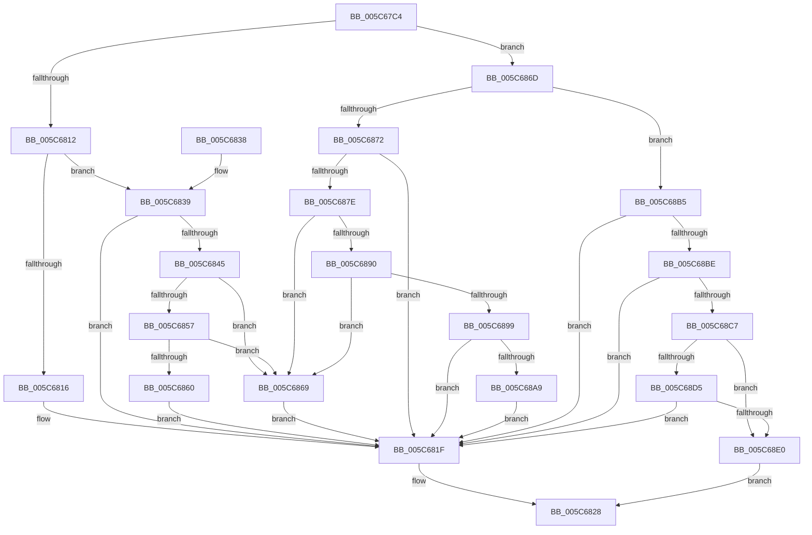

# KiOpComputeLinearAddress

- RVA: `0x005C67C4`–`0x005C68F7` (길이 `307` bytes)
- VA: `0x00000001405C67C4`
- 실행 섹션: `.text`
- PDB 이름 있음: `예`; PDB Function 태그: `아니요`
- unwind 정보 RVA: `0x000CAB64`
- 디코드: `72`개 명령, `307/307` bytes 표시
- 미해석 바이트: `0` (있으면 어셈블리에 `.byte`로 보존)

> 이 문서는 커널 이미지의 기계어와 PDB 기호를 분석해 생성했습니다. 4번과 5번은 함수 원형과 자료형을 바이너리 사용 방식에서 추정한 C 해석이며 원본 소스 복구 결과는 아닙니다.

## 1. Dependencies

- 직접 호출 지점: **0**; 고유 호출 대상: **0**
- 직접 호출자로 확인된 함수: **1**
- RIP 상대 이미지 참조: **1**

### Outgoing calls
- 직접 디코드된 call 명령이 없습니다.

### Direct callers
- [KiOpRetrieveRegMemAddress](../48/KiOpRetrieveRegMemAddress_function_00480B64.md) at `0x00480C72`

### Static image references
- `0x005C67E8` → RVA `0x00028C50` (`.rdata`; read)

## 2. Other-region calls and transfers

- 다른 실행 섹션으로 향하는 call: **0**
- 별도 외부 분기/꼬리 이동을 확인하지 못했습니다.

## 3. Assembly (complete function range)

```asm
005C67C4  48 89 5C 24 10                  mov qword ptr [rsp + 0x10], rbx
005C67C9  48 89 74 24 18                  mov qword ptr [rsp + 0x18], rsi
005C67CE  48 89 7C 24 20                  mov qword ptr [rsp + 0x20], rdi
005C67D3  65 4C 8B 0C 25 88 01 00 00      mov r9, qword ptr gs:[0x188]
005C67DC  48 8B F9                        mov rdi, rcx
005C67DF  8B 41 30                        mov eax, dword ptr [rcx + 0x30]
005C67E2  4C 8B DA                        mov r11, rdx
005C67E5  48 8B 32                        mov rsi, qword ptr [rdx]
005C67E8  48 8D 15 61 24 A6 FF            lea rdx, [rip - 0x59db9f]
005C67EF  8A 59 51                        mov bl, byte ptr [rcx + 0x51]
005C67F2  0F BC C8                        bsf ecx, eax
005C67F5  48 8B 47 18                     mov rax, qword ptr [rdi + 0x18]
005C67F9  44 8B 04 8A                     mov r8d, dword ptr [rdx + rcx*4]
005C67FD  33 D2                           xor edx, edx
005C67FF  45 0F B7 14 00                  movzx r10d, word ptr [r8 + rax]
005C6804  44 8D 42 01                     lea r8d, [rdx + 1]
005C6808  41 8B C0                        mov eax, r8d
005C680B  D3 E0                           shl eax, cl
005C680D  83 F8 20                        cmp eax, 0x20
005C6810  75 5B                           jne 0x1405c686d
005C6812  84 DB                           test bl, bl
005C6814  75 23                           jne 0x1405c6839
005C6816  65 48 8B 14 25 18 00 00 00      mov rdx, qword ptr gs:[0x18]
005C681F  48 8D 04 32                     lea rax, [rdx + rsi]
005C6823  49 89 03                        mov qword ptr [r11], rax
005C6826  33 C0                           xor eax, eax
005C6828  48 8B 5C 24 10                  mov rbx, qword ptr [rsp + 0x10]
005C682D  48 8B 74 24 18                  mov rsi, qword ptr [rsp + 0x18]
005C6832  48 8B 7C 24 20                  mov rdi, qword ptr [rsp + 0x20]
005C6837  C3                              ret
005C6838  CC                              int3
005C6839  49 8B 91 80 06 00 00            mov rdx, qword ptr [r9 + 0x680]
005C6840  48 85 D2                        test rdx, rdx
005C6843  75 DA                           jne 0x1405c681f
005C6845  65 48 8B 14 25 88 01 00 00      mov rdx, qword ptr gs:[0x188]
005C684E  F7 42 74 00 04 00 00            test dword ptr [rdx + 0x74], 0x400
005C6855  75 12                           jne 0x1405c6869
005C6857  44 38 82 4A 02 00 00            cmp byte ptr [rdx + 0x24a], r8b
005C685E  74 09                           je 0x1405c6869
005C6860  48 8B 92 F0 00 00 00            mov rdx, qword ptr [rdx + 0xf0]
005C6867  EB B6                           jmp 0x1405c681f
005C6869  33 D2                           xor edx, edx
005C686B  EB B2                           jmp 0x1405c681f
005C686D  83 F8 10                        cmp eax, 0x10
005C6870  75 43                           jne 0x1405c68b5
005C6872  49 8B 91 78 06 00 00            mov rdx, qword ptr [r9 + 0x678]
005C6879  48 85 D2                        test rdx, rdx
005C687C  75 A1                           jne 0x1405c681f
005C687E  65 48 8B 14 25 88 01 00 00      mov rdx, qword ptr gs:[0x188]
005C6887  F7 42 74 00 04 00 00            test dword ptr [rdx + 0x74], 0x400
005C688E  75 D9                           jne 0x1405c6869
005C6890  44 38 82 4A 02 00 00            cmp byte ptr [rdx + 0x24a], r8b
005C6897  74 D0                           je 0x1405c6869
005C6899  48 8B 92 F0 00 00 00            mov rdx, qword ptr [rdx + 0xf0]
005C68A0  48 85 D2                        test rdx, rdx
005C68A3  0F 84 76 FF FF FF               je 0x1405c681f
005C68A9  48 81 C2 00 20 00 00            add rdx, 0x2000
005C68B0  E9 6A FF FF FF                  jmp 0x1405c681f
005C68B5  41 3A D8                        cmp bl, r8b
005C68B8  0F 85 61 FF FF FF               jne 0x1405c681f
005C68BE  38 57 3A                        cmp byte ptr [rdi + 0x3a], dl
005C68C1  0F 84 58 FF FF FF               je 0x1405c681f
005C68C7  41 8D 42 DD                     lea eax, [r10 - 0x23]
005C68CB  B9 E7 FF 00 00                  mov ecx, 0xffe7
005C68D0  66 85 C1                        test cx, ax
005C68D3  75 0B                           jne 0x1405c68e0
005C68D5  66 41 83 FA 3B                  cmp r10w, 0x3b
005C68DA  0F 85 3F FF FF FF               jne 0x1405c681f
005C68E0  48 B8 00 00 FF FF FF 7F 00 00   movabs rax, 0x7fffffff0000
005C68EA  49 89 03                        mov qword ptr [r11], rax
005C68ED  B8 05 00 00 C0                  mov eax, 0xc0000005
005C68F2  E9 31 FF FF FF                  jmp 0x1405c6828
```

## 4. C-style interpretation (structured pseudocode)

```c
__int64 __fastcall KiOpComputeLinearAddress(__int64 a1, __int64 a2)
{
    __int64 result;
    unsigned __int64 v_stack_p10;
    unsigned __int64 v_stack_p18;
    unsigned __int64 v_stack_p20;

    v_stack_p10 = v_rbx;
    v_stack_p18 = v_rsi;
    v_stack_p20 = v_rdi;
    a2 = 0;
    result = (unsigned int)(((unsigned int)((unsigned int)(a2 + 1))) << ((unsigned __int8)(a1)));
    if (((unsigned int)(result)) != 32) goto loc_005C686D;
    if ((unsigned __int8)(*(unsigned __int8 *)(a1 + 81)) != 0) goto loc_005C6839;
loc_005C681F:
    *(unsigned __int64 *)(a2) = *(unsigned __int64 *)(gs_base + (0 + 24)) + *(unsigned __int64 *)(a2) * 1;
    result = 0;
loc_005C6828:
    return result;
loc_005C6839:
    if (*(unsigned __int64 *)(*(unsigned __int64 *)(gs_base + (0 + 392)) + 1664) != 0) goto loc_005C681F;
    if (((*(unsigned int *)(*(unsigned __int64 *)(gs_base + (0 + 392)) + 116)) & (0x400ULL)) != 0) goto loc_005C6869;
    if ((*(unsigned __int8 *)(*(unsigned __int64 *)(gs_base + (0 + 392)) + 586)) == ((unsigned __int8)(a2 + 1))) goto loc_005C6869;
    goto loc_005C681F;
loc_005C6869:
    a2 = 0;
    goto loc_005C681F;
loc_005C686D:
    if (0 != 16) goto loc_005C68B5;
    if (*(unsigned __int64 *)(*(unsigned __int64 *)(gs_base + (0 + 392)) + 1656) != 0) goto loc_005C681F;
    if (((*(unsigned int *)(*(unsigned __int64 *)(gs_base + (0 + 392)) + 116)) & (0x400ULL)) != 0) goto loc_005C6869;
    if ((*(unsigned __int8 *)(*(unsigned __int64 *)(gs_base + (0 + 392)) + 586)) == ((unsigned __int8)(a2 + 1))) goto loc_005C6869;
    if (*(unsigned __int64 *)(*(unsigned __int64 *)(gs_base + (0 + 392)) + 240) == 0) goto loc_005C681F;
    a2 = (*(unsigned __int64 *)(*(unsigned __int64 *)(gs_base + (0 + 392)) + 240)) + (0x2000ULL);
    goto loc_005C681F;
loc_005C68B5:
    if (((unsigned __int8)(v_stack_p10)) != ((unsigned __int8)(a2 + 1))) goto loc_005C681F;
    if ((*(unsigned __int8 *)(v_stack_p20 + 58)) == ((unsigned __int8)(a2))) goto loc_005C681F;
    if ((((unsigned __int16)((unsigned int)(0xFFE7ULL))) & ((unsigned __int16)(*(unsigned __int16 *)((unsigned int)(*(unsigned int *)(v_rip - 5888927 + a1 * 4)) + *(unsigned __int64 *)(a1 + 24) * 1) - 35))) != 0) goto loc_005C68E0;
    if (((unsigned __int16)(*(unsigned __int16 *)((unsigned int)(*(unsigned int *)(v_rip - 5888927 + a1 * 4)) + *(unsigned __int64 *)(a1 + 24) * 1))) != 59) goto loc_005C681F;
loc_005C68E0:
    *(unsigned __int64 *)(a2) = *(unsigned __int16 *)((unsigned int)(*(unsigned int *)(v_rip - 5888927 + a1 * 4)) + *(unsigned __int64 *)(a1 + 24) * 1) - 35;
    goto loc_005C6828;
}
```

## 5. (Beta) C Style

```c
int64_t KiOpComputeLinearAddress(void *Arg1, void *Arg2)
{
    uint8_t *arg1 = (uint8_t *)Arg1;
    uint8_t *arg2 = (uint8_t *)Arg2;

    int64_t result;
    uint64_t v_stack_p10;
    uint64_t v_stack_p18;
    uint64_t v_stack_p20;

    v_stack_p10 = local_rbx;
    v_stack_p18 = local_rsi;
    v_stack_p20 = local_rdi;
    Arg2 = 0;
    result = (uint32_t)(((uint32_t)((uint32_t)(Arg2 + 1))) << ((uint8_t)(Arg1)));
    if (((uint32_t)(result)) != 32) goto loc_005C686D;
    if ((uint8_t)(*(uint8_t *)(arg1 + 0x51)) != 0) goto loc_005C6839;
loc_005C681F:
    *(uint64_t *)(arg2) = *(uint64_t *)(gs_base + (0 + 0x18)) + *(uint64_t *)(arg2) * 1;
    result = 0;
loc_005C6828:
    return result;
loc_005C6839:
    if (*(uint64_t *)(*(uint64_t *)(gs_base + (0 + 0x188)) + 0x680) != 0) goto loc_005C681F;
    if (((*(uint32_t *)(*(uint64_t *)(gs_base + (0 + 0x188)) + 0x74)) & (0x400ULL)) != 0) goto loc_005C6869;
    if ((*(uint8_t *)(*(uint64_t *)(gs_base + (0 + 0x188)) + 0x24A)) == ((uint8_t)(Arg2 + 1))) goto loc_005C6869;
    goto loc_005C681F;
loc_005C6869:
    Arg2 = 0;
    goto loc_005C681F;
loc_005C686D:
    if (0 != 16) goto loc_005C68B5;
    if (*(uint64_t *)(*(uint64_t *)(gs_base + (0 + 0x188)) + 0x678) != 0) goto loc_005C681F;
    if (((*(uint32_t *)(*(uint64_t *)(gs_base + (0 + 0x188)) + 0x74)) & (0x400ULL)) != 0) goto loc_005C6869;
    if ((*(uint8_t *)(*(uint64_t *)(gs_base + (0 + 0x188)) + 0x24A)) == ((uint8_t)(Arg2 + 1))) goto loc_005C6869;
    if (*(uint64_t *)(*(uint64_t *)(gs_base + (0 + 0x188)) + 0xF0) == 0) goto loc_005C681F;
    Arg2 = (*(uint64_t *)(*(uint64_t *)(gs_base + (0 + 0x188)) + 0xF0)) + (0x2000ULL);
    goto loc_005C681F;
loc_005C68B5:
    if (((uint8_t)(v_stack_p10)) != ((uint8_t)(Arg2 + 1))) goto loc_005C681F;
    if ((*(uint8_t *)(v_stack_p20 + 0x3A)) == ((uint8_t)(Arg2))) goto loc_005C681F;
    if ((((uint16_t)((uint32_t)(0xFFE7ULL))) & ((uint16_t)(*(uint16_t *)((uint32_t)(*(uint32_t *)(v_rip - 0x59DB9F + arg1 * 4)) + *(uint64_t *)(arg1 + 0x18) * 1) - 35))) != 0) goto loc_005C68E0;
    if (((uint16_t)(*(uint16_t *)((uint32_t)(*(uint32_t *)(v_rip - 0x59DB9F + arg1 * 4)) + *(uint64_t *)(arg1 + 0x18) * 1))) != 59) goto loc_005C681F;
loc_005C68E0:
    *(uint64_t *)(arg2) = *(uint16_t *)((uint32_t)(*(uint32_t *)(v_rip - 0x59DB9F + arg1 * 4)) + *(uint64_t *)(arg1 + 0x18) * 1) - 35;
    goto loc_005C6828;
}
```

### 관측된 메모리 오프셋

구조체 형식이 확인되지 않은 접근은 인자 기준의 오프셋으로만 기록했습니다.

| 기준 인자 | 오프셋 표현 | 폭 (bit) | 접근 |
|---|---:|---:|---|
| `Arg1` | `+ 0x18` | `64` | `R` |
| `Arg1` | `+ 0x30` | `32` | `R` |
| `Arg1` | `+ 0x3A` | `8` | `R` |
| `Arg1` | `+ 0x51` | `8` | `R` |
| `Arg2` | `+ 0x0` | `64` | `R` |
| `Arg2` | `+ 0x0` | `64` | `W` |

## 6. Execution-region graph

[열기: 2D/3D 그래프와 함수 탐색 컨트롤 패널](../../../control-panel.html?section=text&rva=0x005C67C4&view=graph)

- 2D 그래프는 위에서 아래로 흐르고, 3D 그래프는 빈 공간을 드래그해 회전합니다. Shift+드래그는 이동, 휠은 확대·축소, 함수 노드 선택은 대상 보고서 이동입니다.

### Static fallback


