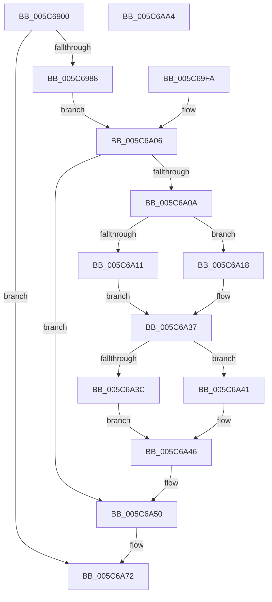

# KiOpPatchCode

- RVA: `0x005C6900`–`0x005C6AA5` (길이 `421` bytes)
- VA: `0x00000001405C6900`
- 실행 섹션: `.text`
- PDB 이름 있음: `예`; PDB Function 태그: `아니요`
- unwind 정보 RVA: `0x000CAB30`
- 디코드: `102`개 명령, `421/421` bytes 표시
- 미해석 바이트: `0` (있으면 어셈블리에 `.byte`로 보존)

> 이 문서는 커널 이미지의 기계어와 PDB 기호를 분석해 생성했습니다. 4번과 5번은 함수 원형과 자료형을 바이너리 사용 방식에서 추정한 C 해석이며 원본 소스 복구 결과는 아닙니다.

## 1. Dependencies

- 직접 호출 지점: **8**; 고유 호출 대상: **7**
- 직접 호출자로 확인된 함수: **2**
- RIP 상대 이미지 참조: **2**

### Outgoing calls
- `0x005C6958` → [ExAcquireFastMutex](../20/ExAcquireFastMutex_function_0020E5A0.md) (function, `0x0020E5A0`)
- `0x005C6979` → [ZwProtectVirtualMemory](../6A/ZwProtectVirtualMemory_function_006ADAD0.md) (function, `0x006ADAD0`)
- `0x005C69F3` → [MmProbeAndLockPages](../23/MmProbeAndLockPages_function_0023B990.md) (function, `0x0023B990`)
- `0x005C6A32` → [MmMapLockedPagesSpecifyCache](../31/MmMapLockedPagesSpecifyCache_function_00318800.md) (function, `0x00318800`)
- `0x005C6A4B` → [MmUnlockPages](../29/MmUnlockPages_function_0029EEE0.md) (function, `0x0029EEE0`)
- `0x005C6A6D` → [ZwProtectVirtualMemory](../6A/ZwProtectVirtualMemory_function_006ADAD0.md) (function, `0x006ADAD0`)
- `0x005C6A79` → [ExReleaseFastMutex](../25/ExReleaseFastMutex_function_002519C0.md) (function, `0x002519C0`)
- `0x005C6A8B` → [_security_check_cookie](../6A/_security_check_cookie_function_006AC640.md) (function, `0x006AC640`)

### Direct callers
- [KiOp_MOVAPS](KiOp_MOVAPS_function_005C6C10.md) at `0x005C6C57`
- [KiOp_MOVDQA](KiOp_MOVDQA_function_005C6C90.md) at `0x005C6CCD`

### Static image references
- `0x005C6916` → RVA `0x00E0A740` (`.data`; read)
- `0x005C6951` → RVA `0x00F10A00` (`.data`; read)

## 2. Other-region calls and transfers

- 다른 실행 섹션으로 향하는 call: **0**
- 별도 외부 분기/꼬리 이동을 확인하지 못했습니다.

## 3. Assembly (complete function range)

```asm
005C6900  4C 8B DC                        mov r11, rsp
005C6903  49 89 5B 08                     mov qword ptr [r11 + 8], rbx
005C6907  45 88 43 18                     mov byte ptr [r11 + 0x18], r8b
005C690B  56                              push rsi
005C690C  57                              push rdi
005C690D  41 56                           push r14
005C690F  48 81 EC 90 00 00 00            sub rsp, 0x90
005C6916  48 8B 05 23 3E 84 00            mov rax, qword ptr [rip + 0x843e23]
005C691D  48 33 C4                        xor rax, rsp
005C6920  48 89 84 24 80 00 00 00         mov qword ptr [rsp + 0x80], rax
005C6928  41 8A F0                        mov sil, r8b
005C692B  4C 8B F2                        mov r14, rdx
005C692E  0F 57 C0                        xorps xmm0, xmm0
005C6931  F3 0F 7F 44 24 54               movdqu xmmword ptr [rsp + 0x54], xmm0
005C6937  33 DB                           xor ebx, ebx
005C6939  89 5C 24 64                     mov dword ptr [rsp + 0x64], ebx
005C693D  49 89 5B D0                     mov qword ptr [r11 - 0x30], rbx
005C6941  89 5C 24 30                     mov dword ptr [rsp + 0x30], ebx
005C6945  49 89 53 98                     mov qword ptr [r11 - 0x68], rdx
005C6949  49 C7 43 90 01 00 00 00         mov qword ptr [r11 - 0x70], 1
005C6951  48 8D 0D A8 A0 94 00            lea rcx, [rip + 0x94a0a8]
005C6958  E8 43 7C C4 FF                  call 0x14020e5a0
005C695D  48 8D 44 24 30                  lea rax, [rsp + 0x30]
005C6962  48 89 44 24 20                  mov qword ptr [rsp + 0x20], rax
005C6967  44 8D 4B 40                     lea r9d, [rbx + 0x40]
005C696B  4C 8D 44 24 38                  lea r8, [rsp + 0x38]
005C6970  48 8D 54 24 40                  lea rdx, [rsp + 0x40]
005C6975  48 83 C9 FF                     or rcx, 0xffffffffffffffff
005C6979  E8 52 71 0E 00                  call 0x1406adad0
005C697E  8B F8                           mov edi, eax
005C6980  85 C0                           test eax, eax
005C6982  0F 88 EA 00 00 00               js 0x1405c6a72
005C6988  0F 57 C0                        xorps xmm0, xmm0
005C698B  F3 0F 7F 44 24 54               movdqu xmmword ptr [rsp + 0x54], xmm0
005C6991  89 5C 24 64                     mov dword ptr [rsp + 0x64], ebx
005C6995  48 89 5C 24 78                  mov qword ptr [rsp + 0x78], rbx
005C699A  48 89 5C 24 48                  mov qword ptr [rsp + 0x48], rbx
005C699F  41 0F B7 C6                     movzx eax, r14w
005C69A3  BA FF 0F 00 00                  mov edx, 0xfff
005C69A8  66 23 C2                        and ax, dx
005C69AB  8D 4A 01                        lea ecx, [rdx + 1]
005C69AE  66 03 C1                        add ax, cx
005C69B1  66 C1 E8 0C                     shr ax, 0xc
005C69B5  66 83 C0 06                     add ax, 6
005C69B9  66 C1 E0 03                     shl ax, 3
005C69BD  66 89 44 24 50                  mov word ptr [rsp + 0x50], ax
005C69C2  66 89 5C 24 52                  mov word ptr [rsp + 0x52], bx
005C69C7  49 8B C6                        mov rax, r14
005C69CA  48 25 00 F0 FF FF               and rax, 0xfffffffffffff000
005C69D0  48 89 44 24 68                  mov qword ptr [rsp + 0x68], rax
005C69D5  44 23 F2                        and r14d, edx
005C69D8  44 89 74 24 74                  mov dword ptr [rsp + 0x74], r14d
005C69DD  C7 44 24 70 01 00 00 00         mov dword ptr [rsp + 0x70], 1
005C69E5  8B FB                           mov edi, ebx
005C69E7  44 8D 43 01                     lea r8d, [rbx + 1]
005C69EB  41 8A D0                        mov dl, r8b
005C69EE  48 8D 4C 24 48                  lea rcx, [rsp + 0x48]
005C69F3  E8 98 4F C7 FF                  call 0x14023b990
005C69F8  EB 0C                           jmp 0x1405c6a06
005C69FA  8B F8                           mov edi, eax
005C69FC  33 DB                           xor ebx, ebx
005C69FE  40 8A B4 24 C0 00 00 00         mov sil, byte ptr [rsp + 0xc0]
005C6A06  85 FF                           test edi, edi
005C6A08  78 46                           js 0x1405c6a50
005C6A0A  F6 44 24 52 05                  test byte ptr [rsp + 0x52], 5
005C6A0F  74 07                           je 0x1405c6a18
005C6A11  48 8B 44 24 60                  mov rax, qword ptr [rsp + 0x60]
005C6A16  EB 1F                           jmp 0x1405c6a37
005C6A18  C7 44 24 28 10 00 00 40         mov dword ptr [rsp + 0x28], 0x40000010
005C6A20  89 5C 24 20                     mov dword ptr [rsp + 0x20], ebx
005C6A24  45 33 C9                        xor r9d, r9d
005C6A27  33 D2                           xor edx, edx
005C6A29  45 8D 41 01                     lea r8d, [r9 + 1]
005C6A2D  48 8D 4C 24 48                  lea rcx, [rsp + 0x48]
005C6A32  E8 C9 1D D5 FF                  call 0x140318800
005C6A37  48 85 C0                        test rax, rax
005C6A3A  74 05                           je 0x1405c6a41
005C6A3C  40 88 30                        mov byte ptr [rax], sil
005C6A3F  EB 05                           jmp 0x1405c6a46
005C6A41  BF 9A 00 00 C0                  mov edi, 0xc000009a
005C6A46  48 8D 4C 24 48                  lea rcx, [rsp + 0x48]
005C6A4B  E8 90 84 CD FF                  call 0x14029eee0
005C6A50  48 8D 44 24 30                  lea rax, [rsp + 0x30]
005C6A55  48 89 44 24 20                  mov qword ptr [rsp + 0x20], rax
005C6A5A  44 8B 4C 24 30                  mov r9d, dword ptr [rsp + 0x30]
005C6A5F  4C 8D 44 24 38                  lea r8, [rsp + 0x38]
005C6A64  48 8D 54 24 40                  lea rdx, [rsp + 0x40]
005C6A69  48 83 C9 FF                     or rcx, 0xffffffffffffffff
005C6A6D  E8 5E 70 0E 00                  call 0x1406adad0
005C6A72  48 8D 0D 87 9F 94 00            lea rcx, [rip + 0x949f87]
005C6A79  E8 42 AF C8 FF                  call 0x1402519c0
005C6A7E  8B C7                           mov eax, edi
005C6A80  48 8B 8C 24 80 00 00 00         mov rcx, qword ptr [rsp + 0x80]
005C6A88  48 33 CC                        xor rcx, rsp
005C6A8B  E8 B0 5B 0E 00                  call 0x1406ac640
005C6A90  48 8B 9C 24 B0 00 00 00         mov rbx, qword ptr [rsp + 0xb0]
005C6A98  48 81 C4 90 00 00 00            add rsp, 0x90
005C6A9F  41 5E                           pop r14
005C6AA1  5F                              pop rdi
005C6AA2  5E                              pop rsi
005C6AA3  C3                              ret
005C6AA4  CC                              int3
```

## 4. C-style interpretation (structured pseudocode)

```c
__int64 __fastcall KiOpPatchCode(__int64 a1, __int64 a2, unsigned __int8 a3)
{
    __int64 result;
    __int64 v_r14;
    __int64 v_rbx;
    __int64 v_rsp;
    unsigned __int64 v_stack_m28;
    unsigned __int64 v_stack_m30;
    unsigned int v_stack_m34;
    unsigned int v_stack_m38;
    unsigned __int64 v_stack_m40;
    unsigned int v_stack_m44;
    unsigned __int64 v_stack_m48;
    unsigned __int64 v_stack_m54;
    unsigned __int16 v_stack_m56;
    unsigned __int16 v_stack_m58;
    unsigned __int64 v_stack_m60;
    unsigned __int64 v_stack_m68;
    unsigned __int64 v_stack_m70;
    unsigned int v_stack_m78;
    unsigned int v_stack_m80;
    unsigned __int64 v_stack_m88;
    unsigned __int8 v_stack_p18;
    unsigned __int64 v_stack_p8;

    *(unsigned __int64 *)(v_rsp + 8) = v_rbx;
    *(unsigned __int8 *)(v_rsp + 24) = a3;
    v_rsp = (v_rsp) - (144);
    result = (*(unsigned __int64 *)(v_rip + 8666659)) ^ (v_rsp);
    v_stack_m28 = result;
    v_stack_m54 = v_xmm0;
    v_rbx = 0;
    v_stack_m44 = 0;
    *(unsigned __int64 *)(v_rsp - 48) = 0;
    v_stack_m78 = 0;
    *(unsigned __int64 *)(v_rsp - 104) = a2;
    *(unsigned __int64 *)(v_rsp - 112) = 1;
    result = ExAcquireFastMutex(v_rip + 9740456, a2, a3, a4);
    v_stack_m88 = v_stack_m78;
    a1 = (v_rip + 9740456) | (-1);
    result = ZwProtectVirtualMemory(a1, v_stack_m68, v_stack_m70, v_rbx + 64);
    if (sign_flag) goto loc_005C6A72;
    v_stack_m54 = v_xmm0;
    v_stack_m44 = 0;
    v_stack_m30 = 0;
    v_stack_m60 = 0;
    result = (unsigned __int16)(((unsigned __int16)(a2)) & ((unsigned __int16)((unsigned int)(0xFFFULL))));
    result = (unsigned __int16)((result) + ((unsigned __int16)((unsigned int)(0xFFFULL) + 1)));
    result = (unsigned __int16)((result) >> (12));
    result = (unsigned __int16)((result) + (6));
    result = (unsigned __int16)((result) << (3));
    v_stack_m58 = (unsigned __int16)(result);
    v_stack_m56 = 0;
    result = (a2) & (0xFFFFFFFFFFFFF000ULL);
    v_stack_m40 = result;
    v_r14 = (unsigned int)((a2) & ((unsigned int)((unsigned int)(0xFFFULL))));
    v_stack_m34 = (unsigned int)(v_r14);
    v_stack_m38 = 1;
    result = MmProbeAndLockPages(v_stack_m60, (unsigned __int8)(v_rbx + 1), v_rbx + 1, v_rbx + 64);
    goto loc_005C6A06;
loc_005C6A06:
    if (sign_flag) goto loc_005C6A50;
    if (((v_stack_m56) & (5)) == 0) goto loc_005C6A18;
    goto loc_005C6A37;
loc_005C6A18:
    v_stack_m80 = 0x40000010ULL;
    v_stack_m88 = 0;
    a4 = 0;
    a2 = 0;
    result = MmMapLockedPagesSpecifyCache(v_stack_m60, a2, a4 + 1, a4);
loc_005C6A37:
    if (result == 0) goto loc_005C6A41;
    *(unsigned __int8 *)(result) = a3;
    goto loc_005C6A46;
loc_005C6A41:
loc_005C6A46:
    result = MmUnlockPages(v_stack_m60, a2, a4 + 1, a4);
loc_005C6A50:
    v_stack_m88 = v_stack_m78;
    a1 = (v_stack_m60) | (-1);
    result = ZwProtectVirtualMemory(a1, v_stack_m68, v_stack_m70, (unsigned int)(v_stack_m78));
loc_005C6A72:
    result = ExReleaseFastMutex(v_rip + 9740167, v_stack_m68, v_stack_m70, (unsigned int)(v_stack_m78));
    a1 = (v_stack_m28) ^ (v_rsp);
    result = _security_check_cookie(a1, v_stack_m68, v_stack_m70, (unsigned int)(v_stack_m78));
    v_rsp = (v_rsp) + (144);
    return result;
}
```

## 5. (Beta) C Style

```c
int64_t KiOpPatchCode(int64_t Arg1, int64_t Arg2, uint8_t Arg3)
{
    int64_t result;
    int64_t local_r14;
    int64_t local_rbx;
    int64_t local_rsp;
    uint64_t v_stack_m28;
    uint64_t v_stack_m30;
    uint32_t v_stack_m34;
    uint32_t v_stack_m38;
    uint64_t v_stack_m40;
    uint32_t v_stack_m44;
    uint64_t v_stack_m48;
    uint64_t v_stack_m54;
    uint16_t v_stack_m56;
    uint16_t v_stack_m58;
    uint64_t v_stack_m60;
    uint64_t v_stack_m68;
    uint64_t v_stack_m70;
    uint32_t v_stack_m78;
    uint32_t v_stack_m80;
    uint64_t v_stack_m88;
    uint8_t v_stack_p18;
    uint64_t v_stack_p8;

    *(uint64_t *)(local_rsp + 0x8) = local_rbx;
    *(uint8_t *)(local_rsp + 0x18) = Arg3;
    local_rsp = (local_rsp) - (144);
    result = (*(uint64_t *)(v_rip + 0x843E23)) ^ (local_rsp);
    v_stack_m28 = result;
    v_stack_m54 = v_xmm0;
    local_rbx = 0;
    v_stack_m44 = 0;
    *(uint64_t *)(local_rsp - 0x30) = 0;
    v_stack_m78 = 0;
    *(uint64_t *)(local_rsp - 0x68) = Arg2;
    *(uint64_t *)(local_rsp - 0x70) = 1;
    result = ExAcquireFastMutex(v_rip + 9740456, Arg2, Arg3, a4);
    v_stack_m88 = v_stack_m78;
    Arg1 = (v_rip + 9740456) | (-1);
    result = ZwProtectVirtualMemory(Arg1, v_stack_m68, v_stack_m70, local_rbx + 64);
    if (sign_flag) goto loc_005C6A72;
    v_stack_m54 = v_xmm0;
    v_stack_m44 = 0;
    v_stack_m30 = 0;
    v_stack_m60 = 0;
    result = (uint16_t)(((uint16_t)(Arg2)) & ((uint16_t)((uint32_t)(0xFFFULL))));
    result = (uint16_t)((result) + ((uint16_t)((uint32_t)(0xFFFULL) + 1)));
    result = (uint16_t)((result) >> (12));
    result = (uint16_t)((result) + (6));
    result = (uint16_t)((result) << (3));
    v_stack_m58 = (uint16_t)(result);
    v_stack_m56 = 0;
    result = (Arg2) & (0xFFFFFFFFFFFFF000ULL);
    v_stack_m40 = result;
    local_r14 = (uint32_t)((Arg2) & ((uint32_t)((uint32_t)(0xFFFULL))));
    v_stack_m34 = (uint32_t)(local_r14);
    v_stack_m38 = 1;
    result = MmProbeAndLockPages(v_stack_m60, (uint8_t)(local_rbx + 1), local_rbx + 1, local_rbx + 64);
    goto loc_005C6A06;
loc_005C6A06:
    if (sign_flag) goto loc_005C6A50;
    if (((v_stack_m56) & (5)) == 0) goto loc_005C6A18;
    goto loc_005C6A37;
loc_005C6A18:
    v_stack_m80 = 0x40000010ULL;
    v_stack_m88 = 0;
    a4 = 0;
    Arg2 = 0;
    result = MmMapLockedPagesSpecifyCache(v_stack_m60, Arg2, a4 + 1, a4);
loc_005C6A37:
    if (result == 0) goto loc_005C6A41;
    *(uint8_t *)(result) = Arg3;
    goto loc_005C6A46;
loc_005C6A41:
loc_005C6A46:
    result = MmUnlockPages(v_stack_m60, Arg2, a4 + 1, a4);
loc_005C6A50:
    v_stack_m88 = v_stack_m78;
    Arg1 = (v_stack_m60) | (-1);
    result = ZwProtectVirtualMemory(Arg1, v_stack_m68, v_stack_m70, (uint32_t)(v_stack_m78));
loc_005C6A72:
    result = ExReleaseFastMutex(v_rip + 9740167, v_stack_m68, v_stack_m70, (uint32_t)(v_stack_m78));
    Arg1 = (v_stack_m28) ^ (local_rsp);
    result = _security_check_cookie(Arg1, v_stack_m68, v_stack_m70, (uint32_t)(v_stack_m78));
    local_rsp = (local_rsp) + (144);
    return result;
}
```

## 6. Execution-region graph

[열기: 2D/3D 그래프와 함수 탐색 컨트롤 패널](../../../control-panel.html?section=text&rva=0x005C6900&view=graph)

- 2D 그래프는 위에서 아래로 흐르고, 3D 그래프는 빈 공간을 드래그해 회전합니다. Shift+드래그는 이동, 휠은 확대·축소, 함수 노드 선택은 대상 보고서 이동입니다.

### Static fallback


