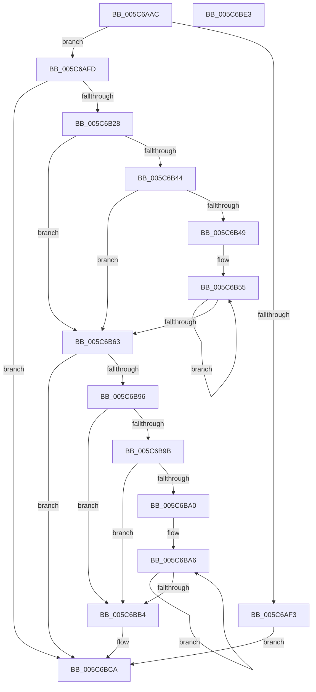

# KiOpPciConfigSpaceAccessCommon

- RVA: `0x005C6AAC`–`0x005C6BE4` (길이 `312` bytes)
- VA: `0x00000001405C6AAC`
- 실행 섹션: `.text`
- PDB 이름 있음: `예`; PDB Function 태그: `아니요`
- unwind 정보 RVA: `0x000CAB14`
- 디코드: `94`개 명령, `312/312` bytes 표시
- 미해석 바이트: `0` (있으면 어셈블리에 `.byte`로 보존)

> 이 문서는 커널 이미지의 기계어와 PDB 기호를 분석해 생성했습니다. 4번과 5번은 함수 원형과 자료형을 바이너리 사용 방식에서 추정한 C 해석이며 원본 소스 복구 결과는 아닙니다.

## 1. Dependencies

- 직접 호출 지점: **2**; 고유 호출 대상: **2**
- 직접 호출자로 확인된 함수: **1**
- RIP 상대 이미지 참조: **0**

### Outgoing calls
- `0x005C6B1B` → [KiOpGetPciConfigSpaceAccessInfoFromPhysicalAddress](../4C/KiOpGetPciConfigSpaceAccessInfoFromPhysicalAddress_function_004C23C0.md) (function, `0x004C23C0`)
- `0x005C6B8D` → [VslAccessPciDevice](../43/VslAccessPciDevice_function_004393E0.md) (function, `0x004393E0`)

### Direct callers
- [KiOp_Mov](../3D/KiOp_Mov_function_003D85C0.md) at `0x003D867A`

### Static image references
- 디코드된 RIP-relative 메모리 참조가 없습니다.

## 2. Other-region calls and transfers

- 다른 실행 섹션으로 향하는 call: **0**
- 별도 외부 분기/꼬리 이동을 확인하지 못했습니다.

## 3. Assembly (complete function range)

```asm
005C6AAC  48 89 5C 24 08                  mov qword ptr [rsp + 8], rbx
005C6AB1  48 89 74 24 18                  mov qword ptr [rsp + 0x18], rsi
005C6AB6  55                              push rbp
005C6AB7  57                              push rdi
005C6AB8  41 54                           push r12
005C6ABA  41 56                           push r14
005C6ABC  41 57                           push r15
005C6ABE  48 8B EC                        mov rbp, rsp
005C6AC1  48 83 EC 50                     sub rsp, 0x50
005C6AC5  45 33 E4                        xor r12d, r12d
005C6AC8  45 8B F0                        mov r14d, r8d
005C6ACB  44 8A F9                        mov r15b, cl
005C6ACE  44 89 65 F8                     mov dword ptr [rbp - 8], r12d
005C6AD2  48 8B 4A 68                     mov rcx, qword ptr [rdx + 0x68]
005C6AD6  49 8B F1                        mov rsi, r9
005C6AD9  44 88 65 F1                     mov byte ptr [rbp - 0xf], r12b
005C6ADD  48 8B FA                        mov rdi, rdx
005C6AE0  44 88 65 F0                     mov byte ptr [rbp - 0x10], r12b
005C6AE4  44 88 65 38                     mov byte ptr [rbp + 0x38], r12b
005C6AE8  66 44 89 65 F4                  mov word ptr [rbp - 0xc], r12w
005C6AED  48 83 F9 FF                     cmp rcx, -1
005C6AF1  75 0A                           jne 0x1405c6afd
005C6AF3  B8 01 00 00 C0                  mov eax, 0xc0000001
005C6AF8  E9 CD 00 00 00                  jmp 0x1405c6bca
005C6AFD  48 8D 45 F8                     lea rax, [rbp - 8]
005C6B01  48 89 44 24 28                  mov qword ptr [rsp + 0x28], rax
005C6B06  4C 8D 4D F0                     lea r9, [rbp - 0x10]
005C6B0A  48 8D 45 38                     lea rax, [rbp + 0x38]
005C6B0E  4C 8D 45 F1                     lea r8, [rbp - 0xf]
005C6B12  48 89 44 24 20                  mov qword ptr [rsp + 0x20], rax
005C6B17  48 8D 55 F4                     lea rdx, [rbp - 0xc]
005C6B1B  E8 A0 B8 EF FF                  call 0x1404c23c0
005C6B20  85 C0                           test eax, eax
005C6B22  0F 88 A2 00 00 00               js 0x1405c6bca
005C6B28  0F B6 5F 41                     movzx ebx, byte ptr [rdi + 0x41]
005C6B2C  48 8B 47 18                     mov rax, qword ptr [rdi + 0x18]
005C6B30  48 C1 EB 03                     shr rbx, 3
005C6B34  48 83 C0 78                     add rax, 0x78
005C6B38  83 E3 07                        and ebx, 7
005C6B3B  48 8D 1C D8                     lea rbx, [rax + rbx*8]
005C6B3F  45 84 FF                        test r15b, r15b
005C6B42  74 1F                           je 0x1405c6b63
005C6B44  45 85 F6                        test r14d, r14d
005C6B47  74 1A                           je 0x1405c6b63
005C6B49  48 8B D3                        mov rdx, rbx
005C6B4C  48 8B CE                        mov rcx, rsi
005C6B4F  48 2B D6                        sub rdx, rsi
005C6B52  4D 8B C6                        mov r8, r14
005C6B55  8A 04 0A                        mov al, byte ptr [rdx + rcx]
005C6B58  88 01                           mov byte ptr [rcx], al
005C6B5A  48 FF C1                        inc rcx
005C6B5D  49 83 E8 01                     sub r8, 1
005C6B61  75 F2                           jne 0x1405c6b55
005C6B63  0F B6 4D 38                     movzx ecx, byte ptr [rbp + 0x38]
005C6B67  8B 45 F8                        mov eax, dword ptr [rbp - 8]
005C6B6A  44 0F B6 4D F0                  movzx r9d, byte ptr [rbp - 0x10]
005C6B6F  44 0F B6 45 F1                  movzx r8d, byte ptr [rbp - 0xf]
005C6B74  0F B7 55 F4                     movzx edx, word ptr [rbp - 0xc]
005C6B78  48 89 74 24 38                  mov qword ptr [rsp + 0x38], rsi
005C6B7D  44 89 74 24 30                  mov dword ptr [rsp + 0x30], r14d
005C6B82  89 44 24 28                     mov dword ptr [rsp + 0x28], eax
005C6B86  89 4C 24 20                     mov dword ptr [rsp + 0x20], ecx
005C6B8A  41 8A CF                        mov cl, r15b
005C6B8D  E8 4E 28 E7 FF                  call 0x1404393e0
005C6B92  85 C0                           test eax, eax
005C6B94  78 34                           js 0x1405c6bca
005C6B96  45 84 FF                        test r15b, r15b
005C6B99  75 19                           jne 0x1405c6bb4
005C6B9B  45 85 F6                        test r14d, r14d
005C6B9E  74 14                           je 0x1405c6bb4
005C6BA0  48 2B F3                        sub rsi, rbx
005C6BA3  49 8B CE                        mov rcx, r14
005C6BA6  8A 04 1E                        mov al, byte ptr [rsi + rbx]
005C6BA9  88 03                           mov byte ptr [rbx], al
005C6BAB  48 FF C3                        inc rbx
005C6BAE  48 83 E9 01                     sub rcx, 1
005C6BB2  75 F2                           jne 0x1405c6ba6
005C6BB4  8B 47 10                        mov eax, dword ptr [rdi + 0x10]
005C6BB7  2B 07                           sub eax, dword ptr [rdi]
005C6BB9  48 8B 57 18                     mov rdx, qword ptr [rdi + 0x18]
005C6BBD  48 01 82 F8 00 00 00            add qword ptr [rdx + 0xf8], rax
005C6BC4  33 C0                           xor eax, eax
005C6BC6  C6 47 60 01                     mov byte ptr [rdi + 0x60], 1
005C6BCA  4C 8D 5C 24 50                  lea r11, [rsp + 0x50]
005C6BCF  49 8B 5B 30                     mov rbx, qword ptr [r11 + 0x30]
005C6BD3  49 8B 73 40                     mov rsi, qword ptr [r11 + 0x40]
005C6BD7  49 8B E3                        mov rsp, r11
005C6BDA  41 5F                           pop r15
005C6BDC  41 5E                           pop r14
005C6BDE  41 5C                           pop r12
005C6BE0  5F                              pop rdi
005C6BE1  5D                              pop rbp
005C6BE2  C3                              ret
005C6BE3  CC                              int3
```

## 4. C-style interpretation (structured pseudocode)

```c
__int64 __fastcall KiOpPciConfigSpaceAccessCommon(unsigned __int8 a1, __int64 a2, int a3, __int64 a4)
{
    __int64 result;
    __int64 v_r12;
    __int64 v_rbx;
    __int64 v_rsi;
    __int64 v_rsp;
    unsigned __int64 v_stack_m28;
    unsigned int v_stack_m30;
    unsigned __int16 v_stack_m34;
    unsigned __int8 v_stack_m37;
    unsigned __int8 v_stack_m38;
    unsigned __int64 v_stack_m40;
    unsigned int v_stack_m48;
    unsigned __int64 v_stack_m50;
    unsigned __int64 v_stack_m58;
    unsigned __int8 v_stack_p10;
    unsigned __int64 v_stack_p18;
    unsigned __int64 v_stack_p8;

    v_stack_p8 = v_rbx;
    v_stack_p18 = v_rsi;
    v_rsp = (v_rsp) - (80);
    v_r12 = 0;
    v_stack_m30 = 0;
    v_stack_m37 = 0;
    v_stack_m38 = 0;
    v_stack_p10 = 0;
    v_stack_m34 = 0;
    if ((*(unsigned __int64 *)(a2 + 104)) != -1) goto loc_005C6AFD;
    goto loc_005C6BCA;
loc_005C6AFD:
    v_stack_m50 = v_stack_m30;
    v_stack_m58 = v_stack_p10;
    result = KiOpGetPciConfigSpaceAccessInfoFromPhysicalAddress(*(unsigned __int64 *)(a2 + 104), v_stack_m34, v_stack_m37, v_stack_m38);
    if (sign_flag) goto loc_005C6BCA;
    v_rbx = (*(unsigned __int8 *)(a2 + 65)) >> (3);
    result = (*(unsigned __int64 *)(a2 + 24)) + (120);
    v_rbx = (unsigned int)((v_rbx) & (7));
    if (a1 == 0) goto loc_005C6B63;
    if ((unsigned int)((unsigned int)(a3)) == 0) goto loc_005C6B63;
    a2 = (result + v_rbx * 8) - (a4);
loc_005C6B55:
    *(unsigned __int8 *)(a4) = (unsigned __int8)(*(unsigned __int8 *)(a2 + a4 * 1));
    a1 = (a4) + 1;
    a3 = ((unsigned int)(a3)) - (1);
    if (condition_is_not_equal) goto loc_005C6B55;
loc_005C6B63:
    v_stack_m40 = a4;
    v_stack_m48 = (unsigned int)((unsigned int)(a3));
    v_stack_m50 = (unsigned int)((unsigned int)(v_stack_m30));
    v_stack_m58 = (unsigned int)(v_stack_p10);
    result = VslAccessPciDevice(a1, v_stack_m34, v_stack_m37, v_stack_m38);
    if (sign_flag) goto loc_005C6BCA;
    if (a1 != 0) goto loc_005C6BB4;
    if ((unsigned int)((unsigned int)(a3)) == 0) goto loc_005C6BB4;
    v_rsi = (a4) - (result + v_rbx * 8);
loc_005C6BA6:
    *(unsigned __int8 *)(result + v_rbx * 8) = (unsigned __int8)(*(unsigned __int8 *)(v_rsi + result + v_rbx * 8 * 1));
    v_rbx = (result + v_rbx * 8) + 1;
    a1 = ((unsigned int)(a3)) - (1);
    if (condition_is_not_equal) goto loc_005C6BA6;
loc_005C6BB4:
    result = (unsigned int)(((unsigned int)(*(unsigned int *)(a2 + 16))) - (*(unsigned int *)(a2)));
    result = 0;
    *(unsigned __int8 *)(a2 + 96) = 1;
loc_005C6BCA:
    return result;
}
```

## 5. (Beta) C Style

```c
int64_t KiOpPciConfigSpaceAccessCommon(uint8_t Arg1, void *Arg2, int32_t Arg3, void *Arg4)
{
    uint8_t *arg2 = (uint8_t *)Arg2;
    uint8_t *arg4 = (uint8_t *)Arg4;

    int64_t result;
    int64_t local_r12;
    int64_t local_rbx;
    int64_t local_rsi;
    int64_t local_rsp;
    uint64_t v_stack_m28;
    uint32_t v_stack_m30;
    uint16_t v_stack_m34;
    uint8_t v_stack_m37;
    uint8_t v_stack_m38;
    uint64_t v_stack_m40;
    uint32_t v_stack_m48;
    uint64_t v_stack_m50;
    uint64_t v_stack_m58;
    uint8_t v_stack_p10;
    uint64_t v_stack_p18;
    uint64_t v_stack_p8;

    v_stack_p8 = local_rbx;
    v_stack_p18 = local_rsi;
    local_rsp = (local_rsp) - (80);
    local_r12 = 0;
    v_stack_m30 = 0;
    v_stack_m37 = 0;
    v_stack_m38 = 0;
    v_stack_p10 = 0;
    v_stack_m34 = 0;
    if ((*(uint64_t *)(arg2 + 0x68)) != -1) goto loc_005C6AFD;
    goto loc_005C6BCA;
loc_005C6AFD:
    v_stack_m50 = v_stack_m30;
    v_stack_m58 = v_stack_p10;
    result = KiOpGetPciConfigSpaceAccessInfoFromPhysicalAddress(*(uint64_t *)(arg2 + 0x68), v_stack_m34, v_stack_m37, v_stack_m38);
    if (sign_flag) goto loc_005C6BCA;
    local_rbx = (*(uint8_t *)(arg2 + 0x41)) >> (3);
    result = (*(uint64_t *)(arg2 + 0x18)) + (120);
    local_rbx = (uint32_t)((local_rbx) & (7));
    if (Arg1 == 0) goto loc_005C6B63;
    if ((uint32_t)((uint32_t)(Arg3)) == 0) goto loc_005C6B63;
    Arg2 = (result + local_rbx * 8) - (Arg4);
loc_005C6B55:
    *(uint8_t *)(arg4) = (uint8_t)(*(uint8_t *)(arg2 + arg4 * 1));
    Arg1 = (Arg4) + 1;
    Arg3 = ((uint32_t)(Arg3)) - (1);
    if (condition_is_not_equal) goto loc_005C6B55;
loc_005C6B63:
    v_stack_m40 = Arg4;
    v_stack_m48 = (uint32_t)((uint32_t)(Arg3));
    v_stack_m50 = (uint32_t)((uint32_t)(v_stack_m30));
    v_stack_m58 = (uint32_t)(v_stack_p10);
    result = VslAccessPciDevice(Arg1, v_stack_m34, v_stack_m37, v_stack_m38);
    if (sign_flag) goto loc_005C6BCA;
    if (Arg1 != 0) goto loc_005C6BB4;
    if ((uint32_t)((uint32_t)(Arg3)) == 0) goto loc_005C6BB4;
    local_rsi = (Arg4) - (result + local_rbx * 8);
loc_005C6BA6:
    *(uint8_t *)(result + local_rbx * 8) = (uint8_t)(*(uint8_t *)(local_rsi + result + local_rbx * 8 * 1));
    local_rbx = (result + local_rbx * 8) + 1;
    Arg1 = ((uint32_t)(Arg3)) - (1);
    if (condition_is_not_equal) goto loc_005C6BA6;
loc_005C6BB4:
    result = (uint32_t)(((uint32_t)(*(uint32_t *)(arg2 + 0x10))) - (*(uint32_t *)(arg2)));
    result = 0;
    *(uint8_t *)(arg2 + 0x60) = 1;
loc_005C6BCA:
    return result;
}
```

### 관측된 메모리 오프셋

구조체 형식이 확인되지 않은 접근은 인자 기준의 오프셋으로만 기록했습니다.

| 기준 인자 | 오프셋 표현 | 폭 (bit) | 접근 |
|---|---:|---:|---|
| `Arg2` | `+ 0x0` | `32` | `R` |
| `Arg2` | `+ 0x10` | `32` | `R` |
| `Arg2` | `+ 0x18` | `64` | `R` |
| `Arg2` | `+ 0x41` | `8` | `R` |
| `Arg2` | `+ 0x60` | `8` | `W` |
| `Arg2` | `+ 0x68` | `64` | `R` |
| `Arg4` | `+ 0x0 + rbx*1` | `8` | `R` |

## 6. Execution-region graph

[열기: 2D/3D 그래프와 함수 탐색 컨트롤 패널](../../../control-panel.html?section=text&rva=0x005C6AAC&view=graph)

- 2D 그래프는 위에서 아래로 흐르고, 3D 그래프는 빈 공간을 드래그해 회전합니다. Shift+드래그는 이동, 휠은 확대·축소, 함수 노드 선택은 대상 보고서 이동입니다.

### Static fallback


