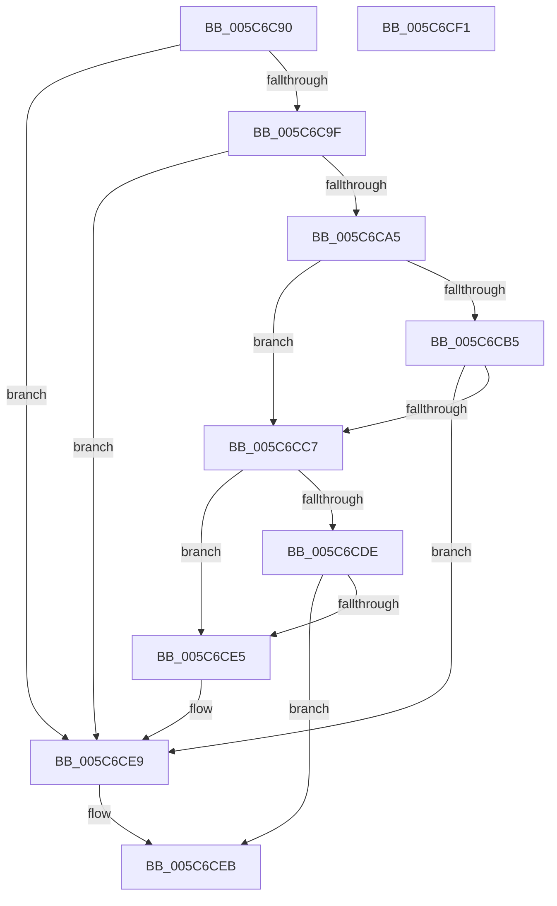

# KiOp_MOVDQA

- RVA: `0x005C6C90`–`0x005C6CF2` (길이 `98` bytes)
- VA: `0x00000001405C6C90`
- 실행 섹션: `.text`
- PDB 이름 있음: `예`; PDB Function 태그: `아니요`
- unwind 정보 RVA: `0x0005CF00`
- 디코드: `30`개 명령, `98/98` bytes 표시
- 미해석 바이트: `0` (있으면 어셈블리에 `.byte`로 보존)

> 이 문서는 커널 이미지의 기계어와 PDB 기호를 분석해 생성했습니다. 4번과 5번은 함수 원형과 자료형을 바이너리 사용 방식에서 추정한 C 해석이며 원본 소스 복구 결과는 아닙니다.

## 1. Dependencies

- 직접 호출 지점: **1**; 고유 호출 대상: **1**
- 직접 호출자로 확인된 함수: **0**
- RIP 상대 이미지 참조: **0**

### Outgoing calls
- `0x005C6CCD` → [KiOpPatchCode](KiOpPatchCode_function_005C6900.md) (function, `0x005C6900`)

### Direct callers
- 이 함수 시작 RVA로 연결되는 직접 call은 확인되지 않았습니다. 간접 호출은 완전히 역산할 수 없습니다.

### Static image references
- 디코드된 RIP-relative 메모리 참조가 없습니다.

## 2. Other-region calls and transfers

- 다른 실행 섹션으로 향하는 call: **0**
- 별도 외부 분기/꼬리 이동을 확인하지 못했습니다.

## 3. Assembly (complete function range)

```asm
005C6C90  40 53                           push rbx
005C6C92  48 83 EC 20                     sub rsp, 0x20
005C6C96  80 79 3A 00                     cmp byte ptr [rcx + 0x3a], 0
005C6C9A  48 8B D9                        mov rbx, rcx
005C6C9D  75 4A                           jne 0x1405c6ce9
005C6C9F  80 79 51 01                     cmp byte ptr [rcx + 0x51], 1
005C6CA3  75 44                           jne 0x1405c6ce9
005C6CA5  65 48 8B 0C 25 88 01 00 00      mov rcx, qword ptr gs:[0x188]
005C6CAE  8B 41 78                        mov eax, dword ptr [rcx + 0x78]
005C6CB1  A8 04                           test al, 4
005C6CB3  75 12                           jne 0x1405c6cc7
005C6CB5  48 8B 81 B8 00 00 00            mov rax, qword ptr [rcx + 0xb8]
005C6CBC  8B 88 88 00 00 00               mov ecx, dword ptr [rax + 0x88]
005C6CC2  F6 C1 01                        test cl, 1
005C6CC5  74 22                           je 0x1405c6ce9
005C6CC7  48 8B 13                        mov rdx, qword ptr [rbx]
005C6CCA  41 B0 F3                        mov r8b, 0xf3
005C6CCD  E8 2E FC FF FF                  call 0x1405c6900
005C6CD2  BA 00 00 00 80                  mov edx, 0x80000000
005C6CD7  8D 0C 10                        lea ecx, [rax + rdx]
005C6CDA  85 CA                           test edx, ecx
005C6CDC  75 07                           jne 0x1405c6ce5
005C6CDE  3D 2D 02 00 C0                  cmp eax, 0xc000022d
005C6CE3  75 06                           jne 0x1405c6ceb
005C6CE5  C6 43 60 01                     mov byte ptr [rbx + 0x60], 1
005C6CE9  33 C0                           xor eax, eax
005C6CEB  48 83 C4 20                     add rsp, 0x20
005C6CEF  5B                              pop rbx
005C6CF0  C3                              ret
005C6CF1  CC                              int3
```

## 4. C-style interpretation (structured pseudocode)

```c
__int64 __fastcall KiOp_MOVDQA(__int64 a1)
{
    __int64 result;
    __int64 v_rsp;

    v_rsp = (v_rsp) - (32);
    if ((*(unsigned __int8 *)(a1 + 58)) != 0) goto loc_005C6CE9;
    if ((*(unsigned __int8 *)(a1 + 81)) != 1) goto loc_005C6CE9;
    if ((((unsigned __int8)((unsigned int)(*(unsigned int *)(*(unsigned __int64 *)(gs_base + (0 + 392)) + 120)))) & (4)) != 0) goto loc_005C6CC7;
    if ((((unsigned __int8)((unsigned int)(*(unsigned int *)(*(unsigned __int64 *)(*(unsigned __int64 *)(gs_base + (0 + 392)) + 184) + 136)))) & (1)) == 0) goto loc_005C6CE9;
loc_005C6CC7:
    result = KiOpPatchCode((unsigned int)(*(unsigned int *)(*(unsigned __int64 *)(*(unsigned __int64 *)(gs_base + (0 + 392)) + 184) + 136)), *(unsigned __int64 *)(a1), 243, a4);
    if ((((unsigned int)((unsigned int)(0x80000000ULL))) & ((unsigned int)(result + (unsigned int)(0x80000000ULL) * 1))) != 0) goto loc_005C6CE5;
    if (((unsigned int)(result)) != 0xC000022DULL) goto loc_005C6CEB;
loc_005C6CE5:
    *(unsigned __int8 *)(a1 + 96) = 1;
loc_005C6CE9:
    result = 0;
loc_005C6CEB:
    v_rsp = (v_rsp) + (32);
    return result;
}
```

## 5. (Beta) C Style

```c
int64_t KiOp_MOVDQA(void *Arg1)
{
    uint8_t *arg1 = (uint8_t *)Arg1;

    int64_t result;
    int64_t local_rsp;

    local_rsp = (local_rsp) - (32);
    if ((*(uint8_t *)(arg1 + 0x3A)) != 0) goto loc_005C6CE9;
    if ((*(uint8_t *)(arg1 + 0x51)) != 1) goto loc_005C6CE9;
    if ((((uint8_t)((uint32_t)(*(uint32_t *)(*(uint64_t *)(gs_base + (0 + 0x188)) + 0x78)))) & (4)) != 0) goto loc_005C6CC7;
    if ((((uint8_t)((uint32_t)(*(uint32_t *)(*(uint64_t *)(*(uint64_t *)(gs_base + (0 + 0x188)) + 0xB8) + 0x88)))) & (1)) == 0) goto loc_005C6CE9;
loc_005C6CC7:
    result = KiOpPatchCode((uint32_t)(*(uint32_t *)(*(uint64_t *)(*(uint64_t *)(gs_base + (0 + 0x188)) + 0xB8) + 0x88)), *(uint64_t *)(arg1), 243, a4);
    if ((((uint32_t)((uint32_t)(0x80000000ULL))) & ((uint32_t)(result + (uint32_t)(0x80000000ULL) * 1))) != 0) goto loc_005C6CE5;
    if (((uint32_t)(result)) != 0xC000022DULL) goto loc_005C6CEB;
loc_005C6CE5:
    *(uint8_t *)(arg1 + 0x60) = 1;
loc_005C6CE9:
    result = 0;
loc_005C6CEB:
    local_rsp = (local_rsp) + (32);
    return result;
}
```

### 관측된 메모리 오프셋

구조체 형식이 확인되지 않은 접근은 인자 기준의 오프셋으로만 기록했습니다.

| 기준 인자 | 오프셋 표현 | 폭 (bit) | 접근 |
|---|---:|---:|---|
| `Arg1` | `+ 0x0` | `64` | `R` |
| `Arg1` | `+ 0x3A` | `8` | `R` |
| `Arg1` | `+ 0x51` | `8` | `R` |
| `Arg1` | `+ 0x60` | `8` | `W` |

## 6. Execution-region graph

[열기: 2D/3D 그래프와 함수 탐색 컨트롤 패널](../../../control-panel.html?section=text&rva=0x005C6C90&view=graph)

- 2D 그래프는 위에서 아래로 흐르고, 3D 그래프는 빈 공간을 드래그해 회전합니다. Shift+드래그는 이동, 휠은 확대·축소, 함수 노드 선택은 대상 보고서 이동입니다.

### Static fallback


