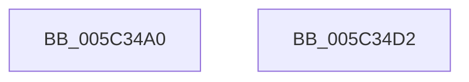

# KiPassiveIsrWatchdog

- RVA: `0x005C34A0`–`0x005C34D3` (길이 `51` bytes)
- VA: `0x00000001405C34A0`
- 실행 섹션: `.text`
- PDB 이름 있음: `예`; PDB Function 태그: `아니요`
- unwind 정보 RVA: `0x0005CF00`
- 디코드: `17`개 명령, `51/51` bytes 표시
- 미해석 바이트: `0` (있으면 어셈블리에 `.byte`로 보존)

> 이 문서는 커널 이미지의 기계어와 PDB 기호를 분석해 생성했습니다. 4번과 5번은 함수 원형과 자료형을 바이너리 사용 방식에서 추정한 C 해석이며 원본 소스 복구 결과는 아닙니다.

## 1. Dependencies

- 직접 호출 지점: **2**; 고유 호출 대상: **2**
- 직접 호출자로 확인된 함수: **0**
- RIP 상대 이미지 참조: **1**

### Outgoing calls
- `0x005C34B1` → [KeSetEvent](../33/KeSetEvent_function_0033F310.md) (function, `0x0033F310`)
- `0x005C34C6` → [DbgPrintEx](../35/DbgPrintEx_function_00359290.md) (function, `0x00359290`)

### Direct callers
- 이 함수 시작 RVA로 연결되는 직접 call은 확인되지 않았습니다. 간접 호출은 완전히 역산할 수 없습니다.

### Static image references
- `0x005C34BA` → RVA `0x006CBB40` (` ?? ::FNODOBFM::`string'`; read)

## 2. Other-region calls and transfers

- 다른 실행 섹션으로 향하는 call: **0**
- 별도 외부 분기/꼬리 이동을 확인하지 못했습니다.

## 3. Assembly (complete function range)

```asm
005C34A0  40 53                           push rbx
005C34A2  48 83 EC 20                     sub rsp, 0x20
005C34A6  48 8B DA                        mov rbx, rdx
005C34A9  45 33 C0                        xor r8d, r8d
005C34AC  48 8B CB                        mov rcx, rbx
005C34AF  33 D2                           xor edx, edx
005C34B1  E8 5A BE D7 FF                  call 0x14033f310
005C34B6  4C 8B 4B 18                     mov r9, qword ptr [rbx + 0x18]
005C34BA  4C 8D 05 7F 86 10 00            lea r8, [rip + 0x10867f]
005C34C1  33 D2                           xor edx, edx
005C34C3  8D 4A 65                        lea ecx, [rdx + 0x65]
005C34C6  E8 C5 5D D9 FF                  call 0x140359290
005C34CB  CC                              int3
005C34CC  48 83 C4 20                     add rsp, 0x20
005C34D0  5B                              pop rbx
005C34D1  C3                              ret
005C34D2  CC                              int3
```

## 4. C-style interpretation (structured pseudocode)

```c
__int64 __fastcall KiPassiveIsrWatchdog(__int64 a1, __int64 a2, int a3)
{
    __int64 result;
    __int64 v_rsp;

    v_rsp = (v_rsp) - (32);
    a3 = 0;
    a2 = 0;
    result = KeSetEvent(a2, a2, a3, a4);
    a2 = 0;
    result = DbgPrintEx(a2 + 101, a2, v_rip + 1083007, *(unsigned __int64 *)(a2 + 24));
    v_rsp = (v_rsp) + (32);
    return result;
}
```

## 5. (Beta) C Style

```c
int64_t KiPassiveIsrWatchdog(int64_t Arg1, void *Arg2, int32_t Arg3)
{
    uint8_t *arg2 = (uint8_t *)Arg2;

    int64_t result;
    int64_t local_rsp;

    local_rsp = (local_rsp) - (32);
    Arg3 = 0;
    Arg2 = 0;
    result = KeSetEvent(Arg2, Arg2, Arg3, a4);
    Arg2 = 0;
    result = DbgPrintEx(Arg2 + 101, Arg2, v_rip + 1083007, *(uint64_t *)(arg2 + 0x18));
    local_rsp = (local_rsp) + (32);
    return result;
}
```

### 관측된 메모리 오프셋

구조체 형식이 확인되지 않은 접근은 인자 기준의 오프셋으로만 기록했습니다.

| 기준 인자 | 오프셋 표현 | 폭 (bit) | 접근 |
|---|---:|---:|---|
| `Arg2` | `+ 0x18` | `64` | `R` |

## 6. Execution-region graph

[열기: 2D/3D 그래프와 함수 탐색 컨트롤 패널](../../../control-panel.html?section=text&rva=0x005C34A0&view=graph)

- 2D 그래프는 위에서 아래로 흐르고, 3D 그래프는 빈 공간을 드래그해 회전합니다. Shift+드래그는 이동, 휠은 확대·축소, 함수 노드 선택은 대상 보고서 이동입니다.

### Static fallback


