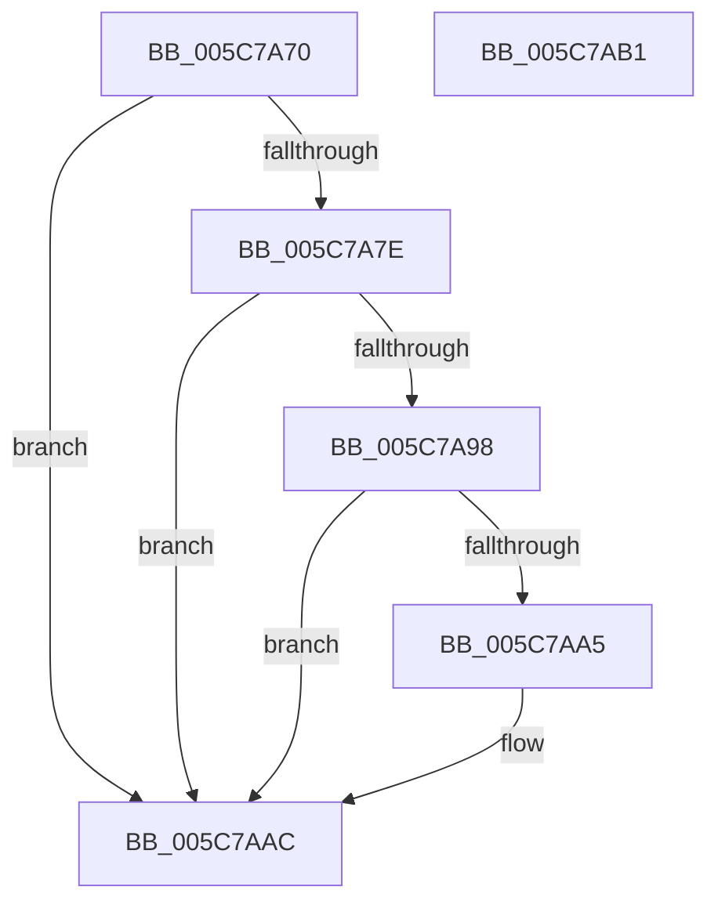

# KiPristineTriageDumpAllocationWorker

- RVA: `0x005C7A70`–`0x005C7AB2` (길이 `66` bytes)
- VA: `0x00000001405C7A70`
- 실행 섹션: `.text`
- PDB 이름 있음: `예`; PDB Function 태그: `아니요`
- unwind 정보 RVA: `0x0005D2F4`
- 디코드: `19`개 명령, `66/66` bytes 표시
- 미해석 바이트: `0` (있으면 어셈블리에 `.byte`로 보존)

> 이 문서는 커널 이미지의 기계어와 PDB 기호를 분석해 생성했습니다. 4번과 5번은 함수 원형과 자료형을 바이너리 사용 방식에서 추정한 C 해석이며 원본 소스 복구 결과는 아닙니다.

## 1. Dependencies

- 직접 호출 지점: **2**; 고유 호출 대상: **2**
- 직접 호출자로 확인된 함수: **0**
- RIP 상대 이미지 참조: **2**

### Outgoing calls
- `0x005C7A8B` → [ExAllocatePool2](../../poolcode/B8/ExAllocatePool2_function_00B820F0.md) (function, `0x00B820F0`)
- `0x005C7AA7` → [ExFreePoolWithTag](../../poolcode/B8/ExFreePoolWithTag_function_00B82870.md) (function, `0x00B82870`)

### Direct callers
- 이 함수 시작 RVA로 연결되는 직접 call은 확인되지 않았습니다. 간접 호출은 완전히 역산할 수 없습니다.

### Static image references
- `0x005C7A74` → RVA `0x00F108A0` (`.data`; read)
- `0x005C7A9A` → RVA `0x00F10898` (`.data`; read)

## 2. Other-region calls and transfers

- 다른 실행 섹션으로 향하는 call: **2**
  - `0x005C7A8B` → [ExAllocatePool2](../../poolcode/B8/ExAllocatePool2_function_00B820F0.md) (`.text` → `POOLCODE`)
  - `0x005C7AA7` → [ExFreePoolWithTag](../../poolcode/B8/ExFreePoolWithTag_function_00B82870.md) (`.text` → `POOLCODE`)
- 별도 외부 분기/꼬리 이동을 확인하지 못했습니다.

## 3. Assembly (complete function range)

```asm
005C7A70  48 83 EC 38                     sub rsp, 0x38
005C7A74  8B 05 26 8E 94 00               mov eax, dword ptr [rip + 0x948e26]
005C7A7A  85 C0                           test eax, eax
005C7A7C  74 2E                           je 0x1405c7aac
005C7A7E  8B D0                           mov edx, eax
005C7A80  B9 40 00 00 00                  mov ecx, 0x40
005C7A85  41 B8 4B 62 63 72               mov r8d, 0x7263624b
005C7A8B  E8 60 A6 5B 00                  call 0x140b820f0
005C7A90  48 8B C8                        mov rcx, rax
005C7A93  48 85 C0                        test rax, rax
005C7A96  74 14                           je 0x1405c7aac
005C7A98  33 C0                           xor eax, eax
005C7A9A  F0 48 0F B1 0D F5 8D 94 00      lock cmpxchg qword ptr [rip + 0x948df5], rcx
005C7AA3  74 07                           je 0x1405c7aac
005C7AA5  33 D2                           xor edx, edx
005C7AA7  E8 C4 AD 5B 00                  call 0x140b82870
005C7AAC  48 83 C4 38                     add rsp, 0x38
005C7AB0  C3                              ret
005C7AB1  CC                              int3
```

## 4. C-style interpretation (structured pseudocode)

```c
__int64 __fastcall KiPristineTriageDumpAllocationWorker(void)
{
    __int64 result;
    __int64 v_rsp;

    v_rsp = (v_rsp) - (56);
    if ((unsigned int)((unsigned int)(*(unsigned int *)(v_rip + 9735718))) == 0) goto loc_005C7AAC;
    result = ExAllocatePool2(64, (unsigned int)((unsigned int)((unsigned int)(*(unsigned int *)(v_rip + 9735718)))), (unsigned int)(0x7263624BULL), a4);
    if (result == 0) goto loc_005C7AAC;
    result = 0;
    if (!(condition_is_equal)) {
        a2 = 0;
        result = ExFreePoolWithTag(result, a2, (unsigned int)(0x7263624BULL), a4);
    }
    v_rsp = (v_rsp) + (56);
    return result;
}
```

## 5. (Beta) C Style

```c
void KiPristineTriageDumpAllocationWorker(void)
{
    int64_t result;
    int64_t local_rsp;

    local_rsp = (local_rsp) - (56);
    if ((uint32_t)((uint32_t)(*(uint32_t *)(v_rip + 0x948E26))) == 0) goto loc_005C7AAC;
    result = ExAllocatePool2(64, (uint32_t)((uint32_t)((uint32_t)(*(uint32_t *)(v_rip + 0x948E26)))), (uint32_t)(0x7263624BULL), a4);
    if (result == 0) goto loc_005C7AAC;
    result = 0;
    if (!(condition_is_equal)) {
        a2 = 0;
        result = ExFreePoolWithTag(result, a2, (uint32_t)(0x7263624BULL), a4);
    }
    local_rsp = (local_rsp) + (56);
    return result;
}
```

## 6. Execution-region graph

[열기: 2D/3D 그래프와 함수 탐색 컨트롤 패널](../../../control-panel.html?section=text&rva=0x005C7A70&view=graph)

- 2D 그래프는 위에서 아래로 흐르고, 3D 그래프는 빈 공간을 드래그해 회전합니다. Shift+드래그는 이동, 휠은 확대·축소, 함수 노드 선택은 대상 보고서 이동입니다.

### Static fallback


