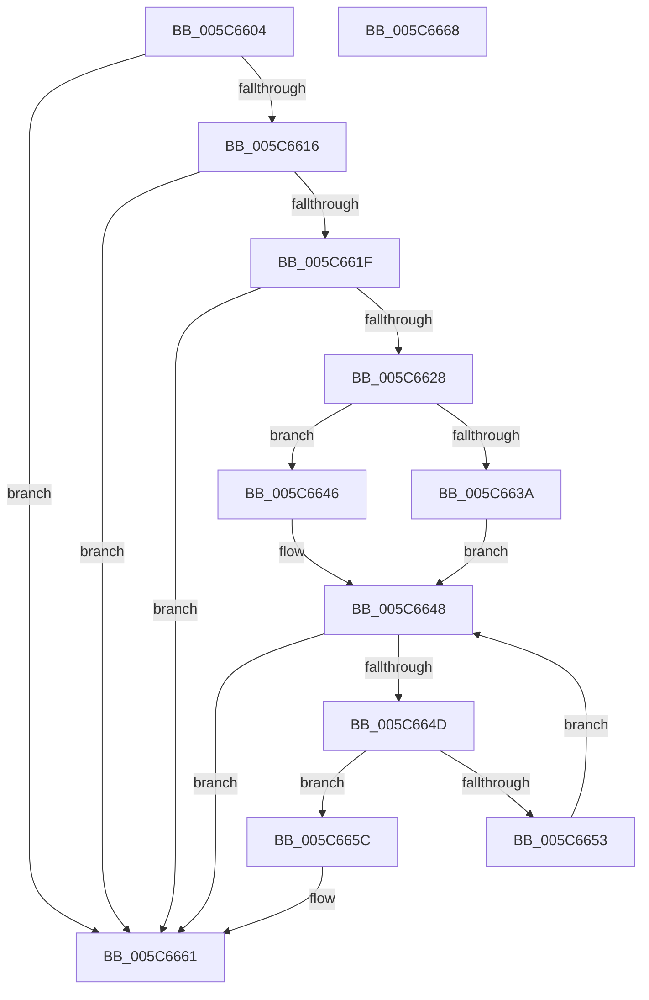

# KiQueryEffectivePriorityThreadWithStateLock

- RVA: `0x005C6604`–`0x005C6669` (길이 `101` bytes)
- VA: `0x00000001405C6604`
- 실행 섹션: `.text`
- PDB 이름 있음: `예`; PDB Function 태그: `아니요`
- unwind 정보 RVA: `0x0005C788`
- 디코드: `29`개 명령, `101/101` bytes 표시
- 미해석 바이트: `0` (있으면 어셈블리에 `.byte`로 보존)

> 이 문서는 커널 이미지의 기계어와 PDB 기호를 분석해 생성했습니다. 4번과 5번은 함수 원형과 자료형을 바이너리 사용 방식에서 추정한 C 해석이며 원본 소스 복구 결과는 아닙니다.

## 1. Dependencies

- 직접 호출 지점: **2**; 고유 호출 대상: **2**
- 직접 호출자로 확인된 함수: **1**
- RIP 상대 이미지 참조: **0**

### Outgoing calls
- `0x005C6616` → [KiIsThreadConstrainedBySchedulingGroup](../30/KiIsThreadConstrainedBySchedulingGroup_function_0030B200.md) (function, `0x0030B200`)
- `0x005C661F` → [KiShouldPreemptionBeDeferred](../35/KiShouldPreemptionBeDeferred_function_00356310.md) (function, `0x00356310`)

### Direct callers
- [sub_006E825E](../6E/Unknown_function_006E825E.md) at `0x006E82C1`

### Static image references
- 디코드된 RIP-relative 메모리 참조가 없습니다.

## 2. Other-region calls and transfers

- 다른 실행 섹션으로 향하는 call: **0**
- 별도 외부 분기/꼬리 이동을 확인하지 못했습니다.

## 3. Assembly (complete function range)

```asm
005C6604  48 83 EC 28                     sub rsp, 0x28
005C6608  48 83 79 68 00                  cmp qword ptr [rcx + 0x68], 0
005C660D  0F BE 91 C3 00 00 00            movsx edx, byte ptr [rcx + 0xc3]
005C6614  74 4B                           je 0x1405c6661
005C6616  E8 E5 4B D4 FF                  call 0x14030b200
005C661B  84 C0                           test al, al
005C661D  74 42                           je 0x1405c6661
005C661F  E8 EC FC D8 FF                  call 0x140356310
005C6624  84 C0                           test al, al
005C6626  75 39                           jne 0x1405c6661
005C6628  65 4C 8B 04 25 20 00 00 00      mov r8, qword ptr gs:[0x20]
005C6631  48 8B 41 68                     mov rax, qword ptr [rcx + 0x68]
005C6635  48 85 C0                        test rax, rax
005C6638  74 0C                           je 0x1405c6646
005C663A  41 8B 88 D8 00 00 00            mov ecx, dword ptr [r8 + 0xd8]
005C6641  48 03 C8                        add rcx, rax
005C6644  EB 02                           jmp 0x1405c6648
005C6646  33 C9                           xor ecx, ecx
005C6648  48 85 C9                        test rcx, rcx
005C664B  74 14                           je 0x1405c6661
005C664D  F6 41 70 08                     test byte ptr [rcx + 0x70], 8
005C6651  75 09                           jne 0x1405c665c
005C6653  48 8B 89 A0 01 00 00            mov rcx, qword ptr [rcx + 0x1a0]
005C665A  EB EC                           jmp 0x1405c6648
005C665C  BA 01 00 00 00                  mov edx, 1
005C6661  8B C2                           mov eax, edx
005C6663  48 83 C4 28                     add rsp, 0x28
005C6667  C3                              ret
005C6668  CC                              int3
```

## 4. C-style interpretation (structured pseudocode)

```c
__int64 __fastcall KiQueryEffectivePriorityThreadWithStateLock(__int64 a1)
{
    __int64 result;
    __int64 v_rsp;

    v_rsp = (v_rsp) - (40);
    if ((*(unsigned __int64 *)(a1 + 104)) == 0) goto loc_005C6661;
    result = KiIsThreadConstrainedBySchedulingGroup(a1, (__int8)(*(unsigned __int8 *)(a1 + 195)), a3, a4);
    if ((unsigned __int8)(result) == 0) goto loc_005C6661;
    result = KiShouldPreemptionBeDeferred(a1, (__int8)(*(unsigned __int8 *)(a1 + 195)), a3, a4);
    if ((unsigned __int8)(result) != 0) goto loc_005C6661;
    if (*(unsigned __int64 *)(a1 + 104) == 0) goto loc_005C6646;
    a1 = ((unsigned int)(*(unsigned int *)(*(unsigned __int64 *)(gs_base + (0 + 32)) + 216))) + (*(unsigned __int64 *)(a1 + 104));
    goto loc_005C6648;
loc_005C6646:
    a1 = 0;
loc_005C6648:
    if (0 == 0) goto loc_005C6661;
    if (((*(unsigned __int8 *)(a1 + 112)) & (8)) != 0) goto loc_005C665C;
    goto loc_005C6648;
loc_005C665C:
loc_005C6661:
    v_rsp = (v_rsp) + (40);
    return 1;
}
```

## 5. (Beta) C Style

```c
int64_t KiQueryEffectivePriorityThreadWithStateLock(void *Arg1)
{
    uint8_t *arg1 = (uint8_t *)Arg1;

    int64_t result;
    int64_t local_rsp;

    local_rsp = (local_rsp) - (40);
    if ((*(uint64_t *)(arg1 + 0x68)) == 0) goto loc_005C6661;
    result = KiIsThreadConstrainedBySchedulingGroup(Arg1, (int8_t)(*(uint8_t *)(arg1 + 0xC3)), a3, a4);
    if ((uint8_t)(result) == 0) goto loc_005C6661;
    result = KiShouldPreemptionBeDeferred(Arg1, (int8_t)(*(uint8_t *)(arg1 + 0xC3)), a3, a4);
    if ((uint8_t)(result) != 0) goto loc_005C6661;
    if (*(uint64_t *)(arg1 + 0x68) == 0) goto loc_005C6646;
    Arg1 = ((uint32_t)(*(uint32_t *)(*(uint64_t *)(gs_base + (0 + 0x20)) + 0xD8))) + (*(uint64_t *)(arg1 + 0x68));
    goto loc_005C6648;
loc_005C6646:
    Arg1 = 0;
loc_005C6648:
    if (0 == 0) goto loc_005C6661;
    if (((*(uint8_t *)(arg1 + 0x70)) & (8)) != 0) goto loc_005C665C;
    goto loc_005C6648;
loc_005C665C:
loc_005C6661:
    local_rsp = (local_rsp) + (40);
    return 1;
}
```

### 관측된 메모리 오프셋

구조체 형식이 확인되지 않은 접근은 인자 기준의 오프셋으로만 기록했습니다.

| 기준 인자 | 오프셋 표현 | 폭 (bit) | 접근 |
|---|---:|---:|---|
| `Arg1` | `+ 0x68` | `64` | `R` |
| `Arg1` | `+ 0xC3` | `8` | `R` |

## 6. Execution-region graph

[열기: 2D/3D 그래프와 함수 탐색 컨트롤 패널](../../../control-panel.html?section=text&rva=0x005C6604&view=graph)

- 2D 그래프는 위에서 아래로 흐르고, 3D 그래프는 빈 공간을 드래그해 회전합니다. Shift+드래그는 이동, 휠은 확대·축소, 함수 노드 선택은 대상 보고서 이동입니다.

### Static fallback


