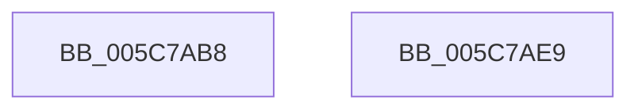

# KiRecordRecoveryFailure

- RVA: `0x005C7AB8`–`0x005C7AEA` (길이 `50` bytes)
- VA: `0x00000001405C7AB8`
- 실행 섹션: `.text`
- PDB 이름 있음: `예`; PDB Function 태그: `아니요`
- unwind 정보 RVA: `0x0005C788`
- 디코드: `11`개 명령, `50/50` bytes 표시
- 미해석 바이트: `0` (있으면 어셈블리에 `.byte`로 보존)

> 이 문서는 커널 이미지의 기계어와 PDB 기호를 분석해 생성했습니다. 4번과 5번은 함수 원형과 자료형을 바이너리 사용 방식에서 추정한 C 해석이며 원본 소스 복구 결과는 아닙니다.

## 1. Dependencies

- 직접 호출 지점: **2**; 고유 호출 대상: **1**
- 직접 호출자로 확인된 함수: **4**
- RIP 상대 이미지 참조: **3**

### Outgoing calls
- `0x005C7ACE` → [IoAddTriageDumpDataBlock](../42/IoAddTriageDumpDataBlock_function_00428374.md) (function, `0x00428374`)
- `0x005C7ADF` → [IoAddTriageDumpDataBlock](../42/IoAddTriageDumpDataBlock_function_00428374.md) (function, `0x00428374`)

### Direct callers
- [KiAttemptBugcheckRecovery](KiAttemptBugcheckRecovery_function_005C6D24.md) at `0x005C6FB9`
- [KiAttemptBugcheckRecovery](KiAttemptBugcheckRecovery_function_005C6D24.md) at `0x005C6FD0`
- [KiDeferredBugcheckRecoveryWorker](KiDeferredBugcheckRecoveryWorker_function_005C75A0.md) at `0x005C7706`
- [KiDeferredBugcheckRecoveryWorker](KiDeferredBugcheckRecoveryWorker_function_005C75A0.md) at `0x005C7719`
- [KiHandleMultipleBugchecksDuringRecovery](KiHandleMultipleBugchecksDuringRecovery_function_005C7860.md) at `0x005C790B`
- [KiScheduleBugcheckRecovery](KiScheduleBugcheckRecovery_function_005C7B20.md) at `0x005C7BB6`

### Static image references
- `0x005C7ABC` → RVA `0x00F109EC` (`.data`; write)
- `0x005C7AC7` → RVA `0x00F109EC` (`.data`; read)
- `0x005C7AD8` → RVA `0x00F109A0` (`.data`; read)

## 2. Other-region calls and transfers

- 다른 실행 섹션으로 향하는 call: **0**
- 별도 외부 분기/꼬리 이동을 확인하지 못했습니다.

## 3. Assembly (complete function range)

```asm
005C7AB8  48 83 EC 28                     sub rsp, 0x28
005C7ABC  89 0D 2A 8F 94 00               mov dword ptr [rip + 0x948f2a], ecx
005C7AC2  BA 04 00 00 00                  mov edx, 4
005C7AC7  48 8D 0D 1E 8F 94 00            lea rcx, [rip + 0x948f1e]
005C7ACE  E8 A1 08 E6 FF                  call 0x140428374
005C7AD3  BA 4C 00 00 00                  mov edx, 0x4c
005C7AD8  48 8D 0D C1 8E 94 00            lea rcx, [rip + 0x948ec1]
005C7ADF  E8 90 08 E6 FF                  call 0x140428374
005C7AE4  48 83 C4 28                     add rsp, 0x28
005C7AE8  C3                              ret
005C7AE9  CC                              int3
```

## 4. C-style interpretation (structured pseudocode)

```c
__int64 __fastcall KiRecordRecoveryFailure(int a1)
{
    __int64 result;
    __int64 v_rsp;

    v_rsp = (v_rsp) - (40);
    *(unsigned int *)(v_rip + 9735978) = a1;
    result = IoAddTriageDumpDataBlock(v_rip + 9735966, 4, a3, a4);
    result = IoAddTriageDumpDataBlock(v_rip + 9735873, 76, a3, a4);
    v_rsp = (v_rsp) + (40);
    return result;
}
```

## 5. (Beta) C Style

```c
int64_t KiRecordRecoveryFailure(int32_t Arg1)
{
    int64_t result;
    int64_t local_rsp;

    local_rsp = (local_rsp) - (40);
    *(uint32_t *)(v_rip + 0x948F2A) = Arg1;
    result = IoAddTriageDumpDataBlock(v_rip + 9735966, 4, a3, a4);
    result = IoAddTriageDumpDataBlock(v_rip + 9735873, 76, a3, a4);
    local_rsp = (local_rsp) + (40);
    return result;
}
```

## 6. Execution-region graph

[열기: 2D/3D 그래프와 함수 탐색 컨트롤 패널](../../../control-panel.html?section=text&rva=0x005C7AB8&view=graph)

- 2D 그래프는 위에서 아래로 흐르고, 3D 그래프는 빈 공간을 드래그해 회전합니다. Shift+드래그는 이동, 휠은 확대·축소, 함수 노드 선택은 대상 보고서 이동입니다.

### Static fallback


