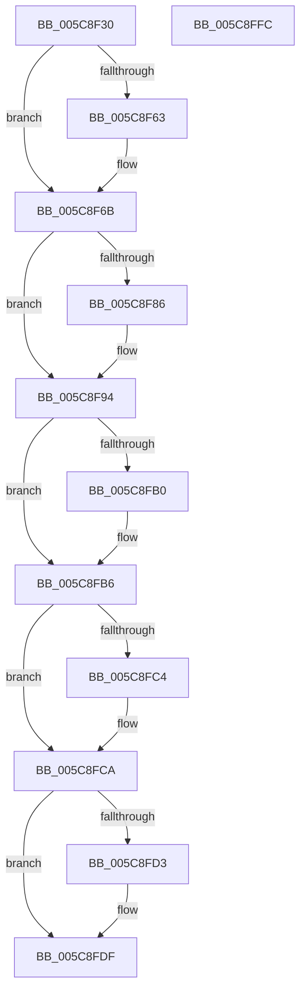

# KiRegisterProcessorWithCooperativeIdleSearchContext

- RVA: `0x005C8F30`–`0x005C8FFD` (길이 `205` bytes)
- VA: `0x00000001405C8F30`
- 실행 섹션: `.text`
- PDB 이름 있음: `예`; PDB Function 태그: `아니요`
- unwind 정보 RVA: `0x0005C954`
- 디코드: `46`개 명령, `205/205` bytes 표시
- 미해석 바이트: `0` (있으면 어셈블리에 `.byte`로 보존)

> 이 문서는 커널 이미지의 기계어와 PDB 기호를 분석해 생성했습니다. 4번과 5번은 함수 원형과 자료형을 바이너리 사용 방식에서 추정한 C 해석이며 원본 소스 복구 결과는 아닙니다.

## 1. Dependencies

- 직접 호출 지점: **2**; 고유 호출 대상: **2**
- 직접 호출자로 확인된 함수: **2**
- RIP 상대 이미지 참조: **1**

### Outgoing calls
- `0x005C8F66` → [KiRaiseIrqlProcessIrqlFlags](../4F/KiRaiseIrqlProcessIrqlFlags_function_004F56FC.md) (function, `0x004F56FC`)
- `0x005C8FDA` → [KiLowerIrqlProcessIrqlFlags](../4F/KiLowerIrqlProcessIrqlFlags_function_004F5698.md) (function, `0x004F5698`)

### Direct callers
- [KiAssignCooperativeIdleSearchContexts](../5B/KiAssignCooperativeIdleSearchContexts_function_005B7088.md) at `0x005B7268`
- [KiReconfigureSubNodeSchedulingInformation](../5B/KiReconfigureSubNodeSchedulingInformation_function_005B844C.md) at `0x005B84E9`

### Static image references
- `0x005C8F5A` → RVA `0x00FC6D20` (`ALMOSTRO`; read)

## 2. Other-region calls and transfers

- 다른 실행 섹션으로 향하는 call: **0**
- 별도 외부 분기/꼬리 이동을 확인하지 못했습니다.

## 3. Assembly (complete function range)

```asm
005C8F30  48 89 5C 24 08                  mov qword ptr [rsp + 8], rbx
005C8F35  48 89 6C 24 10                  mov qword ptr [rsp + 0x10], rbp
005C8F3A  48 89 74 24 18                  mov qword ptr [rsp + 0x18], rsi
005C8F3F  57                              push rdi
005C8F40  48 83 EC 20                     sub rsp, 0x20
005C8F44  49 8B E8                        mov rbp, r8
005C8F47  48 8B FA                        mov rdi, rdx
005C8F4A  48 8B D9                        mov rbx, rcx
005C8F4D  44 0F 20 C6                     mov rsi, cr8
005C8F51  BA 02 00 00 00                  mov edx, 2
005C8F56  44 0F 22 C2                     mov cr8, rdx
005C8F5A  83 3D BF DD 9F 00 00            cmp dword ptr [rip + 0x9fddbf], 0
005C8F61  74 08                           je 0x1405c8f6b
005C8F63  40 8A CE                        mov cl, sil
005C8F66  E8 91 C7 F2 FF                  call 0x1404f56fc
005C8F6B  0F B6 87 D1 00 00 00            movzx eax, byte ptr [rdi + 0xd1]
005C8F72  48 89 AC C3 18 02 00 00         mov qword ptr [rbx + rax*8 + 0x218], rbp
005C8F7A  48 8B 8B 18 04 00 00            mov rcx, qword ptr [rbx + 0x418]
005C8F81  48 85 C9                        test rcx, rcx
005C8F84  75 0E                           jne 0x1405c8f94
005C8F86  0F B6 87 D0 00 00 00            movzx eax, byte ptr [rdi + 0xd0]
005C8F8D  66 89 83 26 04 00 00            mov word ptr [rbx + 0x426], ax
005C8F94  48 0B 8F C8 00 00 00            or rcx, qword ptr [rdi + 0xc8]
005C8F9B  48 89 8B 18 04 00 00            mov qword ptr [rbx + 0x418], rcx
005C8FA2  8A 87 D1 00 00 00               mov al, byte ptr [rdi + 0xd1]
005C8FA8  3A 83 24 04 00 00               cmp al, byte ptr [rbx + 0x424]
005C8FAE  73 06                           jae 0x1405c8fb6
005C8FB0  88 83 24 04 00 00               mov byte ptr [rbx + 0x424], al
005C8FB6  8A 87 D1 00 00 00               mov al, byte ptr [rdi + 0xd1]
005C8FBC  3A 83 25 04 00 00               cmp al, byte ptr [rbx + 0x425]
005C8FC2  76 06                           jbe 0x1405c8fca
005C8FC4  88 83 25 04 00 00               mov byte ptr [rbx + 0x425], al
005C8FCA  83 3D 4F DD 9F 00 00            cmp dword ptr [rip + 0x9fdd4f], 0
005C8FD1  74 0C                           je 0x1405c8fdf
005C8FD3  44 0F 20 C1                     mov rcx, cr8
005C8FD7  40 8A D6                        mov dl, sil
005C8FDA  E8 B9 C6 F2 FF                  call 0x1404f5698
005C8FDF  40 0F B6 C6                     movzx eax, sil
005C8FE3  44 0F 22 C0                     mov cr8, rax
005C8FE7  48 8B 5C 24 30                  mov rbx, qword ptr [rsp + 0x30]
005C8FEC  48 8B 6C 24 38                  mov rbp, qword ptr [rsp + 0x38]
005C8FF1  48 8B 74 24 40                  mov rsi, qword ptr [rsp + 0x40]
005C8FF6  48 83 C4 20                     add rsp, 0x20
005C8FFA  5F                              pop rdi
005C8FFB  C3                              ret
005C8FFC  CC                              int3
```

## 4. C-style interpretation (structured pseudocode)

```c
__int64 __fastcall KiRegisterProcessorWithCooperativeIdleSearchContext(__int64 a1, __int64 a2, __int64 a3)
{
    __int64 result;
    __int64 v_rsp;
    unsigned __int64 v_stack_p10;
    unsigned __int64 v_stack_p18;
    unsigned __int64 v_stack_p8;

    v_stack_p8 = v_rbx;
    v_stack_p10 = v_rbp;
    v_stack_p18 = v_rsi;
    v_rsp = (v_rsp) - (32);
    if ((*(unsigned int *)(v_rip + 10476991)) != 0) {
        a1 = (unsigned __int8)(v_cr8);
        result = KiRaiseIrqlProcessIrqlFlags(a1, 2, a3, a4);
    }
    *(unsigned __int64 *)(a1 + *(unsigned __int8 *)(a2 + 209) * 8 + 536) = a3;
    result = *(unsigned __int8 *)(a2 + 209);
    if (*(unsigned __int64 *)(a1 + 1048) == 0) {
        result = *(unsigned __int8 *)(a2 + 208);
        *(unsigned __int16 *)(a1 + 1062) = (unsigned __int16)(result);
    }
    a1 = (*(unsigned __int64 *)(a1 + 1048)) | (*(unsigned __int64 *)(a2 + 200));
    *(unsigned __int64 *)(a1 + 1048) = a1;
    if (((unsigned __int8)(*(unsigned __int8 *)(a2 + 209))) < (*(unsigned __int8 *)(a1 + 1060))) {
        *(unsigned __int8 *)(a1 + 1060) = (unsigned __int8)(*(unsigned __int8 *)(a2 + 209));
    }
    if (((unsigned __int8)(*(unsigned __int8 *)(a2 + 209))) >= = (*(unsigned __int8 *)(a1 + 1061))) {
        *(unsigned __int8 *)(a1 + 1061) = (unsigned __int8)(*(unsigned __int8 *)(a2 + 209));
    }
    result = *(unsigned __int8 *)(a2 + 209);
    if ((*(unsigned int *)(v_rip + 10476879)) != 0) {
        a1 = 2;
        a2 = (unsigned __int8)(v_cr8);
        result = KiLowerIrqlProcessIrqlFlags(a1, a2, a3, a4);
    }
    v_rsp = (v_rsp) + (32);
    return (unsigned __int8)(v_cr8);
}
```

## 5. (Beta) C Style

```c
int64_t KiRegisterProcessorWithCooperativeIdleSearchContext(void *Arg1, void *Arg2, int64_t Arg3)
{
    uint8_t *arg1 = (uint8_t *)Arg1;
    uint8_t *arg2 = (uint8_t *)Arg2;

    int64_t result;
    int64_t local_rsp;
    uint64_t v_stack_p10;
    uint64_t v_stack_p18;
    uint64_t v_stack_p8;

    v_stack_p8 = local_rbx;
    v_stack_p10 = local_rbp;
    v_stack_p18 = local_rsi;
    local_rsp = (local_rsp) - (32);
    if ((*(uint32_t *)(v_rip + 0x9FDDBF)) != 0) {
        Arg1 = (uint8_t)(v_cr8);
        result = KiRaiseIrqlProcessIrqlFlags(Arg1, 2, Arg3, a4);
    }
    *(uint64_t *)(arg1 + *(uint8_t *)(arg2 + 0xD1) * 8 + 0x218) = Arg3;
    result = *(uint8_t *)(arg2 + 0xD1);
    if (*(uint64_t *)(arg1 + 0x418) == 0) {
        result = *(uint8_t *)(arg2 + 0xD0);
        *(uint16_t *)(arg1 + 0x426) = (uint16_t)(result);
    }
    Arg1 = (*(uint64_t *)(arg1 + 0x418)) | (*(uint64_t *)(arg2 + 0xC8));
    *(void **)(arg1 + 0x418) = Arg1;
    if (((uint8_t)(*(uint8_t *)(arg2 + 0xD1))) < (*(uint8_t *)(arg1 + 0x424))) {
        *(uint8_t *)(arg1 + 0x424) = (uint8_t)(*(uint8_t *)(arg2 + 0xD1));
    }
    if (((uint8_t)(*(uint8_t *)(arg2 + 0xD1))) >= = (*(uint8_t *)(arg1 + 0x425))) {
        *(uint8_t *)(arg1 + 0x425) = (uint8_t)(*(uint8_t *)(arg2 + 0xD1));
    }
    result = *(uint8_t *)(arg2 + 0xD1);
    if ((*(uint32_t *)(v_rip + 0x9FDD4F)) != 0) {
        Arg1 = 2;
        Arg2 = (uint8_t)(v_cr8);
        result = KiLowerIrqlProcessIrqlFlags(Arg1, Arg2, Arg3, a4);
    }
    local_rsp = (local_rsp) + (32);
    return (uint8_t)(v_cr8);
}
```

### 관측된 메모리 오프셋

구조체 형식이 확인되지 않은 접근은 인자 기준의 오프셋으로만 기록했습니다.

| 기준 인자 | 오프셋 표현 | 폭 (bit) | 접근 |
|---|---:|---:|---|
| `Arg1` | `+ 0x218 + rax*8` | `64` | `W` |
| `Arg1` | `+ 0x418` | `64` | `R` |
| `Arg1` | `+ 0x418` | `64` | `W` |
| `Arg1` | `+ 0x424` | `8` | `R` |
| `Arg1` | `+ 0x424` | `8` | `W` |
| `Arg1` | `+ 0x425` | `8` | `R` |
| `Arg1` | `+ 0x425` | `8` | `W` |
| `Arg1` | `+ 0x426` | `16` | `W` |
| `Arg2` | `+ 0xC8` | `64` | `R` |
| `Arg2` | `+ 0xD0` | `8` | `R` |
| `Arg2` | `+ 0xD1` | `8` | `R` |

## 6. Execution-region graph

[열기: 2D/3D 그래프와 함수 탐색 컨트롤 패널](../../../control-panel.html?section=text&rva=0x005C8F30&view=graph)

- 2D 그래프는 위에서 아래로 흐르고, 3D 그래프는 빈 공간을 드래그해 회전합니다. Shift+드래그는 이동, 휠은 확대·축소, 함수 노드 선택은 대상 보고서 이동입니다.

### Static fallback


