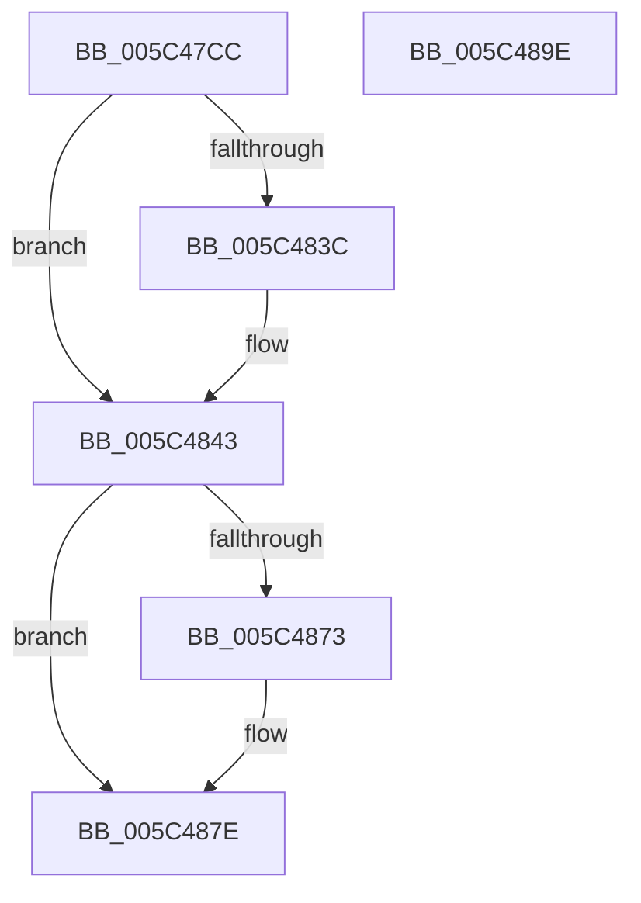

# KiRequestApcInterruptSynchronously

- RVA: `0x005C47CC`–`0x005C489F` (길이 `211` bytes)
- VA: `0x00000001405C47CC`
- 실행 섹션: `.text`
- PDB 이름 있음: `예`; PDB Function 태그: `아니요`
- unwind 정보 RVA: `0x000CAA08`
- 디코드: `48`개 명령, `211/211` bytes 표시
- 미해석 바이트: `0` (있으면 어셈블리에 `.byte`로 보존)

> 이 문서는 커널 이미지의 기계어와 PDB 기호를 분석해 생성했습니다. 4번과 5번은 함수 원형과 자료형을 바이너리 사용 방식에서 추정한 C 해석이며 원본 소스 복구 결과는 아닙니다.

## 1. Dependencies

- 직접 호출 지점: **8**; 고유 호출 대상: **7**
- 직접 호출자로 확인된 함수: **2**
- RIP 상대 이미지 참조: **3**

### Outgoing calls
- `0x005C47F6` → [memset](../6C/memset_function_006C6C40.md) (function, `0x006C6C40`)
- `0x005C4815` → [memset](../6C/memset_function_006C6C40.md) (function, `0x006C6C40`)
- `0x005C4821` → [KeAddProcessorAffinityEx](../25/KeAddProcessorAffinityEx_function_0025B6F0.md) (function, `0x0025B6F0`)
- `0x005C483E` → [KiRaiseIrqlProcessIrqlFlags](../4F/KiRaiseIrqlProcessIrqlFlags_function_004F56FC.md) (function, `0x004F56FC`)
- `0x005C4860` → [KiIpiSendPacket](../47/KiIpiSendPacket_function_004711DC.md) (function, `0x004711DC`)
- `0x005C4865` → [KiIpiStallOnPacketTargets](../47/KiIpiStallOnPacketTargets_function_004718D8.md) (function, `0x004718D8`)
- `0x005C4879` → [KiLowerIrqlProcessIrqlFlags](../4F/KiLowerIrqlProcessIrqlFlags_function_004F5698.md) (function, `0x004F5698`)
- `0x005C4890` → [_security_check_cookie](../6A/_security_check_cookie_function_006AC640.md) (function, `0x006AC640`)

### Direct callers
- [KiSignalThreadForApc](../20/KiSignalThreadForApc_function_00204360.md) at `0x00204493`
- [KiSuspendThread](../46/KiSuspendThread_function_0046B964.md) at `0x0046BC5B`

### Static image references
- `0x005C47D5` → RVA `0x00E0A740` (`.data`; read)
- `0x005C4833` → RVA `0x00FC6D20` (`ALMOSTRO`; read)
- `0x005C4849` → RVA `0x005C47B0` (`KiRequestApcInterruptSynchronouslyWorker`; read)

## 2. Other-region calls and transfers

- 다른 실행 섹션으로 향하는 call: **0**
- 별도 외부 분기/꼬리 이동을 확인하지 못했습니다.

## 3. Assembly (complete function range)

```asm
005C47CC  40 53                           push rbx
005C47CE  48 81 EC 50 01 00 00            sub rsp, 0x150
005C47D5  48 8B 05 64 5F 84 00            mov rax, qword ptr [rip + 0x845f64]
005C47DC  48 33 C4                        xor rax, rsp
005C47DF  48 89 84 24 40 01 00 00         mov qword ptr [rsp + 0x140], rax
005C47E7  8B D9                           mov ebx, ecx
005C47E9  33 D2                           xor edx, edx
005C47EB  48 8D 4C 24 38                  lea rcx, [rsp + 0x38]
005C47F0  41 B8 00 01 00 00               mov r8d, 0x100
005C47F6  E8 45 24 10 00                  call 0x1406c6c40
005C47FB  83 64 24 34 00                  and dword ptr [rsp + 0x34], 0
005C4800  48 8D 4C 24 38                  lea rcx, [rsp + 0x38]
005C4805  33 D2                           xor edx, edx
005C4807  C7 44 24 30 01 00 20 00         mov dword ptr [rsp + 0x30], 0x200001
005C480F  41 B8 00 01 00 00               mov r8d, 0x100
005C4815  E8 26 24 10 00                  call 0x1406c6c40
005C481A  8B D3                           mov edx, ebx
005C481C  48 8D 4C 24 30                  lea rcx, [rsp + 0x30]
005C4821  E8 CA 6E C9 FF                  call 0x14025b6f0
005C4826  44 0F 20 C3                     mov rbx, cr8
005C482A  BA 0C 00 00 00                  mov edx, 0xc
005C482F  44 0F 22 C2                     mov cr8, rdx
005C4833  83 3D E6 24 A0 00 00            cmp dword ptr [rip + 0xa024e6], 0
005C483A  74 07                           je 0x1405c4843
005C483C  8A CB                           mov cl, bl
005C483E  E8 B9 0E F3 FF                  call 0x1404f56fc
005C4843  48 83 64 24 28 00               and qword ptr [rsp + 0x28], 0
005C4849  4C 8D 05 60 FF FF FF            lea r8, [rip - 0xa0]
005C4850  48 83 64 24 20 00               and qword ptr [rsp + 0x20], 0
005C4856  48 8D 54 24 30                  lea rdx, [rsp + 0x30]
005C485B  45 33 C9                        xor r9d, r9d
005C485E  33 C9                           xor ecx, ecx
005C4860  E8 77 C9 EA FF                  call 0x1404711dc
005C4865  E8 6E D0 EA FF                  call 0x1404718d8
005C486A  83 3D AF 24 A0 00 00            cmp dword ptr [rip + 0xa024af], 0
005C4871  74 0B                           je 0x1405c487e
005C4873  44 0F 20 C1                     mov rcx, cr8
005C4877  8A D3                           mov dl, bl
005C4879  E8 1A 0E F3 FF                  call 0x1404f5698
005C487E  0F B6 C3                        movzx eax, bl
005C4881  44 0F 22 C0                     mov cr8, rax
005C4885  48 8B 8C 24 40 01 00 00         mov rcx, qword ptr [rsp + 0x140]
005C488D  48 33 CC                        xor rcx, rsp
005C4890  E8 AB 7D 0E 00                  call 0x1406ac640
005C4895  48 81 C4 50 01 00 00            add rsp, 0x150
005C489C  5B                              pop rbx
005C489D  C3                              ret
005C489E  CC                              int3
```

## 4. C-style interpretation (structured pseudocode)

```c
__int64 __fastcall KiRequestApcInterruptSynchronously(int a1, int a2, __int64 a3, int a4)
{
    __int64 result;
    __int64 v_rsp;
    unsigned __int64 v_stack_m120;
    unsigned int v_stack_m124;
    unsigned int v_stack_m128;
    unsigned __int64 v_stack_m130;
    unsigned __int64 v_stack_m138;
    unsigned __int64 v_stack_m18;

    v_rsp = (v_rsp) - (336);
    result = (*(unsigned __int64 *)(v_rip + 8675172)) ^ (v_rsp);
    v_stack_m18 = result;
    a2 = 0;
    result = memset(v_stack_m120, a2, 256, a4);
    a2 = 0;
    v_stack_m128 = 0x200001ULL;
    result = memset(v_stack_m120, a2, 256, a4);
    result = KeAddProcessorAffinityEx(v_stack_m128, (unsigned int)((unsigned int)((unsigned int)(a1))), 256, a4);
    if ((*(unsigned int *)(v_rip + 10495206)) != 0) {
        a1 = (unsigned __int8)(v_cr8);
        result = KiRaiseIrqlProcessIrqlFlags(a1, 12, 256, a4);
    }
    a4 = 0;
    a1 = 0;
    result = KiIpiSendPacket(a1, v_stack_m128, v_rip - 160, a4);
    result = KiIpiStallOnPacketTargets(a1, v_stack_m128, v_rip - 160, a4);
    if ((*(unsigned int *)(v_rip + 10495151)) != 0) {
        a1 = 12;
        a2 = (unsigned __int8)(v_cr8);
        result = KiLowerIrqlProcessIrqlFlags(a1, a2, v_rip - 160, a4);
    }
    a1 = (v_stack_m18) ^ (v_rsp);
    result = _security_check_cookie(a1, a2, v_rip - 160, a4);
    v_rsp = (v_rsp) + (336);
    return result;
}
```

## 5. (Beta) C Style

```c
int64_t KiRequestApcInterruptSynchronously(int32_t Arg1, int32_t Arg2, int64_t Arg3, int32_t Arg4)
{
    int64_t result;
    int64_t local_rsp;
    uint64_t v_stack_m120;
    uint32_t v_stack_m124;
    uint32_t v_stack_m128;
    uint64_t v_stack_m130;
    uint64_t v_stack_m138;
    uint64_t v_stack_m18;

    local_rsp = (local_rsp) - (336);
    result = (*(uint64_t *)(v_rip + 0x845F64)) ^ (local_rsp);
    v_stack_m18 = result;
    Arg2 = 0;
    result = memset(v_stack_m120, Arg2, 256, Arg4);
    Arg2 = 0;
    v_stack_m128 = 0x200001ULL;
    result = memset(v_stack_m120, Arg2, 256, Arg4);
    result = KeAddProcessorAffinityEx(v_stack_m128, (uint32_t)((uint32_t)((uint32_t)(Arg1))), 256, Arg4);
    if ((*(uint32_t *)(v_rip + 0xA024E6)) != 0) {
        Arg1 = (uint8_t)(v_cr8);
        result = KiRaiseIrqlProcessIrqlFlags(Arg1, 12, 256, Arg4);
    }
    Arg4 = 0;
    Arg1 = 0;
    result = KiIpiSendPacket(Arg1, v_stack_m128, v_rip - 160, Arg4);
    result = KiIpiStallOnPacketTargets(Arg1, v_stack_m128, v_rip - 160, Arg4);
    if ((*(uint32_t *)(v_rip + 0xA024AF)) != 0) {
        Arg1 = 12;
        Arg2 = (uint8_t)(v_cr8);
        result = KiLowerIrqlProcessIrqlFlags(Arg1, Arg2, v_rip - 160, Arg4);
    }
    Arg1 = (v_stack_m18) ^ (local_rsp);
    result = _security_check_cookie(Arg1, Arg2, v_rip - 160, Arg4);
    local_rsp = (local_rsp) + (336);
    return result;
}
```

## 6. Execution-region graph

[열기: 2D/3D 그래프와 함수 탐색 컨트롤 패널](../../../control-panel.html?section=text&rva=0x005C47CC&view=graph)

- 2D 그래프는 위에서 아래로 흐르고, 3D 그래프는 빈 공간을 드래그해 회전합니다. Shift+드래그는 이동, 휠은 확대·축소, 함수 노드 선택은 대상 보고서 이동입니다.

### Static fallback


