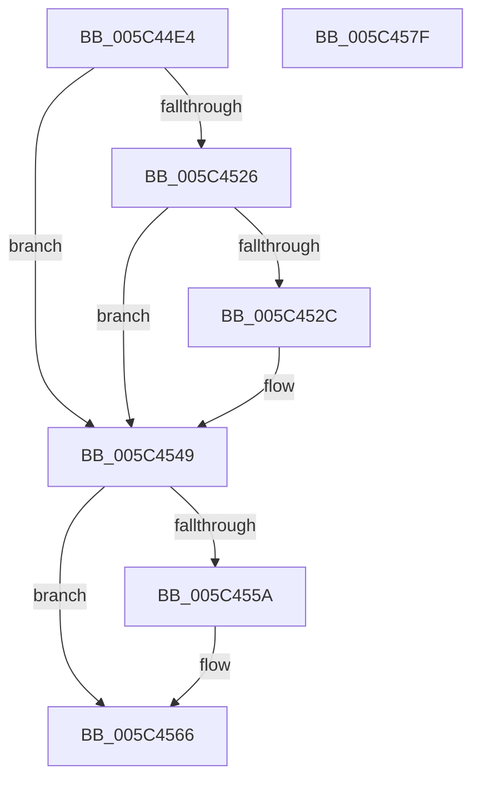

# KiRequestSchedulerApcThread

- RVA: `0x005C44E4`–`0x005C4580` (길이 `156` bytes)
- VA: `0x00000001405C44E4`
- 실행 섹션: `.text`
- PDB 이름 있음: `예`; PDB Function 태그: `아니요`
- unwind 정보 RVA: `0x0006C8E8`
- 디코드: `39`개 명령, `156/156` bytes 표시
- 미해석 바이트: `0` (있으면 어셈블리에 `.byte`로 보존)

> 이 문서는 커널 이미지의 기계어와 PDB 기호를 분석해 생성했습니다. 4번과 5번은 함수 원형과 자료형을 바이너리 사용 방식에서 추정한 C 해석이며 원본 소스 복구 결과는 아닙니다.

## 1. Dependencies

- 직접 호출 지점: **4**; 고유 호출 대상: **4**
- 직접 호출자로 확인된 함수: **1**
- RIP 상대 이미지 참조: **1**

### Outgoing calls
- `0x005C450A` → [KiAcquireThreadLockRaiseToDpc](../39/KiAcquireThreadLockRaiseToDpc_function_00396280.md) (function, `0x00396280`)
- `0x005C4533` → [KiInsertQueueApc](../20/KiInsertQueueApc_function_002041F0.md) (function, `0x002041F0`)
- `0x005C4544` → [KiSignalThreadForApc](../20/KiSignalThreadForApc_function_00204360.md) (function, `0x00204360`)
- `0x005C4561` → [KiLowerIrqlProcessIrqlFlags](../4F/KiLowerIrqlProcessIrqlFlags_function_004F5698.md) (function, `0x004F5698`)

### Direct callers
- [KiSlistRollbackDpc](../5B/KiSlistRollbackDpc_function_005B23C0.md) at `0x005B23CD`

### Static image references
- `0x005C4551` → RVA `0x00FC6D20` (`ALMOSTRO`; read)

## 2. Other-region calls and transfers

- 다른 실행 섹션으로 향하는 call: **0**
- 별도 외부 분기/꼬리 이동을 확인하지 못했습니다.

## 3. Assembly (complete function range)

```asm
005C44E4  48 8B C4                        mov rax, rsp
005C44E7  48 89 58 10                     mov qword ptr [rax + 0x10], rbx
005C44EB  48 89 68 18                     mov qword ptr [rax + 0x18], rbp
005C44EF  48 89 70 20                     mov qword ptr [rax + 0x20], rsi
005C44F3  57                              push rdi
005C44F4  48 83 EC 20                     sub rsp, 0x20
005C44F8  48 8D 50 08                     lea rdx, [rax + 8]
005C44FC  C6 40 08 00                     mov byte ptr [rax + 8], 0
005C4500  48 8B D9                        mov rbx, rcx
005C4503  48 8D B1 88 02 00 00            lea rsi, [rcx + 0x288]
005C450A  E8 71 1D DD FF                  call 0x140396280
005C450F  65 48 8B 2C 25 20 00 00 00      mov rbp, qword ptr gs:[0x20]
005C4518  F7 43 74 00 40 00 00            test dword ptr [rbx + 0x74], 0x4000
005C451F  0F B6 7C 24 30                  movzx edi, byte ptr [rsp + 0x30]
005C4524  74 23                           je 0x1405c4549
005C4526  80 7E 52 00                     cmp byte ptr [rsi + 0x52], 0
005C452A  75 1D                           jne 0x1405c4549
005C452C  48 8B CE                        mov rcx, rsi
005C452F  C6 46 52 01                     mov byte ptr [rsi + 0x52], 1
005C4533  E8 B8 FC C3 FF                  call 0x1402041f0
005C4538  45 33 C9                        xor r9d, r9d
005C453B  44 8A C7                        mov r8b, dil
005C453E  48 8B D6                        mov rdx, rsi
005C4541  48 8B CD                        mov rcx, rbp
005C4544  E8 17 FE C3 FF                  call 0x140204360
005C4549  48 C7 43 40 00 00 00 00         mov qword ptr [rbx + 0x40], 0
005C4551  83 3D C8 27 A0 00 00            cmp dword ptr [rip + 0xa027c8], 0
005C4558  74 0C                           je 0x1405c4566
005C455A  44 0F 20 C1                     mov rcx, cr8
005C455E  40 8A D7                        mov dl, dil
005C4561  E8 32 11 F3 FF                  call 0x1404f5698
005C4566  44 0F 22 C7                     mov cr8, rdi
005C456A  48 8B 5C 24 38                  mov rbx, qword ptr [rsp + 0x38]
005C456F  48 8B 6C 24 40                  mov rbp, qword ptr [rsp + 0x40]
005C4574  48 8B 74 24 48                  mov rsi, qword ptr [rsp + 0x48]
005C4579  48 83 C4 20                     add rsp, 0x20
005C457D  5F                              pop rdi
005C457E  C3                              ret
005C457F  CC                              int3
```

## 4. C-style interpretation (structured pseudocode)

```c
__int64 __fastcall KiRequestSchedulerApcThread(__int64 a1, __int64 a2, __int64 a3, int a4)
{
    __int64 result;
    __int64 v_rsp;
    unsigned __int64 v_stack_p10;
    unsigned __int64 v_stack_p18;
    unsigned __int64 v_stack_p20;
    unsigned __int8 v_stack_p8;

    *(unsigned __int64 *)(v_rsp + 16) = v_rbx;
    *(unsigned __int64 *)(v_rsp + 24) = v_rbp;
    *(unsigned __int64 *)(v_rsp + 32) = v_rsi;
    v_rsp = (v_rsp) - (32);
    *(unsigned __int8 *)(v_rsp + 8) = 0;
    result = KiAcquireThreadLockRaiseToDpc(a1, v_rsp + 8, a3, a4);
    if (((*(unsigned int *)(a1 + 116)) & (0x4000ULL)) == 0) goto loc_005C4549;
    if ((*(unsigned __int8 *)(a1 + 648 + 82)) == 0) {
        a1 = a1 + 648;
        *(unsigned __int8 *)(a1 + 648 + 82) = 1;
        result = KiInsertQueueApc(a1, v_rsp + 8, a3, a4);
        a4 = 0;
        a3 = (unsigned __int8)(v_stack_p8);
        a2 = a1 + 648;
        a1 = *(unsigned __int64 *)(gs_base + (0 + 32));
        result = KiSignalThreadForApc(a1, a2, a3, a4);
    }
    *(unsigned __int64 *)(a1 + 64) = 0;
    if ((*(unsigned int *)(v_rip + 10495944)) != 0) {
        a1 = v_cr8;
        a2 = (unsigned __int8)(v_stack_p8);
        result = KiLowerIrqlProcessIrqlFlags(a1, a2, a3, a4);
    }
    v_rsp = (v_rsp) + (32);
    return result;
}
```

## 5. (Beta) C Style

```c
int64_t KiRequestSchedulerApcThread(void *Arg1, int64_t Arg2, int64_t Arg3, int32_t Arg4)
{
    uint8_t *arg1 = (uint8_t *)Arg1;

    int64_t result;
    int64_t local_rsp;
    uint64_t v_stack_p10;
    uint64_t v_stack_p18;
    uint64_t v_stack_p20;
    uint8_t v_stack_p8;

    *(uint64_t *)(local_rsp + 0x10) = local_rbx;
    *(uint64_t *)(local_rsp + 0x18) = local_rbp;
    *(uint64_t *)(local_rsp + 0x20) = local_rsi;
    local_rsp = (local_rsp) - (32);
    *(uint8_t *)(local_rsp + 0x8) = 0;
    result = KiAcquireThreadLockRaiseToDpc(Arg1, local_rsp + 8, Arg3, Arg4);
    if (((*(uint32_t *)(arg1 + 0x74)) & (0x4000ULL)) == 0) goto loc_005C4549;
    if ((*(uint8_t *)(arg1 + 0x288 + 0x52)) == 0) {
        Arg1 = Arg1 + 648;
        *(uint8_t *)(arg1 + 0x288 + 0x52) = 1;
        result = KiInsertQueueApc(Arg1, local_rsp + 8, Arg3, Arg4);
        Arg4 = 0;
        Arg3 = (uint8_t)(v_stack_p8);
        Arg2 = Arg1 + 648;
        Arg1 = *(uint64_t *)(gs_base + (0 + 0x20));
        result = KiSignalThreadForApc(Arg1, Arg2, Arg3, Arg4);
    }
    *(uint64_t *)(arg1 + 0x40) = 0;
    if ((*(uint32_t *)(v_rip + 0xA027C8)) != 0) {
        Arg1 = v_cr8;
        Arg2 = (uint8_t)(v_stack_p8);
        result = KiLowerIrqlProcessIrqlFlags(Arg1, Arg2, Arg3, Arg4);
    }
    local_rsp = (local_rsp) + (32);
    return result;
}
```

### 관측된 메모리 오프셋

구조체 형식이 확인되지 않은 접근은 인자 기준의 오프셋으로만 기록했습니다.

| 기준 인자 | 오프셋 표현 | 폭 (bit) | 접근 |
|---|---:|---:|---|
| `Arg1` | `+ 0x40` | `64` | `W` |
| `Arg1` | `+ 0x52` | `8` | `R` |
| `Arg1` | `+ 0x52` | `8` | `W` |
| `Arg1` | `+ 0x74` | `32` | `R` |
| `Arg1` | `+ 0x288` | `64` | `R` |

## 6. Execution-region graph

[열기: 2D/3D 그래프와 함수 탐색 컨트롤 패널](../../../control-panel.html?section=text&rva=0x005C44E4&view=graph)

- 2D 그래프는 위에서 아래로 흐르고, 3D 그래프는 빈 공간을 드래그해 회전합니다. Shift+드래그는 이동, 휠은 확대·축소, 함수 노드 선택은 대상 보고서 이동입니다.

### Static fallback


