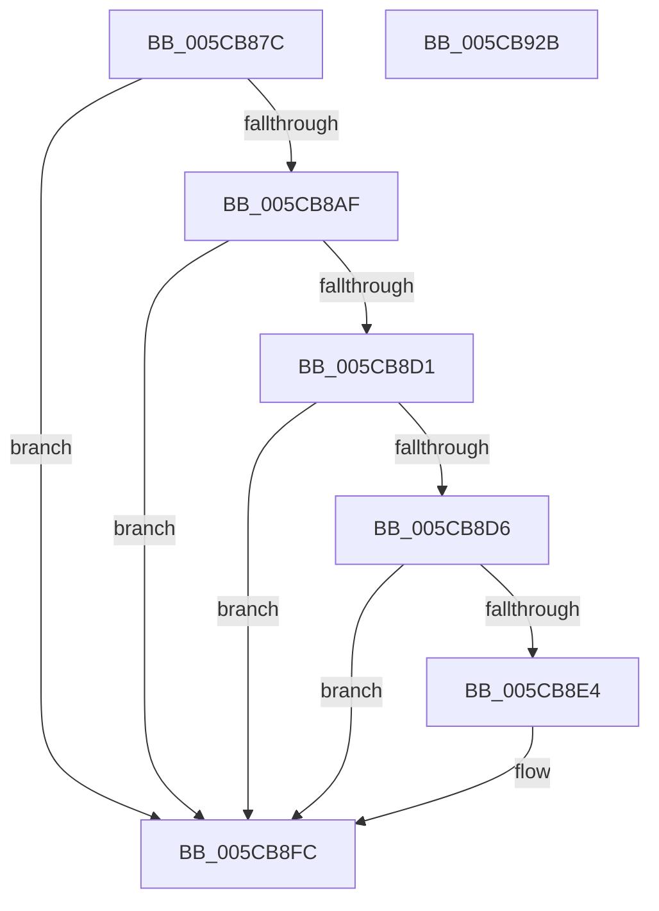

# KiRestoreProcessorState

- RVA: `0x005CB87C`–`0x005CB92C` (길이 `176` bytes)
- VA: `0x00000001405CB87C`
- 실행 섹션: `.text`
- PDB 이름 있음: `예`; PDB Function 태그: `아니요`
- unwind 정보 RVA: `0x000794E0`
- 디코드: `47`개 명령, `176/176` bytes 표시
- 미해석 바이트: `0` (있으면 어셈블리에 `.byte`로 보존)

> 이 문서는 커널 이미지의 기계어와 PDB 기호를 분석해 생성했습니다. 4번과 5번은 함수 원형과 자료형을 바이너리 사용 방식에서 추정한 C 해석이며 원본 소스 복구 결과는 아닙니다.

## 1. Dependencies

- 직접 호출 지점: **3**; 고유 호출 대상: **3**
- 직접 호출자로 확인된 함수: **1**
- RIP 상대 이미지 참조: **0**

### Outgoing calls
- `0x005CB8F7` → [RtlXRestore](../3D/RtlXRestore_function_003D6DBC.md) (function, `0x003D6DBC`)
- `0x005CB90A` → [KeContextToKframes](../4F/KeContextToKframes_function_004FD790.md) (function, `0x004FD790`)
- `0x005CB916` → [KiRestoreProcessorControlState](../6B/KiRestoreProcessorControlState_function_006B0E20.md) (function, `0x006B0E20`)

### Direct callers
- [KiFreezeTargetExecution](KiFreezeTargetExecution_function_005C30A0.md) at `0x005C3270`

### Static image references
- 디코드된 RIP-relative 메모리 참조가 없습니다.

## 2. Other-region calls and transfers

- 다른 실행 섹션으로 향하는 call: **0**
- 별도 외부 분기/꼬리 이동을 확인하지 못했습니다.

## 3. Assembly (complete function range)

```asm
005CB87C  48 89 5C 24 08                  mov qword ptr [rsp + 8], rbx
005CB881  48 89 74 24 10                  mov qword ptr [rsp + 0x10], rsi
005CB886  57                              push rdi
005CB887  48 83 EC 30                     sub rsp, 0x30
005CB88B  65 48 8B 1C 25 20 00 00 00      mov rbx, qword ptr gs:[0x20]
005CB894  48 8B FA                        mov rdi, rdx
005CB897  48 8B F1                        mov rsi, rcx
005CB89A  4C 8B 93 C0 8F 00 00            mov r10, qword ptr [rbx + 0x8fc0]
005CB8A1  45 8A 5A 38                     mov r11b, byte ptr [r10 + 0x38]
005CB8A5  45 8B 4A 30                     mov r9d, dword ptr [r10 + 0x30]
005CB8A9  41 80 E3 01                     and r11b, 1
005CB8AD  75 4D                           jne 0x1405cb8fc
005CB8AF  BA 40 00 10 00                  mov edx, 0x100040
005CB8B4  45 8B C1                        mov r8d, r9d
005CB8B7  44 23 C2                        and r8d, edx
005CB8BA  41 8B C1                        mov eax, r9d
005CB8BD  8D 4A C8                        lea ecx, [rdx - 0x38]
005CB8C0  23 C1                           and eax, ecx
005CB8C2  3B C1                           cmp eax, ecx
005CB8C4  0F 95 C1                        setne cl
005CB8C7  44 3B C2                        cmp r8d, edx
005CB8CA  0F 95 C0                        setne al
005CB8CD  84 C8                           test al, cl
005CB8CF  75 2B                           jne 0x1405cb8fc
005CB8D1  44 3B C2                        cmp r8d, edx
005CB8D4  75 26                           jne 0x1405cb8fc
005CB8D6  A1 E0 03 00 00 80 F7 FF FF      movabs eax, dword ptr [0xfffff780000003e0]
005CB8DF  83 E0 FC                        and eax, 0xfffffffc
005CB8E2  74 18                           je 0x1405cb8fc
005CB8E4  49 63 8A E0 04 00 00            movsxd rcx, dword ptr [r10 + 0x4e0]
005CB8EB  48 81 C1 D0 02 00 00            add rcx, 0x2d0
005CB8F2  8B D0                           mov edx, eax
005CB8F4  49 03 CA                        add rcx, r10
005CB8F7  E8 C0 B4 E0 FF                  call 0x1403d6dbc
005CB8FC  4D 8B C2                        mov r8, r10
005CB8FF  44 88 5C 24 20                  mov byte ptr [rsp + 0x20], r11b
005CB904  48 8B D7                        mov rdx, rdi
005CB907  48 8B CE                        mov rcx, rsi
005CB90A  E8 81 1E F3 FF                  call 0x1404fd790
005CB90F  48 8D 8B 00 01 00 00            lea rcx, [rbx + 0x100]
005CB916  E8 05 55 0E 00                  call 0x1406b0e20
005CB91B  48 8B 5C 24 40                  mov rbx, qword ptr [rsp + 0x40]
005CB920  48 8B 74 24 48                  mov rsi, qword ptr [rsp + 0x48]
005CB925  48 83 C4 30                     add rsp, 0x30
005CB929  5F                              pop rdi
005CB92A  C3                              ret
005CB92B  CC                              int3
```

## 4. C-style interpretation (structured pseudocode)

```c
__int64 __fastcall KiRestoreProcessorState(__int64 a1, __int64 a2)
{
    __int64 result;
    __int64 v_r11;
    __int64 v_rsp;
    unsigned __int8 v_stack_m18;
    unsigned __int64 v_stack_p10;
    unsigned __int64 v_stack_p8;

    v_stack_p8 = v_rbx;
    v_stack_p10 = v_rsi;
    v_rsp = (v_rsp) - (48);
    v_r11 = (unsigned __int8)((*(unsigned __int8 *)(*(unsigned __int64 *)(*(unsigned __int64 *)(gs_base + (0 + 32)) + 36800) + 56)) & (1));
    if (condition_is_not_equal) goto loc_005CB8FC;
    a3 = (unsigned int)(((unsigned int)((unsigned int)((unsigned int)(*(unsigned int *)(*(unsigned __int64 *)(*(unsigned __int64 *)(gs_base + (0 + 32)) + 36800) + 48))))) & ((unsigned int)((unsigned int)(0x100040ULL))));
    result = (unsigned int)(((unsigned int)((unsigned int)((unsigned int)(*(unsigned int *)(*(unsigned __int64 *)(*(unsigned __int64 *)(gs_base + (0 + 32)) + 36800) + 48))))) & ((unsigned int)((unsigned int)(0x100040ULL) - 56)));
    a1 = (((unsigned int)(result)) != ((unsigned int)((unsigned int)(0x100040ULL) - 56))) ? 1 : 0;
    result = (((unsigned int)(a3)) != ((unsigned int)((unsigned int)(0x100040ULL)))) ? 1 : 0;
    if ((((unsigned __int8)(result)) & ((unsigned __int8)(a1))) != 0) goto loc_005CB8FC;
    if (((unsigned int)(a3)) != ((unsigned int)((unsigned int)(0x100040ULL)))) goto loc_005CB8FC;
    result = (unsigned int)((result) & (0xFFFFFFFCULL));
    if (!(condition_is_equal)) {
        a1 = (int)(*(unsigned int *)(*(unsigned __int64 *)(*(unsigned __int64 *)(gs_base + (0 + 32)) + 36800) + 1248));
        a1 = (a1) + (720);
        a2 = (unsigned int)(result);
        a1 = (a1) + (*(unsigned __int64 *)(*(unsigned __int64 *)(gs_base + (0 + 32)) + 36800));
        result = RtlXRestore(a1, a2, a3, (unsigned int)(*(unsigned int *)(*(unsigned __int64 *)(*(unsigned __int64 *)(gs_base + (0 + 32)) + 36800) + 48)));
    }
    v_stack_m18 = (unsigned __int8)(v_r11);
    result = KeContextToKframes(a1, a2, *(unsigned __int64 *)(*(unsigned __int64 *)(gs_base + (0 + 32)) + 36800), (unsigned int)(*(unsigned int *)(*(unsigned __int64 *)(*(unsigned __int64 *)(gs_base + (0 + 32)) + 36800) + 48)));
    result = KiRestoreProcessorControlState(*(unsigned __int64 *)(gs_base + (0 + 32)) + 256, a2, *(unsigned __int64 *)(*(unsigned __int64 *)(gs_base + (0 + 32)) + 36800), (unsigned int)(*(unsigned int *)(*(unsigned __int64 *)(*(unsigned __int64 *)(gs_base + (0 + 32)) + 36800) + 48)));
    v_rsp = (v_rsp) + (48);
    return result;
}
```

## 5. (Beta) C Style

```c
int64_t KiRestoreProcessorState(int64_t Arg1, int64_t Arg2)
{
    int64_t result;
    int64_t local_r11;
    int64_t local_rsp;
    uint8_t v_stack_m18;
    uint64_t v_stack_p10;
    uint64_t v_stack_p8;

    v_stack_p8 = local_rbx;
    v_stack_p10 = local_rsi;
    local_rsp = (local_rsp) - (48);
    local_r11 = (uint8_t)((*(uint8_t *)(*(uint64_t *)(*(uint64_t *)(gs_base + (0 + 0x20)) + 0x8FC0) + 0x38)) & (1));
    if (condition_is_not_equal) goto loc_005CB8FC;
    a3 = (uint32_t)(((uint32_t)((uint32_t)((uint32_t)(*(uint32_t *)(*(uint64_t *)(*(uint64_t *)(gs_base + (0 + 0x20)) + 0x8FC0) + 0x30))))) & ((uint32_t)((uint32_t)(0x100040ULL))));
    result = (uint32_t)(((uint32_t)((uint32_t)((uint32_t)(*(uint32_t *)(*(uint64_t *)(*(uint64_t *)(gs_base + (0 + 0x20)) + 0x8FC0) + 0x30))))) & ((uint32_t)((uint32_t)(0x100040ULL) - 56)));
    Arg1 = (((uint32_t)(result)) != ((uint32_t)((uint32_t)(0x100040ULL) - 56))) ? 1 : 0;
    result = (((uint32_t)(a3)) != ((uint32_t)((uint32_t)(0x100040ULL)))) ? 1 : 0;
    if ((((uint8_t)(result)) & ((uint8_t)(Arg1))) != 0) goto loc_005CB8FC;
    if (((uint32_t)(a3)) != ((uint32_t)((uint32_t)(0x100040ULL)))) goto loc_005CB8FC;
    result = (uint32_t)((result) & (0xFFFFFFFCULL));
    if (!(condition_is_equal)) {
        Arg1 = (int32_t)(*(uint32_t *)(*(uint64_t *)(*(uint64_t *)(gs_base + (0 + 0x20)) + 0x8FC0) + 0x4E0));
        Arg1 = (Arg1) + (720);
        Arg2 = (uint32_t)(result);
        Arg1 = (Arg1) + (*(uint64_t *)(*(uint64_t *)(gs_base + (0 + 0x20)) + 0x8FC0));
        result = RtlXRestore(Arg1, Arg2, a3, (uint32_t)(*(uint32_t *)(*(uint64_t *)(*(uint64_t *)(gs_base + (0 + 0x20)) + 0x8FC0) + 0x30)));
    }
    v_stack_m18 = (uint8_t)(local_r11);
    result = KeContextToKframes(Arg1, Arg2, *(uint64_t *)(*(uint64_t *)(gs_base + (0 + 0x20)) + 0x8FC0), (uint32_t)(*(uint32_t *)(*(uint64_t *)(*(uint64_t *)(gs_base + (0 + 0x20)) + 0x8FC0) + 0x30)));
    result = KiRestoreProcessorControlState(*(uint64_t *)(gs_base + (0 + 0x20)) + 256, Arg2, *(uint64_t *)(*(uint64_t *)(gs_base + (0 + 0x20)) + 0x8FC0), (uint32_t)(*(uint32_t *)(*(uint64_t *)(*(uint64_t *)(gs_base + (0 + 0x20)) + 0x8FC0) + 0x30)));
    local_rsp = (local_rsp) + (48);
    return result;
}
```

## 6. Execution-region graph

[열기: 2D/3D 그래프와 함수 탐색 컨트롤 패널](../../../control-panel.html?section=text&rva=0x005CB87C&view=graph)

- 2D 그래프는 위에서 아래로 흐르고, 3D 그래프는 빈 공간을 드래그해 회전합니다. Shift+드래그는 이동, 휠은 확대·축소, 함수 노드 선택은 대상 보고서 이동입니다.

### Static fallback


