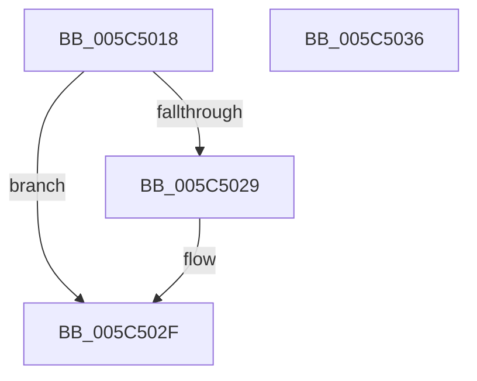

# KiSanitizeProfileInterval

- RVA: `0x005C5018`–`0x005C5037` (길이 `31` bytes)
- VA: `0x00000001405C5018`
- 실행 섹션: `.text`
- PDB 이름 있음: `예`; PDB Function 태그: `아니요`
- unwind 정보 RVA: `0x000DB714`
- 디코드: `10`개 명령, `31/31` bytes 표시
- 미해석 바이트: `0` (있으면 어셈블리에 `.byte`로 보존)

> 이 문서는 커널 이미지의 기계어와 PDB 기호를 분석해 생성했습니다. 4번과 5번은 함수 원형과 자료형을 바이너리 사용 방식에서 추정한 C 해석이며 원본 소스 복구 결과는 아닙니다.

## 1. Dependencies

- 직접 호출 지점: **0**; 고유 호출 대상: **0**
- 직접 호출자로 확인된 함수: **1**
- RIP 상대 이미지 참조: **2**

### Outgoing calls
- 직접 디코드된 call 명령이 없습니다.

### Direct callers
- [KeSetIntervalProfile](../../page/AD/KeSetIntervalProfile_function_00ADB5A8.md) at `0x00ADB600`

### Static image references
- `0x005C5018` → RVA `0x00FC6D28` (`ALMOSTRO`; read)
- `0x005C502F` → RVA `0x00F10D64` (`.data`; write)

## 2. Other-region calls and transfers

- 다른 실행 섹션으로 향하는 call: **0**
- 별도 외부 분기/꼬리 이동을 확인하지 못했습니다.

## 3. Assembly (complete function range)

```asm
005C5018  48 8B 05 09 1D A0 00            mov rax, qword ptr [rip + 0xa01d09]
005C501F  8B 11                           mov edx, dword ptr [rcx]
005C5021  44 8B 00                        mov r8d, dword ptr [rax]
005C5024  41 3B D0                        cmp edx, r8d
005C5027  76 06                           jbe 0x1405c502f
005C5029  44 89 01                        mov dword ptr [rcx], r8d
005C502C  41 8B D0                        mov edx, r8d
005C502F  89 15 2F BD 94 00               mov dword ptr [rip + 0x94bd2f], edx
005C5035  C3                              ret
005C5036  CC                              int3
```

## 4. C-style interpretation (structured pseudocode)

```c
__int64 __fastcall KiSanitizeProfileInterval(__int64 a1)
{
    if (((unsigned int)((unsigned int)(*(unsigned int *)(a1)))) >= = ((unsigned int)((unsigned int)(*(unsigned int *)(*(unsigned __int64 *)(v_rip + 10493193)))))) {
        *(unsigned int *)(a1) = (unsigned int)((unsigned int)(*(unsigned int *)(*(unsigned __int64 *)(v_rip + 10493193))));
        a2 = (unsigned int)((unsigned int)(*(unsigned int *)(*(unsigned __int64 *)(v_rip + 10493193))));
    }
    *(unsigned int *)(v_rip + 9747759) = (unsigned int)(a2);
    return *(unsigned __int64 *)(v_rip + 10493193);
}
```

## 5. (Beta) C Style

```c
int64_t KiSanitizeProfileInterval(void *Arg1)
{
    uint8_t *arg1 = (uint8_t *)Arg1;

    if (((uint32_t)((uint32_t)(*(uint32_t *)(arg1)))) >= = ((uint32_t)((uint32_t)(*(uint32_t *)(*(uint64_t *)(v_rip + 0xA01D09)))))) {
        *(uint32_t *)(arg1) = (uint32_t)((uint32_t)(*(uint32_t *)(*(uint64_t *)(v_rip + 0xA01D09))));
        a2 = (uint32_t)((uint32_t)(*(uint32_t *)(*(uint64_t *)(v_rip + 0xA01D09))));
    }
    *(uint32_t *)(v_rip + 0x94BD2F) = (uint32_t)(a2);
    return *(uint64_t *)(v_rip + 0xA01D09);
}
```

### 관측된 메모리 오프셋

구조체 형식이 확인되지 않은 접근은 인자 기준의 오프셋으로만 기록했습니다.

| 기준 인자 | 오프셋 표현 | 폭 (bit) | 접근 |
|---|---:|---:|---|
| `Arg1` | `+ 0x0` | `32` | `R` |
| `Arg1` | `+ 0x0` | `32` | `W` |

## 6. Execution-region graph

[열기: 2D/3D 그래프와 함수 탐색 컨트롤 패널](../../../control-panel.html?section=text&rva=0x005C5018&view=graph)

- 2D 그래프는 위에서 아래로 흐르고, 3D 그래프는 빈 공간을 드래그해 회전합니다. Shift+드래그는 이동, 휠은 확대·축소, 함수 노드 선택은 대상 보고서 이동입니다.

### Static fallback


