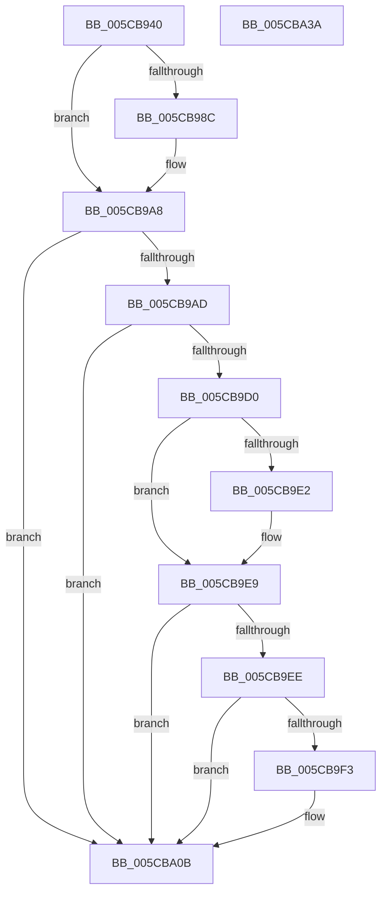

# KiSaveProcessorState

- RVA: `0x005CB940`–`0x005CBA3B` (길이 `251` bytes)
- VA: `0x00000001405CB940`
- 실행 섹션: `.text`
- PDB 이름 있음: `예`; PDB Function 태그: `아니요`
- unwind 정보 RVA: `0x0005C954`
- 디코드: `60`개 명령, `251/251` bytes 표시
- 미해석 바이트: `0` (있으면 어셈블리에 `.byte`로 보존)

> 이 문서는 커널 이미지의 기계어와 PDB 기호를 분석해 생성했습니다. 4번과 5번은 함수 원형과 자료형을 바이너리 사용 방식에서 추정한 C 해석이며 원본 소스 복구 결과는 아닙니다.

## 1. Dependencies

- 직접 호출 지점: **3**; 고유 호출 대상: **3**
- 직접 호출자로 확인된 함수: **2**
- RIP 상대 이미지 참조: **0**

### Outgoing calls
- `0x005CBA06` → [RtlXSave](../3D/RtlXSave_function_003D9D10.md) (function, `0x003D9D10`)
- `0x005CBA14` → [KeContextFromKframes](../3D/KeContextFromKframes_function_003D9380.md) (function, `0x003D9380`)
- `0x005CBA20` → [KiSaveProcessorControlState](../6B/KiSaveProcessorControlState_function_006B0EF0.md) (function, `0x006B0EF0`)

### Direct callers
- [KiFreezeTargetExecution](KiFreezeTargetExecution_function_005C30A0.md) at `0x005C3185`
- [KxNmiInterrupt](../6B/KxNmiInterrupt_function_006BD840.md) at `0x006BD8B1`

### Static image references
- 디코드된 RIP-relative 메모리 참조가 없습니다.

## 2. Other-region calls and transfers

- 다른 실행 섹션으로 향하는 call: **0**
- 별도 외부 분기/꼬리 이동을 확인하지 못했습니다.

## 3. Assembly (complete function range)

```asm
005CB940  48 89 5C 24 08                  mov qword ptr [rsp + 8], rbx
005CB945  48 89 6C 24 10                  mov qword ptr [rsp + 0x10], rbp
005CB94A  48 89 74 24 18                  mov qword ptr [rsp + 0x18], rsi
005CB94F  57                              push rdi
005CB950  48 83 EC 20                     sub rsp, 0x20
005CB954  65 48 8B 3C 25 20 00 00 00      mov rdi, qword ptr gs:[0x20]
005CB95D  48 8B EA                        mov rbp, rdx
005CB960  48 8B F1                        mov rsi, rcx
005CB963  48 8B 9F C0 8F 00 00            mov rbx, qword ptr [rdi + 0x8fc0]
005CB96A  44 8B 8F C8 8F 00 00            mov r9d, dword ptr [rdi + 0x8fc8]
005CB971  44 89 4B 30                     mov dword ptr [rbx + 0x30], r9d
005CB975  44 8A 91 70 01 00 00            mov r10b, byte ptr [rcx + 0x170]
005CB97C  4C 8B 87 10 87 00 00            mov r8, qword ptr [rdi + 0x8710]
005CB983  41 80 E2 01                     and r10b, 1
005CB987  4D 85 C0                        test r8, r8
005CB98A  74 1C                           je 0x1405cb9a8
005CB98C  48 B8 00 00 00 00 00 00 00 80   movabs rax, 0x8000000000000000
005CB996  4C 0B C0                        or r8, rax
005CB999  48 63 83 E0 04 00 00            movsxd rax, dword ptr [rbx + 0x4e0]
005CB9A0  4C 89 84 18 D8 04 00 00         mov qword ptr [rax + rbx + 0x4d8], r8
005CB9A8  45 84 D2                        test r10b, r10b
005CB9AB  75 5E                           jne 0x1405cba0b
005CB9AD  41 BA 08 00 10 00               mov r10d, 0x100008
005CB9B3  41 8B D1                        mov edx, r9d
005CB9B6  41 23 D2                        and edx, r10d
005CB9B9  45 8D 42 38                     lea r8d, [r10 + 0x38]
005CB9BD  45 23 C8                        and r9d, r8d
005CB9C0  45 3B C8                        cmp r9d, r8d
005CB9C3  0F 95 C1                        setne cl
005CB9C6  41 3B D2                        cmp edx, r10d
005CB9C9  0F 95 C0                        setne al
005CB9CC  84 C8                           test al, cl
005CB9CE  75 3B                           jne 0x1405cba0b
005CB9D0  48 B8 E0 03 00 00 80 F7 FF FF   movabs rax, 0xfffff780000003e0
005CB9DA  48 8B 00                        mov rax, qword ptr [rax]
005CB9DD  41 3B D2                        cmp edx, r10d
005CB9E0  75 07                           jne 0x1405cb9e9
005CB9E2  0F AE 83 00 01 00 00            fxsave [rbx + 0x100]
005CB9E9  45 3B C8                        cmp r9d, r8d
005CB9EC  75 1D                           jne 0x1405cba0b
005CB9EE  83 E0 FC                        and eax, 0xfffffffc
005CB9F1  74 18                           je 0x1405cba0b
005CB9F3  48 63 8B E0 04 00 00            movsxd rcx, dword ptr [rbx + 0x4e0]
005CB9FA  48 81 C1 D0 02 00 00            add rcx, 0x2d0
005CBA01  8B D0                           mov edx, eax
005CBA03  48 03 CB                        add rcx, rbx
005CBA06  E8 05 E3 E0 FF                  call 0x1403d9d10
005CBA0B  4C 8B C3                        mov r8, rbx
005CBA0E  48 8B D5                        mov rdx, rbp
005CBA11  48 8B CE                        mov rcx, rsi
005CBA14  E8 67 D9 E0 FF                  call 0x1403d9380
005CBA19  48 8D 8F 00 01 00 00            lea rcx, [rdi + 0x100]
005CBA20  E8 CB 54 0E 00                  call 0x1406b0ef0
005CBA25  48 8B 5C 24 30                  mov rbx, qword ptr [rsp + 0x30]
005CBA2A  48 8B 6C 24 38                  mov rbp, qword ptr [rsp + 0x38]
005CBA2F  48 8B 74 24 40                  mov rsi, qword ptr [rsp + 0x40]
005CBA34  48 83 C4 20                     add rsp, 0x20
005CBA38  5F                              pop rdi
005CBA39  C3                              ret
005CBA3A  CC                              int3
```

## 4. C-style interpretation (structured pseudocode)

```c
__int64 __fastcall KiSaveProcessorState(__int64 a1, __int64 a2)
{
    __int64 result;
    __int64 v_r10;
    __int64 v_rsp;
    unsigned __int64 v_stack_p10;
    unsigned __int64 v_stack_p18;
    unsigned __int64 v_stack_p8;

    v_stack_p8 = v_rbx;
    v_stack_p10 = v_rbp;
    v_stack_p18 = v_rsi;
    v_rsp = (v_rsp) - (32);
    *(unsigned int *)(*(unsigned __int64 *)(*(unsigned __int64 *)(gs_base + (0 + 32)) + 36800) + 48) = (unsigned int)((unsigned int)(*(unsigned int *)(*(unsigned __int64 *)(gs_base + (0 + 32)) + 36808)));
    v_r10 = (unsigned __int8)((*(unsigned __int8 *)(a1 + 368)) & (1));
    if (*(unsigned __int64 *)(*(unsigned __int64 *)(gs_base + (0 + 32)) + 34576) != 0) {
        a3 = (*(unsigned __int64 *)(*(unsigned __int64 *)(gs_base + (0 + 32)) + 34576)) | (result);
        result = (int)(*(unsigned int *)(*(unsigned __int64 *)(*(unsigned __int64 *)(gs_base + (0 + 32)) + 36800) + 1248));
        *(unsigned __int64 *)(result + *(unsigned __int64 *)(*(unsigned __int64 *)(gs_base + (0 + 32)) + 36800) * 1 + 1240) = a3;
    }
    if ((unsigned __int8)(v_r10) != 0) goto loc_005CBA0B;
    a2 = (unsigned int)(((unsigned int)((unsigned int)((unsigned int)(*(unsigned int *)(*(unsigned __int64 *)(gs_base + (0 + 32)) + 36808))))) & ((unsigned int)((unsigned int)(0x100008ULL))));
    a4 = (unsigned int)(((unsigned int)(*(unsigned int *)(*(unsigned __int64 *)(gs_base + (0 + 32)) + 36808))) & ((unsigned int)((unsigned int)(0x100008ULL) + 56)));
    a1 = (((unsigned int)(a4)) != ((unsigned int)((unsigned int)(0x100008ULL) + 56))) ? 1 : 0;
    result = (((unsigned int)(a2)) != ((unsigned int)((unsigned int)(0x100008ULL)))) ? 1 : 0;
    if ((((unsigned __int8)(result)) & ((unsigned __int8)(a1))) != 0) goto loc_005CBA0B;
    if (((unsigned int)(a2)) == ((unsigned int)((unsigned int)(0x100008ULL)))) {
    }
    if (((unsigned int)(a4)) != ((unsigned int)((unsigned int)(0x100008ULL) + 56))) goto loc_005CBA0B;
    result = (unsigned int)((*(unsigned __int64 *)(result)) & (0xFFFFFFFCULL));
    if (!(condition_is_equal)) {
        a1 = (int)(*(unsigned int *)(*(unsigned __int64 *)(*(unsigned __int64 *)(gs_base + (0 + 32)) + 36800) + 1248));
        a1 = (a1) + (720);
        a2 = (unsigned int)(result);
        a1 = (a1) + (*(unsigned __int64 *)(*(unsigned __int64 *)(gs_base + (0 + 32)) + 36800));
        result = RtlXSave(a1, a2, (unsigned int)(0x100008ULL) + 56, a4);
    }
    result = KeContextFromKframes(a1, a2, *(unsigned __int64 *)(*(unsigned __int64 *)(gs_base + (0 + 32)) + 36800), a4);
    result = KiSaveProcessorControlState(*(unsigned __int64 *)(gs_base + (0 + 32)) + 256, a2, *(unsigned __int64 *)(*(unsigned __int64 *)(gs_base + (0 + 32)) + 36800), a4);
    v_rsp = (v_rsp) + (32);
    return result;
}
```

## 5. (Beta) C Style

```c
int64_t KiSaveProcessorState(void *Arg1, int64_t Arg2)
{
    uint8_t *arg1 = (uint8_t *)Arg1;

    int64_t result;
    int64_t local_r10;
    int64_t local_rsp;
    uint64_t v_stack_p10;
    uint64_t v_stack_p18;
    uint64_t v_stack_p8;

    v_stack_p8 = local_rbx;
    v_stack_p10 = local_rbp;
    v_stack_p18 = local_rsi;
    local_rsp = (local_rsp) - (32);
    *(uint32_t *)(*(uint64_t *)(*(uint64_t *)(gs_base + (0 + 0x20)) + 0x8FC0) + 0x30) = (uint32_t)((uint32_t)(*(uint32_t *)(*(uint64_t *)(gs_base + (0 + 0x20)) + 0x8FC8)));
    local_r10 = (uint8_t)((*(uint8_t *)(arg1 + 0x170)) & (1));
    if (*(uint64_t *)(*(uint64_t *)(gs_base + (0 + 0x20)) + 0x8710) != 0) {
        a3 = (*(uint64_t *)(*(uint64_t *)(gs_base + (0 + 0x20)) + 0x8710)) | (result);
        result = (int32_t)(*(uint32_t *)(*(uint64_t *)(*(uint64_t *)(gs_base + (0 + 0x20)) + 0x8FC0) + 0x4E0));
        *(uint64_t *)(result + *(uint64_t *)(*(uint64_t *)(gs_base + (0 + 0x20)) + 0x8FC0) * 1 + 0x4D8) = a3;
    }
    if ((uint8_t)(local_r10) != 0) goto loc_005CBA0B;
    Arg2 = (uint32_t)(((uint32_t)((uint32_t)((uint32_t)(*(uint32_t *)(*(uint64_t *)(gs_base + (0 + 0x20)) + 0x8FC8))))) & ((uint32_t)((uint32_t)(0x100008ULL))));
    a4 = (uint32_t)(((uint32_t)(*(uint32_t *)(*(uint64_t *)(gs_base + (0 + 0x20)) + 0x8FC8))) & ((uint32_t)((uint32_t)(0x100008ULL) + 56)));
    Arg1 = (((uint32_t)(a4)) != ((uint32_t)((uint32_t)(0x100008ULL) + 56))) ? 1 : 0;
    result = (((uint32_t)(Arg2)) != ((uint32_t)((uint32_t)(0x100008ULL)))) ? 1 : 0;
    if ((((uint8_t)(result)) & ((uint8_t)(Arg1))) != 0) goto loc_005CBA0B;
    if (((uint32_t)(Arg2)) == ((uint32_t)((uint32_t)(0x100008ULL)))) {
    }
    if (((uint32_t)(a4)) != ((uint32_t)((uint32_t)(0x100008ULL) + 56))) goto loc_005CBA0B;
    result = (uint32_t)((*(uint64_t *)(result)) & (0xFFFFFFFCULL));
    if (!(condition_is_equal)) {
        Arg1 = (int32_t)(*(uint32_t *)(*(uint64_t *)(*(uint64_t *)(gs_base + (0 + 0x20)) + 0x8FC0) + 0x4E0));
        Arg1 = (Arg1) + (720);
        Arg2 = (uint32_t)(result);
        Arg1 = (Arg1) + (*(uint64_t *)(*(uint64_t *)(gs_base + (0 + 0x20)) + 0x8FC0));
        result = RtlXSave(Arg1, Arg2, (uint32_t)(0x100008ULL) + 56, a4);
    }
    result = KeContextFromKframes(Arg1, Arg2, *(uint64_t *)(*(uint64_t *)(gs_base + (0 + 0x20)) + 0x8FC0), a4);
    result = KiSaveProcessorControlState(*(uint64_t *)(gs_base + (0 + 0x20)) + 256, Arg2, *(uint64_t *)(*(uint64_t *)(gs_base + (0 + 0x20)) + 0x8FC0), a4);
    local_rsp = (local_rsp) + (32);
    return result;
}
```

### 관측된 메모리 오프셋

구조체 형식이 확인되지 않은 접근은 인자 기준의 오프셋으로만 기록했습니다.

| 기준 인자 | 오프셋 표현 | 폭 (bit) | 접근 |
|---|---:|---:|---|
| `Arg1` | `+ 0x170` | `8` | `R` |

## 6. Execution-region graph

[열기: 2D/3D 그래프와 함수 탐색 컨트롤 패널](../../../control-panel.html?section=text&rva=0x005CB940&view=graph)

- 2D 그래프는 위에서 아래로 흐르고, 3D 그래프는 빈 공간을 드래그해 회전합니다. Shift+드래그는 이동, 휠은 확대·축소, 함수 노드 선택은 대상 보고서 이동입니다.

### Static fallback


