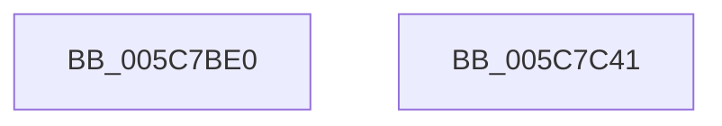

# KiScheduleBugcheckRecoveryWorkItem

- RVA: `0x005C7BE0`–`0x005C7C42` (길이 `98` bytes)
- VA: `0x00000001405C7BE0`
- 실행 섹션: `.text`
- PDB 이름 있음: `예`; PDB Function 태그: `아니요`
- unwind 정보 RVA: `0x0005C788`
- 디코드: `18`개 명령, `98/98` bytes 표시
- 미해석 바이트: `0` (있으면 어셈블리에 `.byte`로 보존)

> 이 문서는 커널 이미지의 기계어와 PDB 기호를 분석해 생성했습니다. 4번과 5번은 함수 원형과 자료형을 바이너리 사용 방식에서 추정한 C 해석이며 원본 소스 복구 결과는 아닙니다.

## 1. Dependencies

- 직접 호출 지점: **1**; 고유 호출 대상: **1**
- 직접 호출자로 확인된 함수: **0**
- RIP 상대 이미지 참조: **11**

### Outgoing calls
- `0x005C7C37` → [ExQueueWorkItem](../2F/ExQueueWorkItem_function_002F9520.md) (function, `0x002F9520`)

### Direct callers
- 이 함수 시작 RVA로 연결되는 직접 call은 확인되지 않았습니다. 간접 호출은 완전히 역산할 수 없습니다.

### Static image references
- `0x005C7BE6` → RVA `0x00F10980` (`.data`; write)
- `0x005C7BEF` → RVA `0x00F10988` (`.data`; read)
- `0x005C7BF6` → RVA `0x00F10984` (`.data`; write)
- `0x005C7BFC` → RVA `0x00F10990` (`.data`; write)
- `0x005C7C03` → RVA `0x00F10988` (`.data`; write)
- `0x005C7C0A` → RVA `0x005C75A0` (`KiDeferredBugcheckRecoveryWorker`; read)
- `0x005C7C14` → RVA `0x00F10978` (`.data`; write)
- `0x005C7C1B` → RVA `0x00F10960` (`.data`; write)
- `0x005C7C22` → RVA `0x00F10960` (`.data`; read)
- `0x005C7C29` → RVA `0x00F10982` (`.data`; write)
- `0x005C7C30` → RVA `0x00F10970` (`.data`; write)

## 2. Other-region calls and transfers

- 다른 실행 섹션으로 향하는 call: **0**
- 별도 외부 분기/꼬리 이동을 확인하지 못했습니다.

## 3. Assembly (complete function range)

```asm
005C7BE0  48 83 EC 28                     sub rsp, 0x28
005C7BE4  33 C9                           xor ecx, ecx
005C7BE6  66 C7 05 91 8D 94 00 01 00      mov word ptr [rip + 0x948d91], 1
005C7BEF  48 8D 05 92 8D 94 00            lea rax, [rip + 0x948d92]
005C7BF6  89 0D 88 8D 94 00               mov dword ptr [rip + 0x948d88], ecx
005C7BFC  48 89 05 8D 8D 94 00            mov qword ptr [rip + 0x948d8d], rax
005C7C03  48 89 05 7E 8D 94 00            mov qword ptr [rip + 0x948d7e], rax
005C7C0A  48 8D 05 8F F9 FF FF            lea rax, [rip - 0x671]
005C7C11  8D 51 05                        lea edx, [rcx + 5]
005C7C14  48 89 0D 5D 8D 94 00            mov qword ptr [rip + 0x948d5d], rcx
005C7C1B  48 89 0D 3E 8D 94 00            mov qword ptr [rip + 0x948d3e], rcx
005C7C22  48 8D 0D 37 8D 94 00            lea rcx, [rip + 0x948d37]
005C7C29  C6 05 52 8D 94 00 06            mov byte ptr [rip + 0x948d52], 6
005C7C30  48 89 05 39 8D 94 00            mov qword ptr [rip + 0x948d39], rax
005C7C37  E8 E4 18 D3 FF                  call 0x1402f9520
005C7C3C  48 83 C4 28                     add rsp, 0x28
005C7C40  C3                              ret
005C7C41  CC                              int3
```

## 4. C-style interpretation (structured pseudocode)

```c
__int64 __fastcall KiScheduleBugcheckRecoveryWorkItem(int a1)
{
    __int64 result;
    __int64 v_rsp;

    v_rsp = (v_rsp) - (40);
    a1 = 0;
    *(unsigned __int16 *)(v_rip + 9735569) = 1;
    *(unsigned int *)(v_rip + 9735560) = 0;
    *(unsigned __int64 *)(v_rip + 9735565) = v_rip + 9735570;
    *(unsigned __int64 *)(v_rip + 9735550) = v_rip + 9735570;
    *(unsigned __int64 *)(v_rip + 9735517) = 0;
    *(unsigned __int64 *)(v_rip + 9735486) = 0;
    *(unsigned __int8 *)(v_rip + 9735506) = 6;
    *(unsigned __int64 *)(v_rip + 9735481) = v_rip - 1649;
    result = ExQueueWorkItem(v_rip + 9735479, a1 + 5, a3, a4);
    v_rsp = (v_rsp) + (40);
    return result;
}
```

## 5. (Beta) C Style

```c
int64_t KiScheduleBugcheckRecoveryWorkItem(int32_t Arg1)
{
    int64_t result;
    int64_t local_rsp;

    local_rsp = (local_rsp) - (40);
    Arg1 = 0;
    *(uint16_t *)(v_rip + 0x948D91) = 1;
    *(uint32_t *)(v_rip + 0x948D88) = 0;
    *(uint64_t *)(v_rip + 0x948D8D) = v_rip + 9735570;
    *(uint64_t *)(v_rip + 0x948D7E) = v_rip + 9735570;
    *(uint64_t *)(v_rip + 0x948D5D) = 0;
    *(uint64_t *)(v_rip + 0x948D3E) = 0;
    *(uint8_t *)(v_rip + 0x948D52) = 6;
    *(uint64_t *)(v_rip + 0x948D39) = v_rip - 1649;
    result = ExQueueWorkItem(v_rip + 9735479, Arg1 + 5, a3, a4);
    local_rsp = (local_rsp) + (40);
    return result;
}
```

## 6. Execution-region graph

[열기: 2D/3D 그래프와 함수 탐색 컨트롤 패널](../../../control-panel.html?section=text&rva=0x005C7BE0&view=graph)

- 2D 그래프는 위에서 아래로 흐르고, 3D 그래프는 빈 공간을 드래그해 회전합니다. Shift+드래그는 이동, 휠은 확대·축소, 함수 노드 선택은 대상 보고서 이동입니다.

### Static fallback


