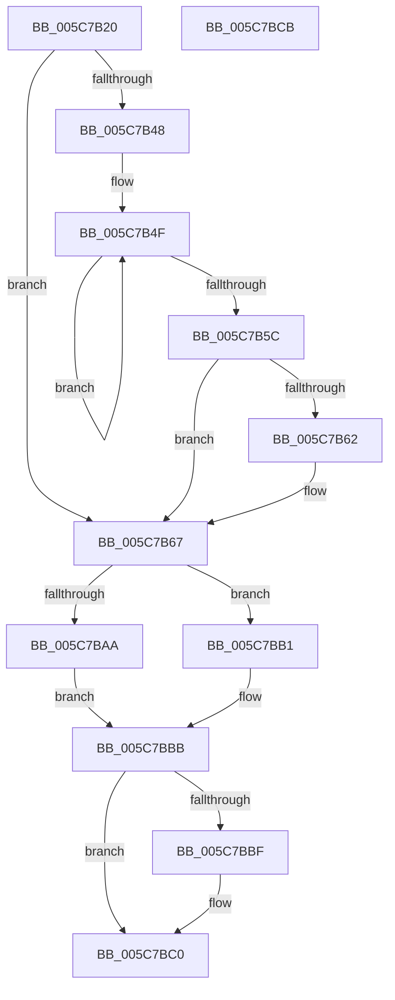

# KiScheduleBugcheckRecovery

- RVA: `0x005C7B20`–`0x005C7BCC` (길이 `172` bytes)
- VA: `0x00000001405C7B20`
- 실행 섹션: `.text`
- PDB 이름 있음: `예`; PDB Function 태그: `아니요`
- unwind 정보 RVA: `0x0005CAAC`
- 디코드: `44`개 명령, `172/172` bytes 표시
- 미해석 바이트: `0` (있으면 어셈블리에 `.byte`로 보존)

> 이 문서는 커널 이미지의 기계어와 PDB 기호를 분석해 생성했습니다. 4번과 5번은 함수 원형과 자료형을 바이너리 사용 방식에서 추정한 C 해석이며 원본 소스 복구 결과는 아닙니다.

## 1. Dependencies

- 직접 호출 지점: **5**; 고유 호출 대상: **5**
- 직접 호출자로 확인된 함수: **1**
- RIP 상대 이미지 참조: **7**

### Outgoing calls
- `0x005C7B2A` → [KeAreInterruptsEnabled](../2F/KeAreInterruptsEnabled_function_002F8060.md) (function, `0x002F8060`)
- `0x005C7B62` → [KiRemoveSystemWorkPriorityKick](../26/KiRemoveSystemWorkPriorityKick_function_002631D0.md) (function, `0x002631D0`)
- `0x005C7BA1` → [KeInsertQueueDpc](../20/KeInsertQueueDpc_function_00207C50.md) (function, `0x00207C50`)
- `0x005C7BAA` → [KiStallBugcheckThread](KiStallBugcheckThread_function_005C7C78.md) (function, `0x005C7C78`)
- `0x005C7BB6` → [KiRecordRecoveryFailure](KiRecordRecoveryFailure_function_005C7AB8.md) (function, `0x005C7AB8`)

### Direct callers
- [KiAttemptBugcheckRecovery](KiAttemptBugcheckRecovery_function_005C6D24.md) at `0x005C6F99`

### Static image references
- `0x005C7B68` → RVA `0x005C7BE0` (`KiScheduleBugcheckRecoveryWorkItem`; read)
- `0x005C7B6F` → RVA `0x00F10920` (`.data`; write)
- `0x005C7B7C` → RVA `0x00F10938` (`.data`; write)
- `0x005C7B85` → RVA `0x00F10940` (`.data`; write)
- `0x005C7B8C` → RVA `0x00F10920` (`.data`; read)
- `0x005C7B93` → RVA `0x00F10958` (`.data`; write)
- `0x005C7B9A` → RVA `0x00F10930` (`.data`; write)

## 2. Other-region calls and transfers

- 다른 실행 섹션으로 향하는 call: **0**
- 별도 외부 분기/꼬리 이동을 확인하지 못했습니다.

## 3. Assembly (complete function range)

```asm
005C7B20  48 89 5C 24 08                  mov qword ptr [rsp + 8], rbx
005C7B25  57                              push rdi
005C7B26  48 83 EC 20                     sub rsp, 0x20
005C7B2A  E8 31 05 D3 FF                  call 0x1402f8060
005C7B2F  65 48 8B 0C 25 20 00 00 00      mov rcx, qword ptr gs:[0x20]
005C7B38  33 FF                           xor edi, edi
005C7B3A  8A D8                           mov bl, al
005C7B3C  4C 8B 81 B8 8E 00 00            mov r8, qword ptr [rcx + 0x8eb8]
005C7B43  4D 85 C0                        test r8, r8
005C7B46  74 1F                           je 0x1405c7b67
005C7B48  41 0F 0D 08                     prefetchw byte ptr [r8]
005C7B4C  41 8B 00                        mov eax, dword ptr [r8]
005C7B4F  8B D0                           mov edx, eax
005C7B51  0F BA F2 15                     btr edx, 0x15
005C7B55  F0 41 0F B1 10                  lock cmpxchg dword ptr [r8], edx
005C7B5A  75 F3                           jne 0x1405c7b4f
005C7B5C  0F BA E0 15                     bt eax, 0x15
005C7B60  73 05                           jae 0x1405c7b67
005C7B62  E8 69 B6 C9 FF                  call 0x1402631d0
005C7B67  FB                              sti
005C7B68  48 8D 05 71 00 00 00            lea rax, [rip + 0x71]
005C7B6F  C7 05 A7 8D 94 00 13 02 00 00   mov dword ptr [rip + 0x948da7], 0x213
005C7B79  45 33 C0                        xor r8d, r8d
005C7B7C  48 89 05 B5 8D 94 00            mov qword ptr [rip + 0x948db5], rax
005C7B83  33 D2                           xor edx, edx
005C7B85  48 89 3D B4 8D 94 00            mov qword ptr [rip + 0x948db4], rdi
005C7B8C  48 8D 0D 8D 8D 94 00            lea rcx, [rip + 0x948d8d]
005C7B93  48 89 3D BE 8D 94 00            mov qword ptr [rip + 0x948dbe], rdi
005C7B9A  48 89 3D 8F 8D 94 00            mov qword ptr [rip + 0x948d8f], rdi
005C7BA1  E8 AA 00 C4 FF                  call 0x140207c50
005C7BA6  84 C0                           test al, al
005C7BA8  74 07                           je 0x1405c7bb1
005C7BAA  E8 C9 00 00 00                  call 0x1405c7c78
005C7BAF  EB 0A                           jmp 0x1405c7bbb
005C7BB1  B9 04 00 00 00                  mov ecx, 4
005C7BB6  E8 FD FE FF FF                  call 0x1405c7ab8
005C7BBB  84 DB                           test bl, bl
005C7BBD  75 01                           jne 0x1405c7bc0
005C7BBF  FA                              cli
005C7BC0  48 8B 5C 24 30                  mov rbx, qword ptr [rsp + 0x30]
005C7BC5  48 83 C4 20                     add rsp, 0x20
005C7BC9  5F                              pop rdi
005C7BCA  C3                              ret
005C7BCB  CC                              int3
```

## 4. C-style interpretation (structured pseudocode)

```c
__int64 __fastcall KiScheduleBugcheckRecovery(void)
{
    __int64 result;
    __int64 v_rdi;
    __int64 v_rsp;
    unsigned __int64 v_stack_p8;

    v_stack_p8 = v_rbx;
    v_rsp = (v_rsp) - (32);
    result = KeAreInterruptsEnabled(a1, a2, a3, a4);
    v_rdi = 0;
    if (*(unsigned __int64 *)(*(unsigned __int64 *)(gs_base + (0 + 32)) + 36536) == 0) goto loc_005C7B67;
loc_005C7B4F:
    if (*(unsigned __int64 *)(*(unsigned __int64 *)(gs_base + (0 + 32)) + 36536) != 0) goto loc_005C7B4F;
    result = (unsigned int)(*(unsigned int *)(*(unsigned __int64 *)(*(unsigned __int64 *)(gs_base + (0 + 32)) + 36536)));
    if (!(condition_is_above_or_equal)) {
        result = KiRemoveSystemWorkPriorityKick(*(unsigned __int64 *)(gs_base + (0 + 32)), (unsigned int)((unsigned int)((unsigned int)(*(unsigned int *)(*(unsigned __int64 *)(*(unsigned __int64 *)(gs_base + (0 + 32)) + 36536))))), *(unsigned __int64 *)(*(unsigned __int64 *)(gs_base + (0 + 32)) + 36536), a4);
    }
    *(unsigned int *)(v_rip + 9735591) = 531;
    a3 = 0;
    *(unsigned __int64 *)(v_rip + 9735605) = v_rip + 113;
    a2 = 0;
    *(unsigned __int64 *)(v_rip + 9735604) = 0;
    *(unsigned __int64 *)(v_rip + 9735614) = 0;
    *(unsigned __int64 *)(v_rip + 9735567) = 0;
    result = KeInsertQueueDpc(v_rip + 9735565, a2, a3, a4);
    if ((unsigned __int8)(result) == 0) goto loc_005C7BB1;
    result = KiStallBugcheckThread(v_rip + 9735565, a2, a3, a4);
    goto loc_005C7BBB;
loc_005C7BB1:
    result = KiRecordRecoveryFailure(4, a2, a3, a4);
loc_005C7BBB:
    if ((unsigned __int8)((unsigned __int8)(result)) == 0) {
    }
    v_rsp = (v_rsp) + (32);
    return result;
}
```

## 5. (Beta) C Style

```c
void KiScheduleBugcheckRecovery(void)
{
    int64_t result;
    int64_t local_rdi;
    int64_t local_rsp;
    uint64_t v_stack_p8;

    v_stack_p8 = local_rbx;
    local_rsp = (local_rsp) - (32);
    result = KeAreInterruptsEnabled(a1, a2, a3, a4);
    local_rdi = 0;
    if (*(uint64_t *)(*(uint64_t *)(gs_base + (0 + 0x20)) + 0x8EB8) == 0) goto loc_005C7B67;
loc_005C7B4F:
    if (*(uint64_t *)(*(uint64_t *)(gs_base + (0 + 0x20)) + 0x8EB8) != 0) goto loc_005C7B4F;
    result = (uint32_t)(*(uint32_t *)(*(uint64_t *)(*(uint64_t *)(gs_base + (0 + 0x20)) + 0x8EB8)));
    if (!(condition_is_above_or_equal)) {
        result = KiRemoveSystemWorkPriorityKick(*(uint64_t *)(gs_base + (0 + 0x20)), (uint32_t)((uint32_t)((uint32_t)(*(uint32_t *)(*(uint64_t *)(*(uint64_t *)(gs_base + (0 + 0x20)) + 0x8EB8))))), *(uint64_t *)(*(uint64_t *)(gs_base + (0 + 0x20)) + 0x8EB8), a4);
    }
    *(uint32_t *)(v_rip + 0x948DA7) = 531;
    a3 = 0;
    *(uint64_t *)(v_rip + 0x948DB5) = v_rip + 113;
    a2 = 0;
    *(uint64_t *)(v_rip + 0x948DB4) = 0;
    *(uint64_t *)(v_rip + 0x948DBE) = 0;
    *(uint64_t *)(v_rip + 0x948D8F) = 0;
    result = KeInsertQueueDpc(v_rip + 9735565, a2, a3, a4);
    if ((uint8_t)(result) == 0) goto loc_005C7BB1;
    result = KiStallBugcheckThread(v_rip + 9735565, a2, a3, a4);
    goto loc_005C7BBB;
loc_005C7BB1:
    result = KiRecordRecoveryFailure(4, a2, a3, a4);
loc_005C7BBB:
    if ((uint8_t)((uint8_t)(result)) == 0) {
    }
    local_rsp = (local_rsp) + (32);
    return result;
}
```

## 6. Execution-region graph

[열기: 2D/3D 그래프와 함수 탐색 컨트롤 패널](../../../control-panel.html?section=text&rva=0x005C7B20&view=graph)

- 2D 그래프는 위에서 아래로 흐르고, 3D 그래프는 빈 공간을 드래그해 회전합니다. Shift+드래그는 이동, 휠은 확대·축소, 함수 노드 선택은 대상 보고서 이동입니다.

### Static fallback


