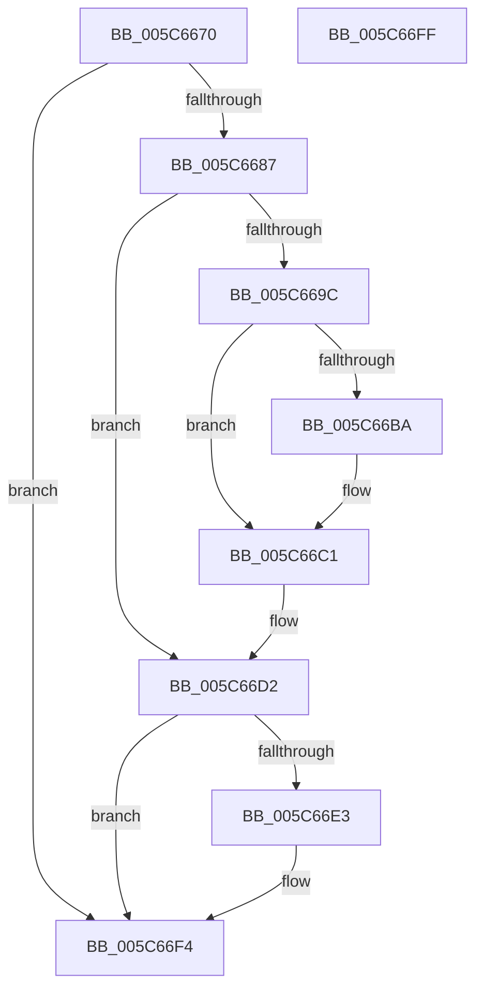

# KiScheduleNextForegroundBoost

- RVA: `0x005C6670`–`0x005C6700` (길이 `144` bytes)
- VA: `0x00000001405C6670`
- 실행 섹션: `.text`
- PDB 이름 있음: `예`; PDB Function 태그: `아니요`
- unwind 정보 RVA: `0x0005CAAC`
- 디코드: `36`개 명령, `144/144` bytes 표시
- 미해석 바이트: `0` (있으면 어셈블리에 `.byte`로 보존)

> 이 문서는 커널 이미지의 기계어와 PDB 기호를 분석해 생성했습니다. 4번과 5번은 함수 원형과 자료형을 바이너리 사용 방식에서 추정한 C 해석이며 원본 소스 복구 결과는 아닙니다.

## 1. Dependencies

- 직접 호출 지점: **3**; 고유 호출 대상: **3**
- 직접 호출자로 확인된 함수: **3**
- RIP 상대 이미지 참조: **5**

### Outgoing calls
- `0x005C6691` → [KeAcquireSpinLockAtDpcLevel](../20/KeAcquireSpinLockAtDpcLevel_function_00208430.md) (function, `0x00208430`)
- `0x005C66D9` → [KxReleaseSpinLock](../20/KxReleaseSpinLock_function_00206670.md) (function, `0x00206670`)
- `0x005C66EF` → [KeInsertQueueDpc](../20/KeInsertQueueDpc_function_00207C50.md) (function, `0x00207C50`)

### Direct callers
- [sub_0021D7F8](../21/Unknown_function_0021D7F8.md) at `0x0021EB6F`
- [sub_002546EC](../25/Unknown_function_002546EC.md) at `0x002552B8`
- [KiTryScheduleNextForegroundBoost](../47/KiTryScheduleNextForegroundBoost_function_0047B51C.md) at `0x0047B558`

### Static image references
- `0x005C6687` → RVA `0x00F22D38` (`.data`; read)
- `0x005C669C` → RVA `0x00F22D30` (`.data`; read)
- `0x005C66A3` → RVA `0x00F22D28` (`.data`; read)
- `0x005C66CB` → RVA `0x00F22D30` (`.data`; write)
- `0x005C66E6` → RVA `0x00F22CE8` (`.data`; read)

## 2. Other-region calls and transfers

- 다른 실행 섹션으로 향하는 call: **0**
- 별도 외부 분기/꼬리 이동을 확인하지 못했습니다.

## 3. Assembly (complete function range)

```asm
005C6670  48 89 5C 24 08                  mov qword ptr [rsp + 8], rbx
005C6675  57                              push rdi
005C6676  48 83 EC 20                     sub rsp, 0x20
005C667A  48 8D 99 70 03 00 00            lea rbx, [rcx + 0x370]
005C6681  48 83 3B 01                     cmp qword ptr [rbx], 1
005C6685  75 6D                           jne 0x1405c66f4
005C6687  48 8D 0D AA C6 95 00            lea rcx, [rip + 0x95c6aa]
005C668E  40 32 FF                        xor dil, dil
005C6691  E8 9A 1D C4 FF                  call 0x140208430
005C6696  48 83 3B 01                     cmp qword ptr [rbx], 1
005C669A  75 36                           jne 0x1405c66d2
005C669C  48 8B 05 8D C6 95 00            mov rax, qword ptr [rip + 0x95c68d]
005C66A3  48 8D 0D 7E C6 95 00            lea rcx, [rip + 0x95c67e]
005C66AA  48 39 0D 77 C6 95 00            cmp qword ptr [rip + 0x95c677], rcx
005C66B1  40 0F 94 C7                     sete dil
005C66B5  48 39 08                        cmp qword ptr [rax], rcx
005C66B8  74 07                           je 0x1405c66c1
005C66BA  B9 03 00 00 00                  mov ecx, 3
005C66BF  CD 29                           int 0x29
005C66C1  48 89 0B                        mov qword ptr [rbx], rcx
005C66C4  48 89 43 08                     mov qword ptr [rbx + 8], rax
005C66C8  48 89 18                        mov qword ptr [rax], rbx
005C66CB  48 89 1D 5E C6 95 00            mov qword ptr [rip + 0x95c65e], rbx
005C66D2  48 8D 0D 5F C6 95 00            lea rcx, [rip + 0x95c65f]
005C66D9  E8 92 FF C3 FF                  call 0x140206670
005C66DE  40 84 FF                        test dil, dil
005C66E1  74 11                           je 0x1405c66f4
005C66E3  45 33 C0                        xor r8d, r8d
005C66E6  48 8D 0D FB C5 95 00            lea rcx, [rip + 0x95c5fb]
005C66ED  33 D2                           xor edx, edx
005C66EF  E8 5C 15 C4 FF                  call 0x140207c50
005C66F4  48 8B 5C 24 30                  mov rbx, qword ptr [rsp + 0x30]
005C66F9  48 83 C4 20                     add rsp, 0x20
005C66FD  5F                              pop rdi
005C66FE  C3                              ret
005C66FF  CC                              int3
```

## 4. C-style interpretation (structured pseudocode)

```c
__int64 __fastcall KiScheduleNextForegroundBoost(__int64 a1, int a2, int a3)
{
    __int64 result;
    __int64 v_rdi;
    __int64 v_rsp;
    unsigned __int64 v_stack_p8;

    v_stack_p8 = v_rbx;
    v_rsp = (v_rsp) - (32);
    if ((*(unsigned __int64 *)(a1 + 880)) != 1) goto loc_005C66F4;
    v_rdi = 0;
    result = KeAcquireSpinLockAtDpcLevel(v_rip + 9815722, a2, a3, a4);
    if ((*(unsigned __int64 *)(a1 + 880)) != 1) goto loc_005C66D2;
    v_rdi = ((*(unsigned __int64 *)(v_rip + 9815671)) == (v_rip + 9815678)) ? 1 : 0;
    if ((*(unsigned __int64 *)(*(unsigned __int64 *)(v_rip + 9815693))) != (v_rip + 9815678)) {
        a1 = 3;
    }
    *(unsigned __int64 *)(a1 + 880) = a1;
    *(unsigned __int64 *)(a1 + 880 + 8) = *(unsigned __int64 *)(v_rip + 9815693);
    *(unsigned __int64 *)(*(unsigned __int64 *)(v_rip + 9815693)) = a1 + 880;
    *(unsigned __int64 *)(v_rip + 9815646) = a1 + 880;
loc_005C66D2:
    result = KxReleaseSpinLock(v_rip + 9815647, a2, a3, a4);
    if ((unsigned __int8)(v_rdi) != 0) {
        a3 = 0;
        a1 = v_rip + 9815547;
        a2 = 0;
        result = KeInsertQueueDpc(a1, a2, a3, a4);
    }
    v_rsp = (v_rsp) + (32);
    return result;
}
```

## 5. (Beta) C Style

```c
int64_t KiScheduleNextForegroundBoost(void *Arg1, int32_t Arg2, int32_t Arg3)
{
    uint8_t *arg1 = (uint8_t *)Arg1;

    int64_t result;
    int64_t local_rdi;
    int64_t local_rsp;
    uint64_t v_stack_p8;

    v_stack_p8 = local_rbx;
    local_rsp = (local_rsp) - (32);
    if ((*(uint64_t *)(arg1 + 0x370)) != 1) goto loc_005C66F4;
    local_rdi = 0;
    result = KeAcquireSpinLockAtDpcLevel(v_rip + 9815722, Arg2, Arg3, a4);
    if ((*(uint64_t *)(arg1 + 0x370)) != 1) goto loc_005C66D2;
    local_rdi = ((*(uint64_t *)(v_rip + 0x95C677)) == (v_rip + 9815678)) ? 1 : 0;
    if ((*(uint64_t *)(*(uint64_t *)(v_rip + 0x95C68D))) != (v_rip + 9815678)) {
        Arg1 = 3;
    }
    *(void **)(arg1 + 0x370) = Arg1;
    *(uint64_t *)(arg1 + 0x370 + 0x8) = *(uint64_t *)(v_rip + 0x95C68D);
    *(void **)(*(uint64_t *)(v_rip + 0x95C68D)) = Arg1 + 880;
    *(void **)(v_rip + 0x95C65E) = Arg1 + 880;
loc_005C66D2:
    result = KxReleaseSpinLock(v_rip + 9815647, Arg2, Arg3, a4);
    if ((uint8_t)(local_rdi) != 0) {
        Arg3 = 0;
        Arg1 = v_rip + 9815547;
        Arg2 = 0;
        result = KeInsertQueueDpc(Arg1, Arg2, Arg3, a4);
    }
    local_rsp = (local_rsp) + (32);
    return result;
}
```

### 관측된 메모리 오프셋

구조체 형식이 확인되지 않은 접근은 인자 기준의 오프셋으로만 기록했습니다.

| 기준 인자 | 오프셋 표현 | 폭 (bit) | 접근 |
|---|---:|---:|---|
| `Arg1` | `+ 0x0` | `64` | `R` |
| `Arg1` | `+ 0x0` | `64` | `W` |
| `Arg1` | `+ 0x8` | `64` | `W` |
| `Arg1` | `+ 0x370` | `64` | `R` |

## 6. Execution-region graph

[열기: 2D/3D 그래프와 함수 탐색 컨트롤 패널](../../../control-panel.html?section=text&rva=0x005C6670&view=graph)

- 2D 그래프는 위에서 아래로 흐르고, 3D 그래프는 빈 공간을 드래그해 회전합니다. Shift+드래그는 이동, 휠은 확대·축소, 함수 노드 선택은 대상 보고서 이동입니다.

### Static fallback


