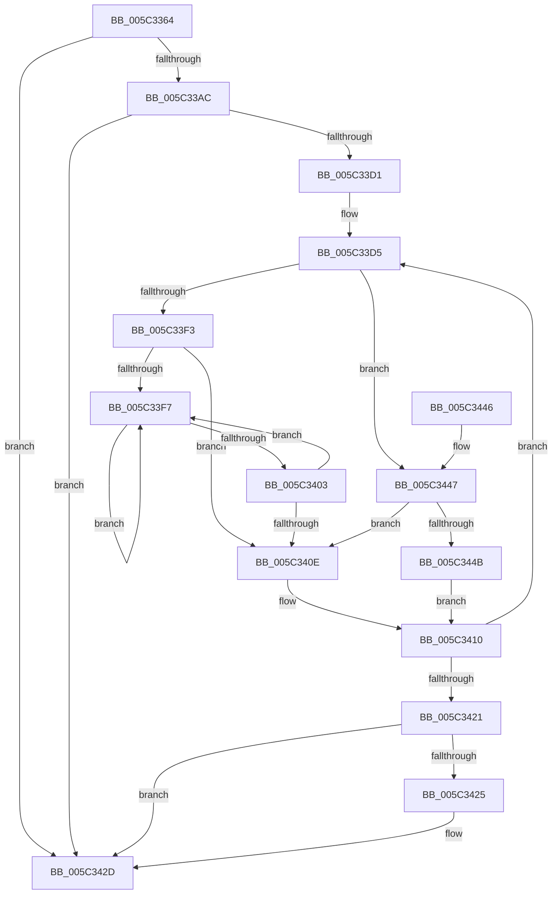

# KiSendFreeze

- RVA: `0x005C3364`–`0x005C3458` (길이 `244` bytes)
- VA: `0x00000001405C3364`
- 실행 섹션: `.text`
- PDB 이름 있음: `예`; PDB Function 태그: `아니요`
- unwind 정보 RVA: `0x000CA954`
- 디코드: `70`개 명령, `244/244` bytes 표시
- 미해석 바이트: `0` (있으면 어셈블리에 `.byte`로 보존)

> 이 문서는 커널 이미지의 기계어와 PDB 기호를 분석해 생성했습니다. 4번과 5번은 함수 원형과 자료형을 바이너리 사용 방식에서 추정한 C 해석이며 원본 소스 복구 결과는 아닙니다.

## 1. Dependencies

- 직접 호출 지점: **4**; 고유 호출 대상: **3**
- 직접 호출자로 확인된 함수: **3**
- RIP 상대 이미지 참조: **2**

### Outgoing calls
- `0x005C33C8` → [KeEnumerateNextProcessor](../41/KeEnumerateNextProcessor_function_00415480.md) (function, `0x00415480`)
- `0x005C3418` → [KeEnumerateNextProcessor](../41/KeEnumerateNextProcessor_function_00415480.md) (function, `0x00415480`)
- `0x005C3428` → [HalSendNMI](../54/HalSendNMI_function_00545E80.md) (function, `0x00545E80`)
- `0x005C3451` → [KeRemoveProcessorAffinityEx](../30/KeRemoveProcessorAffinityEx_function_00304E10.md) (function, `0x00304E10`)

### Direct callers
- [KeFreezeExecution](../4D/KeFreezeExecution_function_004DFA40.md) at `0x004DFC5B`
- [KeBugCheck2](../5B/KeBugCheck2_function_005B27D0.md) at `0x005B3514`
- [KiBugCheckRecoveryFreezeOtherProcessors](KiBugCheckRecoveryFreezeOtherProcessors_function_005C7120.md) at `0x005C72E4`

### Static image references
- `0x005C3399` → RVA `0x00F10DE8` (`.data`; read/write)
- `0x005C33D8` → RVA `0x00FC8C40` (`ALMOSTRO`; read)

## 2. Other-region calls and transfers

- 다른 실행 섹션으로 향하는 call: **0**
- 별도 외부 분기/꼬리 이동을 확인하지 못했습니다.

## 3. Assembly (complete function range)

```asm
005C3364  48 89 5C 24 08                  mov qword ptr [rsp + 8], rbx
005C3369  48 89 74 24 10                  mov qword ptr [rsp + 0x10], rsi
005C336E  48 89 7C 24 20                  mov qword ptr [rsp + 0x20], rdi
005C3373  55                              push rbp
005C3374  41 54                           push r12
005C3376  41 56                           push r14
005C3378  48 8B EC                        mov rbp, rsp
005C337B  48 83 EC 40                     sub rsp, 0x40
005C337F  45 33 F6                        xor r14d, r14d
005C3382  40 8A F2                        mov sil, dl
005C3385  48 8B D9                        mov rbx, rcx
005C3388  44 89 75 F2                     mov dword ptr [rbp - 0xe], r14d
005C338C  66 44 89 75 F6                  mov word ptr [rbp - 0xa], r14w
005C3391  44 89 75 30                     mov dword ptr [rbp + 0x30], r14d
005C3395  41 8D 46 01                     lea eax, [r14 + 1]
005C3399  F0 0F C1 05 47 DA 94 00         lock xadd dword ptr [rip + 0x94da47], eax
005C33A1  FF C0                           inc eax
005C33A3  83 F8 01                        cmp eax, 1
005C33A6  0F 8F 81 00 00 00               jg 0x1405c342d
005C33AC  48 8B 41 08                     mov rax, qword ptr [rcx + 8]
005C33B0  48 8D 55 E0                     lea rdx, [rbp - 0x20]
005C33B4  48 89 4D E0                     mov qword ptr [rbp - 0x20], rcx
005C33B8  41 8B FE                        mov edi, r14d
005C33BB  48 8D 4D 30                     lea rcx, [rbp + 0x30]
005C33BF  66 44 89 75 F0                  mov word ptr [rbp - 0x10], r14w
005C33C4  48 89 45 E8                     mov qword ptr [rbp - 0x18], rax
005C33C8  E8 B3 20 E5 FF                  call 0x140415480
005C33CD  85 C0                           test eax, eax
005C33CF  75 5C                           jne 0x1405c342d
005C33D1  45 8D 66 05                     lea r12d, [r14 + 5]
005C33D5  8B 45 30                        mov eax, dword ptr [rbp + 0x30]
005C33D8  48 8D 0D 61 58 A0 00            lea rcx, [rip + 0xa05861]
005C33DF  48 8B 0C C1                     mov rcx, qword ptr [rcx + rax*8]
005C33E3  33 C0                           xor eax, eax
005C33E5  F0 44 0F B1 A1 88 2D 00 00      lock cmpxchg dword ptr [rcx + 0x2d88], r12d
005C33EE  40 84 F6                        test sil, sil
005C33F1  74 54                           je 0x1405c3447
005C33F3  85 C0                           test eax, eax
005C33F5  74 17                           je 0x1405c340e
005C33F7  F3 90                           pause
005C33F9  8B 81 88 2D 00 00               mov eax, dword ptr [rcx + 0x2d88]
005C33FF  85 C0                           test eax, eax
005C3401  75 F4                           jne 0x1405c33f7
005C3403  F0 44 0F B1 A1 88 2D 00 00      lock cmpxchg dword ptr [rcx + 0x2d88], r12d
005C340C  75 E9                           jne 0x1405c33f7
005C340E  FF C7                           inc edi
005C3410  48 8D 55 E0                     lea rdx, [rbp - 0x20]
005C3414  48 8D 4D 30                     lea rcx, [rbp + 0x30]
005C3418  E8 63 20 E5 FF                  call 0x140415480
005C341D  85 C0                           test eax, eax
005C341F  74 B4                           je 0x1405c33d5
005C3421  85 FF                           test edi, edi
005C3423  74 08                           je 0x1405c342d
005C3425  48 8B CB                        mov rcx, rbx
005C3428  E8 53 2A F8 FF                  call 0x140545e80
005C342D  48 8B 5C 24 60                  mov rbx, qword ptr [rsp + 0x60]
005C3432  48 8B 74 24 68                  mov rsi, qword ptr [rsp + 0x68]
005C3437  48 8B 7C 24 78                  mov rdi, qword ptr [rsp + 0x78]
005C343C  48 83 C4 40                     add rsp, 0x40
005C3440  41 5E                           pop r14
005C3442  41 5C                           pop r12
005C3444  5D                              pop rbp
005C3445  C3                              ret
005C3446  CC                              int3
005C3447  85 C0                           test eax, eax
005C3449  74 C3                           je 0x1405c340e
005C344B  8B 55 30                        mov edx, dword ptr [rbp + 0x30]
005C344E  48 8B CB                        mov rcx, rbx
005C3451  E8 BA 19 D4 FF                  call 0x140304e10
005C3456  EB B8                           jmp 0x1405c3410
```

## 4. C-style interpretation (structured pseudocode)

```c
__int64 __fastcall KiSendFreeze(__int64 a1, unsigned __int8 a2)
{
    __int64 result;
    __int64 v_r14;
    __int64 v_rdi;
    __int64 v_rsp;
    unsigned __int16 v_stack_m22;
    unsigned int v_stack_m26;
    unsigned __int16 v_stack_m28;
    unsigned __int64 v_stack_m30;
    unsigned __int64 v_stack_m38;
    unsigned __int64 v_stack_p10;
    unsigned int v_stack_p18;
    unsigned __int64 v_stack_p20;
    unsigned __int64 v_stack_p8;

    v_stack_p8 = v_rbx;
    v_stack_p10 = v_rsi;
    v_stack_p20 = v_rdi;
    v_rsp = (v_rsp) - (64);
    v_r14 = 0;
    v_stack_m26 = 0;
    v_stack_m22 = 0;
    v_stack_p18 = 0;
    result = (unsigned int)((v_r14 + 1) + 1);
    if (((unsigned int)(result)) > 1) goto loc_005C342D;
    v_stack_m38 = a1;
    v_stack_m28 = 0;
    v_stack_m30 = *(unsigned __int64 *)(a1 + 8);
    result = KeEnumerateNextProcessor(v_stack_p18, v_stack_m38, a3, a4);
    if ((unsigned int)(result) != 0) goto loc_005C342D;
loc_005C33D5:
    result = 0;
    if (a2 == 0) goto loc_005C3447;
    if (0 == 0) goto loc_005C340E;
loc_005C33F7:
    if ((unsigned int)((unsigned int)(*(unsigned int *)(*(unsigned __int64 *)(v_rip + 10508385 + (unsigned int)(v_stack_p18) * 8) + 11656))) != 0) goto loc_005C33F7;
    if ((unsigned int)((unsigned int)(*(unsigned int *)(*(unsigned __int64 *)(v_rip + 10508385 + (unsigned int)(v_stack_p18) * 8) + 11656))) != 0) goto loc_005C33F7;
loc_005C340E:
    v_rdi = (unsigned int)((0) + 1);
loc_005C3410:
    result = KeEnumerateNextProcessor(v_stack_p18, v_stack_m38, a3, a4);
    if ((unsigned int)(result) == 0) goto loc_005C33D5;
    if ((unsigned int)(v_rdi) != 0) {
        a1 = a1;
        result = HalSendNMI(a1, v_stack_m38, a3, a4);
    }
    v_rsp = (v_rsp) + (64);
    return result;
loc_005C3447:
    if ((unsigned int)(result) == 0) goto loc_005C340E;
    result = KeRemoveProcessorAffinityEx(v_stack_p8, (unsigned int)(v_stack_p18), a3, a4);
    goto loc_005C3410;
}
```

## 5. (Beta) C Style

```c
int64_t KiSendFreeze(void *Arg1, uint8_t Arg2)
{
    uint8_t *arg1 = (uint8_t *)Arg1;

    int64_t result;
    int64_t local_r14;
    int64_t local_rdi;
    int64_t local_rsp;
    uint16_t v_stack_m22;
    uint32_t v_stack_m26;
    uint16_t v_stack_m28;
    uint64_t v_stack_m30;
    uint64_t v_stack_m38;
    uint64_t v_stack_p10;
    uint32_t v_stack_p18;
    uint64_t v_stack_p20;
    uint64_t v_stack_p8;

    v_stack_p8 = local_rbx;
    v_stack_p10 = local_rsi;
    v_stack_p20 = local_rdi;
    local_rsp = (local_rsp) - (64);
    local_r14 = 0;
    v_stack_m26 = 0;
    v_stack_m22 = 0;
    v_stack_p18 = 0;
    result = (uint32_t)((local_r14 + 1) + 1);
    if (((uint32_t)(result)) > 1) goto loc_005C342D;
    v_stack_m38 = Arg1;
    v_stack_m28 = 0;
    v_stack_m30 = *(uint64_t *)(arg1 + 0x8);
    result = KeEnumerateNextProcessor(v_stack_p18, v_stack_m38, a3, a4);
    if ((uint32_t)(result) != 0) goto loc_005C342D;
loc_005C33D5:
    result = 0;
    if (Arg2 == 0) goto loc_005C3447;
    if (0 == 0) goto loc_005C340E;
loc_005C33F7:
    if ((uint32_t)((uint32_t)(*(uint32_t *)(*(uint64_t *)(v_rip + 0xA05861 + (uint32_t)(v_stack_p18) * 8) + 0x2D88))) != 0) goto loc_005C33F7;
    if ((uint32_t)((uint32_t)(*(uint32_t *)(*(uint64_t *)(v_rip + 0xA05861 + (uint32_t)(v_stack_p18) * 8) + 0x2D88))) != 0) goto loc_005C33F7;
loc_005C340E:
    local_rdi = (uint32_t)((0) + 1);
loc_005C3410:
    result = KeEnumerateNextProcessor(v_stack_p18, v_stack_m38, a3, a4);
    if ((uint32_t)(result) == 0) goto loc_005C33D5;
    if ((uint32_t)(local_rdi) != 0) {
        Arg1 = Arg1;
        result = HalSendNMI(Arg1, v_stack_m38, a3, a4);
    }
    local_rsp = (local_rsp) + (64);
    return result;
loc_005C3447:
    if ((uint32_t)(result) == 0) goto loc_005C340E;
    result = KeRemoveProcessorAffinityEx(v_stack_p8, (uint32_t)(v_stack_p18), a3, a4);
    goto loc_005C3410;
}
```

### 관측된 메모리 오프셋

구조체 형식이 확인되지 않은 접근은 인자 기준의 오프셋으로만 기록했습니다.

| 기준 인자 | 오프셋 표현 | 폭 (bit) | 접근 |
|---|---:|---:|---|
| `Arg1` | `+ 0x8` | `64` | `R` |

## 6. Execution-region graph

[열기: 2D/3D 그래프와 함수 탐색 컨트롤 패널](../../../control-panel.html?section=text&rva=0x005C3364&view=graph)

- 2D 그래프는 위에서 아래로 흐르고, 3D 그래프는 빈 공간을 드래그해 회전합니다. Shift+드래그는 이동, 휠은 확대·축소, 함수 노드 선택은 대상 보고서 이동입니다.

### Static fallback


