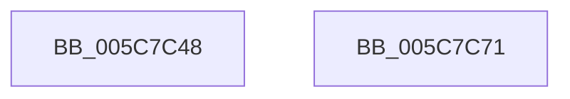

# KiSetBugCheckRecoveryProgressFlag

- RVA: `0x005C7C48`–`0x005C7C72` (길이 `42` bytes)
- VA: `0x00000001405C7C48`
- 실행 섹션: `.text`
- PDB 이름 있음: `예`; PDB Function 태그: `아니요`
- unwind 정보 RVA: `0x00082420`
- 디코드: `11`개 명령, `42/42` bytes 표시
- 미해석 바이트: `0` (있으면 어셈블리에 `.byte`로 보존)

> 이 문서는 커널 이미지의 기계어와 PDB 기호를 분석해 생성했습니다. 4번과 5번은 함수 원형과 자료형을 바이너리 사용 방식에서 추정한 C 해석이며 원본 소스 복구 결과는 아닙니다.

## 1. Dependencies

- 직접 호출 지점: **1**; 고유 호출 대상: **1**
- 직접 호출자로 확인된 함수: **3**
- RIP 상대 이미지 참조: **0**

### Outgoing calls
- `0x005C7C67` → [KiUpdateBugcheckRecoveryProgress](KiUpdateBugcheckRecoveryProgress_function_005C7E1C.md) (function, `0x005C7E1C`)

### Direct callers
- [KiAttemptBugcheckRecovery](KiAttemptBugcheckRecovery_function_005C6D24.md) at `0x005C6DC1`
- [KiDeferredBugcheckRecoveryWorker](KiDeferredBugcheckRecoveryWorker_function_005C75A0.md) at `0x005C75F3`
- [KiHandleMultipleBugchecksDuringRecovery](KiHandleMultipleBugchecksDuringRecovery_function_005C7860.md) at `0x005C78FD`

### Static image references
- 디코드된 RIP-relative 메모리 참조가 없습니다.

## 2. Other-region calls and transfers

- 다른 실행 섹션으로 향하는 call: **0**
- 별도 외부 분기/꼬리 이동을 확인하지 못했습니다.

## 3. Assembly (complete function range)

```asm
005C7C48  48 8B C4                        mov rax, rsp
005C7C4B  48 83 EC 48                     sub rsp, 0x48
005C7C4F  48 83 60 E4 00                  and qword ptr [rax - 0x1c], 0
005C7C54  48 C7 40 D8 02 00 00 00         mov qword ptr [rax - 0x28], 2
005C7C5C  83 60 DC 00                     and dword ptr [rax - 0x24], 0
005C7C60  89 48 E0                        mov dword ptr [rax - 0x20], ecx
005C7C63  48 8D 48 D8                     lea rcx, [rax - 0x28]
005C7C67  E8 B0 01 00 00                  call 0x1405c7e1c
005C7C6C  48 83 C4 48                     add rsp, 0x48
005C7C70  C3                              ret
005C7C71  CC                              int3
```

## 4. C-style interpretation (structured pseudocode)

```c
__int64 __fastcall KiSetBugCheckRecoveryProgressFlag(int a1)
{
    __int64 result;
    __int64 v_rsp;

    v_rsp = (v_rsp) - (72);
    *(unsigned __int64 *)(v_rsp - 40) = 2;
    *(unsigned int *)(v_rsp - 32) = a1;
    result = KiUpdateBugcheckRecoveryProgress(v_rsp - 40, a2, a3, a4);
    v_rsp = (v_rsp) + (72);
    return result;
}
```

## 5. (Beta) C Style

```c
int64_t KiSetBugCheckRecoveryProgressFlag(int32_t Arg1)
{
    int64_t result;
    int64_t local_rsp;

    local_rsp = (local_rsp) - (72);
    *(uint64_t *)(local_rsp - 0x28) = 2;
    *(uint32_t *)(local_rsp - 0x20) = Arg1;
    result = KiUpdateBugcheckRecoveryProgress(local_rsp - 40, a2, a3, a4);
    local_rsp = (local_rsp) + (72);
    return result;
}
```

## 6. Execution-region graph

[열기: 2D/3D 그래프와 함수 탐색 컨트롤 패널](../../../control-panel.html?section=text&rva=0x005C7C48&view=graph)

- 2D 그래프는 위에서 아래로 흐르고, 3D 그래프는 빈 공간을 드래그해 회전합니다. Shift+드래그는 이동, 휠은 확대·축소, 함수 노드 선택은 대상 보고서 이동입니다.

### Static fallback


