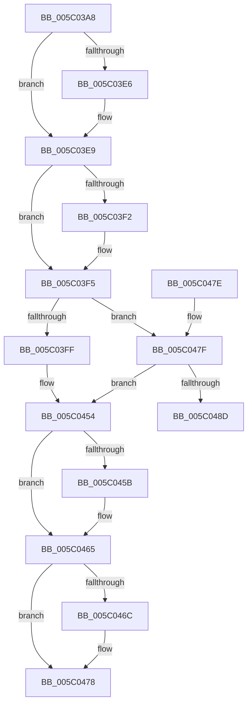

# KiSetHardwareSpeculationControlFeatures

- RVA: `0x005C03A8`–`0x005C04A6` (길이 `254` bytes)
- VA: `0x00000001405C03A8`
- 실행 섹션: `.text`
- PDB 이름 있음: `예`; PDB Function 태그: `아니요`
- unwind 정보 RVA: `0x000CA600`
- 디코드: `57`개 명령, `254/254` bytes 표시
- 미해석 바이트: `0` (있으면 어셈블리에 `.byte`로 보존)

> 이 문서는 커널 이미지의 기계어와 PDB 기호를 분석해 생성했습니다. 4번과 5번은 함수 원형과 자료형을 바이너리 사용 방식에서 추정한 C 해석이며 원본 소스 복구 결과는 아닙니다.

## 1. Dependencies

- 직접 호출 지점: **2**; 고유 호출 대상: **2**
- 직접 호출자로 확인된 함수: **1**
- RIP 상대 이미지 참조: **11**

### Outgoing calls
- `0x005C03CF` → [KiDetectHardwareSpecControlFeatures](../5B/KiDetectHardwareSpecControlFeatures_function_005BEC4C.md) (function, `0x005BEC4C`)
- `0x005C04A0` → [KeBugCheckEx](../4F/KeBugCheckEx_function_004FD660.md) (function, `0x004FD660`)

### Direct callers
- [KiInitializeKernel](../../pagelk/B6/KiInitializeKernel_function_00B68D20.md) at `0x00B68DED`

### Static image references
- `0x005C03E9` → RVA `0x01201841` (`CFGRO`; read)
- `0x005C03FF` → RVA `0x00FC6B48` (`ALMOSTRO`; read)
- `0x005C041D` → RVA `0x00FC6DB0` (`ALMOSTRO`; write)
- `0x005C0428` → RVA `0x00FC6B48` (`ALMOSTRO`; write)
- `0x005C0434` → RVA `0x00FC6B58` (`ALMOSTRO`; write)
- `0x005C043B` → RVA `0x00E0B1F0` (`.data`; write)
- `0x005C0442` → RVA `0x00FC6B50` (`ALMOSTRO`; write)
- `0x005C0448` → RVA `0x00FC6B54` (`ALMOSTRO`; write)
- `0x005C044E` → RVA `0x00E0B1F8` (`.data`; write)
- `0x005C045B` → RVA `0x00FC6E78` (`ALMOSTRO`; write)
- `0x005C047F` → RVA `0x00FC6DB0` (`ALMOSTRO`; read)

## 2. Other-region calls and transfers

- 다른 실행 섹션으로 향하는 call: **0**
- 별도 외부 분기/꼬리 이동을 확인하지 못했습니다.

## 3. Assembly (complete function range)

```asm
005C03A8  40 53                           push rbx
005C03AA  48 83 EC 50                     sub rsp, 0x50
005C03AE  0F 57 C0                        xorps xmm0, xmm0
005C03B1  C6 44 24 60 00                  mov byte ptr [rsp + 0x60], 0
005C03B6  33 C0                           xor eax, eax
005C03B8  4C 8D 4C 24 60                  lea r9, [rsp + 0x60]
005C03BD  4C 8D 44 24 30                  lea r8, [rsp + 0x30]
005C03C2  48 89 44 24 40                  mov qword ptr [rsp + 0x40], rax
005C03C7  0F 11 44 24 30                  movups xmmword ptr [rsp + 0x30], xmm0
005C03CC  48 8B D9                        mov rbx, rcx
005C03CF  E8 78 E8 FF FF                  call 0x1405bec4c
005C03D4  4C 8B 44 24 30                  mov r8, qword ptr [rsp + 0x30]
005C03D9  48 8D 93 DC 06 00 00            lea rdx, [rbx + 0x6dc]
005C03E0  41 F6 C0 20                     test r8b, 0x20
005C03E4  74 03                           je 0x1405c03e9
005C03E6  80 0A 04                        or byte ptr [rdx], 4
005C03E9  80 3D 51 14 C4 00 00            cmp byte ptr [rip + 0xc41451], 0
005C03F0  74 03                           je 0x1405c03f5
005C03F2  80 0A 08                        or byte ptr [rdx], 8
005C03F5  83 7B 24 00                     cmp dword ptr [rbx + 0x24], 0
005C03F9  0F 85 80 00 00 00               jne 0x1405c047f
005C03FF  48 8B 0D 42 67 A0 00            mov rcx, qword ptr [rip + 0xa06742]
005C0406  48 B8 00 00 00 00 FF FF FF FF   movabs rax, 0xffffffff00000000
005C0410  8B 54 24 38                     mov edx, dword ptr [rsp + 0x38]
005C0414  48 23 C8                        and rcx, rax
005C0417  41 8B C0                        mov eax, r8d
005C041A  48 0B C8                        or rcx, rax
005C041D  44 89 05 8C 69 A0 00            mov dword ptr [rip + 0xa0698c], r8d
005C0424  8A 44 24 3C                     mov al, byte ptr [rsp + 0x3c]
005C0428  48 89 0D 19 67 A0 00            mov qword ptr [rip + 0xa06719], rcx
005C042F  48 8B 4C 24 40                  mov rcx, qword ptr [rsp + 0x40]
005C0434  48 89 0D 1D 67 A0 00            mov qword ptr [rip + 0xa0671d], rcx
005C043B  48 89 0D AE AD 84 00            mov qword ptr [rip + 0x84adae], rcx
005C0442  89 15 08 67 A0 00               mov dword ptr [rip + 0xa06708], edx
005C0448  88 05 06 67 A0 00               mov byte ptr [rip + 0xa06706], al
005C044E  89 15 A4 AD 84 00               mov dword ptr [rip + 0x84ada4], edx
005C0454  80 7C 24 60 00                  cmp byte ptr [rsp + 0x60], 0
005C0459  74 0A                           je 0x1405c0465
005C045B  C7 05 13 6A A0 00 01 00 00 00   mov dword ptr [rip + 0xa06a13], 1
005C0465  49 0F BA E0 16                  bt r8, 0x16
005C046A  73 0C                           jae 0x1405c0478
005C046C  B8 00 01 00 00                  mov eax, 0x100
005C0471  66 09 83 D8 06 00 00            or word ptr [rbx + 0x6d8], ax
005C0478  48 83 C4 50                     add rsp, 0x50
005C047C  5B                              pop rbx
005C047D  C3                              ret
005C047E  CC                              int3
005C047F  8B 05 2B 69 A0 00               mov eax, dword ptr [rip + 0xa0692b]
005C0485  45 8B C8                        mov r9d, r8d
005C0488  49 3B C1                        cmp rax, r9
005C048B  74 C7                           je 0x1405c0454
005C048D  48 83 64 24 20 00               and qword ptr [rsp + 0x20], 0
005C0493  44 8B C0                        mov r8d, eax
005C0496  BA 49 42 52 53                  mov edx, 0x53524249
005C049B  B9 5D 00 00 00                  mov ecx, 0x5d
005C04A0  E8 BB D1 F3 FF                  call 0x1404fd660
005C04A5  CC                              int3
```

## 4. C-style interpretation (structured pseudocode)

```c
__int64 __fastcall KiSetHardwareSpeculationControlFeatures(__int64 a1)
{
    __int64 result;
    __int64 v_rsp;
    unsigned __int64 v_stack_m18;
    unsigned __int8 v_stack_m1C;
    unsigned int v_stack_m20;
    unsigned __int64 v_stack_m28;
    unsigned __int64 v_stack_p20;
    unsigned __int8 v_stack_p8;

    v_rsp = (v_rsp) - (80);
    v_stack_p8 = 0;
    result = 0;
    v_stack_m18 = 0;
    v_stack_m28 = v_xmm0;
    result = KiDetectHardwareSpecControlFeatures(a1, a2, v_stack_m28, v_stack_p8);
    if ((((unsigned __int8)(v_stack_m28)) & (32)) != 0) {
    }
    if ((*(unsigned __int8 *)(v_rip + 12850257)) != 0) {
    }
    if ((*(unsigned int *)(a1 + 36)) != 0) goto loc_005C047F;
    a1 = (*(unsigned __int64 *)(v_rip + 10512194)) & (result);
    a1 = (a1) | ((unsigned int)((unsigned int)(v_stack_m28)));
    *(unsigned int *)(v_rip + 10512780) = (unsigned int)(v_stack_m28);
    *(unsigned __int64 *)(v_rip + 10512153) = a1;
    *(unsigned __int64 *)(v_rip + 10512157) = v_stack_m18;
    *(unsigned __int64 *)(v_rip + 8695214) = v_stack_m18;
    *(unsigned int *)(v_rip + 10512136) = (unsigned int)((unsigned int)(v_stack_m20));
    *(unsigned __int8 *)(v_rip + 10512134) = (unsigned __int8)(v_stack_m1C);
    *(unsigned int *)(v_rip + 8695204) = (unsigned int)((unsigned int)(v_stack_m20));
loc_005C0454:
    if (v_stack_p8 != 0) {
        *(unsigned int *)(v_rip + 10512915) = 1;
    }
    result = v_stack_m1C;
    if (v_stack_p8 < 0) {
        result = 256;
    }
    v_rsp = (v_rsp) + (80);
    return result;
loc_005C047F:
    if (((unsigned int)(*(unsigned int *)(v_rip + 10512683))) == ((unsigned int)((unsigned int)(v_stack_m28)))) goto loc_005C0454;
    result = KeBugCheckEx(93, (unsigned int)(0x53524249ULL), (unsigned int)((unsigned int)((unsigned int)(*(unsigned int *)(v_rip + 10512683)))), (unsigned int)((unsigned int)(v_stack_m28)));
    return result;
}
```

## 5. (Beta) C Style

```c
int64_t KiSetHardwareSpeculationControlFeatures(void *Arg1)
{
    uint8_t *arg1 = (uint8_t *)Arg1;

    int64_t result;
    int64_t local_rsp;
    uint64_t v_stack_m18;
    uint8_t v_stack_m1C;
    uint32_t v_stack_m20;
    uint64_t v_stack_m28;
    uint64_t v_stack_p20;
    uint8_t v_stack_p8;

    local_rsp = (local_rsp) - (80);
    v_stack_p8 = 0;
    result = 0;
    v_stack_m18 = 0;
    v_stack_m28 = v_xmm0;
    result = KiDetectHardwareSpecControlFeatures(Arg1, a2, v_stack_m28, v_stack_p8);
    if ((((uint8_t)(v_stack_m28)) & (32)) != 0) {
    }
    if ((*(uint8_t *)(v_rip + 0xC41451)) != 0) {
    }
    if ((*(uint32_t *)(arg1 + 0x24)) != 0) goto loc_005C047F;
    Arg1 = (*(uint64_t *)(v_rip + 0xA06742)) & (result);
    Arg1 = (Arg1) | ((uint32_t)((uint32_t)(v_stack_m28)));
    *(uint32_t *)(v_rip + 0xA0698C) = (uint32_t)(v_stack_m28);
    *(void **)(v_rip + 0xA06719) = Arg1;
    *(uint64_t *)(v_rip + 0xA0671D) = v_stack_m18;
    *(uint64_t *)(v_rip + 0x84ADAE) = v_stack_m18;
    *(uint32_t *)(v_rip + 0xA06708) = (uint32_t)((uint32_t)(v_stack_m20));
    *(uint8_t *)(v_rip + 0xA06706) = (uint8_t)(v_stack_m1C);
    *(uint32_t *)(v_rip + 0x84ADA4) = (uint32_t)((uint32_t)(v_stack_m20));
loc_005C0454:
    if (v_stack_p8 != 0) {
        *(uint32_t *)(v_rip + 0xA06A13) = 1;
    }
    result = v_stack_m1C;
    if (v_stack_p8 < 0) {
        result = 256;
    }
    local_rsp = (local_rsp) + (80);
    return result;
loc_005C047F:
    if (((uint32_t)(*(uint32_t *)(v_rip + 0xA0692B))) == ((uint32_t)((uint32_t)(v_stack_m28)))) goto loc_005C0454;
    result = KeBugCheckEx(93, (uint32_t)(0x53524249ULL), (uint32_t)((uint32_t)((uint32_t)(*(uint32_t *)(v_rip + 0xA0692B)))), (uint32_t)((uint32_t)(v_stack_m28)));
    return result;
}
```

### 관측된 메모리 오프셋

구조체 형식이 확인되지 않은 접근은 인자 기준의 오프셋으로만 기록했습니다.

| 기준 인자 | 오프셋 표현 | 폭 (bit) | 접근 |
|---|---:|---:|---|
| `Arg1` | `+ 0x0` | `8` | `R/W` |
| `Arg1` | `+ 0x24` | `32` | `R` |
| `Arg1` | `+ 0x6D8` | `16` | `R/W` |
| `Arg1` | `+ 0x6DC` | `64` | `R` |

## 6. Execution-region graph

[열기: 2D/3D 그래프와 함수 탐색 컨트롤 패널](../../../control-panel.html?section=text&rva=0x005C03A8&view=graph)

- 2D 그래프는 위에서 아래로 흐르고, 3D 그래프는 빈 공간을 드래그해 회전합니다. Shift+드래그는 이동, 휠은 확대·축소, 함수 노드 선택은 대상 보고서 이동입니다.

### Static fallback


