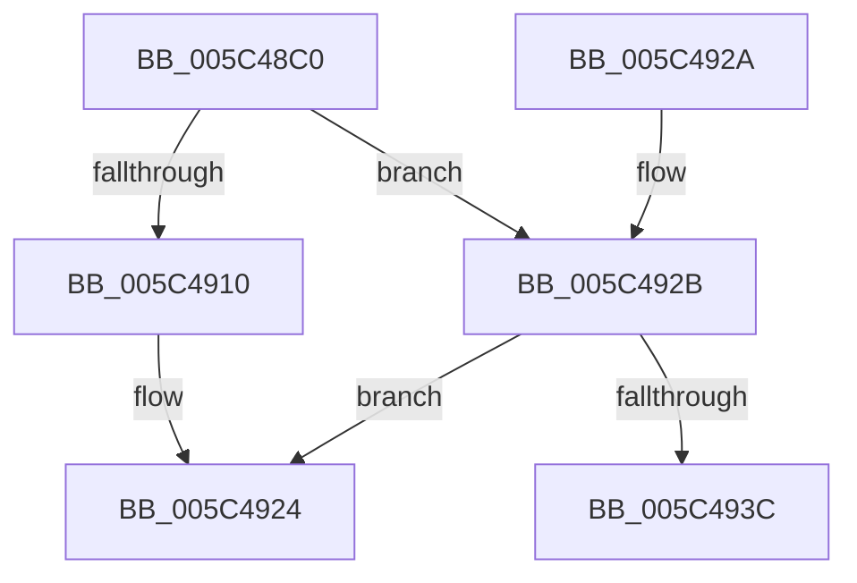

# KiSetProcessorSignature

- RVA: `0x005C48C0`–`0x005C4951` (길이 `145` bytes)
- VA: `0x00000001405C48C0`
- 실행 섹션: `.text`
- PDB 이름 있음: `예`; PDB Function 태그: `아니요`
- unwind 정보 RVA: `0x000CAA20`
- 디코드: `37`개 명령, `145/145` bytes 표시
- 미해석 바이트: `0` (있으면 어셈블리에 `.byte`로 보존)

> 이 문서는 커널 이미지의 기계어와 PDB 기호를 분석해 생성했습니다. 4번과 5번은 함수 원형과 자료형을 바이너리 사용 방식에서 추정한 C 해석이며 원본 소스 복구 결과는 아닙니다.

## 1. Dependencies

- 직접 호출 지점: **3**; 고유 호출 대상: **3**
- 직접 호출자로 확인된 함수: **2**
- RIP 상대 이미지 참조: **2**

### Outgoing calls
- `0x005C48EE` → [RtlDetectProcessorFeatures](../../pagelk/B7/RtlDetectProcessorFeatures_function_00B719B0.md) (function, `0x00B719B0`)
- `0x005C491F` → [KiPublishProcessorFeatures](../../init/C3/KiPublishProcessorFeatures_function_00C39F38.md) (function, `0x00C39F38`)
- `0x005C494B` → [KeBugCheckEx](../4F/KeBugCheckEx_function_004FD660.md) (function, `0x004FD660`)

### Direct callers
- [KiInitializeBootStructures](../../pagelk/B6/KiInitializeBootStructures_function_00B68530.md) at `0x00B687AE`
- [KiSetFeatureBits](../../pagelk/B6/KiSetFeatureBits_function_00B6A03C.md) at `0x00B6A1FF`

### Static image references
- `0x005C4918` → RVA `0x00FC6B60` (`ALMOSTRO`; read/write)
- `0x005C4930` → RVA `0x00FC6B60` (`ALMOSTRO`; read)

## 2. Other-region calls and transfers

- 다른 실행 섹션으로 향하는 call: **2**
  - `0x005C48EE` → [RtlDetectProcessorFeatures](../../pagelk/B7/RtlDetectProcessorFeatures_function_00B719B0.md) (`.text` → `PAGELK`)
  - `0x005C491F` → [KiPublishProcessorFeatures](../../init/C3/KiPublishProcessorFeatures_function_00C39F38.md) (`.text` → `INIT`)
- 별도 외부 분기/꼬리 이동을 확인하지 못했습니다.

## 3. Assembly (complete function range)

```asm
005C48C0  48 8B C4                        mov rax, rsp
005C48C3  53                              push rbx
005C48C4  48 83 EC 30                     sub rsp, 0x30
005C48C8  48 83 60 18 00                  and qword ptr [rax + 0x18], 0
005C48CD  4C 8D 48 10                     lea r9, [rax + 0x10]
005C48D1  48 83 60 08 00                  and qword ptr [rax + 8], 0
005C48D6  4C 8D 40 08                     lea r8, [rax + 8]
005C48DA  83 60 10 00                     and dword ptr [rax + 0x10], 0
005C48DE  48 8B D9                        mov rbx, rcx
005C48E1  89 91 C8 06 00 00               mov dword ptr [rcx + 0x6c8], edx
005C48E7  48 8D 50 18                     lea rdx, [rax + 0x18]
005C48EB  8B 49 24                        mov ecx, dword ptr [rcx + 0x24]
005C48EE  E8 BD D0 5A 00                  call 0x140b719b0
005C48F3  48 8B 44 24 50                  mov rax, qword ptr [rsp + 0x50]
005C48F8  48 89 83 A0 8F 00 00            mov qword ptr [rbx + 0x8fa0], rax
005C48FF  8B 44 24 48                     mov eax, dword ptr [rsp + 0x48]
005C4903  89 83 CC 06 00 00               mov dword ptr [rbx + 0x6cc], eax
005C4909  8B 43 24                        mov eax, dword ptr [rbx + 0x24]
005C490C  85 C0                           test eax, eax
005C490E  75 1B                           jne 0x1405c492b
005C4910  48 8B 44 24 40                  mov rax, qword ptr [rsp + 0x40]
005C4915  48 8B CB                        mov rcx, rbx
005C4918  48 09 05 41 22 A0 00            or qword ptr [rip + 0xa02241], rax
005C491F  E8 14 56 67 00                  call 0x140c39f38
005C4924  48 83 C4 30                     add rsp, 0x30
005C4928  5B                              pop rbx
005C4929  C3                              ret
005C492A  CC                              int3
005C492B  4C 8B 44 24 40                  mov r8, qword ptr [rsp + 0x40]
005C4930  4C 8B 0D 29 22 A0 00            mov r9, qword ptr [rip + 0xa02229]
005C4937  4D 3B C1                        cmp r8, r9
005C493A  74 E8                           je 0x1405c4924
005C493C  BA F7 FF FF FF                  mov edx, 0xfffffff7
005C4941  48 89 44 24 20                  mov qword ptr [rsp + 0x20], rax
005C4946  B9 5D 00 00 00                  mov ecx, 0x5d
005C494B  E8 10 8D F3 FF                  call 0x1404fd660
005C4950  CC                              int3
```

## 4. C-style interpretation (structured pseudocode)

```c
__int64 __fastcall KiSetProcessorSignature(__int64 a1, int a2)
{
    __int64 result;
    __int64 v_rsp;
    unsigned int v_stack_p10;
    unsigned __int64 v_stack_p18;
    unsigned __int64 v_stack_p20;
    unsigned __int64 v_stack_p40;
    unsigned __int64 v_stack_p8;

    v_rsp = (v_rsp) - (48);
    *(unsigned int *)(a1 + 1736) = a2;
    result = RtlDetectProcessorFeatures((unsigned int)(*(unsigned int *)(a1 + 36)), v_rsp + 24, v_rsp + 8, v_rsp + 16);
    *(unsigned __int64 *)(a1 + 36768) = v_stack_p18;
    *(unsigned int *)(a1 + 1740) = (unsigned int)((unsigned int)(v_stack_p10));
    if ((unsigned int)((unsigned int)(*(unsigned int *)(a1 + 36))) != 0) goto loc_005C492B;
    result = KiPublishProcessorFeatures(a1, v_rsp + 24, v_rsp + 8, v_rsp + 16);
loc_005C4924:
    v_rsp = (v_rsp) + (48);
    return result;
loc_005C492B:
    if (v_stack_p40 == (*(unsigned __int64 *)(v_rip + 10494505))) goto loc_005C4924;
    v_stack_p20 = result;
    result = KeBugCheckEx(93, (unsigned int)(0xFFFFFFF7ULL), v_stack_p40, *(unsigned __int64 *)(v_rip + 10494505));
    return result;
}
```

## 5. (Beta) C Style

```c
int64_t KiSetProcessorSignature(void *Arg1, int32_t Arg2)
{
    uint8_t *arg1 = (uint8_t *)Arg1;

    int64_t result;
    int64_t local_rsp;
    uint32_t v_stack_p10;
    uint64_t v_stack_p18;
    uint64_t v_stack_p20;
    uint64_t v_stack_p40;
    uint64_t v_stack_p8;

    local_rsp = (local_rsp) - (48);
    *(uint32_t *)(arg1 + 0x6C8) = Arg2;
    result = RtlDetectProcessorFeatures((uint32_t)(*(uint32_t *)(arg1 + 0x24)), local_rsp + 24, local_rsp + 8, local_rsp + 16);
    *(uint64_t *)(arg1 + 0x8FA0) = v_stack_p18;
    *(uint32_t *)(arg1 + 0x6CC) = (uint32_t)((uint32_t)(v_stack_p10));
    if ((uint32_t)((uint32_t)(*(uint32_t *)(arg1 + 0x24))) != 0) goto loc_005C492B;
    result = KiPublishProcessorFeatures(Arg1, local_rsp + 24, local_rsp + 8, local_rsp + 16);
loc_005C4924:
    local_rsp = (local_rsp) + (48);
    return result;
loc_005C492B:
    if (v_stack_p40 == (*(uint64_t *)(v_rip + 0xA02229))) goto loc_005C4924;
    v_stack_p20 = result;
    result = KeBugCheckEx(93, (uint32_t)(0xFFFFFFF7ULL), v_stack_p40, *(uint64_t *)(v_rip + 0xA02229));
    return result;
}
```

### 관측된 메모리 오프셋

구조체 형식이 확인되지 않은 접근은 인자 기준의 오프셋으로만 기록했습니다.

| 기준 인자 | 오프셋 표현 | 폭 (bit) | 접근 |
|---|---:|---:|---|
| `Arg1` | `+ 0x24` | `32` | `R` |
| `Arg1` | `+ 0x6C8` | `32` | `W` |
| `Arg1` | `+ 0x6CC` | `32` | `W` |
| `Arg1` | `+ 0x8FA0` | `64` | `W` |

## 6. Execution-region graph

[열기: 2D/3D 그래프와 함수 탐색 컨트롤 패널](../../../control-panel.html?section=text&rva=0x005C48C0&view=graph)

- 2D 그래프는 위에서 아래로 흐르고, 3D 그래프는 빈 공간을 드래그해 회전합니다. Shift+드래그는 이동, 휠은 확대·축소, 함수 노드 선택은 대상 보고서 이동입니다.

### Static fallback


