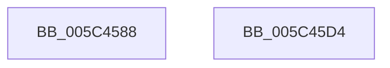

# KiSetSystemAffinityThreadToProcessor

- RVA: `0x005C4588`–`0x005C45D5` (길이 `77` bytes)
- VA: `0x00000001405C4588`
- 실행 섹션: `.text`
- PDB 이름 있음: `예`; PDB Function 태그: `아니요`
- unwind 정보 RVA: `0x0005D2F4`
- 디코드: `21`개 명령, `77/77` bytes 표시
- 미해석 바이트: `0` (있으면 어셈블리에 `.byte`로 보존)

> 이 문서는 커널 이미지의 기계어와 PDB 기호를 분석해 생성했습니다. 4번과 5번은 함수 원형과 자료형을 바이너리 사용 방식에서 추정한 C 해석이며 원본 소스 복구 결과는 아닙니다.

## 1. Dependencies

- 직접 호출 지점: **1**; 고유 호출 대상: **1**
- 직접 호출자로 확인된 함수: **3**
- RIP 상대 이미지 참조: **1**

### Outgoing calls
- `0x005C45CA` → [KeSetSystemGroupAffinityThread](../39/KeSetSystemGroupAffinityThread_function_00399140.md) (function, `0x00399140`)

### Direct callers
- [KiDeregisterNmiSxCallback](../5B/KiDeregisterNmiSxCallback_function_005B1D4C.md) at `0x005B1DFE`
- [KiDeregisterNmiSxCallback](../5B/KiDeregisterNmiSxCallback_function_005B1D4C.md) at `0x005B1E0C`
- [KiInitMachineDependent](KiInitMachineDependent_function_005C1880.md) at `0x005C1916`
- [KiInitMachineDependent](KiInitMachineDependent_function_005C1880.md) at `0x005C1922`
- [KiExecuteDpc](KiExecuteDpc_function_005C84F0.md) at `0x005C854D`

### Static image references
- `0x005C458C` → RVA `0x00F231B0` (`.data`; read)

## 2. Other-region calls and transfers

- 다른 실행 섹션으로 향하는 call: **0**
- 별도 외부 분기/꼬리 이동을 확인하지 못했습니다.

## 3. Assembly (complete function range)

```asm
005C4588  48 83 EC 38                     sub rsp, 0x38
005C458C  48 8B 05 1D EC 95 00            mov rax, qword ptr [rip + 0x95ec1d]
005C4593  0F 57 C0                        xorps xmm0, xmm0
005C4596  0F 11 44 24 20                  movups xmmword ptr [rsp + 0x20], xmm0
005C459B  8B C9                           mov ecx, ecx
005C459D  8B 0C 88                        mov ecx, dword ptr [rax + rcx*4]
005C45A0  33 C0                           xor eax, eax
005C45A2  89 44 24 2A                     mov dword ptr [rsp + 0x2a], eax
005C45A6  66 89 44 24 2E                  mov word ptr [rsp + 0x2e], ax
005C45AB  8B C1                           mov eax, ecx
005C45AD  C1 E8 06                        shr eax, 6
005C45B0  83 E1 3F                        and ecx, 0x3f
005C45B3  66 89 44 24 28                  mov word ptr [rsp + 0x28], ax
005C45B8  B8 01 00 00 00                  mov eax, 1
005C45BD  48 D3 E0                        shl rax, cl
005C45C0  48 8D 4C 24 20                  lea rcx, [rsp + 0x20]
005C45C5  48 89 44 24 20                  mov qword ptr [rsp + 0x20], rax
005C45CA  E8 71 4B DD FF                  call 0x140399140
005C45CF  48 83 C4 38                     add rsp, 0x38
005C45D3  C3                              ret
005C45D4  CC                              int3
```

## 4. C-style interpretation (structured pseudocode)

```c
__int64 __fastcall KiSetSystemAffinityThreadToProcessor(int a1)
{
    __int64 result;
    __int64 v_rsp;
    unsigned __int16 v_stack_m10;
    unsigned __int64 v_stack_m18;
    unsigned __int16 v_stack_mA;
    unsigned int v_stack_mE;

    v_rsp = (v_rsp) - (56);
    v_stack_m18 = v_xmm0;
    result = 0;
    v_stack_mE = 0;
    v_stack_mA = 0;
    result = (unsigned int)(((unsigned int)((unsigned int)((unsigned int)(*(unsigned int *)(*(unsigned __int64 *)(v_rip + 9825309) + (unsigned int)(a1) * 4))))) >> (6));
    a1 = (unsigned int)(((unsigned int)(*(unsigned int *)(*(unsigned __int64 *)(v_rip + 9825309) + (unsigned int)(a1) * 4))) & (63));
    v_stack_m10 = (unsigned __int16)(result);
    result = (1) << ((unsigned __int8)(a1));
    v_stack_m18 = result;
    result = KeSetSystemGroupAffinityThread(v_stack_m18, a2, a3, a4);
    v_rsp = (v_rsp) + (56);
    return result;
}
```

## 5. (Beta) C Style

```c
int64_t KiSetSystemAffinityThreadToProcessor(int32_t Arg1)
{
    int64_t result;
    int64_t local_rsp;
    uint16_t v_stack_m10;
    uint64_t v_stack_m18;
    uint16_t v_stack_mA;
    uint32_t v_stack_mE;

    local_rsp = (local_rsp) - (56);
    v_stack_m18 = v_xmm0;
    result = 0;
    v_stack_mE = 0;
    v_stack_mA = 0;
    result = (uint32_t)(((uint32_t)((uint32_t)((uint32_t)(*(uint32_t *)(*(uint64_t *)(v_rip + 0x95EC1D) + (uint32_t)(Arg1) * 4))))) >> (6));
    Arg1 = (uint32_t)(((uint32_t)(*(uint32_t *)(*(uint64_t *)(v_rip + 0x95EC1D) + (uint32_t)(Arg1) * 4))) & (63));
    v_stack_m10 = (uint16_t)(result);
    result = (1) << ((uint8_t)(Arg1));
    v_stack_m18 = result;
    result = KeSetSystemGroupAffinityThread(v_stack_m18, a2, a3, a4);
    local_rsp = (local_rsp) + (56);
    return result;
}
```

## 6. Execution-region graph

[열기: 2D/3D 그래프와 함수 탐색 컨트롤 패널](../../../control-panel.html?section=text&rva=0x005C4588&view=graph)

- 2D 그래프는 위에서 아래로 흐르고, 3D 그래프는 빈 공간을 드래그해 회전합니다. Shift+드래그는 이동, 휠은 확대·축소, 함수 노드 선택은 대상 보고서 이동입니다.

### Static fallback


