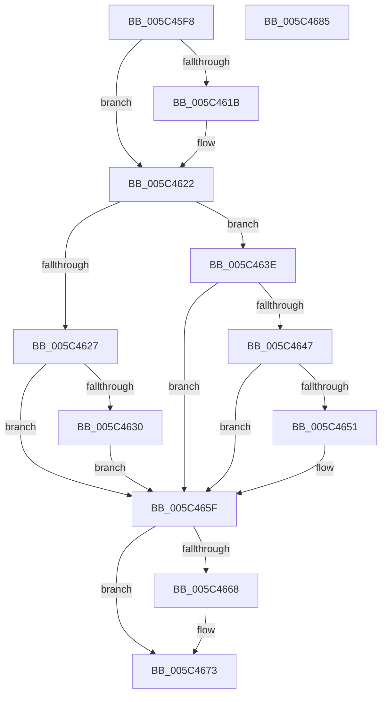

# KiSetVirtualHeteroClockIntervalRequest

- RVA: `0x005C45F8`–`0x005C4686` (길이 `142` bytes)
- VA: `0x00000001405C45F8`
- 실행 섹션: `.text`
- PDB 이름 있음: `예`; PDB Function 태그: `아니요`
- unwind 정보 RVA: `0x0005CAAC`
- 디코드: `38`개 명령, `142/142` bytes 표시
- 미해석 바이트: `0` (있으면 어셈블리에 `.byte`로 보존)

> 이 문서는 커널 이미지의 기계어와 PDB 기호를 분석해 생성했습니다. 4번과 5번은 함수 원형과 자료형을 바이너리 사용 방식에서 추정한 C 해석이며 원본 소스 복구 결과는 아닙니다.

## 1. Dependencies

- 직접 호출 지점: **4**; 고유 호출 대상: **4**
- 직접 호출자로 확인된 함수: **2**
- RIP 상대 이미지 참조: **4**

### Outgoing calls
- `0x005C461D` → [KiRaiseIrqlProcessIrqlFlags](../4F/KiRaiseIrqlProcessIrqlFlags_function_004F56FC.md) (function, `0x004F56FC`)
- `0x005C4637` → [KiResetClockInterval](../5B/KiResetClockInterval_function_005BB8BC.md) (function, `0x005BB8BC`)
- `0x005C465A` → [KeSetClockInterval](../47/KeSetClockInterval_function_0047503C.md) (function, `0x0047503C`)
- `0x005C466E` → [KiLowerIrqlProcessIrqlFlags](../4F/KiLowerIrqlProcessIrqlFlags_function_004F5698.md) (function, `0x004F5698`)

### Direct callers
- [KiSetVirtualHeteroClockIntervalRequestDpcRoutine](KiSetVirtualHeteroClockIntervalRequestDpcRoutine_function_005C4690.md) at `0x005C469F`
- [sub_006E57E2](../6E/Unknown_function_006E57E2.md) at `0x006E57FF`

### Static image references
- `0x005C4612` → RVA `0x00FC6D20` (`ALMOSTRO`; read)
- `0x005C4627` → RVA `0x00E0ADA0` (`.data`; read)
- `0x005C4630` → RVA `0x00E0AD88` (`.data`; read)
- `0x005C4647` → RVA `0x00FC6CE4` (`ALMOSTRO`; read)

## 2. Other-region calls and transfers

- 다른 실행 섹션으로 향하는 call: **0**
- 별도 외부 분기/꼬리 이동을 확인하지 못했습니다.

## 3. Assembly (complete function range)

```asm
005C45F8  48 89 5C 24 08                  mov qword ptr [rsp + 8], rbx
005C45FD  57                              push rdi
005C45FE  48 83 EC 20                     sub rsp, 0x20
005C4602  40 8A F9                        mov dil, cl
005C4605  44 0F 20 C3                     mov rbx, cr8
005C4609  BA 0F 00 00 00                  mov edx, 0xf
005C460E  44 0F 22 C2                     mov cr8, rdx
005C4612  83 3D 07 27 A0 00 00            cmp dword ptr [rip + 0xa02707], 0
005C4619  74 07                           je 0x1405c4622
005C461B  8A CB                           mov cl, bl
005C461D  E8 DA 10 F3 FF                  call 0x1404f56fc
005C4622  40 84 FF                        test dil, dil
005C4625  74 17                           je 0x1405c463e
005C4627  80 3D 72 67 84 00 00            cmp byte ptr [rip + 0x846772], 0
005C462E  74 2F                           je 0x1405c465f
005C4630  48 8D 0D 51 67 84 00            lea rcx, [rip + 0x846751]
005C4637  E8 80 72 FF FF                  call 0x1405bb8bc
005C463C  EB 21                           jmp 0x1405c465f
005C463E  80 3D 5B 67 84 00 00            cmp byte ptr [rip + 0x84675b], 0
005C4645  75 18                           jne 0x1405c465f
005C4647  8B 0D 97 26 A0 00               mov ecx, dword ptr [rip + 0xa02697]
005C464D  85 C9                           test ecx, ecx
005C464F  74 0E                           je 0x1405c465f
005C4651  4C 8D 05 30 67 84 00            lea r8, [rip + 0x846730]
005C4658  33 D2                           xor edx, edx
005C465A  E8 DD 09 EB FF                  call 0x14047503c
005C465F  83 3D BA 26 A0 00 00            cmp dword ptr [rip + 0xa026ba], 0
005C4666  74 0B                           je 0x1405c4673
005C4668  44 0F 20 C1                     mov rcx, cr8
005C466C  8A D3                           mov dl, bl
005C466E  E8 25 10 F3 FF                  call 0x1404f5698
005C4673  0F B6 C3                        movzx eax, bl
005C4676  44 0F 22 C0                     mov cr8, rax
005C467A  48 8B 5C 24 30                  mov rbx, qword ptr [rsp + 0x30]
005C467F  48 83 C4 20                     add rsp, 0x20
005C4683  5F                              pop rdi
005C4684  C3                              ret
005C4685  CC                              int3
```

## 4. C-style interpretation (structured pseudocode)

```c
__int64 __fastcall KiSetVirtualHeteroClockIntervalRequest(unsigned __int8 a1)
{
    __int64 result;
    __int64 v_rsp;
    unsigned __int64 v_stack_p8;

    v_stack_p8 = v_rbx;
    v_rsp = (v_rsp) - (32);
    if ((*(unsigned int *)(v_rip + 10495751)) != 0) {
        a1 = (unsigned __int8)(v_cr8);
        result = KiRaiseIrqlProcessIrqlFlags(a1, 15, a3, a4);
    }
    if (a1 == 0) goto loc_005C463E;
    if ((*(unsigned __int8 *)(v_rip + 8677234)) == 0) goto loc_005C465F;
    result = KiResetClockInterval(v_rip + 8677201, 15, a3, a4);
    goto loc_005C465F;
loc_005C463E:
    if ((*(unsigned __int8 *)(v_rip + 8677211)) != 0) goto loc_005C465F;
    if ((unsigned int)((unsigned int)(*(unsigned int *)(v_rip + 10495639))) != 0) {
        a3 = v_rip + 8677168;
        a2 = 0;
        result = KeSetClockInterval((unsigned int)(*(unsigned int *)(v_rip + 10495639)), a2, a3, a4);
    }
    if ((*(unsigned int *)(v_rip + 10495674)) != 0) {
        a1 = 15;
        a2 = (unsigned __int8)(v_cr8);
        result = KiLowerIrqlProcessIrqlFlags(a1, a2, a3, a4);
    }
    v_rsp = (v_rsp) + (32);
    return (unsigned __int8)(v_cr8);
}
```

## 5. (Beta) C Style

```c
int64_t KiSetVirtualHeteroClockIntervalRequest(uint8_t Arg1)
{
    int64_t result;
    int64_t local_rsp;
    uint64_t v_stack_p8;

    v_stack_p8 = local_rbx;
    local_rsp = (local_rsp) - (32);
    if ((*(uint32_t *)(v_rip + 0xA02707)) != 0) {
        Arg1 = (uint8_t)(v_cr8);
        result = KiRaiseIrqlProcessIrqlFlags(Arg1, 15, a3, a4);
    }
    if (Arg1 == 0) goto loc_005C463E;
    if ((*(uint8_t *)(v_rip + 0x846772)) == 0) goto loc_005C465F;
    result = KiResetClockInterval(v_rip + 8677201, 15, a3, a4);
    goto loc_005C465F;
loc_005C463E:
    if ((*(uint8_t *)(v_rip + 0x84675B)) != 0) goto loc_005C465F;
    if ((uint32_t)((uint32_t)(*(uint32_t *)(v_rip + 0xA02697))) != 0) {
        a3 = v_rip + 8677168;
        a2 = 0;
        result = KeSetClockInterval((uint32_t)(*(uint32_t *)(v_rip + 0xA02697)), a2, a3, a4);
    }
    if ((*(uint32_t *)(v_rip + 0xA026BA)) != 0) {
        Arg1 = 15;
        a2 = (uint8_t)(v_cr8);
        result = KiLowerIrqlProcessIrqlFlags(Arg1, a2, a3, a4);
    }
    local_rsp = (local_rsp) + (32);
    return (uint8_t)(v_cr8);
}
```

## 6. Execution-region graph

[열기: 2D/3D 그래프와 함수 탐색 컨트롤 패널](../../../control-panel.html?section=text&rva=0x005C45F8&view=graph)

- 2D 그래프는 위에서 아래로 흐르고, 3D 그래프는 빈 공간을 드래그해 회전합니다. Shift+드래그는 이동, 휠은 확대·축소, 함수 노드 선택은 대상 보고서 이동입니다.

### Static fallback


