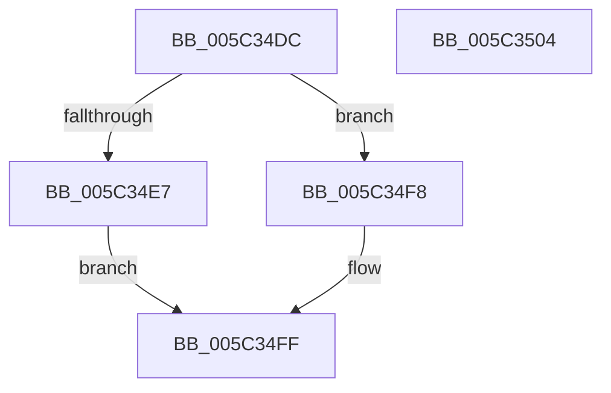

# KiSignalWaitDisconnectLock

- RVA: `0x005C34DC`–`0x005C3505` (길이 `41` bytes)
- VA: `0x00000001405C34DC`
- 실행 섹션: `.text`
- PDB 이름 있음: `예`; PDB Function 태그: `아니요`
- unwind 정보 RVA: `0x0005D2F4`
- 디코드: `14`개 명령, `41/41` bytes 표시
- 미해석 바이트: `0` (있으면 어셈블리에 `.byte`로 보존)

> 이 문서는 커널 이미지의 기계어와 PDB 기호를 분석해 생성했습니다. 4번과 5번은 함수 원형과 자료형을 바이너리 사용 방식에서 추정한 C 해석이며 원본 소스 복구 결과는 아닙니다.

## 1. Dependencies

- 직접 호출 지점: **2**; 고유 호출 대상: **2**
- 직접 호출자로 확인된 함수: **1**
- RIP 상대 이미지 참조: **0**

### Outgoing calls
- `0x005C34F1` → [KeWaitForSingleObject](../20/KeWaitForSingleObject_function_0020E6B0.md) (function, `0x0020E6B0`)
- `0x005C34FA` → [KeSetEvent](../33/KeSetEvent_function_0033F310.md) (function, `0x0033F310`)

### Direct callers
- [KiDisconnectInterruptCommon](../2D/KiDisconnectInterruptCommon_function_002D36A8.md) at `0x002D381F`

### Static image references
- 디코드된 RIP-relative 메모리 참조가 없습니다.

## 2. Other-region calls and transfers

- 다른 실행 섹션으로 향하는 call: **0**
- 별도 외부 분기/꼬리 이동을 확인하지 못했습니다.

## 3. Assembly (complete function range)

```asm
005C34DC  48 83 EC 38                     sub rsp, 0x38
005C34E0  45 33 C0                        xor r8d, r8d
005C34E3  84 D2                           test dl, dl
005C34E5  74 11                           je 0x1405c34f8
005C34E7  4C 21 44 24 20                  and qword ptr [rsp + 0x20], r8
005C34EC  45 33 C9                        xor r9d, r9d
005C34EF  33 D2                           xor edx, edx
005C34F1  E8 BA B1 C4 FF                  call 0x14020e6b0
005C34F6  EB 07                           jmp 0x1405c34ff
005C34F8  33 D2                           xor edx, edx
005C34FA  E8 11 BE D7 FF                  call 0x14033f310
005C34FF  48 83 C4 38                     add rsp, 0x38
005C3503  C3                              ret
005C3504  CC                              int3
```

## 4. C-style interpretation (structured pseudocode)

```c
__int64 __fastcall KiSignalWaitDisconnectLock(__int64 a1, int a2, int a3, int a4)
{
    __int64 result;
    __int64 v_rsp;
    unsigned __int64 v_stack_m18;

    v_rsp = (v_rsp) - (56);
    a3 = 0;
    if ((unsigned __int8)(a2) == 0) goto loc_005C34F8;
    a4 = 0;
    a2 = 0;
    result = KeWaitForSingleObject(a1, a2, a3, a4);
    goto loc_005C34FF;
loc_005C34F8:
    a2 = 0;
    result = KeSetEvent(a1, a2, a3, a4);
loc_005C34FF:
    v_rsp = (v_rsp) + (56);
    return result;
}
```

## 5. (Beta) C Style

```c
int64_t KiSignalWaitDisconnectLock(int64_t Arg1, int32_t Arg2, int32_t Arg3, int32_t Arg4)
{
    int64_t result;
    int64_t local_rsp;
    uint64_t v_stack_m18;

    local_rsp = (local_rsp) - (56);
    Arg3 = 0;
    if ((uint8_t)(Arg2) == 0) goto loc_005C34F8;
    Arg4 = 0;
    Arg2 = 0;
    result = KeWaitForSingleObject(Arg1, Arg2, Arg3, Arg4);
    goto loc_005C34FF;
loc_005C34F8:
    Arg2 = 0;
    result = KeSetEvent(Arg1, Arg2, Arg3, Arg4);
loc_005C34FF:
    local_rsp = (local_rsp) + (56);
    return result;
}
```

## 6. Execution-region graph

[열기: 2D/3D 그래프와 함수 탐색 컨트롤 패널](../../../control-panel.html?section=text&rva=0x005C34DC&view=graph)

- 2D 그래프는 위에서 아래로 흐르고, 3D 그래프는 빈 공간을 드래그해 회전합니다. Shift+드래그는 이동, 휠은 확대·축소, 함수 노드 선택은 대상 보고서 이동입니다.

### Static fallback


