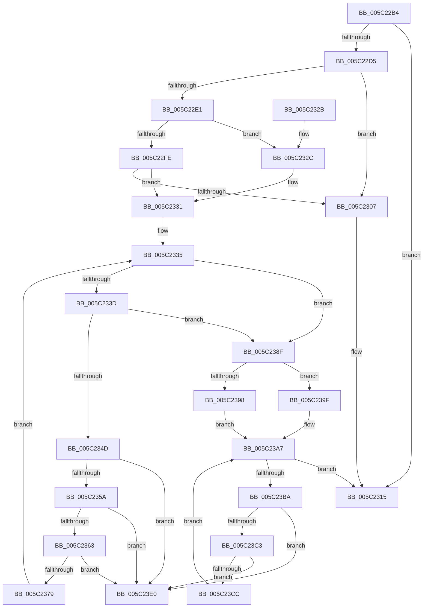

# KiSrcuFlushCompleted

- RVA: `0x005C22B4`–`0x005C23E7` (길이 `307` bytes)
- VA: `0x00000001405C22B4`
- 실행 섹션: `.text`
- PDB 이름 있음: `예`; PDB Function 태그: `아니요`
- unwind 정보 RVA: `0x000CA920`
- 디코드: `87`개 명령, `307/307` bytes 표시
- 미해석 바이트: `0` (있으면 어셈블리에 `.byte`로 보존)

> 이 문서는 커널 이미지의 기계어와 PDB 기호를 분석해 생성했습니다. 4번과 5번은 함수 원형과 자료형을 바이너리 사용 방식에서 추정한 C 해석이며 원본 소스 복구 결과는 아닙니다.

## 1. Dependencies

- 직접 호출 지점: **8**; 고유 호출 대상: **8**
- 직접 호출자로 확인된 함수: **11**
- RIP 상대 이미지 참조: **0**

### Outgoing calls
- `0x005C22D5` → [KeGetEffectiveIrql](../2F/KeGetEffectiveIrql_function_002F8030.md) (function, `0x002F8030`)
- `0x005C22FE` → [KxTryToAcquireSpinLock](../46/KxTryToAcquireSpinLock_function_0046BE18.md) (function, `0x0046BE18`)
- `0x005C2310` → [KeInsertQueueDpc](../20/KeInsertQueueDpc_function_00207C50.md) (function, `0x00207C50`)
- `0x005C232C` → [KeAcquireSpinLockRaiseToDpc](../20/KeAcquireSpinLockRaiseToDpc_function_00208470.md) (function, `0x00208470`)
- `0x005C2344` → [KiRcuCompareGraceSequence](../4D/KiRcuCompareGraceSequence_function_004D6538.md) (function, `0x004D6538`)
- `0x005C2398` → [KxReleaseSpinLock](../20/KxReleaseSpinLock_function_00206670.md) (function, `0x00206670`)
- `0x005C23A2` → [KeReleaseSpinLock](../39/KeReleaseSpinLock_function_00392BA0.md) (function, `0x00392BA0`)
- `0x005C23D9` → [KeSignalGate](../2C/KeSignalGate_function_002C748C.md) (function, `0x002C748C`)

### Direct callers
- [sub_002099FA](../20/Unknown_function_002099FA.md) at `0x00209F35`
- [sub_0020C2D4](../20/Unknown_function_0020C2D4.md) at `0x0020CE59`
- [sub_0020D8DF](../20/Unknown_function_0020D8DF.md) at `0x0020DE52`
- [KeWaitForSingleObject](../20/KeWaitForSingleObject_function_0020E6B0.md) at `0x0020F668`
- [sub_0021B161](../21/Unknown_function_0021B161.md) at `0x0021B3C1`
- [KeClockInterruptNotify](../39/KeClockInterruptNotify_function_0039A970.md) at `0x0039B22A`
- [sub_003C6144](../3C/Unknown_function_003C6144.md) at `0x003C63C0`
- [sub_0043C8B6](../43/Unknown_function_0043C8B6.md) at `0x0043C8F6`
- [KeSrcuReadUnlock](KeSrcuReadUnlock_function_005C2140.md) at `0x005C228F`
- [KiSrcuFlushCompletedDpcRoutine](KiSrcuFlushCompletedDpcRoutine_function_005C23F0.md) at `0x005C23F7`
- [KiSrcuStartGracePeriod](KiSrcuStartGracePeriod_function_005C2E3C.md) at `0x005C2EA7`

### Static image references
- 디코드된 RIP-relative 메모리 참조가 없습니다.

## 2. Other-region calls and transfers

- 다른 실행 섹션으로 향하는 call: **0**
- 별도 외부 분기/꼬리 이동을 확인하지 못했습니다.

## 3. Assembly (complete function range)

```asm
005C22B4  48 89 5C 24 08                  mov qword ptr [rsp + 8], rbx
005C22B9  48 89 74 24 10                  mov qword ptr [rsp + 0x10], rsi
005C22BE  48 89 7C 24 18                  mov qword ptr [rsp + 0x18], rdi
005C22C3  41 56                           push r14
005C22C5  48 83 EC 30                     sub rsp, 0x30
005C22C9  4C 8D 71 40                     lea r14, [rcx + 0x40]
005C22CD  48 8B D9                        mov rbx, rcx
005C22D0  4D 39 36                        cmp qword ptr [r14], r14
005C22D3  74 40                           je 0x1405c2315
005C22D5  E8 56 5D D3 FF                  call 0x1402f8030
005C22DA  40 8A F8                        mov dil, al
005C22DD  3C 02                           cmp al, 2
005C22DF  77 26                           ja 0x1405c2307
005C22E1  48 8D 44 24 20                  lea rax, [rsp + 0x20]
005C22E6  48 89 44 24 28                  mov qword ptr [rsp + 0x28], rax
005C22EB  48 8D 73 28                     lea rsi, [rbx + 0x28]
005C22EF  48 8D 44 24 20                  lea rax, [rsp + 0x20]
005C22F4  48 8B CE                        mov rcx, rsi
005C22F7  48 89 44 24 20                  mov qword ptr [rsp + 0x20], rax
005C22FC  72 2E                           jb 0x1405c232c
005C22FE  E8 15 9B EA FF                  call 0x14046be18
005C2303  84 C0                           test al, al
005C2305  75 2A                           jne 0x1405c2331
005C2307  48 8D 4B 50                     lea rcx, [rbx + 0x50]
005C230B  45 33 C0                        xor r8d, r8d
005C230E  33 D2                           xor edx, edx
005C2310  E8 3B 59 C4 FF                  call 0x140207c50
005C2315  48 8B 5C 24 40                  mov rbx, qword ptr [rsp + 0x40]
005C231A  48 8B 74 24 48                  mov rsi, qword ptr [rsp + 0x48]
005C231F  48 8B 7C 24 50                  mov rdi, qword ptr [rsp + 0x50]
005C2324  48 83 C4 30                     add rsp, 0x30
005C2328  41 5E                           pop r14
005C232A  C3                              ret
005C232B  CC                              int3
005C232C  E8 3F 61 C4 FF                  call 0x140208470
005C2331  4C 8B 4B 30                     mov r9, qword ptr [rbx + 0x30]
005C2335  4D 8B 06                        mov r8, qword ptr [r14]
005C2338  4D 3B C6                        cmp r8, r14
005C233B  74 52                           je 0x1405c238f
005C233D  49 8B 50 10                     mov rdx, qword ptr [r8 + 0x10]
005C2341  49 8B C9                        mov rcx, r9
005C2344  E8 EF 41 F1 FF                  call 0x1404d6538
005C2349  85 C0                           test eax, eax
005C234B  78 42                           js 0x1405c238f
005C234D  49 8B 00                        mov rax, qword ptr [r8]
005C2350  4C 39 40 08                     cmp qword ptr [rax + 8], r8
005C2354  0F 85 86 00 00 00               jne 0x1405c23e0
005C235A  49 8B 48 08                     mov rcx, qword ptr [r8 + 8]
005C235E  4C 39 01                        cmp qword ptr [rcx], r8
005C2361  75 7D                           jne 0x1405c23e0
005C2363  48 89 01                        mov qword ptr [rcx], rax
005C2366  48 89 48 08                     mov qword ptr [rax + 8], rcx
005C236A  48 8D 4C 24 20                  lea rcx, [rsp + 0x20]
005C236F  48 8B 44 24 28                  mov rax, qword ptr [rsp + 0x28]
005C2374  48 39 08                        cmp qword ptr [rax], rcx
005C2377  75 67                           jne 0x1405c23e0
005C2379  49 89 40 08                     mov qword ptr [r8 + 8], rax
005C237D  48 8D 4C 24 20                  lea rcx, [rsp + 0x20]
005C2382  49 89 08                        mov qword ptr [r8], rcx
005C2385  4C 89 00                        mov qword ptr [rax], r8
005C2388  4C 89 44 24 28                  mov qword ptr [rsp + 0x28], r8
005C238D  EB A6                           jmp 0x1405c2335
005C238F  48 8B CE                        mov rcx, rsi
005C2392  40 80 FF 02                     cmp dil, 2
005C2396  72 07                           jb 0x1405c239f
005C2398  E8 D3 42 C4 FF                  call 0x140206670
005C239D  EB 08                           jmp 0x1405c23a7
005C239F  40 8A D7                        mov dl, dil
005C23A2  E8 F9 07 DD FF                  call 0x140392ba0
005C23A7  48 8B 4C 24 20                  mov rcx, qword ptr [rsp + 0x20]
005C23AC  48 8D 44 24 20                  lea rax, [rsp + 0x20]
005C23B1  48 3B C8                        cmp rcx, rax
005C23B4  0F 84 5B FF FF FF               je 0x1405c2315
005C23BA  48 8B 11                        mov rdx, qword ptr [rcx]
005C23BD  48 39 4A 08                     cmp qword ptr [rdx + 8], rcx
005C23C1  75 1D                           jne 0x1405c23e0
005C23C3  48 8B 41 08                     mov rax, qword ptr [rcx + 8]
005C23C7  48 39 08                        cmp qword ptr [rax], rcx
005C23CA  75 14                           jne 0x1405c23e0
005C23CC  48 89 10                        mov qword ptr [rax], rdx
005C23CF  48 83 C1 18                     add rcx, 0x18
005C23D3  48 89 42 08                     mov qword ptr [rdx + 8], rax
005C23D7  33 D2                           xor edx, edx
005C23D9  E8 AE 50 D0 FF                  call 0x1402c748c
005C23DE  EB C7                           jmp 0x1405c23a7
005C23E0  B9 03 00 00 00                  mov ecx, 3
005C23E5  CD 29                           int 0x29
```

## 4. C-style interpretation (structured pseudocode)

```c
__int64 __fastcall KiSrcuFlushCompleted(__int64 a1, int a2, int a3)
{
    __int64 result;
    __int64 v_rsp;
    unsigned __int64 v_stack_m10;
    unsigned __int64 v_stack_m18;
    unsigned __int64 v_stack_p10;
    unsigned __int64 v_stack_p18;
    unsigned __int64 v_stack_p20;
    unsigned __int64 v_stack_p28;
    unsigned __int64 v_stack_p8;

    v_stack_p8 = v_rbx;
    v_stack_p10 = v_rsi;
    v_stack_p18 = v_rdi;
    v_rsp = (v_rsp) - (48);
    if ((*(unsigned __int64 *)(a1 + 64)) == (a1 + 64)) goto loc_005C2315;
    result = KeGetEffectiveIrql(a1, a2, a3, a4);
    if (((unsigned __int8)(result)) > 2) goto loc_005C2307;
    v_stack_m10 = v_stack_m18;
    v_stack_m18 = v_stack_m18;
    if (((unsigned __int8)(result)) < 2) goto loc_005C232C;
    result = KxTryToAcquireSpinLock(a1 + 40, a2, a3, a4);
    if ((unsigned __int8)(result) != 0) goto loc_005C2331;
loc_005C2307:
    a3 = 0;
    a2 = 0;
    result = KeInsertQueueDpc(a1 + 80, a2, a3, a4);
loc_005C2315:
    v_rsp = (v_rsp) + (48);
    return result;
loc_005C232C:
    result = KeAcquireSpinLockRaiseToDpc(a1 + 80, a2, a3, a4);
loc_005C2331:
loc_005C2335:
    if ((*(unsigned __int64 *)(a1 + 64)) == (a1 + 64)) goto loc_005C238F;
    result = KiRcuCompareGraceSequence(*(unsigned __int64 *)(v_stack_p8 + 48), *(unsigned __int64 *)(*(unsigned __int64 *)(a1 + 64) + 16), *(unsigned __int64 *)(a1 + 64), *(unsigned __int64 *)(v_stack_p8 + 48));
    if (sign_flag) goto loc_005C238F;
    if ((*(unsigned __int64 *)(*(unsigned __int64 *)(*(unsigned __int64 *)(a1 + 64)) + 8)) != (*(unsigned __int64 *)(a1 + 64))) goto loc_005C23E0;
    if ((*(unsigned __int64 *)(*(unsigned __int64 *)(*(unsigned __int64 *)(a1 + 64) + 8))) != (*(unsigned __int64 *)(a1 + 64))) goto loc_005C23E0;
    *(unsigned __int64 *)(*(unsigned __int64 *)(*(unsigned __int64 *)(a1 + 64) + 8)) = *(unsigned __int64 *)(*(unsigned __int64 *)(a1 + 64));
    *(unsigned __int64 *)(*(unsigned __int64 *)(*(unsigned __int64 *)(a1 + 64)) + 8) = *(unsigned __int64 *)(*(unsigned __int64 *)(a1 + 64) + 8);
    if ((*(unsigned __int64 *)(v_stack_p28)) != v_stack_p20) goto loc_005C23E0;
    *(unsigned __int64 *)(*(unsigned __int64 *)(a1 + 64) + 8) = v_stack_p28;
    *(unsigned __int64 *)(*(unsigned __int64 *)(a1 + 64)) = v_stack_p20;
    *(unsigned __int64 *)(v_stack_p28) = *(unsigned __int64 *)(a1 + 64);
    v_stack_p28 = *(unsigned __int64 *)(a1 + 64);
    goto loc_005C2335;
loc_005C238F:
    if (((unsigned __int8)(v_stack_p18)) < 2) goto loc_005C239F;
    result = KxReleaseSpinLock(v_stack_p10, *(unsigned __int64 *)(*(unsigned __int64 *)(a1 + 64) + 16), *(unsigned __int64 *)(a1 + 64), *(unsigned __int64 *)(v_stack_p8 + 48));
    goto loc_005C23A7;
loc_005C239F:
    result = KeReleaseSpinLock(v_stack_p10, (unsigned __int8)(v_stack_p18), *(unsigned __int64 *)(a1 + 64), *(unsigned __int64 *)(v_stack_p8 + 48));
loc_005C23A7:
    if (v_stack_p20 == v_stack_p20) goto loc_005C2315;
    if ((*(unsigned __int64 *)(*(unsigned __int64 *)(v_stack_p20) + 8)) != v_stack_p20) goto loc_005C23E0;
    if ((*(unsigned __int64 *)(*(unsigned __int64 *)(v_stack_p20 + 8))) != v_stack_p20) goto loc_005C23E0;
    *(unsigned __int64 *)(*(unsigned __int64 *)(v_stack_p20 + 8)) = *(unsigned __int64 *)(v_stack_p20);
    a1 = (v_stack_p20) + (24);
    *(unsigned __int64 *)(*(unsigned __int64 *)(v_stack_p20) + 8) = *(unsigned __int64 *)(v_stack_p20 + 8);
    a2 = 0;
    result = KeSignalGate(a1, a2, *(unsigned __int64 *)(a1 + 64), *(unsigned __int64 *)(v_stack_p8 + 48));
    goto loc_005C23A7;
loc_005C23E0:
    return result;
}
```

## 5. (Beta) C Style

```c
int64_t KiSrcuFlushCompleted(void *Arg1, int32_t Arg2, int32_t Arg3)
{
    uint8_t *arg1 = (uint8_t *)Arg1;

    int64_t result;
    int64_t local_rsp;
    uint64_t v_stack_m10;
    uint64_t v_stack_m18;
    uint64_t v_stack_p10;
    uint64_t v_stack_p18;
    uint64_t v_stack_p20;
    uint64_t v_stack_p28;
    uint64_t v_stack_p8;

    v_stack_p8 = local_rbx;
    v_stack_p10 = local_rsi;
    v_stack_p18 = local_rdi;
    local_rsp = (local_rsp) - (48);
    if ((*(uint64_t *)(arg1 + 0x40)) == (Arg1 + 64)) goto loc_005C2315;
    result = KeGetEffectiveIrql(Arg1, Arg2, Arg3, a4);
    if (((uint8_t)(result)) > 2) goto loc_005C2307;
    v_stack_m10 = v_stack_m18;
    v_stack_m18 = v_stack_m18;
    if (((uint8_t)(result)) < 2) goto loc_005C232C;
    result = KxTryToAcquireSpinLock(Arg1 + 40, Arg2, Arg3, a4);
    if ((uint8_t)(result) != 0) goto loc_005C2331;
loc_005C2307:
    Arg3 = 0;
    Arg2 = 0;
    result = KeInsertQueueDpc(Arg1 + 80, Arg2, Arg3, a4);
loc_005C2315:
    local_rsp = (local_rsp) + (48);
    return result;
loc_005C232C:
    result = KeAcquireSpinLockRaiseToDpc(Arg1 + 80, Arg2, Arg3, a4);
loc_005C2331:
loc_005C2335:
    if ((*(uint64_t *)(arg1 + 0x40)) == (Arg1 + 64)) goto loc_005C238F;
    result = KiRcuCompareGraceSequence(*(uint64_t *)(v_stack_p8 + 0x30), *(uint64_t *)(*(uint64_t *)(arg1 + 0x40) + 0x10), *(uint64_t *)(arg1 + 0x40), *(uint64_t *)(v_stack_p8 + 0x30));
    if (sign_flag) goto loc_005C238F;
    if ((*(uint64_t *)(*(uint64_t *)(*(uint64_t *)(arg1 + 0x40)) + 0x8)) != (*(uint64_t *)(arg1 + 0x40))) goto loc_005C23E0;
    if ((*(uint64_t *)(*(uint64_t *)(*(uint64_t *)(arg1 + 0x40) + 0x8))) != (*(uint64_t *)(arg1 + 0x40))) goto loc_005C23E0;
    *(uint64_t *)(*(uint64_t *)(*(uint64_t *)(arg1 + 0x40) + 0x8)) = *(uint64_t *)(*(uint64_t *)(arg1 + 0x40));
    *(uint64_t *)(*(uint64_t *)(*(uint64_t *)(arg1 + 0x40)) + 0x8) = *(uint64_t *)(*(uint64_t *)(arg1 + 0x40) + 0x8);
    if ((*(uint64_t *)(v_stack_p28)) != v_stack_p20) goto loc_005C23E0;
    *(uint64_t *)(*(uint64_t *)(arg1 + 0x40) + 0x8) = v_stack_p28;
    *(uint64_t *)(*(uint64_t *)(arg1 + 0x40)) = v_stack_p20;
    *(uint64_t *)(v_stack_p28) = *(uint64_t *)(arg1 + 0x40);
    v_stack_p28 = *(uint64_t *)(arg1 + 0x40);
    goto loc_005C2335;
loc_005C238F:
    if (((uint8_t)(v_stack_p18)) < 2) goto loc_005C239F;
    result = KxReleaseSpinLock(v_stack_p10, *(uint64_t *)(*(uint64_t *)(arg1 + 0x40) + 0x10), *(uint64_t *)(arg1 + 0x40), *(uint64_t *)(v_stack_p8 + 0x30));
    goto loc_005C23A7;
loc_005C239F:
    result = KeReleaseSpinLock(v_stack_p10, (uint8_t)(v_stack_p18), *(uint64_t *)(arg1 + 0x40), *(uint64_t *)(v_stack_p8 + 0x30));
loc_005C23A7:
    if (v_stack_p20 == v_stack_p20) goto loc_005C2315;
    if ((*(uint64_t *)(*(uint64_t *)(v_stack_p20) + 0x8)) != v_stack_p20) goto loc_005C23E0;
    if ((*(uint64_t *)(*(uint64_t *)(v_stack_p20 + 0x8))) != v_stack_p20) goto loc_005C23E0;
    *(uint64_t *)(*(uint64_t *)(v_stack_p20 + 0x8)) = *(uint64_t *)(v_stack_p20);
    Arg1 = (v_stack_p20) + (24);
    *(uint64_t *)(*(uint64_t *)(v_stack_p20) + 0x8) = *(uint64_t *)(v_stack_p20 + 0x8);
    Arg2 = 0;
    result = KeSignalGate(Arg1, Arg2, *(uint64_t *)(arg1 + 0x40), *(uint64_t *)(v_stack_p8 + 0x30));
    goto loc_005C23A7;
loc_005C23E0:
    return result;
}
```

### 관측된 메모리 오프셋

구조체 형식이 확인되지 않은 접근은 인자 기준의 오프셋으로만 기록했습니다.

| 기준 인자 | 오프셋 표현 | 폭 (bit) | 접근 |
|---|---:|---:|---|
| `Arg1` | `+ 0x0` | `64` | `R` |
| `Arg1` | `+ 0x28` | `64` | `R` |
| `Arg1` | `+ 0x30` | `64` | `R` |
| `Arg1` | `+ 0x40` | `64` | `R` |
| `Arg1` | `+ 0x50` | `64` | `R` |

## 6. Execution-region graph

[열기: 2D/3D 그래프와 함수 탐색 컨트롤 패널](../../../control-panel.html?section=text&rva=0x005C22B4&view=graph)

- 2D 그래프는 위에서 아래로 흐르고, 3D 그래프는 빈 공간을 드래그해 회전합니다. Shift+드래그는 이동, 휠은 확대·축소, 함수 노드 선택은 대상 보고서 이동입니다.

### Static fallback


